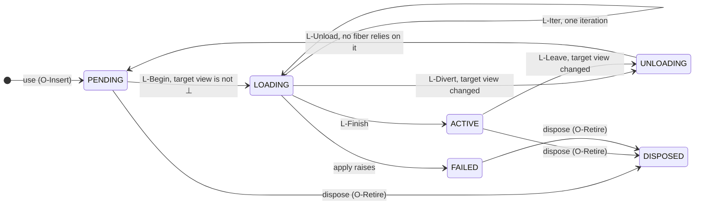

# API Reference

pycordis implements the calculus of the paper *A Programming Paradigm for Spatiotemporal
Composability* (arXiv `2608.25512`). This page gives the formal objects of the paper and the
pycordis names that implement them. Each section ends with links to the generated pages that
hold the full contract.

The public API is the set of names that `pycordis/__init__.py` exports. Other modules are
importable, but they can change in any release. The pages in this section are generated from
the source docstrings by `scripts/gen_ref_pages.py`: to change a page, edit the docstring.

## Modules

| Module | Contents | Start with |
|---|---|---|
| [context](context.md) | The context, from which code registers effects and reads services | `Context` |
| [fiber](fiber.md) | Fibers, effects, and the lifecycle state machine | `Fiber`, `FiberState`, `EffectHandle` |
| [service](service.md) | Component classes that provide themselves as a service | `Service` |
| [keys](keys.md) | Typed service keys | `Key`, `Keyable` |
| [registry](registry.md) | Components, dependency declarations, and the loaded-component record | `inject`, `Component` |
| [reflect](reflect.md) | The provider table and the accessors of a root context | `ReflectService` |
| [events](events.md) | Event listeners and dispatch | `EventsService` |
| [scheduler](scheduler.md) | The schedulers that run lifecycle steps on the owner thread | `ImmediateScheduler`, `FramePumpScheduler` |
| [deferred](deferred.md) | The result of work that ends later | `Deferred` |
| [errors](errors.md) | Errors and configuration issues | `CordisError`, `ValidationError` |
| [logger](logger.md) | Logging through the standard `logging` package | `LoggerService` |
| [traceable](traceable.md) | Views of a service for the context that reads it | `get_traceable` |
| [disposables](disposables.md) | An ordered collection of removable registrations | `DisposableList` |

## From the Paper to the Code

The paper describes one component in two dimensions:

- **Temporal composability**: the runtime can revert every side effect of a component when the
  component is removed. *Revertible effects* give this property.
- **Spatial composability**: a component declares the services it needs, and the runtime loads
  and unloads it when those services change. *Reactive coeffects* give this property.

The calculus then puts many components together as **fibers** and proves that the two
properties hold for the whole system. The sections below follow that order.

### Revertible effects

An **effect function** takes the current context $\gamma$ and returns the changed context
together with an inverse (Definition 8):

$$
\mathfrak{E}_\Gamma := \Gamma \to \Gamma \times (\Gamma \to \Gamma)
$$

An effect is **witnessed** when its inverse $g$ reverts it at the state where it was applied:
if $e(\gamma) = (\delta, g)$, then $g(\delta) = \gamma$.

The runtime keeps the inverses in an **accumulator** $\varphi$. The effect context pairs the
current state with the accumulator (Definition 2), and tracking an effect composes its inverse
onto $\varphi$ (Definition 3):

$$
\partial\Gamma := \Gamma \times (\Gamma \to \Gamma)
\qquad
\mathrm{track}_\Gamma(f, g) := (\gamma, \varphi) \mapsto (f(\gamma),\ \varphi \circ g)
$$

Recovery applies the accumulator and resets it (Definition 6):

$$
\mathrm{recover}_\Gamma := (\gamma, \varphi) \mapsto (\varphi(\gamma),\ \mathrm{id}_\Gamma)
$$

Because each new inverse is composed on the right, $\varphi = g_1 \circ \cdots \circ g_n$
applies the inverses in the reverse order of the effects. An **effect iterator** applies a
sequence of effects one at a time. Each iteration gives the changed context, an inverse, and
an optional continuation (Definition 17):

$$
\mathfrak{I}_\Gamma := \mu \mathfrak{I}.\ \Gamma \to \Gamma \times (\Gamma \to \Gamma)
\times \mathsf{Maybe}(\mathfrak{I})
$$

| Paper | pycordis |
|---|---|
| Effect function $e \in \mathfrak{E}_\Gamma$ | A setup function that `Context.effect` calls. It returns a `Disposer`, the inverse. |
| Effect iterator $i \in \mathfrak{I}_\Gamma$ | A setup function that returns a generator or an async generator. Each `yield` gives one inverse (see `EffectForm`). |
| $\mathrm{effect}_\Gamma(e)$, tracking | `Context.effect(setup)`: it runs `setup` and records the inverse on the fiber. |
| Accumulator $\varphi$ | The effects of a fiber, which `Fiber.get_effects()` lists in order of registration. |
| $\mathrm{recover}_\Gamma$ | `Fiber.dispose()`, or the `EffectHandle` that `Context.effect` returns, for one effect. |

!!! warning "The witness is your obligation"
    pycordis records the inverse that a setup function returns, but it cannot check that the
    inverse reverts the change. A setup function that returns a wrong inverse breaks the
    guarantee `EFF-REVERT` for its own fiber.

See [Context.effect](context.md), [Fiber](fiber.md), and [EffectHandle](fiber.md).

### Reactive coeffects

The **coeffect context** is a finite table from keys to values, where each key $k$ has its own
value type $\mathcal{V}_k$ (Definition 19):

$$
\Sigma := (k : K) \rightharpoonup \mathcal{V}_k
$$

Reading a key and providing a key are the two operations on it (Definition 20). Providing is
an effect: its inverse removes the binding.

$$
\mathrm{get}(k) := \sigma \mapsto \sigma(k)
\qquad
\mathrm{set}(k, v) := \sigma \mapsto \bigl(\sigma[k \mapsto v],\ \lambda\sigma'.\ \sigma' \setminus k\bigr)
$$

A component declares a **coeffect specification** $d \subseteq K$, the keys that it needs
(Definition 21). The state satisfies the specification when every key has a binding:

$$
\sigma \models d := \forall k \in d.\ k \in \mathrm{dom}(\sigma)
$$

Each change from $\sigma$ to $\sigma'$ is **classified** against $d$ (Definition 22). An
activating change loads the component, a deactivating change unloads it, and a neutral change
does nothing:

$$
\mathrm{notify}_d(\sigma, \sigma') :=
\begin{cases}
\text{activating} & \text{if } \sigma \not\models d \wedge \sigma' \models d \\
\text{deactivating} & \text{if } \sigma \models d \wedge \sigma' \not\models d \\
\text{neutral} & \text{otherwise}
\end{cases}
$$

The paper extends $\Sigma$ in two ways. **Isolation** adds a realm table $\rho$, so that a key
resolves to $\sigma(\rho(k))$ and two contexts can bind the same key to different values
(Definitions 24 and 25). **Interception** adds metadata to a key, which a merge operation
$\oplus_k$ combines with the metadata that the context carries (Definitions 26 and 27).

| Paper | pycordis |
|---|---|
| Key $k$ with value type $\mathcal{V}_k$ | `Key[T]`, or a plain `str` name |
| $\mathrm{set}(k, v)$ | `Context.provide(key, value)`. It returns an `EffectHandle` that removes the service. |
| $\mathrm{get}(k)$ | `ctx[key]`, which a component's context checks against its specification, and `Context.get(key)`, which returns `None` when no provider is visible |
| Specification $d$ | The `inject` attribute of a component, or the `inject` decorator |
| $\mathrm{notify}_d$ | Each change of a provider reloads or unloads the fibers that inject its key |
| $\mathrm{isolate}(k, r)$ | `Context.isolate(name, label)`: a child context with its own realm for `name` |
| $\mathrm{intercept}(k, \nu)$, merge $\oplus_k$ | `Context.intercept(name, config)` and `Service.cordis_merge_intercept` |

Isolation and interception return a new child context and leave the parent unchanged, so they
need no inverse: the paper calls this a *derived realization* (Definition 23).

See [Context](context.md), [Key](keys.md), [inject](registry.md), and [Service](service.md).

### Components and fibers

A **component** is a triple of a specification $d$, a provision $p$ (the keys that it can
provide), and a witnessed effect iterator $e$ (Definition 48):

$$
\mathfrak{C}_\Gamma := (d : \mathfrak{D}_\Gamma) \times (p : \mathfrak{P}_\Gamma)
\times \mathfrak{I}_\Gamma^{d \cup p}
$$

A **fiber** is one instance of a component, with a parent $\pi$, its own table $\sigma$, a
retirement flag $\tau$, and a lifecycle state $\theta$ (Definition 49). The lifecycle state
carries the accumulator $g$ and the **committed view** $\omega$, which records the provider of
each declared key when the load started:

$$
\Theta_\Gamma := \mathsf{Inactive} \mid \mathsf{Reloading}(i, g, \omega)
\mid \mathsf{Active}(g, \omega) \mid \mathsf{Unloading}(g, \omega)
$$

The **target view** of a fiber maps each declared key to its provider, or is $\bot$ when the
fiber must not run (Definition 53). The lifecycle rules compare the target view with the
committed view, and start a transition when they differ:

$$
\mathrm{target}_n(\gamma) :=
\begin{cases}
\bot & \text{if } \tau_n \vee \neg(\gamma \models d_n) \\
(k \in d_n) \mapsto \mathrm{provider}_k(\gamma) & \text{otherwise}
\end{cases}
$$

A provider can unload only when no other installed fiber resolves a key to it (Definition 54).
This guard lets a dependent use a service during its own teardown:

$$
\mathrm{relied}_n(\gamma) := \exists m \in \mathrm{dom}(F_\gamma),\ k \in d_m.\
m \neq n \wedge \mathrm{installed}_m(\gamma) \wedge \omega_m(k) = n
$$

The lifecycle rules move a fiber between the states:

| Paper | pycordis |
|---|---|
| Component $(d, p, e)$ | A `Component`: a function, a class, or an object with `apply`. `inject` gives $d$; a `Service` subclass gives $p$ with `provide`. |
| Fiber $\langle d, p, e, \pi, \sigma, \tau, \theta \rangle$ | `Fiber`, which `Context.use` returns |
| Name $n$, parent $\pi$ | `Fiber.uid`; the parent fiber is `fiber.parent.fiber`, because `Fiber.parent` is the context that created the fiber |
| Own table $\sigma_n$ | `Fiber.provisions` |
| $\mathsf{Inactive}$ | `FiberState.PENDING` |
| $\mathsf{Reloading}$ | `FiberState.LOADING` |
| $\mathsf{Active}$ | `FiberState.ACTIVE` |
| $\mathsf{Unloading}$ | `FiberState.UNLOADING` |
| Failure (Section 4.4) | `FiberState.FAILED`, with the cause in `Fiber.error` |
| Retirement $\tau = \top$ and removal | `Fiber.dispose()`, then `FiberState.DISPOSED` |
| Committed view $\omega$ | `Fiber.committed` |
| Effect iterator of one load | The `apply` of the component, run with the context `Fiber.ctx` |

See [Fiber](fiber.md), [FiberState](fiber.md), [Context.use](context.md), and
[registry](registry.md).

### Guarantees

The metatheory of the paper (Section 4.3) proves that the local properties of each component
hold for the whole system. pycordis states each result as a contract property with a stable ID,
and tests each property. The
[semantic contract](../architecture.md#semantic-contract) gives the full statement of each one.

| Contract ID | Paper | Formal core |
|---|---|---|
| `EFF-REVERT` | Theorem 16 | Effects reverted in reverse order: each revert recovers the state its application ran against. |
| `EFF-ISOLATE` | Theorems 45 and 47 | Operations at distinct keys are independent, so their effects can interleave. |
| `REG-WELLFORMED` | Theorem 64 | If the registry $F^t$ is well formed, then $F^{t+1}$ is well formed. |
| `LIFE-ORDER` | Theorem 70 | $\mathrm{step}_t = \text{L-Begin}(m) \Rightarrow \gamma^t \models d_m$, and a provider stays while a dependent resolves to it. |
| `LIFE-COHERENT` | Theorem 71 | Every iteration of one load runs against the one resolution $\omega$. |
| `LIFE-PROGRESS` | Theorem 73 | With acyclic dependencies, every schedule reaches quiescence. |
| `LIFE-CONFLUENT` | Theorem 80 | Schedules with the same orchestration steps reach the same quiescent state. |
| `LIFE-FAILURE` | Section 4.4 | A failed `apply` leaves no installed effects and records the error on the fiber. |

A state is **quiescent** when every fiber is at its target view and no transition runs:

$$
\mathrm{quiet}(\gamma) := \forall n \in \mathrm{dom}(F_\gamma).\
\begin{cases}
\mathrm{target}_n(\gamma) = \bot & \text{if } \theta_n = \mathsf{Inactive} \\
\mathrm{target}_n(\gamma) = \omega_n & \text{if } \theta_n = \mathsf{Active}(-, \omega_n) \\
\text{false} & \text{otherwise}
\end{cases}
$$

With `ImmediateScheduler`, a call returns at a quiescent state when no task waits for a
`Deferred`. With `FramePumpScheduler`, the state is quiescent when `pump` returns `0` and no task waits for a
`Deferred`.
