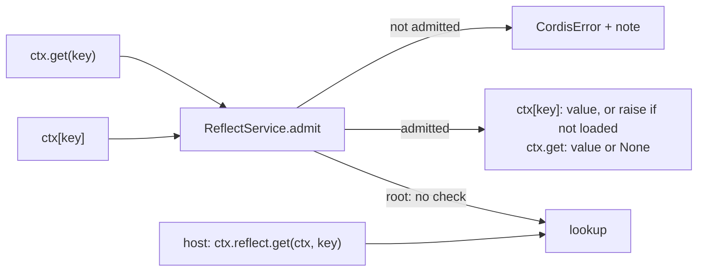

# Build Spec: Checked Get

**Status**: 📝 Draft — not started; spec 3 of 4 (see [Dependencies](#dependencies))

**Reference**: [#11 Make ctx.get check inject in a component's context](https://github.com/uclatommy/pycordis/issues/11)

## Goal

Make `Context.get` use the same admission check as `ctx[key]` in a component's context, so
that every read of a service by a component is a declared dependency that the lifecycle
tracks.

## Architecture

### One owner for admission

`ctx[key]` admits a read through `locate` and the def-site rule in `ReflectService.read`.
`ctx.get` has no check. After this spec, one `ReflectService` method owns the admission rule,
and both reads call it.

```
ReflectService.admit(ctx: Context, name: str) -> Located | None
    # None: the def site has no fiber (a root context): the read is not checked
    # Located: a fiber admits the read
    # raises CordisError: no fiber admits the read
Context.get(key, strict=True) -> T | None      # admit, then the lenient result of ReflectService.get
ReflectService.get(ctx, key, strict=True)      # unchanged: the unchecked lookup
```



[Context Restriction](context_restriction.md) adds its read rule to `admit`, so the restriction
has one enforcement point for reads.

### Results

| Read from a component's context | `ctx[key]` | `ctx.get(key)` before | `ctx.get(key)` after |
|---|---|---|---|
| No fiber in the chain injects or provides `key` | raises | value or `None` | raises |
| Admitted, and the provider is loaded | value | value | value |
| Admitted, and the declaring fiber is not loaded | raises | `None` | `None` |
| Admitted, and the provider is hidden by `strict` | value | `None` | `None` |
| A root context (`root`, `root.isolate(...)`) | unchecked | unchecked | unchecked |

## File Structure

```
src/pycordis/
├── reflect.py          # MODIFY: admit; read uses it
├── context.py          # MODIFY: get uses admit; docstring
├── service.py          # MODIFY: docstring that names ctx.get
├── loader/_entry.py    # MODIFY: find_loader uses the unchecked lookup
└── hmr/_service.py     # MODIFY: docstring on the nested-call view
tests/
├── test_reflect.py     # MODIFY: admission cases for ctx.get; divergence test
└── (callers)           # MODIFY: tests that read with ctx.get from an undeclared context
conformance/
└── ledger.toml         # MODIFY: ReflectService.get and the affected loader cases
docs/
├── user_guide.md       # MODIFY: "Services and dependencies", optional services
└── architecture.md     # MODIFY: checked-get row; service-access row
```

## Implementation References

- **This repository**: `ReflectService.read` and `_checked` (the def-site rule and the two
  upstream messages); `locate` and `Located`; `ReflectService.get` and `find` (the lenient
  lookup); `Context.inject(deps, callback)` (the child fiber for an optional service);
  `CallSite.annotate` and the `error-notes` row (notes on an error); `find_loader` in
  `loader/_entry.py`.
- **Upstream**: `ReflectService.get` and `_getImpl` in `packages/core/src/reflect.ts` (no inject
  check). Upstream test uses of `ctx.get` from a component: `replace.spec.ts` ("reloads a
  consumer of a replaced service": the consumer injects) and `intercept.spec.ts` ("stop
  looking for injected config at an isolation boundary": an ancestor injects) keep their
  results. `loader/tests/isolate.spec.ts` reads `fiber.ctx.get('bar')` from the test, outside the
  component, in about 10 assertions.

## Key Constraints

- **One rule**: `admit` holds the def-site rule (`ctx.shadow` decides, as in `read`) and the
  root shortcut. `read` and `Context.get` call it. No second copy of the rule exists.
- **Messages**: the error keeps the upstream text `cannot get property "<name>" without inject`
  (Critical Rule 8). The hint from the #11 feedback goes in a note with `add_note`, for both
  `ctx[key]` and `ctx.get`: declare the service in `inject`, or use `ctx.inject([...], callback)`
  for an optional service. A test that checks the message is not changed by the note.
- **Lenient after admission**: when a fiber admits the read, `ctx.get` keeps its result: `None`
  when no provider is visible or `strict` hides the provider. Only an undeclared read raises.
- **No events**: `ctx.get` does not run the `internal/get` waterfall. Only `ctx[key]` does, as
  today.
- **Accessors**: `ctx.get` does not read accessors, as today. A mixin accessor already admits
  through `read`.
- **Host lookup**: `ctx.reflect.get(ctx, key, strict)` stays unchecked. It is the documented way
  for a host to see which provider a component's context resolves.
- **Internal callers**: `find_loader` reads the loader service from an entry context that does
  not inject it, so it uses `ctx.reflect.get`. Find other callers with the full suite: every
  test failure with the upstream message from a library path is a caller to change, and every one
  from a test is a test to review.
- **hmr**: `reconcile` finds a nested call through the service view that a component reads. The
  docstring and the user guide name `ctx.get("hmr")`. After this spec, the component must inject
  `hmr` (or an ancestor must); the docs say `ctx["hmr"]` and state that rule.
- **Contract**: no contract row changes. The change makes `LIFE-ORDER` and `LIFE-COHERENT` reach
  every read by a component.

## Integration

- **Breaking change**: `Context.get` is exported and its documented behavior changes. The
  release branch is `release/0.2.0`, never a `0.1.x` patch. The release notes state the change
  and the migration.
- The work goes on `feature/checked-get` from `develop`, and merges through a pull request.
- `conformance/ledger.toml`:
    - `src/reflect.ts:ReflectService.get`: `divergence = "checked-get"`; the target is
      `pycordis.context.Context.get`, with a note that `ReflectService.get` is the unchecked
      lookup.
    - The `loader/isolate.spec.ts` cases that read a component's context from outside:
      `adapted` with `divergence = "checked-get"` and a note: the probe reads through
      `ctx.reflect.get` and gives the upstream result.
    - No hash changes.

## Testing

- ✅ `divergence("checked-get")`, `contract("LIFE-ORDER")`: `ctx.get` of a service that no fiber
  in the chain injects or provides raises `CordisError` with the upstream message and the note,
  where upstream returns the value
- ✅ The rows of the results table in [Architecture](#results): one parametrized test over
  `ctx[key]` and `ctx.get` for each row
- ✅ A shadow context of a service method admits by the def site: a service reads its own
  injected service with `self.ctx.get(...)` when the caller does not inject it
- ✅ Optional service: a component that reads `metrics` through `ctx.inject(["metrics"], ...)`
  loads with no provider, and its child fiber loads when `metrics` is provided (this test is the
  example of the user guide section)
- ✅ `find_loader` works from an entry context that does not inject `loader`
- ✅ The translated `loader/isolate.spec.ts` cases pass with `ctx.reflect.get` and carry their
  `upstream` markers and the divergence marker
- ✅ `replace.spec.ts` and `intercept.spec.ts` cases that use `ctx.get` pass with no change
- ✅ `uv run pytest`, `uv run ruff check .`, and `uv run ruff format --check .` pass; the
  unmarked slow tests section of the full suite is empty

## Documentation

- Docstrings: `Context.get` (the admission rule, the lenient result, the error and its note,
  the optional-service pattern with an example, and `ctx.reflect.get` for a host);
  `Context.__getitem__` (it shares the rule); `ReflectService.admit` and `ReflectService.get`
  (checked and unchecked); the `Service` docstring; the `Hmr` docstring on the nested-call view.
- `docs/user_guide.md`, "Services and dependencies": both reads raise for an undeclared service;
  a short subsection "Optional services" with the `ctx.inject` pattern; the hmr section names
  `ctx["hmr"]`.
- `docs/architecture.md`: the `checked-get` row (see [Appendix A](#appendix-a-divergences)), and
  the `service-access` row no longer describes `ctx.get` as lenient.
- `zensical.toml`: none (no new page).

## Dependencies

- **Sequence**: spec 3 of 4. The order is [Pump Budget](completed/pump_budget.md),
  [Step Reports](completed/step_reports.md), Checked Get, [Context Restriction](context_restriction.md).
  `0.1.3` (specs 1 and 2) is released first, so that a host can take those without this
  breaking change.
- **In parallel**: Increment 1 of [Context Restriction](context_restriction.md) (the audit) is
  read-only and runs during this spec. If the audit finds a path that needs a breaking change,
  that change joins `0.2.0` with this spec.
- **Prerequisite**: none in code.
- **Required by**: [Context Restriction](context_restriction.md) (the read rule attaches to
  `admit`).
- **Runtime**: none.
- **Dev**: none new.

## Migration Strategy

### Increment 1: One admission owner
**Goal**: `ReflectService.admit` holds the admission rule, `ctx[key]` uses it, and its error
carries the note; no read gives a different result.
**Files**: `reflect.py` (~30), `test_reflect.py` (~40)
**Validation**: `uv run pytest tests/test_reflect.py tests/test_shadow.py tests/test_traceable.py`;
the full suite passes with no other change
**Docs**: the `ReflectService.admit` and `ReflectService.read` docstrings
**Status**: ⏳ Not started

### Increment 2: `ctx.get` admits
**Goal**: `Context.get` raises for an undeclared read, every caller and test is migrated, and the
divergence, ledger, and user guide are in place.
**Files**: `context.py` (~20), `loader/_entry.py` (~3), `hmr/_service.py` (docstring),
`service.py` (docstring), `test_reflect.py` (~80), the affected tests, `ledger.toml`,
`architecture.md`, `user_guide.md` (~30)
**Validation**: `uv run pytest`; manual: in `uv run python`, read an undeclared service with
`ctx.get` in `apply`, check that `fiber.error` has the upstream message and the note, then
change the component to use `ctx.inject` and check that it loads with no provider
**Docs**: `Context.get`, `Service`, and `Hmr` docstrings; `docs/user_guide.md`;
`docs/architecture.md` rows; review of every docstring that names `ctx.get`
**Status**: ⏳ Not started

## Code Standards

- [Contributing](../contributing.md): the test and docstring standards, with the pull request
  checklist
- [Developer Guide](../developer_guide.md): the upstream review procedure, branches, and release
  rules (breaking change)
- [Architecture](../architecture.md): the semantic contract (`LIFE-ORDER`, `LIFE-COHERENT`) and
  the divergence table
- The instruction files in `.github/instructions/`: Python Coding Standards (one owner for a
  rule), Docstrings & Markdown Style, Testing Standards, and Upstream Porting (message text,
  ledger, divergence markers)

This spec is scaffolding — do not cite it, its filename, or its increment numbers in source,
docstrings, comments, or test names. Docstrings state the present rule, not the change that
introduced it.

## Appendix A: Divergences

The maintainer approved this row on #8 and #11. It goes to the divergence table in
`docs/architecture.md` in Increment 2.

| ID | Kind | Upstream | pycordis | Contract | Reason and evidence |
|---|---|---|---|---|---|
| `checked-get` | improvement | `ctx.get(name)` returns the provider that the context sees, with no inject check | In a component's context, `ctx.get(key)` admits the read as `ctx[key]` does, and raises `CordisError` when no fiber in the chain injects or provides `key`; a root context is not checked; `ctx.reflect.get(ctx, key)` is the unchecked lookup | `LIFE-ORDER`, `LIFE-COHERENT` | A read that is not declared is outside the lifecycle: its provider can revert under it, and a change of provider does not reload it. Test: `divergence("checked-get")` in `tests/test_reflect.py` |
| `service-access` (existing row) | adaptation | — | Remove "`ctx.get(key)` (lenient)"; name `ctx.get(key)` as checked in a component's context, as `ctx[key]` is | — | — |
