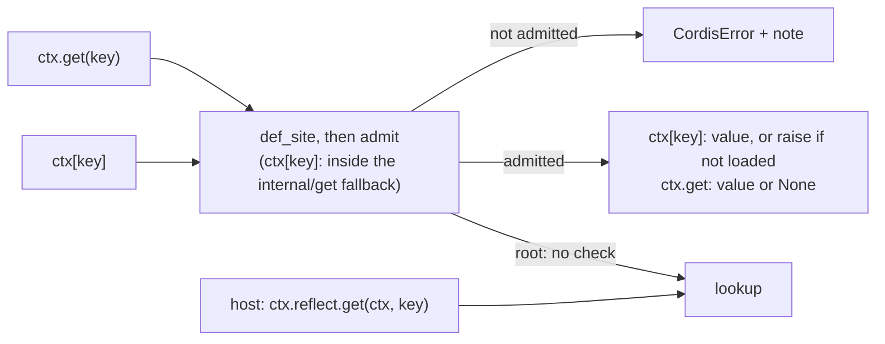

# Build Spec: Checked Get

**Status**: ✅ Completed — spec 3 of 4 (see [Dependencies](#dependencies))

**Reference**: [#11 Make ctx.get check inject in a component's context](https://github.com/uclatommy/pycordis/issues/11)

## Goal

Make `Context.get` use the same admission check as `ctx[key]` in a component's context, so
that every read of a service by a component is a declared dependency that the lifecycle
tracks.

## Architecture

### One owner for admission

`ctx[key]` admits a read through `locate` and the def-site rule in `ReflectService.read`.
`ctx.get` has no check. After this spec, `ReflectService` owns the admission rule in two
methods, and both reads call them.

```
ReflectService.def_site(ctx: Context) -> Context | None
    # ctx.shadow or ctx; None when that context's fiber has no runtime (a root context)
ReflectService.admit(def_site: Context, name: str) -> Located
    # raises CordisError (upstream text + note): no fiber admits the read
ReflectService.read(ctx, key, receiver=None)    # def_site; None -> unchecked get;
    # else the internal/get waterfall, whose fallback calls admit
ReflectService.checked_get(ctx, key, strict=True) -> Any
    # def_site; None -> get; else admit, then Located.impl: None if missing,
    # None if strict and its fiber is not ACTIVE, else the view for ctx.use_site
Context.get(key, strict=True) -> T | None       # delegates to checked_get
ReflectService.get(ctx, key, strict=True)       # unchanged: the unchecked store lookup
```

The admission is split in two because `ctx[key]` decides the root shortcut before the
`internal/get` waterfall and calls `locate` inside its fallback. A listener of `internal/get`
sees an access that no fiber admits (`test_the_get_listener_sees_an_access_that_no_fiber_admits`
in `tests/test_reflect.py`). `admit` must not move before the waterfall.

After admission, `ctx.get` reads the provider that the admitting fiber committed
(`Located.impl`), as `ctx[key]` does, not the current store. Between a provider change and the
reload of the fiber, both reads give the committed provider (`LIFE-COHERENT`).



[Context Restriction](../context_restriction.md) adds its read rule to `admit`, so the restriction
has one enforcement point for reads.

### Results

| Read from a component's context | `ctx[key]` | `ctx.get(key)` before | `ctx.get(key)` after |
|---|---|---|---|
| No fiber in the chain injects or provides `key` | raises | value or `None` | raises |
| Admitted, and the provider is loaded | value | value | value |
| Admitted, and the declaring fiber is not loaded | raises | the visible provider, or `None` | `None` |
| Admitted, and the provider is hidden by `strict` | value | `None` | `None` |
| Admitted, and the visible provider changed before the fiber reloads | committed provider | new provider | committed provider (`None` if `strict` hides it) |
| A root context (`root`, `root.isolate(...)`) | unchecked | unchecked | unchecked |

A read from a context that isolates `key` again (`ctx.isolate(key, label).get(key)`) is not
admitted by an ancestor's `inject`: `locate` stops at the isolate. Both reads raise.

## File Structure

```
src/pycordis/
├── reflect.py          # MODIFY: def_site, admit, checked_get; read uses them
├── context.py          # MODIFY: get delegates to checked_get; docstrings (get, provide example)
├── service.py          # MODIFY: docstring that names ctx.get
├── loader/_entry.py    # MODIFY: find_loader uses the unchecked lookup
├── loader/_service.py  # REVIEW: docstring example ctx.get("loader")
└── hmr/_service.py     # MODIFY: docstrings on the nested-call view (Hmr, reconcile)
tests/
├── test_reflect.py         # MODIFY: admission cases for ctx.get; divergence test
├── test_intercept.py       # MODIFY: the isolation-boundary case reads with ctx.reflect.get
├── test_hmr_reconcile.py   # MODIFY: components that read hmr inject it
├── test_loader_isolate.py  # MODIFY: loader.ctx.get("svc") reads with ctx.reflect.get
└── test_loader.py          # CHECK: a group without a loader keeps its error message
conformance/
└── ledger.toml         # MODIFY: ReflectService.get and the intercept isolation-boundary case
docs/
├── user_guide.md       # MODIFY: "Services and dependencies", optional services
└── architecture.md     # MODIFY: checked-get row; service-access row
```

## Implementation References

- **This repository**: `ReflectService.read` and `_checked` (the def-site rule and the two
  upstream messages); the `internal/get` tests in `tests/test_reflect.py`; `locate` and `Located`; `ReflectService.get` and `find` (the lenient
  lookup); `Context.inject(deps, callback)` (the child fiber for an optional service);
  `CallSite.annotate` and the `error-notes` row (notes on an error); `find_loader` in
  `loader/_entry.py`.
- **Upstream**: `ReflectService.get` and `_getImpl` in `packages/core/src/reflect.ts` (no inject
  check); the `get` trap of `ReflectService.handler` (the root shortcut before the
  `internal/get` waterfall, `locate` in its fallback). Upstream test uses of `ctx.get` from a
  component:
    - `replace.spec.ts` ("reloads a consumer of a replaced service"): the consumer injects, and
      the read is in `apply`, where the committed and the current provider are the same. The
      result does not change.
    - `intercept.spec.ts` ("stop looking for injected config at an isolation boundary"): the
      read is from `ctx.isolate('foo', label)`, which the ancestor's `inject` does not admit. The
      read raises; the translated test reads with `ctx.reflect.get`.
    - `loader/tests/isolate.spec.ts` reads `fiber.ctx.get('bar')` from the test in 11
      assertions, but every `fiber` is a `foo` entry that injects `bar`, so the results do not
      change. The translations read `ctx["bar"]` in the component.

## Key Constraints

- **One rule**: `def_site` holds the def-site rule (`ctx.shadow` decides) and the root
  shortcut; `admit` holds the `locate` call and the error. `read` and `checked_get` call them.
  No second copy of the rule exists.
- **Waterfall order**: in `read`, `admit` runs inside the `internal/get` fallback, so a listener
  still sees an access that no fiber admits, and the existing `internal/get` tests in
  `tests/test_reflect.py` pass with no change.
- **Messages**: the error keeps the upstream text `cannot get property "<name>" without inject`
  (Critical Rule 8). The hint from the #11 feedback goes in a note with `add_note`, for both
  `ctx[key]` and `ctx.get`: declare the service in `inject`, or use `ctx.inject([...], callback)`
  for an optional service. A test that checks the message is not changed by the note. The
  `in inactive context` error of `ctx[key]` gets no note.
- **Lenient after admission**: when a fiber admits the read, `ctx.get` returns `None` where
  `ctx[key]` raises: `Located.impl` is `None` (the declaring fiber is not loaded), or `strict`
  hides it (its fiber is not `ACTIVE`). Only an undeclared read raises.
- **Committed provider**: `checked_get` returns `Located.impl`, never a second lookup through
  `find`. A read cannot see a provider that the fiber did not load against.
- **Views**: `ctx.get` returns the view for `ctx.use_site`, as `ReflectService.get` does today;
  `ctx[key]` returns the view for `ctx`. Keep both.
- **No events**: `ctx.get` does not run the `internal/get` waterfall. Only `ctx[key]` does, as
  today.
- **Accessors**: `ctx.get` does not read accessors, as today. A mixin accessor already admits
  through `read`.
- **Host lookup**: `ctx.reflect.get(ctx, key, strict)` stays unchecked. It is the documented way
  for a host to see which provider a component's context resolves.
- **Internal callers**: `find_loader` reads the loader service from an entry context that does
  not inject it, so it uses `ctx.reflect.get`. A run of the suite with a temporary checked
  `Context.get` fails 6 tests: `test_loader.py` (`find_loader`), 3 in `test_hmr_reconcile.py`
  (components read `hmr` with no inject), `test_loader_isolate.py` (`loader.ctx.get("svc")`
  from the loader's own context), and the `test_intercept.py` isolation-boundary case. Run the
  full suite again after the change: every failure with the upstream message from a library path
  is a caller to change, and every one from a test is a test to review. A component error that
  goes to `fiber.error` does not fail a test by itself, so also search `tests/` for `.get(` in
  `apply` bodies.
- **hmr**: `reconcile` finds a nested call through the service view that a component reads. The
  docstring and the user guide name `ctx.get("hmr")`. After this spec, the component must inject
  `hmr` (or an ancestor must); the docs say `ctx["hmr"]` and state that rule.
- **Contract**: no contract row changes. The change makes `LIFE-ORDER` and `LIFE-COHERENT` reach
  every read by a component.

## Integration

- **Breaking change**: `Context.get` is exported and its documented behavior changes. The
  release branch is `release/0.2.0`, never a `0.1.x` patch. The release notes state the change
  and the migration:
    - An undeclared read: add the key to `inject`.
    - An optional read: `ctx.inject([key], callback)`, so that the component does not wait for
      the service.
    - A read in another realm: `ctx.isolate(key, label).get(key)` raises, because an ancestor's
      `inject` does not admit a read across the isolate. Use
      `ctx.isolate(key, label).inject([key], callback)`.
    - An admitted read returns the committed provider: `None` while the declaring fiber is not
      loaded, and the committed provider until the fiber reloads after a provider change.
    - A host probe: `ctx.reflect.get(ctx, key, strict)`.
- The work goes on `feature/checked-get` from `develop`, and merges through a pull request.
- `conformance/ledger.toml`:
    - `src/reflect.ts:ReflectService.get`: `divergence = "checked-get"`; the target is
      `pycordis.context.Context.get`, with a note that `ReflectService.get` is the unchecked
      lookup.
    - `intercept.spec.ts::Intercept::stop looking for injected config at an isolation
      boundary`: `adapted` with `divergence = "checked-get"` and a note: the reader is not
      admitted at the isolate, so the test reads through `ctx.reflect.get` and gives the
      upstream result.
    - The `loader/isolate.spec.ts` cases do not change.
    - No hash changes.

## Testing

- ✅ `divergence("checked-get")`, `contract("LIFE-ORDER")`: `ctx.get` of a service that no fiber
  in the chain injects or provides raises `CordisError` with the upstream message and the note,
  where upstream returns the value
- ✅ The rows of the results table in [Architecture](#results): one parametrized test over
  `ctx[key]` and `ctx.get` for each row, including the provider change before a reload
  (`contract("LIFE-COHERENT")`: both reads give the committed provider)
- ✅ The existing `internal/get` tests in `tests/test_reflect.py` pass with no change (the
  listener runs before admission)
- ✅ A shadow context of a service method admits by the def site: a service reads its own
  injected service with `self.ctx.get(...)` when the caller does not inject it
- ✅ Optional service: a component that reads `metrics` through `ctx.inject(["metrics"], ...)`
  loads with no provider, and its child fiber loads when `metrics` is provided (this test is the
  example of the user guide section); a parametrized case reads a service in another realm
  through `ctx.isolate(key, label).inject([key], ...)`
- ✅ `find_loader` works from an entry context that does not inject `loader`
- ✅ The translated `intercept.spec.ts` isolation-boundary case passes with `ctx.reflect.get`,
  and carries its `upstream` marker and `divergence("checked-get")`
- ✅ The `replace.spec.ts` case and the `loader/isolate.spec.ts` cases pass with no change
- ✅ `uv run pytest`, `uv run ruff check .`, and `uv run ruff format --check .` pass; the
  unmarked slow tests section of the full suite is empty

## Documentation

- Docstrings: `Context.get` (the admission rule, the lenient result, the error and its note,
  the optional-service pattern with an example, and `ctx.reflect.get` for a host);
  `Context.__getitem__` (it shares the rule); `ReflectService.def_site`, `admit`,
  `checked_get`, and `get` (checked and unchecked); the `Service` docstring; the `Hmr` and
  `reconcile` docstrings on the nested-call view and their examples; the `Context.provide` and
  `Loader` examples that call `ctx.get`.
- `docs/user_guide.md`, "Services and dependencies": both reads raise for an undeclared service;
  a short subsection "Optional services" with the `ctx.inject` pattern, and the
  `ctx.isolate(key, label).inject([key], callback)` form for a service in another realm; the
  `Context.get` docstring names the same two forms; the hmr section names
  `ctx["hmr"]`.
- `docs/architecture.md`: the `checked-get` row (see [Appendix A](#appendix-a-divergences)), and
  the `service-access` row no longer describes `ctx.get` as lenient.
- `zensical.toml`: none (no new page).

## Dependencies

- **Sequence**: spec 3 of 4. The order is [Pump Budget](pump_budget.md),
  [Step Reports](step_reports.md), Checked Get, [Context Restriction](../context_restriction.md).
  `0.1.3` (specs 1 and 2) is released first, so that a host can take those without this
  breaking change.
- **In parallel**: Increment 1 of [Context Restriction](../context_restriction.md) (the audit) is
  read-only and runs during this spec. If the audit finds a path that needs a breaking change,
  that change joins `0.2.0` with this spec.
- **Prerequisite**: none in code.
- **Required by**: [Context Restriction](../context_restriction.md) (the read rule attaches to
  `admit`).
- **Runtime**: none.
- **Dev**: none new.

## Migration Strategy

### Increment 1: One admission owner
**Goal**: `ReflectService.def_site` and `admit` hold the admission rule, `ctx[key]` uses them,
and its error carries the note; no read gives a different result.
**Files**: `reflect.py` (~30), `test_reflect.py` (~40)
**Validation**: `uv run pytest tests/test_reflect.py tests/test_shadow.py tests/test_traceable.py`;
the full suite passes with no other change
**Docs**: the `ReflectService.def_site`, `admit`, and `read` docstrings
**Status**: ✅ Completed
**Changed**:
- `reflect.py`: `ReflectService.def_site` gives the shadow or the context, or `None` for a root context
- `reflect.py`: `ReflectService.admit` calls `locate` and raises the upstream error with a note that names `inject` and `ctx.inject([...], callback)`
- `reflect.py`: `read` uses `def_site` before the `internal/get` waterfall; `_checked` calls `admit` in its fallback and keeps the `in inactive context` error without a note
**Tests**:
- `test_reflect.py`: added `test_only_an_undeclared_access_names_both_declarations` (2 cases: the note, and no note on the `in inactive context` error), `test_the_def_site_decides_which_reads_are_checked` (4 cases), `test_a_fiber_admits_what_it_injects_or_provides` (2 cases)
- `tests/test_reflect.py`, `tests/test_shadow.py`, `tests/test_traceable.py`: 87 passed; the existing `internal/get` tests did not change
- Full suite: 1414 passed; `ruff check` and `ruff format --check` clean
**Deviations**:
- None
**Manual validation**:
- Confirmed in `uv run python`: an undeclared `ctx["metrics"]` raises the upstream message with the note, and `def_site` and `admit` give the expected contexts and fiber

### Increment 2: `ctx.get` admits
**Goal**: `Context.get` raises for an undeclared read, every caller and test is migrated, and the
divergence, ledger, and user guide are in place.
**Files**: `reflect.py` (`checked_get`, ~15), `context.py` (~20), `loader/_entry.py` (~3),
`hmr/_service.py` and `service.py` (docstrings), `test_reflect.py` (~80), `test_intercept.py`,
`test_hmr_reconcile.py`, `test_loader_isolate.py` (~15 together), `ledger.toml`,
`architecture.md`, `user_guide.md` (~30)
**Validation**: `uv run pytest`; manual: in `uv run python`, read an undeclared service with
`ctx.get` in `apply`, check that `fiber.error` has the upstream message and the note, then
change the component to use `ctx.inject` and check that it loads with no provider
**Docs**: `Context.get`, `Service`, and `Hmr` docstrings; `docs/user_guide.md`;
`docs/architecture.md` rows; review of every docstring that names `ctx.get`
**Status**: ✅ Completed
**Changed**:
- `reflect.py`: `ReflectService.checked_get` admits a read from a component's context and returns the committed provider, or `None` where `ctx[key]` raises or `strict` hides it; a root context uses `get`
- `reflect.py`: `_visible` holds the `strict` rule for `find` and `checked_get`; the `get` docstring names it as the unchecked host lookup
- `context.py`: `Context.get` calls `checked_get`; its docstring gives the admission rule, the error and note, the optional-service and other-realm forms, and `ctx.reflect.get`; the `__getitem__` and `provide` docstrings agree
- `loader/_entry.py`: `find_loader` reads the loader with the unchecked `ctx.reflect.get`
- `service.py`, `hmr/_service.py`, `loader/_service.py`: the examples read from `root`; the `Hmr` limit says that a component that calls `reconcile` reads `ctx["hmr"]` and injects `hmr`
- `ledger.toml`: `src/reflect.ts:ReflectService.get` targets `Context.get` with `divergence = "checked-get"` and a note; the intercept isolation-boundary case has `divergence = "checked-get"` and a note; no hash changes
- `architecture.md`: the `checked-get` row; the `service-access` row names `ctx.get(key)` as checked
- `user_guide.md`: "Services and dependencies" states the shared admission rule and the host lookup; new subsection "Optional services"; the hmr limit names `ctx["hmr"]`
- `tests/conformance_checks.py`: the Contract cell of a divergence row can name more than one ID in backticks
**Tests**:
- `test_reflect.py`: `test_only_an_undeclared_access_names_both_declarations` has a `ctx.get` case (`divergence("checked-get")`, `contract("LIFE-ORDER")`); added `test_get_admits_a_read_as_an_item_access_does_and_returns_none_where_it_raises` (9 cases: the results-table rows, a fiber's own provision while it loads, and the isolate case; the `changed` case has `contract("LIFE-COHERENT")`) and `test_a_child_fiber_reads_an_optional_service_without_holding_its_parent` (same realm, other realm)
- `test_reflect.py`: `test_a_key_must_be_a_str_or_a_key` covers `ctx[key]` and `ctx.get` from the root and from a component (4 cases)
- `test_shadow.py`: `test_a_service_reads_what_it_injects_whatever_its_caller_injects` replaces the no-inject test (4 cases: `ctx[key]` and `ctx.get`, with and without inject)
- `test_intercept.py`: the isolation-boundary case reads with `ctx.reflect.get` and has `divergence("checked-get")`
- `test_hmr_reconcile.py`: the nested-call components inject `hmr` and read `ctx["hmr"]`
- `test_loader_isolate.py`: the realm-change case reads with `ctx.reflect.get`
- `test_conformance.py`: the unknown-contract-ID case uses a cell with inner backticks; it fails against the old split
- A `checked_get` that reads the current store in place of `Located.impl` fails the `unloaded` and `changed` cases
- Full suite: 1433 passed; `ruff check` and `ruff format --check` clean; the unmarked slow tests section is empty
**Deviations**:
- Both ledger entries have the status `diverged`, not `adapted`: the conformance checks accept an `improvement` divergence only on a `diverged` entry
- The conformance checker split the Contract cell on commas and spaces only, so a row with two IDs in backticks failed; the split also removes backticks
- The `LIFE-COHERENT` marker is on the `changed` case, not on the seeded test in `test_invariants.py`: in those schedules a provider removal always unloads the dependents first, so a `ctx.get` assertion there did not fail against a store lookup
- The undeclared cases use a sibling provider: a provision of the root fiber admits a read from every component below it
- The nested-call hmr test uses its module as the component, with a module-level `inject`: with `apply.inject`, `Hmr` replaced the component with the module, and the moved fiber lost its `inject`
- The shadow case is in `test_shadow.py`, as a parametrization of the existing upstream test
- `test_loader.py` needed no change: `find_loader` no longer calls `Context.get`
- The work is on `feature/checked-get` from Increment 2; the Increment 1 commit is on `develop`
**Manual validation**:
- Confirmed in `uv run python`: an undeclared `ctx.get("metrics")` in `apply` sets `fiber.error` to the upstream message with the note, and a component that reads `metrics` through `ctx.inject` is `ACTIVE` with no provider and its child reads the value when `metrics` is provided

## Code Standards

- [Contributing](../../contributing.md): the test and docstring standards, with the pull request
  checklist
- [Developer Guide](../../developer_guide.md): the upstream review procedure, branches, and release
  rules (breaking change)
- [Architecture](../../architecture.md): the semantic contract (`LIFE-ORDER`, `LIFE-COHERENT`) and
  the divergence table
- The instruction files in `.github/instructions/`: Python Coding Standards (one owner for a
  rule), Docstrings & Markdown Style, Testing Standards, and Upstream Porting (message text,
  ledger, divergence markers)

This spec is scaffolding — do not cite it, its filename, or its increment numbers in source,
docstrings, comments, or test names. Docstrings state the present rule, not the change that
introduced it.

## Appendix A: Divergences

The maintainer approved this row on #8 and #11. It goes to the divergence table in
`docs/architecture.md` in Increment 2.

| ID | Kind | Upstream | pycordis | Contract | Reason and evidence |
|---|---|---|---|---|---|
| `checked-get` | improvement | `ctx.get(name)` returns the provider that the context sees, with no inject check | In a component's context, `ctx.get(key)` admits the read as `ctx[key]` does, raises `CordisError` when no fiber in the chain injects or provides `key`, and returns the provider that the admitting fiber committed (`None` where `ctx[key]` raises for an unloaded fiber, or where `strict` hides it); a root context is not checked; `ctx.reflect.get(ctx, key)` is the unchecked lookup | `LIFE-ORDER`, `LIFE-COHERENT` | A read that is not declared is outside the lifecycle: its provider can revert under it, and a change of provider does not reload it. Test: `divergence("checked-get")` in `tests/test_reflect.py` |
| `service-access` (existing row) | adaptation | — | Remove "`ctx.get(key)` (lenient)"; name `ctx.get(key)` as checked in a component's context, as `ctx[key]` is | — | — |
