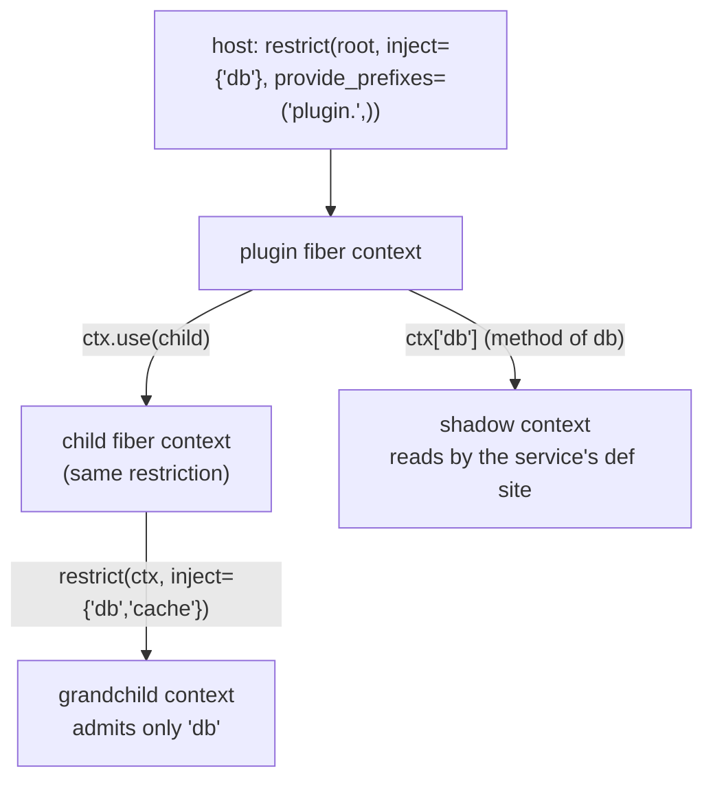

# Build Spec: Context Restriction

**Status**: ✅ Completed — spec 4 of 4 (see [Dependencies](#dependencies))

**Reference**: [#8 Feature request: context view that restricts which keys a component can inject and provide](https://github.com/uclatommy/pycordis/issues/8)

## Goal

Let a host give a component a restricted context that limits the service keys it can inject,
read, and provide, for the component and every fiber it creates, behind a feature flag.

## Why This

A host that loads plugins it did not write has no way to state which services a plugin can use
or replace. A host wrapper around the context does not reach child fibers or service calls. The
restriction is a **guard, not a sandbox**: it stops accidental and undeclared access, and fails
fast. It does not stop hostile code, which can reach other objects through `gc`,
`sys._getframe`, or module globals. The maintainer accepted this position on #8.

## Architecture

### The rule and the restricted context

```
@dataclass(frozen=True)
class Rule:
    names: frozenset[str]          # exact names; a Key[T] becomes its name
    prefixes: tuple[str, ...]      # for example "plugin."
    def admits(self, name: str) -> bool

restrict(ctx: Context, *, inject: Iterable[Keyable] | None = None,
         inject_prefixes: Iterable[str] | None = None,
         provide: Iterable[Keyable] | None = None,
         provide_prefixes: Iterable[str] | None = None) -> Context
```

`restrict` returns a derived context that carries a restriction: one `Rule | None` for inject
and reads, and one `Rule | None` for provide. A dimension whose two arguments are both `None`
has no rule (`None`) and admits every key. An explicit empty iterable admits no key. A call
with all four arguments `None` raises `ValueError`. A bare `str` in place of an iterable raises
`TypeError`, because its characters would become names. `pycordis/__init__.py` does not export
`restrict` or `Rule` (the feature flag). The rule is data, never a predicate: `LIFE-CONFLUENT`
needs the same answer in every schedule, and an error can show a data rule.

### Inheritance and intersection

The restriction is stored in the context chain, as the isolation table is, so every context that
a restricted context derives (`use`, `inject`, `isolate`, `intercept`, `extend`, a fiber's own
context) carries it. `Context._derive` copies each field by name, so the restriction is a new
field there and in `Context.__init__` (empty at the root); `with_shadow` copies the use site's
fields, so a shadow carries the caller's restriction. A `restrict` call on a restricted context
adds a second restriction. A key is admitted only when every restriction in the chain admits
it, so a component can make its restriction stricter, but never wider. An error names the
`Rule` that rejects (its names and prefixes, sorted, so the text is the same in every run).

**Which context's restriction applies**: reads and the guarded attributes use the def site
(`ctx.shadow` when it is set, else `ctx`); inject and provide use the use site. So a method of
a host service that a restricted plugin calls can read `self.ctx.registry`, and its
`self.ctx.provide(...)` follows the plugin's provide rule.



### Enforcement points

| Operation | Enforcement point | Result outside the rule |
|---|---|---|
| A declared inject key | The one helper that every path that sets `Fiber.inject` calls: fiber attach and `Fiber._replace` | The fiber goes to `FAILED` before `apply`; `fiber.error` names the key and the rule |
| A read (`ctx[key]`, `ctx.get`, an accessor) | One `ReflectService` check of the def site's read rule, that `read` (accessor and service branches) and `checked_get` call before the root shortcut (`def_site` returns `None` for a root-fiber context). `admit` and `locate` stay as they are | `CordisError` that names the key and the rule. A plain accessor is checked by its own name; a mixin accessor is checked by its source service (`timer`), not by its name (`sleep`), so `Accessor` records the source that `_forward` reads |
| A write (`ctx[key] = value`) | `ReflectService.write`: the same check for an accessor setter; a service write already needs a provider on the writer's own fiber (`ReflectService.set`) | As for a read |
| `provide`, `accessor`, `mixin` | The effect setup in `ReflectService.provide`, `accessor`, and `mixin` | The effect raises; in `apply` the fiber fails and reverts, as `LIFE-FAILURE` requires |
| `ctx.root`, `ctx.reflect`, `ctx.registry`, `ctx.events` | Read-only properties on `Context`, checked against the def site's restriction | `CordisError` in a restricted context; no change in other contexts |
| Paths that the audit finds | Per the audit (Appendix B) | Per the audit |

The root shortcut has two parts, and the read rule comes before both: `def_site` gives `None`
for a context on the root fiber (so `restrict(root, ...)` itself must be checked first), and
`locate` admits a service that an ancestor provides (so a plugin cannot read a root-only
service). A restricted root-fiber context whose read passes the rule keeps the unchecked read.

`accessor` and `mixin` names are in the provide rule because an accessor takes precedence over a
service of the same name: an accessor at a host key would replace every read of that key.

## File Structure

```
src/pycordis/
├── context.py          # MODIFY: restrict, Rule, restriction in the chain, guarded attributes
├── reflect.py          # MODIFY: read rule in admit; provide rule in provide, accessor, mixin
├── fiber.py            # MODIFY: inject check helper, called at attach and in _replace
├── registry.py, events.py, service.py, traceable.py, logger.py, timer.py,
│   loader/*.py, hmr/*.py   # MODIFY: internal uses of root, reflect, registry, events
tests/
├── test_restrict.py    # NEW: Python-only restriction tests
└── test_invariants.py  # MODIFY: restricted fibers in the LIFE-FAILURE schedules
docs/
├── architecture.md     # MODIFY: divergence row
└── build_specs/context_restriction.md   # Appendix B: the audit
```

## Implementation References

- **This repository**: `Context._derive` and the `_isolates` chain (how a table reaches every
  derived context); `Context.with_shadow`, `shadow`, and `use_site`, and the def-site rule in
  `ReflectService.read`; `ReflectService.admit` from [Checked Get](checked_get.md);
  `ReflectService.provide`, `accessor`, `mixin`, and `_forward`; `Fiber._attach` (its `except`
  that records the error and leaves the fiber `FAILED`); `Fiber._replace` (it sets `inject`
  again); `RegistryService.inject` and `run_inject_methods` (the paths that create fibers with
  `inject`); `key_name` in `keys.py`.
- **Upstream**: none. Upstream has no access rule, and `ctx.root`, `ctx.reflect`,
  `ctx.registry`, and `ctx.events` are always public.

## Key Constraints

- **Guard, not sandbox**: the `restrict` docstring has a `!!! warning` admonition that says the
  restriction does not stop hostile code, and that untrusted code must run in another process.
- **No restriction, no change**: an unrestricted context keeps every result. The cost is one
  empty check at each enforcement point (no allocation on the read path). The guarded attributes,
  and `fiber`, are instance attributes today and become read-only properties; internal code reads
  private names (`_root`, `_reflect`, `_registry`, `_events`, `_fiber`), so the cost of a property
  is only on a host or plugin read. The `Attributes:` entries in the `Context` docstring move to
  the property docstrings. Assignment to these names was never documented, so a read-only
  property is not a breaking change.
- **Inject check, not a wait**: a fiber with an inject key outside the rule goes to `FAILED`. It
  does not stay `PENDING`, because a fiber that waits for a key it can never use would wait with
  no report. It loads again only through `update` or a replacement, as `LIFE-FAILURE` says. In
  `_attach`, the check runs inside the existing `try`, before `_refresh`. In `_replace`, which
  clears `_error`, the check runs after the clear and a rejection skips `_refresh`.
- **Error content**: every error names the key and the rule (its names and prefixes), so a host
  status view shows the cause from `fiber.error` alone (the #8 feedback). These messages are new;
  no upstream text applies.
- **Service calls**: a method of an allowed service reads, and reads the guarded attributes, at
  the service's def site, so the caller's rule does not restrict it. A service that a restricted
  plugin provides has a restricted def site, so its methods are restricted for every caller. A
  `provide`, `accessor`, or `mixin` call in a service method registers on the calling fiber, so
  it follows the caller's provide rule.
- **Root reads**: the read rule applies before both parts of the root shortcut (see
  [Enforcement points](#enforcement-points)), so a restricted plugin cannot read a service that
  only the root provides.
- **Events and other operations**: `on`, `emit`, `effect`, `use`, timers, and the scheduler are not
  restricted. The #8 feedback confirmed that event names need no rule in this spec.
- **Audit gate**: a path that lets a restricted component register an effect that outlives the
  component (as `ctx.root.provide` does today) must close before release. A read path can stay
  open with a documented gap. If an effect path cannot close without a breaking change to the
  public API, the restriction waits for that change (the #8 feedback).
- **Audit candidates** (Increment 1 confirms or rejects each one):
    - `ctx.fiber.runtime.fibers`: the other fibers of the same component, whose contexts can be
      unrestricted
    - service values that expose a context or a fiber (loader entries, hmr), and
      `get_original` in the non-public module `pycordis.traceable`
    - global listeners (`options.is_global`) and listeners on internal events
    - `ctx.isolate(name, label)` with a label that the host uses
    - `ctx.scheduler.submit`: work that runs after the component is disposed
    - `fiber.parent`, `fiber.ctx`, and `fiber.children`: `ctx.fiber.parent.fiber.ctx` reaches
      the root context from any plugin, because the root fiber's `ctx` is the root itself. The
      `host-introspection` row makes `parent` public, and a `Fiber` cannot tell which context
      reads it, so a guard on `parent` or `ctx` also breaks the host's introspection of
      restricted fibers. A plugin fiber's `parent` is the restricted context; the leak is
      `.fiber` on that context, which gives the host's unrestricted fiber. Candidate fix: guard
      `Context.fiber` only on a context where `restrict` crosses a fiber boundary, and leave
      `Fiber.parent` and `Fiber.ctx` as they are (cost: internal reads of `ctx.fiber` move to a
      private name). Rejected: a check at effect
      registration against the fiber that runs the current step. A host listener that runs in a
      plugin's `emit` would be rejected in one schedule and accepted in another
      (`LIFE-CONFLUENT`), and the check would restrict events, which this spec does not do
    - A host service method that registers an effect on its own root (`self.ctx.root.provide`)
      when a restricted plugin calls it. The def site decides the guarded attributes, so this
      path stays open. The audit gate covers the paths that pycordis gives a component, not
      effects that a trusted host service registers, so the plan is "document"
    - `Fiber` objects in internal event arguments (`internal/plugin`, `internal/status`,
      `internal/replace`), whose `ctx` can be unrestricted
    - `Context.with_shadow`, a public method that sets the def site that reads use

## Integration

- `pycordis/__init__.py` does not change (the feature flag). `pycordis.context` is not a public
  module.
- The guarded attributes, and the `fiber` guard, change only in a restricted context, which
  only the flagged API can create, so neither is breaking on its own.
- **Breaking**: closing the `Loader` row of the audit (Increment 5) replaces
  `Loader.cordis_tracker = Tracker(no_shadow=True)` with the default
  `Tracker(property="ctx", associate="loader")` that every other `Service` already has. This
  changes what a view gives for every caller, restricted or not: `root.get("loader").ctx` now
  gives the reading context's use site, not the loader's own context object. `pycordis.loader`
  is a public module, so this needs a minor increment: the release branch for this spec is
  `release/0.2.0`, not a patch branch.
- Promotion (an export, `Context.restrict` as a method, and a user guide section) is a separate
  change. A loader entry option for the restriction is a second divergence from the upstream
  loader schema and gets its own spec.
- The work goes on `feature/context-restriction` from `develop`, and merges through a pull
  request.
- `conformance/ledger.toml`: no change (no upstream item).

## Testing

- ✅ Inject outside the rule, one parametrized test over each path that sets `inject`
  (component `inject`, an `@inject` method, `ctx.inject(deps, callback)`, a replacement): the
  fiber is `FAILED`, `fiber.error` names the key and the rule, and its siblings and parent stay
  `ACTIVE`
- ✅ `contract("LIFE-FAILURE")`: `provide`, `accessor`, and `mixin` outside the rule in `apply`
  leave the fiber `FAILED` with no installed effects; the seeded schedules in
  `tests/test_invariants.py` include restricted fibers that break their rule, and the seed is in
  the assertion message
- ✅ Reads: `ctx[key]`, `ctx.get`, and a mixin accessor outside the rule raise, including a
  service that only the root provides; the mixin error names the source service (one
  parametrized test)
- ✅ Arguments: a bare `str` raises `TypeError`, all four arguments `None` raise `ValueError`,
  and a dimension with no rule admits every key (one parametrized test)
- ✅ Reads: a plain accessor outside the rule raises by its own name; `restrict(root, ...)` used
  directly (a root-fiber context) checks its reads; `ctx[key] = value` through an accessor
  setter outside the rule raises (cases of the read test above)
- ✅ Inheritance: a child fiber, an `isolate` context, and an `extend` context carry the
  restriction; a nested `restrict` admits only the intersection and cannot widen it
- ✅ A method of an allowed service reads its own injected service and `self.ctx.registry` when
  the caller's rule does not list that service; its `self.ctx.provide` follows the caller's
  provide rule
- ✅ `divergence("context-restriction")`: `ctx.root`, `ctx.reflect`, `ctx.registry`,
  `ctx.events`, and `ctx.fiber` raise in a restricted context and work in an
  unrestricted one
- ✅ Each effect path that the audit closes has a test that the restricted component cannot
  register an effect that outlives it
- ✅ An unrestricted context passes the full suite with no test change
- ✅ `uv run pytest`, `uv run ruff check .`, and `uv run ruff format --check .` pass; the
  unmarked slow tests section of the full suite is empty

## Documentation

- Docstrings: `restrict` (the guard-not-sandbox warning, an experimental warning, the
  inheritance rule, each enforcement point, the error content, and an example) and `Rule`. The
  docstrings of `Context.root`, `reflect`, `registry`, and `events` state the restricted-context
  rule. The API page of `pycordis.context` is generated.
- `docs/architecture.md`: the `context-restriction` row (see
  [Appendix A](#appendix-a-divergences)). The Design Principles section gets no change: the
  restriction is opt-in.
- `docs/user_guide.md`: none. The feature is behind a flag; the section comes with the promotion.
- This spec: Appendix B holds the audit result.
- `zensical.toml`: none (no new page).

## Dependencies

- **Sequence**: spec 4 of 4. The order is [Pump Budget](pump_budget.md),
  [Step Reports](step_reports.md), [Checked Get](checked_get.md), Context Restriction.
- **In parallel**: Increment 1 (the audit) is read-only. It runs while `feature/checked-get` is
  not merged to `develop`, and it is complete before `release/0.2.0` is cut, so that a breaking
  change it finds can join `0.2.0`.
- **Prerequisite**: [Checked Get](checked_get.md) (`ReflectService.admit` and the checked
  `ctx.get`). Increments 2 to 5 start after Checked Get merges.
- **Required by**: the later loader entry option.
- **Runtime**: none.
- **Dev**: none new.

## Migration Strategy

### Increment 1: Audit of the escape paths
**Goal**: a table in Appendix B of every path from a restricted component to an unrestricted
context, fiber, or core service, with its class (effect outlives the component, read gap, or
reachable only through a non-public module) and its plan (close, document, or out of scope).
**Files**: this spec, Appendix B (~60); throwaway probe scripts in a scratch directory, not in
the repository
**Validation**: each candidate in Key Constraints has a row; each "effect outlives" row has a
closing plan that needs no breaking change, or the maintainer has decided it
**Docs**: Appendix B of this spec
**Status**: ✅ Completed
**Changed**:
- Appendix B: nine rows, one per candidate in Key Constraints plus `Loader`'s
  `Tracker(no_shadow=True)`, found while tracing `ctx["loader"].ctx`
**Tests**: None (read-only increment; no code changed)
**Deviations**:
- None
**Manual validation**:
- `uv run python -c`: a component that injects `loader` and reads `ctx["loader"].ctx`
  gets a context whose `.fiber` is the loader's own fiber, not the component's; a
  component that injects `timer` and reads `ctx["timer"].ctx` gets the use site, as
  `Service`'s default `Tracker(property="ctx", ...)` intends. The contrast confirms the
  `Loader` row of Appendix B

### Increment 2: Rule, restrict, and the inject check
**Goal**: `restrict` returns a context whose restriction reaches every derived context, and a
fiber with an inject key outside the rule fails at attach.
**Files**: `context.py` (~80), `fiber.py` (~20), `test_restrict.py` (~150)
**Validation**: `uv run pytest tests/test_restrict.py tests/test_fiber.py tests/test_replace.py`;
manual: in `uv run python`, restrict the root to `inject={"db"}`, use a component that injects
`cache`, and read `fiber.state` and `fiber.error`
**Docs**: the `restrict` and `Rule` docstrings
**Status**: ✅ Completed
**Changed**:
- `context.py`: `Rule` (names and prefixes, `admits`, a sorted `__str__` for error
  text), `Restriction` (one `Rule | None` per dimension), a `_restrictions` chain field
  on `Context` (empty at the root, copied by `_derive`, so `use`, `inject`, `isolate`,
  `intercept`, `extend`, and `with_shadow` all carry it), `Context._rejecting(name,
  provide=)` (the first `Rule` in the chain that rejects `name`), and the `restrict`
  function (validates its four arguments, builds one `Restriction`, and appends it to
  the chain of a derived context)
- `fiber.py`: `Fiber._check_inject` raises `CordisError` naming the key and the
  rejecting `Rule` when `self.parent`'s chain rejects an inject key; `Fiber._fail`
  records the error and calls `_update_state`, so `fiber.state` reports `FAILED` for
  every exception the `try` in `_attach` catches, not only the new check; `_attach`
  calls `_check_inject` before `_refresh`, inside its existing `try`; `_replace` calls
  it after clearing `self._error` and returns before `_revision`/`_refresh` on
  rejection
**Tests**:
- `tests/test_restrict.py` (20 cases): argument validation (`ValueError` for all four
  `None`, `TypeError` for a bare `str` in each of the four, a dimension with no rule
  admits every key, `Rule.admits` by exact name and by prefix); inject failure across
  the four paths that set `Fiber.inject` (component `inject`, an `@inject` method,
  `ctx.inject`, a replacement), checking `FAILED`, the error text, and those siblings
  and the root staying `ACTIVE`; `inject_prefixes` admits a matching name and rejects
  the rest; inheritance through a child fiber, `isolate`, and `extend`; a nested
  `restrict` narrows but cannot widen
- `uv run pytest tests/test_restrict.py tests/test_fiber.py tests/test_replace.py`:
  65 passed
- Regression: `uv run pytest` (full suite): 1453 passed, confirming the `_fail` fix
  changes no existing test's expectation
**Deviations**:
- `Fiber._fail` is a new private helper, not named in the spec's **Files** line; it was
  needed to make `fiber.state == FAILED` observable at all for the new check (see
  **Changed**), and `_attach`'s pre-existing `except` had the same gap, so both call
  sites use it

### Increment 3: Read and provide rules
**Goal**: reads and `provide`, `accessor`, and `mixin` calls outside the rule fail, with the
`LIFE-FAILURE` schedules.
**Files**: `reflect.py` (~40), `test_restrict.py` (~120), `test_invariants.py` (~40)
**Validation**: `uv run pytest tests/test_restrict.py tests/test_reflect.py tests/test_invariants.py tests/test_timer.py`;
manual: in `uv run python`, a restricted plugin without `timer` in its rule calls `ctx["sleep"]`,
and the error names `timer`
**Docs**: the `restrict` docstring (each enforcement point)
**Status**: ✅ Completed
**Changed**:
- `reflect.py`: `Accessor.source` (the service name a mixin forwards, `None` for a
  plain accessor), module-level `_site`, `_check_read`, and `_check_provide`;
  `def_site` now builds its site through `_site`; `read` and `checked_get` call
  `_check_read` on the def site before the root shortcut, with a mixin accessor
  checked by `accessor.source` instead of its own name; `write` calls `_check_read`
  for an accessor setter; `provide` and `accessor` call `_check_provide` on the use
  site before registering; `_forward` passes `source` to the `Accessor` it builds
- `context.py`: the `restrict` docstring states the read and provide-call
  enforcement points, alongside the inject one from the previous increment
- `test_restrict.py`: `TestReads` (a parametrized read/`ctx.get` case; a restricted
  root-fiber context and a restricted component's own context checking their reads;
  a shadowed read checked at the def site, not the use site, in both directions; a
  parametrized plain/mixin accessor case covering both the read and the write path)
  and a parametrized test that `provide`, `accessor`, and `mixin` outside the rule
  fail the fiber with no installed effects; the no-rule-admits-every-key case is now
  two tests, one per dimension, since a read now follows the inject rule
- `test_invariants.py`: `restricted_provide_violator`, a component whose own
  restriction forbids the service it provides; the `LIFE-FAILURE` schedule seeds a
  pool that includes it alongside the existing `ValueError`-raising `failing`
  component, and asserts both fail with no installed effects
**Tests**:
- `test_restrict.py` (10 new cases): reads, writes, and accessors outside the rule,
  across a root-fiber context, a component's own context, and a shadowed def site;
  `provide`, `accessor`, and `mixin` outside the rule fail the fiber with no
  installed effects (one parametrized test)
- `uv run pytest tests/test_restrict.py tests/test_reflect.py tests/test_invariants.py tests/test_timer.py`:
  474 passed
- Regression: `uv run pytest` (full suite): 1463 passed; no unmarked slow tests
**Deviations**:
- None
**Manual validation**:
- `uv run python -c`: `root.provide("timer", object()); root.mixin("timer", ["sleep"]);
  restricted = restrict(root, inject=["other"]); restricted["sleep"]` raises
  `CordisError: cannot get property "timer": names: other`, naming `timer`, not `sleep`

### Increment 4: Guarded attributes
**Goal**: `ctx.root`, `ctx.reflect`, `ctx.registry`, and `ctx.events` raise in a restricted
context (by the def site) and work in every other context.
**Files**: `context.py` (~40), internal callers in 13 modules (~70 renames to the private
names), `test_restrict.py` (~50)
**Validation**: `uv run pytest`; manual: in `uv run python`, a restricted plugin calls
`ctx.root.provide(...)` and gets `CordisError`, and a host service method that reads
`self.ctx.registry` works when that plugin calls it
**Docs**: the docstrings of the guarded attributes and of `Context` (the `Attributes:` section)
**Status**: ✅ Completed
**Changed**:
- `context.py`: `root`, `events`, `reflect`, and `registry` are read-only properties, backed
  by the private attributes `_root`, `_events`, `_reflect`, and `_registry`; each property
  calls `Context._check_guarded(name)`, which raises `CordisError` naming the attribute when
  the def site (`self.shadow` when set, else `self`) carries any restriction. `_derive` and
  `__init__` set the private attributes directly, so deriving a context never goes through
  the guard. The `Context` docstring's `Attributes:` section keeps only `scheduler` and
  `fiber`; each guarded property has its own docstring and a `Raises:` entry
- `reflect.py`, `events.py`, `traceable.py`, `logger.py`, `fiber.py`, `hmr/_service.py`,
  `loader/_entry.py`: every internal read of a guarded attribute moves to its private name
  (`_root`, `_events`, `_reflect`, `_registry`), so framework plumbing that must act on behalf
  of a restricted context's own fiber (registering a listener, admitting a read, notifying a
  provider change, buffering a log record) does not trip the new guard
**Tests**:
- `test_restrict.py` (4 new cases): a parametrized case that each of `ctx.root`, `ctx.reflect`,
  `ctx.registry`, and `ctx.events` raises `CordisError` in a restricted context and gives the
  same value on every call in an unrestricted one; a case that the guard follows the def site,
  not the use site, in both directions (mirrors
  `test_a_shadowed_read_is_checked_at_the_def_site_not_the_use_site`); a case that `ctx.on` and
  `ctx.emit` on a restricted context still register and call a listener, proving the internal
  `events.py` read of `_reflect` (not the guarded `reflect` property) keeps `on`/`emit`
  unrestricted; a case that a restricted component's `ctx.provide` reaches a dependent fiber
  that already injects the service, proving the internal `fiber.py` reads of `_reflect` in
  `_update_state`'s `announce` call keep a restricted provider's `internal/service`
  notification working. Both of the last two were checked to fail against the guarded
  `.reflect` property before the private-name fix, confirming they are not vacuous
- `uv run pytest tests/test_restrict.py`: 37 passed
- Regression: `uv run pytest` (full suite): 1470 passed; no unmarked slow tests
**Deviations**:
- `tests/test_restrict.py::_via_replace` called `ctx.registry.replace(...)` on the restricted
  context under test, which the new guard on `registry` now rejects. The fix is in the test,
  not the guard: a replacement is a host operation on the shared registry, so the helper now
  takes the unrestricted `root` fixture alongside `ctx` and calls `root.registry.replace(...)`.
  The other three `_via_*` helpers take the same two-argument shape for a uniform
  `parametrize` signature, though only `_via_replace` uses `root`
- The new guarded-attribute test does not carry `@pytest.mark.divergence("context-restriction")`:
  Appendix A states that row joins `docs/architecture.md` in Increment 5, and
  `test_conformance.py` rejects a marker with no matching row
**Manual validation**:
- `uv run python -c`: `plugin_ctx = restrict(root, inject=['db']); plugin_ctx.root.provide('x',
  1)` raises `CordisError: cannot read "root" in a restricted context`; a service whose own
  `self.ctx` is the host's unrestricted root reads `self.ctx.registry` without error when a
  plugin restricted to `inject=['svc']` calls it through `inject(['svc'], ...)`, confirming the
  guard follows the def site, not the use site

### Increment 5: Close the escape paths and close out
**Goal**: every "close" row of Appendix B is closed, and the divergence row is in place.
**Files**: per Appendix B; `test_restrict.py` (~50), `architecture.md`
**Validation**: `uv run pytest`; the full-suite unmarked slow tests section is empty; manual: in
`uv run python`, each closed path in Appendix B gives `CordisError` from a restricted plugin
**Docs**: `docs/architecture.md` row; review of every docstring in `context.py`, `reflect.py`,
and `fiber.py`
**Status**: ✅ Completed
**Changed**:
- `src/pycordis/loader/_service.py`: `Loader` no longer overrides `cordis_tracker` with
  `Tracker(no_shadow=True)`; it keeps the `Tracker(property="ctx", associate="loader")`
  that `Service.__init__` sets, so a read of `ctx["loader"].ctx` gives the use site, as
  every other `Service` already gives
- `src/pycordis/context.py`: `fiber` is a read-only property backed by the private
  attribute `_fiber`; the property raises `CordisError` when this context's
  restriction chain is not the one its own `_fiber`'s context carries, which happens
  only when `restrict` added a restriction without binding a new fiber (`_derive` and
  `bind_fiber` always resynchronize the two, so a component's own context, and
  everything `extend`, `isolate`, `intercept`, or `with_shadow` derive from it, read
  `fiber` with no change); `__init__`, `_derive`, `_route_update_listener`, and
  `effect` read or set `_fiber` directly; the `restrict` docstring states the new
  enforcement point
- Internal reads of `ctx.fiber` move to `ctx._fiber` across `fiber.py`, `reflect.py`,
  `registry.py`, `events.py`, `logger.py`, `timer.py`, `hmr/_service.py`, and
  `loader/_entry.py`, `_service.py`, `_group.py`, `_tree.py`, so framework plumbing
  that walks the fiber tree on behalf of a restricted context does not trip the guard
- `docs/architecture.md`: the `context-restriction` divergence row, covering both the
  guarded attributes from the previous increment and the `fiber` guard
**Tests**:
- `tests/test_restrict.py` (3 new cases): a bare `restrict` result raises on `fiber`;
  a restricted component's own `fiber` is readable, but `fiber.parent.fiber` (the
  audit's `fiber.parent.fiber.ctx` leak) raises; a restricted plugin's
  `ctx["loader"].ctx` is the plugin's own context, not the loader's unrestricted one
  (the audit's `Loader` row)
- `test_a_guarded_attribute_raises_in_a_restricted_context_and_works_in_others` and the
  two new fiber/loader tests carry `@pytest.mark.divergence("context-restriction")`,
  which the row above now has evidence for
- `uv run pytest tests/test_restrict.py tests/test_conformance.py`: 92 passed
- Regression: `uv run pytest` (full suite): 1473 passed; no unmarked slow tests
**Deviations**:
- The `Loader` tracker fix changed what `loader.ctx` gives through an existing view in
  two tests that were not in the spec's **Files** line:
  `tests/test_loader_evaluate.py::test_a_new_inject_loads_the_component_again_with_a_new_outer_fiber`
  and
  `tests/test_loader_group.py::test_the_fiber_of_an_entry_is_a_child_of_the_fiber_of_its_tree`
  asserted `... is loader.ctx.fiber` to mean the loader's own fiber; both now read
  `loader.cordis_original.ctx.fiber` for that fiber, since `loader.ctx` is now the use
  site, as every other `Service` already gives it. This is the same public-surface
  change that Integration flags as needing `release/0.2.0`
- The audit's "document" and "reject" rows (`get_original`, the internal event
  listeners, `ctx.scheduler.submit`, the host-service def site, `runtime.fibers`,
  `ctx.isolate` labels, `with_shadow`, the subject-fiber-only internal events) needed
  no code change, as Appendix B already concluded
- The release review of PR #13 reproduced four `Fiber` paths that stay open
  (`fiber.committed`, `runtime.fibers`, an internal event's `Fiber`, lifecycle calls on a
  host fiber) and the host-service path; Appendix B and the `restrict` warning list them,
  and #14 and #15 track the code change
**Manual validation**:
- `uv run python -c`: a restricted plugin that injects `loader` and reads
  `ctx["loader"].ctx` gets back its own context (`is ctx`), not the loader's; reading
  `fiber.parent.fiber` on the plugin's own fiber raises `CordisError: cannot read
  "fiber" in a restricted context`

## Code Standards

- [Contributing](../../contributing.md): the test and docstring standards, with the pull request
  checklist
- [Developer Guide](../../developer_guide.md): branches, slow tests, and release rules
- [Architecture](../../architecture.md): the semantic contract (`LIFE-FAILURE`, `EFF-REVERT`,
  `LIFE-CONFLUENT`) and the divergence table
- The instruction files in `.github/instructions/`: Python Coding Standards (enforcement points,
  fail fast), Docstrings & Markdown Style, Testing Standards, and Upstream Porting (divergence
  records)

This spec is scaffolding — do not cite it, its filename, or its increment numbers in source,
docstrings, comments, or test names. Docstrings state the present rule, not the change that
introduced it.

## Appendix A: Divergences

The maintainer approved this row on #8. The spec review added accessor reads and writes to the
pycordis column, and #8 has a comment about it. The row goes to the divergence table in
`docs/architecture.md` in Increment 5.

| ID | Kind | Upstream | pycordis | Contract | Reason and evidence |
|---|---|---|---|---|---|
| `context-restriction` | improvement | No access rule; `ctx.root`, `ctx.reflect`, `ctx.registry`, `ctx.events`, and `ctx.fiber` are always public | `pycordis.context.restrict` gives a context whose inject keys, service and accessor reads and writes, and provide keys follow data rules, for every derived context; in a restricted context, `ctx.root`, `ctx.reflect`, `ctx.registry`, and `ctx.events` raise `CordisError`; `ctx.fiber` raises when `restrict` added a restriction without binding a new fiber, so that the attribute would otherwise give the fiber of a less-restricted ancestor | `LIFE-FAILURE`, `EFF-REVERT` | A host states which services a plugin can use or replace. A restricted plugin cannot register an effect on the root through `ctx.root`, or reach the root fiber through `fiber.parent.fiber`, which would outlive or exceed the plugin. A guard, not a sandbox: a `Fiber` that the plugin can get (`fiber.committed`, `fiber.runtime.fibers`, an internal event argument) still gives an unrestricted context and lifecycle methods, as the `restrict` warning lists. Test: `divergence("context-restriction")` in `tests/test_restrict.py` |

## Appendix B: Audit

| Path | Class | Plan |
|---|---|---|
| `Loader.cordis_tracker = Tracker(no_shadow=True)` (`loader/_service.py`): a plain read of `ctx["loader"].ctx` returns the real instance attribute, the loader's own unrestricted context, because `no_shadow=True` leaves `Tracker.property` at `None`, so `_read_attribute` never recognizes `"ctx"` as the tracked property and `TraceableView.__getattribute__` falls through to the stored value instead of `ctx.use_site` | effect outlives component: a restricted plugin that injects `loader` reaches `ctx["loader"].ctx.provide(...)`, `.use(...)`, or any other call on the host's own context, with no restriction at all | close: give `Loader` a `Tracker(property="ctx", ...)` like every other `Service`, so a read of `ctx["loader"].ctx` gives the use site, as `Hmr` already does; `Loader.locate` and `_on_plugin` keep reading the private `self.ctx` they already hold |
| `pycordis.traceable.get_original(value)`: returns the service object itself, whose `ctx` attribute is the def-site context, unwrapped | effect outlives component: a restricted plugin with a reference to any service view (from an injected service, an event argument, or a mixin) calls `get_original(view).ctx` to read or register effects on the unrestricted def-site context directly | document: `get_original` is not in a public module (`pycordis.traceable`); the restriction warning in `restrict`'s docstring names it as a way that hostile code reaches other objects, matching the guard-not-sandbox position |
| `internal/plugin`, `internal/status`, and `internal/replace` listeners (`Fiber.__init__`, `Fiber._left`, `Fiber._update_state`, `Fiber._replace`): each `ctx.emit(...)` call passes no `this` filter, so `EventsService._resolve` returns every listener of the name with no check of the registering context against the emitting one | effect outlives component: a restricted plugin that does `ctx.on("internal/plugin", cb)` receives the `Fiber` of every component in the tree, including the host's; `fiber.ctx` of a host fiber is unrestricted, so `fiber.ctx.provide(...)` registers a provider that stays after the restricted plugin is disposed | document: the spec does not restrict event names or dispatch (`#8` feedback); the warning in `restrict` lists the path; [#14](https://github.com/uclatommy/pycordis/issues/14) closes it with read-only fiber views |
| `fiber.committed[name].ctx`: `Fiber.committed` holds the `Impl` of each injected service, and `Impl.ctx` is the provider's context, which is the root when the host provides the service | effect outlives component: a plugin under `restrict(root, inject=["db"], provide=[])` calls `ctx.fiber.committed["db"].ctx.provide("leak", ...)`; the provide rule does not apply, and the provider stays after `fiber.dispose()` | document: the warning in `restrict` lists the path; [#14](https://github.com/uclatommy/pycordis/issues/14) closes it |
| `dispose()`, `restart()`, and `update()` on a `Fiber` that the restricted component does not own (from an internal event, `runtime.fibers`, or `fiber.parent`) | exceeds component: a restricted plugin gets a host fiber from `internal/status` and calls `dispose()`; the host plugin goes to `DISPOSED` | document: the warning in `restrict` lists the path; [#14](https://github.com/uclatommy/pycordis/issues/14) closes it |
| A host service that returns fibers or contexts, such as `ctx["loader"].resolve(id).live_fiber()` or `.parent` | effect outlives component: under `restrict(root, inject=["loader"], provide=[])`, `.live_fiber().ctx.provide(...)` and `.parent.ctx.provide(...)` succeed, and both providers stay after the plugin is disposed | document: the warning in `restrict` says that such a service gives the caller that authority; [#15](https://github.com/uclatommy/pycordis/issues/15) closes it with host-service views |
| `ctx.scheduler.submit(fn)`: `fn` is a bare callable with no fiber, no restriction check, and no tie to the registering fiber's lifecycle | effect outlives component: a restricted plugin closes over anything it can already reach and hands it to `submit`; the callable runs on the owner thread after the plugin that scheduled it is disposed, with none of the fiber-teardown ordering that `Fiber.effect` gives | document: `submit` is the one cross-thread primitive (`Scheduler.submit`), and restricting it would need a change to the `Scheduler` protocol, which is host-neutral and outside this spec; a host that must stop this gives a restricted plugin no scheduler reference of its own (it already shares `ctx.scheduler` with the whole tree) |
| A host service method that runs with a shadow context whose def site is the service's own `ctx` (for example `Hmr.reconcile`, which reads `self.ctx.registry.replace` unchecked): `Context.with_shadow` resolves the guarded attributes at the def site, which is the host's context when the host provides the service | read gap, by design: a restricted plugin that merely injects `hmr` or `loader` can call a host-service method that reaches `ctx.registry`, `ctx.reflect`, or `ctx.root` at the host's own, unrestricted def site | document: this is the same path as `self.ctx.root.provide` in Key Constraints ("Service calls"); the def site decides the guarded attributes by design, so a host that provides such a service to a restricted plugin is trusting that service, not the plugin |
| `ctx.fiber.runtime.fibers`: the sibling fibers of the same component | effect outlives component: the restriction belongs to the context that uses a component, not to the component, so one `Runtime` can hold a restricted and an unrestricted fiber; after `root.use(comp, "open")` and `restrict(root, inject=[], provide=[]).use(comp, "restricted")`, the restricted fiber calls `sib.ctx.root.provide(...)` on its sibling, and the provider stays after the restricted fiber is disposed | document: the warning in `restrict` lists the path; [#14](https://github.com/uclatommy/pycordis/issues/14) closes it |
| `fiber.parent`, `fiber.ctx`, `fiber.children`: `ctx.fiber.parent.fiber.ctx` reaches the root context from any plugin, because the root fiber's `ctx` is the root itself | effect outlives component / read gap: confirmed, as Key Constraints describes; the leak is `Context.fiber` on a context that crosses a fiber boundary, not `Fiber.parent` or `Fiber.ctx` themselves | close (Increment 5, per Key Constraints): guard `Context.fiber` only where `restrict` crosses a fiber boundary; leave `Fiber.parent` and `Fiber.ctx` public, so the host's introspection of a restricted fiber's tree keeps working |
| `ctx.isolate(name, label)` with a label the host uses: `Context.isolate` accepts any `label`, so a restricted plugin can join the host's realm for a service name if it can guess or obtain the host's label object | read gap, narrow: joining a realm only changes which provider a later `inject`/`ctx[key]` resolves to; the read itself still goes through the inject or provide rule at the fiber that uses the joined context | document: a label is an arbitrary object that the host must already hand out or construct predictably for this to matter; no enforcement point in this spec's design changes without widening `restrict` to cover isolation, which the spec does not do |
| `Context.with_shadow`, a public method that sets the def site a read uses | reject as its own path: `with_shadow` only ever receives a `Context` that the caller already holds (a service's own stored `ctx`, in `_create_shadow`); it has no way to source an unrestricted context that the caller could not already read some other way | out of scope: covered by the "host service def site" row above, not a separate escape |
| `Fiber` objects in internal event arguments outside `internal/plugin`/`internal/status`/`internal/replace` (`internal/update`, `internal/commit`, `internal/config`): same no-filter `emit`, but these fire on `fiber.ctx.emit(...)` for the fiber's own context, so a listener a restricted plugin's own `ctx.on` installs only ever receives its own fiber here, never the host's | reject: unlike `internal/plugin`/`internal/status`/`internal/replace`, which the registry and the fiber constructor emit for every fiber in the tree, these three emit only on the subject fiber's own context, so the listener and the subject share a restriction chain |

Increments 2 through 5 act on the "close" rows; the "document" and "reject" rows need no
code change in this spec. The `restrict` docstring's warning admonition (Key Constraints,
"Guard, not sandbox") states the trust model and lists each open `Fiber` path and the
host-service path. The release review of PR #13 found the `fiber.committed`, lifecycle, and
host-service rows, and reclassified the internal-event and `runtime.fibers` rows from read
gap and reject to effect paths. Issues #14 and #15 track the code change that closes them.
