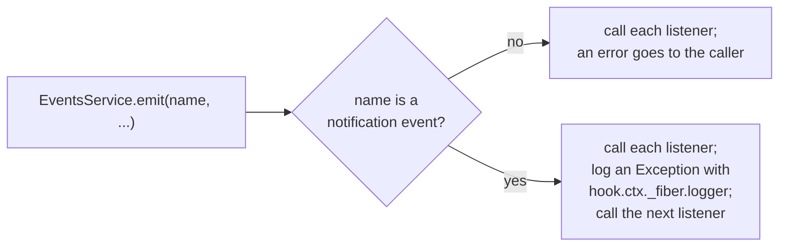

# Build Spec: Notification Listener Errors

**Status**: ✅ Completed — both increments are done

**Reference**: [#16 Listener error: an internal/status listener's error fails the fiber whose state changed](https://github.com/uclatommy/pycordis/issues/16)

## Goal

An error that a listener of a lifecycle notification event raises stays with the plugin that
owns the listener: the lifecycle change that the event reports completes, and the error is
logged by the listener's fiber.

## Architecture

### Root cause

`EventsService` has one error rule for two kinds of internal event:

| Kind | Events | Dispatch | Role of the listener |
|---|---|---|---|
| Interceptor | `internal/config`, `internal/update`, `internal/get`, `internal/set`, `internal/listener` | `waterfall`, `bail` | Takes part in the operation and can change its result |
| Notification | `internal/plugin`, `internal/replace`, `internal/status`, `internal/service`, `internal/commit`, `internal/dispatch` | `emit` | Observes a change that another component makes |

`EventsService.emit` sends every listener error to the caller. For an interceptor, that is
correct: the error is part of the operation. For a notification, the caller is lifecycle code
in the middle of a change that is not atomic (`Fiber._update_state`, `Fiber._left`,
`Fiber._replace`, `ReflectService.notify`). The observer's error stops the change halfway and
is recorded on the wrong fiber. Each `Hook` already records the context that registered it, so
the owner of the error is known at dispatch, but `emit` does not use it.

Invariant: **an error in a notification listener never changes the result of the lifecycle
change that the event reports.**

### Sibling cases

Reproduced in pycordis at `develop` `1656ffb`. The upstream source has the same structure at
each site (read, not run).

| Event | Emit site | Result when a listener of another plugin raises | Contract |
|---|---|---|---|
| `internal/plugin` | `Fiber._left` | `dispose()` returns. The fiber stays `ACTIVE`, its effects are not reverted, it stays in `children`, and its services stay provided | `EFF-REVERT` |
| `internal/plugin` | `Fiber.__init__` | `use()` raises before the fiber is attached | `LIFE-FAILURE` |
| `internal/status` | `Fiber._update_state` | #16: the fiber is `FAILED` with the listener's error, `announce` does not run, dependents stay `PENDING`, and `_inertia` rejects | `LIFE-FAILURE`, `LIFE-PROGRESS` |
| `internal/service` | `ReflectService.notify` | The later names are not reported, and the error goes into the provider's lifecycle | `LIFE-PROGRESS` |
| `internal/replace` | `Fiber._replace` | The fiber has the new runtime and a stale store; the other fibers of the component are not moved | `LIFE-PROGRESS` |
| `internal/commit` | `Fiber.update` | `update()` raises before any change; an observer can block an update | — (wrong owner) |
| `internal/dispatch` | `EventsService._resolve` | Each user dispatch raises the observer's error | — (wrong owner) |

The comment in `Fiber._left` ("`_reload` and `_unload` log their own errors, so `_inertia`
never rejects") asserts an invariant that a notification listener breaks today. After the fix,
the dispatcher enforces it.

### Enforcement point



- `events.py` owns one private classification of the notification events, next to
  `InternalEventName`. `emit` applies it, so no emit site can omit the rule. A separate
  `notify` method is rejected: each new emit site would have to select it.
- The rule applies to every `emit` of a notification event name, also an `emit` that a host
  makes. A `ContextView` refuses an `internal/` dispatch, so restricted code cannot use it.
- Only `Exception` is caught. `BaseException` (`KeyboardInterrupt`, `SystemExit`) propagates.
- Log record: the logger of the listener's fiber (`pycordis.<fiber name>`), the event name, and
  `exc_info`. A listener that `install` registers belongs to the root fiber.
- Interceptor events and all other event names keep the current rule (the maintainer decision
  on #16).
- Not changed: the `mirror = true` items (`_update_state`, `_set_epoch`, `_reload`, `_unload`,
  `_refresh`, `_get_state`) and the order of `emit` and `announce` in `_update_state`.

## File Structure

```
src/pycordis/
├── events.py      # MODIFY: notification classification; emit contains listener errors
├── context.py     # MODIFY: Context.on and Context.emit docstrings
└── fiber.py       # MODIFY: the _inertia comment in _left
tests/
├── test_events.py      # MODIFY: parametrized notification-error cases
└── test_invariants.py  # MODIFY: seeded schedules with a raising notification listener
docs/
├── architecture.md     # MODIFY: notification-errors row
└── user_guide.md       # MODIFY: Failure section
```

## Implementation References

- **This repository**: `Hook.ctx` (the owner of a listener); `EventsService.parallel` (each
  listener runs on its owner's fiber); `Fiber._check_impl` (a `check` error is logged with the
  provider's logger and the lookup continues); `Fiber.logger`; the schedule helpers of
  `tests/test_invariants.py`.
- **Upstream**: `EventsService.emit` in `events.ts`; `Fiber._updateState`, `Fiber._replace`,
  and the dispose effect in the `Fiber` constructor in `fiber.ts`; `ReflectService.notify` in
  `reflect.ts`. No upstream test depends on a notification listener error that propagates, so no
  ledger case changes status.

## Key Constraints

- **Fail safe, not silent**: each contained error has a log record. A test checks the record.
- **Other listeners run**: a listener that raises does not stop the listeners after it.
- **No cost on the hot path**: one `frozenset` membership test per `emit`; no allocation when no
  listener raises.
- **Loader**: `LoaderService._on_commit` listens to `internal/commit`. A save error in it is
  logged by the loader's fiber and no longer makes `update()` raise (approved on #16).
- **Ledger**: `src/events.ts:EventsService.emit` keeps `adapted` and `event-dispatch-args`. The
  divergence row is linked by its `divergence` marker. No hash changes.
- **Independent of upstream**: the row has kind `improvement`, so it needs no upstream issue.
  The maintainer can file the report in [Appendix B](#appendix-b-upstream-report) at any time.

## Integration

- Public API: no new name. The documented behavior of `Context.emit` and `Context.on` changes
  for the six notification events. This is a **breaking change**: the release needs a minor
  increment (`release/0.3.0`).
- Branch: `feature/cross-plugin-leaks` from `develop`. The branch also holds the work for #20,
  and merges through one pull request after both are complete.
- `conformance/ledger.toml`: no change (see Key Constraints).

## Testing

- ✅ `divergence("notification-errors")` in `tests/test_events.py`, parametrized over the seven
  emit sites in the sibling table: a listener of a second plugin raises; the target fiber reaches
  the same state, `error`, effects, `children`, and provided services as in a run with no
  listener; the call that started the change does not raise
- ✅ The same test checks the log record: logger `pycordis.<listener plugin>`, the event name,
  and the exception
- ✅ A second listener of the same event, after the one that raises, runs
- ✅ Interceptor events keep the rule: an `internal/config` listener that raises fails the fiber
  (a parametrized case of the notification test, with one interceptor event name; no new function)
- ✅ A user event keeps the rule: `ctx.emit("x")` raises the listener's error
- ✅ `BaseException` from a notification listener propagates (one parametrized case)
- ✅ `contract("EFF-REVERT")`, `contract("LIFE-PROGRESS")`, `contract("LIFE-FAILURE")`,
  `divergence("notification-errors")` in `tests/test_invariants.py`: seeded schedules of `use`,
  `dispose`, and provider changes, with a raising listener on every notification event; the
  existing invariants hold, and each seed is in the assertion message
- ✅ Each notification-event test above fails against the code before the fix (revert check). The
  cases that keep the current rule (interceptor event, user event, `BaseException`) pass both
  before and after; they guard the limits of the fix
- ✅ `uv run pytest`, `uv run ruff check .`, and `uv run ruff format --check .` pass; the
  unmarked slow tests section of the full suite is empty

## Documentation

- Docstrings: the `pycordis.events` module docstring (the two error rules), `EventsService.emit`
  (the notification rule and the log record), `InternalEventName` (which events are
  notifications), and `Context.on` and `Context.emit` (the error rule that a listener author
  sees).
- `docs/user_guide.md`, section "Failure": a paragraph that says an error in a listener of a
  notification event is logged by the listener's fiber and does not change the fiber that the
  event reports.
- `docs/architecture.md`: the `notification-errors` row (see
  [Appendix A](#appendix-a-divergence)).
- `zensical.toml`: none (no new page).

## Dependencies

- **Related**: #20 on the same branch; no code dependency in either direction.
- **Runtime**: none (standard library `logging`).
- **Dev**: none new.

## Migration Strategy

### Increment 1: Contain notification listener errors
**Goal**: `EventsService.emit` contains and logs listener errors of the six notification
events, and the parametrized divergence tests pass.
**Files**: `events.py` (~25), `context.py` (~10), `fiber.py` (~3), `test_events.py` (~120),
`architecture.md` (1 row), `user_guide.md` (~5)
**Validation**: `uv run pytest tests/test_events.py tests/test_fiber.py tests/test_reflect.py
tests/test_replace.py tests/test_update.py tests/test_loader_commit.py tests/test_conformance.py`;
manual: in `uv run python`, run the #16 reproduction and the dispose case from the sibling table
**Docs**: the docstrings of `pycordis.events`, `EventsService.emit`, `InternalEventName`,
`Context.on`, and `Context.emit`; `docs/user_guide.md` "Failure"; the `notification-errors` row
**Status**: ✅ Completed

**Changed**:
- `events.py`: `_NOTIFICATION_EVENTS` classifies the six events; `emit` logs a listener `Exception` of these events with the listener fiber's logger and calls the next listener; module, `InternalEventName`, and `emit` docstrings state the two error rules
- `context.py`: `Context.on` and `Context.emit` docstrings state the error rule
- `fiber.py`: the `_inertia` comment in `_left` names the dispatcher as the owner of the invariant
- `docs/user_guide.md`: "Failure" paragraph on notification listener errors
- `docs/architecture.md`: `notification-errors` row, kind `improvement`

**Tests**:
- `tests/test_events.py`: one parametrized test over seven emit sites (`divergence("notification-errors")`), one test for a listener that `install` registers (logged by the root fiber), one parametrized test for the cases that keep the caller rule (user event, `KeyboardInterrupt` of a notification), and one interceptor-event test
- `tests/test_loader_commit.py`: a failed save in the loader's `internal/commit` listener is logged and `update` does not raise
- Full suite 1562 passed; `ruff check` and `ruff format --check` clean; no unmarked slow tests
- Revert check: the seven site cases, the `install` case, and the loader case fail against the original `events.py`; the guard cases pass both ways

**Deviations**:
- The row has kind `improvement`, not `correction`, and the upstream report (Appendix B) is optional and no longer a prerequisite: the maintainer chose to work independently of upstream
- The site test compares each armed run with an unarmed run on a fresh root and sorts the `internal/service` names, because the notification order of one provider's names is not fixed

**Manual validation**:
- In `uv run python`, a raising `internal/status` and `internal/plugin` listener of a second plugin gives logged errors on `pycordis.watcher`, a provider that reaches `ACTIVE` with `svc` available, and a dispose that reverts its effects

### Increment 2: Contract schedules and guide
**Goal**: the seeded contract test passes with a raising listener on every notification event.
**Files**: `test_invariants.py` (~60)
**Validation**: `uv run pytest`; the unmarked slow tests section is empty
**Docs**: a review of every docstring in `events.py` and of the `notification-errors` row
**Status**: ✅ Completed

**Changed**:
- `tests/test_invariants.py`: `watch_notifications` starts a plugin `watcher` with a listener on each of the six notification events; the listeners raise when armed

**Tests**:
- `tests/test_invariants.py`: the dispose-every-fiber test gains a `raising` parameter (`EFF-REVERT`, logged by `pycordis.watcher`), and a new seeded test: an armed schedule ends in the same structure as an unarmed one (`LIFE-PROGRESS`, `LIFE-FAILURE`); both carry `divergence("notification-errors")`
- Full suite 1622 passed; `ruff check` and `ruff format --check` clean; no unmarked slow tests
- Revert check: all 60 new cases fail against the original `events.py`

**Deviations**:
- The docstring review found no change to make

**Manual validation**:
- `uv run pytest tests/test_invariants.py -k raising` gives 60 passed

## Code Standards

- [Python Coding Standards](../../../.github/instructions/python-coding-standards.instructions.md):
  bug remediation (invariant, sibling cases, enforcement point), mirror items
- [Docstrings & Markdown Style](../../../.github/instructions/docstrings-and-markdown.instructions.md)
- [Testing Standards](../../../.github/instructions/testing-standards.instructions.md): seeded
  contract schedules, parametrized cases
- [Upstream Porting](../../../.github/instructions/upstream-porting.instructions.md): bugs that
  upstream also has, divergence evidence

This spec is scaffolding — do not cite it, its filename, or its increment numbers in source,
docstrings, comments, or test names. Docstrings state the present rule, not the change that
introduced it.

## Appendix A: Divergence

The maintainer approved this divergence on #16. It goes to the divergence table in
`docs/architecture.md` in Increment 1.

| ID | Kind | Upstream | pycordis | Contract | Reason and evidence |
|---|---|---|---|---|---|
| `notification-errors` | improvement | An error that a listener of `internal/plugin`, `internal/replace`, `internal/status`, `internal/service`, `internal/commit`, or `internal/dispatch` raises goes to the code that emits the event, in the middle of the lifecycle change | `emit` of these events logs a listener `Exception` with the logger of the listener's fiber, and calls the next listener; the lifecycle change completes. Interceptor events and other events send a listener error to the caller | `EFF-REVERT`, `LIFE-FAILURE`, `LIFE-PROGRESS` | An observer's error stops a lifecycle change halfway: a dispose that does not revert the effects, or a fiber that fails with another plugin's error. Upstream has no fix, and pycordis does not wait for one. Test: `divergence("notification-errors")` in `tests/test_events.py` |

## Appendix B: Upstream Report

Optional. Text for an issue on `cordiverse/cordis`, for the maintainer to file when they
choose. The work does not depend on it. It uses upstream terms. Before filing, run the
reproductions against the tracked revision (`68c9d99`) and correct them if necessary. If the
issue is filed, add its link to the `notification-errors` row.

---

**Title**: An error in an `internal/*` notification listener breaks the lifecycle change it reports

**Summary**

`EventsService.emit` does not catch listener errors. The core services emit the notification
events `internal/plugin`, `internal/status`, `internal/service`, and `internal/replace` in the
middle of a lifecycle change. When a listener of one of these events throws, the error leaves
the lifecycle code before the change is complete, and it is recorded on the fiber that the
event reports, not on the plugin that owns the listener.

**Reproduction 1: dispose does not revert effects**

```ts
const root = new Context()
let armed = false
root.plugin((ctx) => {
  ctx.on('internal/plugin', () => { if (armed) throw new Error('listener bug') })
})
const reverted: number[] = []
const fiber = root.plugin((ctx) => {
  ctx.effect(() => () => { reverted.push(1) })
})
armed = true
await fiber.dispose().catch(() => {})
// expected: reverted = [1], fiber.state = DISPOSED
// actual:   reverted = [], the fiber is still in runtime.fibers, its effects stay installed
```

In the dispose effect of the `Fiber` constructor, `internal/plugin` is emitted after
`this.uid = null` and before `this._remove()` and `this._setEpoch(INACTIVE)`. The throw skips
both.

**Reproduction 2: a fiber fails with another plugin's error**

```ts
const root = new Context()
root.plugin((ctx) => {
  ctx.on('internal/status', (fiber) => {
    if (fiber.name === 'provider') throw new Error('listener bug')
  })
})
const dependent = root.inject(['svc'], () => {})
root.plugin({ name: 'provider', apply: (ctx) => { ctx.provide('svc', 1) } })
// expected: provider ACTIVE, dependent ACTIVE, listener error reported by its own plugin
// actual:   provider FAILED with "listener bug", dependent PENDING, root.svc undefined
```

`Fiber._updateState` emits `internal/status` before it notifies providers, so the throw skips
`reflect.notify` and dependents never load.

**Other sites**

- `Fiber._replace`: a throw from `internal/replace` leaves the fiber with the new runtime and
  the old `_store`, and stops the loop over the other fibers of the replaced component.
- `ReflectService.notify`: a throw from `internal/service` skips the later names.
- `internal/commit` (in `update`) and `internal/dispatch` (in `_resolve`) do not corrupt state,
  but an observer's error reaches the caller of `update` or of every dispatch.

**Cause**

One error rule serves two kinds of event. For `waterfall` and `bail` events (`internal/config`,
`internal/update`, `internal/get`, `internal/set`, `internal/listener`), the listener takes part
in the operation, so its error correctly goes to the caller. For the notification events, the
listener only observes, and the caller is lifecycle code that is not atomic. The comment in the
dispose effect ("`inertia` never rejects: `_reload` and `_unload` both log their own work
errors") depends on an invariant that a notification listener can break.

**Suggested fix**

For the notification events, catch each listener error in `emit`, report it with the logger of
the listener's context (`hook.ctx.logger`), and continue with the next listener. `_checkImpl`
already handles an error from `impl.check` this way. The fix leaves the order in
`_updateState`, the `waterfall` and `bail` events, and user events as they are.
