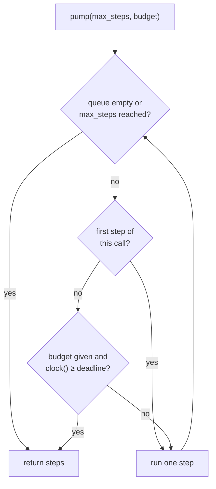

# Build Spec: Pump Budget

**Status**: ✅ Completed — the one increment is done; spec 1 of 4 (see [Dependencies](#dependencies))

**Reference**: [#9 Feature request: time limit for FramePumpScheduler.pump](https://github.com/uclatommy/pycordis/issues/9)

## Goal

Give `FramePumpScheduler.pump` a time budget, and give every built-in scheduler a clock function
that the host can inject, so that a frame loop can limit lifecycle work by time.

## Architecture

### The scheduler clock

The base `Scheduler` keeps a clock: a function that returns monotonic seconds. The default is
`time.monotonic`. The clock measures work. It does not drive a blocking wait.

```
Scheduler.__init__(self, *, clock: Callable[[], float] = time.monotonic) -> None
ImmediateScheduler.__init__(self, *, clock: Callable[[], float] = time.monotonic) -> None
FramePumpScheduler.__init__(self, *, clock: Callable[[], float] = time.monotonic) -> None
```

A host subclass that calls `super().__init__()` with no argument gets the default, so the
change does not break a subclass. A host that drives time with `pycordis.timer.ManualClock`
passes `clock=manual_clock.now`, and both the timers and the budget then use one time source.

[Step Reports](step_reports.md) uses the same clock for the duration of a step.

### The budget

```
FramePumpScheduler.pump(max_steps: int | None = None, *, budget: float | None = None) -> int
FramePumpScheduler.pending -> int          # property: the number of queued steps
```



- The call stops at the first limit that it reaches.
- With a budget, the first step always runs when the queue has work (`LIFE-PROGRESS`). The
  budget is checked only before each later step. A frame can be late by at most one step.
- `max_steps=0` runs no steps, because that is an explicit request for no work.

## File Structure

```
src/pycordis/
└── scheduler.py        # MODIFY: clock on Scheduler and both subclasses; pump budget; pending
tests/
├── test_scheduler.py   # MODIFY: budget, limits, pending, clock-read cases
├── test_threading.py   # MODIFY: pending in the second-thread driver test
└── test_invariants.py  # MODIFY: a budget pump driver in the LIFE-PROGRESS schedules
docs/
└── user_guide.md       # MODIFY: "Choose a Scheduler"
.github/
└── copilot-instructions.md  # MODIFY: "Threading and Scheduling Model" names the budget
```

## Implementation References

- **This repository**: `FramePumpScheduler.pump` (the loop that this spec extends, and its
  `ValueError` for a negative `max_steps`); `ImmediateScheduler._serve` (a blocking wait on a
  `threading.Condition`); `Scheduler.assert_owner` (the owner-thread check for `pending`);
  `test_an_empty_pump_is_fast_and_allocates_nothing` in `tests/test_scheduler.py` (the
  pattern for a test of no extra cost); the seeded schedule drivers in `tests/test_invariants.py`
  (the `LIFE-PROGRESS` tests).
- **Upstream**: none. Upstream has no frame-pump scheduler. The `async-model` divergence row
  covers `FramePumpScheduler`.

## Key Constraints

- **Argument validation** (`ValueError`, with a message that names the argument and the value):
  a call with neither `max_steps` nor `budget`; a negative `max_steps` (as today); a negative
  or NaN `budget` (NaN would make every deadline check false, so the call would have no time
  limit). A budget of `0` is valid and runs one step.
- **Clock reads**: with `budget=None`, `pump` keeps today's loop and does not call the clock.
  With a budget, `pump` reads the clock only when a step will run: once to set the deadline
  before the first step, and once before each later step. A call that runs no step (an empty
  queue, or `max_steps=0`) does not read the clock.
- **The clock must be monotonic**: the budget measures the clock, so a clock that does not move
  during the call (for example `ManualClock.now` with no step that advances it) gives no time
  limit. The `pump` docstring states this.
- **Order**: a step that does not run stays queued, in order. A step that another step submits
  is in the same call when the limits allow it, as today.
- **Errors**: if a step raises, the exception goes to the caller and the later steps stay
  queued, as today.
- **Threads**: `pump` and `pending` check the owner thread (`CordisError("WRONG_THREAD")`).
  `submit` stays callable from any thread.
- **Blocking waits use real time**: `ImmediateScheduler.run_until_quiet` and `serve` keep
  `time.monotonic` for their `timeout`. They wait on a `threading.Condition`, which waits in real
  time, so a fake clock that does not move would make the wait loop without end. The comment on
  #9 said that `ImmediateScheduler` uses the injected clock for these timeouts; this spec does
  not do that, for this reason. The docstrings state the rule: the clock measures work, and a
  blocking wait uses real time.
- `ImmediateScheduler` takes the clock now, although no `ImmediateScheduler` method reads it in
  this spec, so that [Step Reports](step_reports.md) needs no second constructor change.

## Integration

- No new export. `FramePumpScheduler`, `ImmediateScheduler`, and `Scheduler` are already
  exported. The new keyword arguments and the `pending` property add to the public API and break
  nothing.
- Release: a patch increment. This spec and [Step Reports](step_reports.md) ship in `0.1.3`.
  The work is one increment, so it goes directly on `develop`.
- `conformance/ledger.toml`: no change (no upstream item).
- Issue #9: the accepted design said that `ImmediateScheduler` uses the injected clock for its
  timeouts. Before the release, tell the issue author that the timeouts keep real time, and why
  (see Key Constraints).

## Testing

- ✅ `test_pump_runs_at_most_the_limit_and_returns_the_steps_run` gets parametrized cases for a
  budget alone and for both limits in both orders: with a fake clock that each step advances,
  the call stops at the first limit that it reaches, and the next call continues with the next
  queued step. `pending` is asserted after each call. Fake-clock values do not put a reading
  exactly on the deadline, so float rounding cannot change the result
- ✅ A budget that is already used up runs one step; `max_steps=0` runs none; an empty queue
  returns `0`; each case asserts the count of clock reads (one parametrized test)
- ✅ With no budget, a counting clock is never called
- ✅ Argument validation: one parametrized test over the invalid arguments, which replaces
  `test_pump_rejects_a_negative_limit`
- ✅ `pending` from another thread raises `CordisError("WRONG_THREAD")`: a case in
  `test_the_scheduler_drivers_reject_a_second_thread` (`tests/test_threading.py`, which joins
  the thread with a timeout through `call_on_thread`)
- ✅ `contract("LIFE-PROGRESS")`: the LIFE-PROGRESS test in `tests/test_invariants.py` is
  parametrized over two drivers, the present step driver and a budget driver. The budget driver
  uses a fake clock that advances by a seeded amount on each read (one read for each step), and
  seeded budgets that include `0` and values smaller than one advance, so the first-step rule is
  the only progress in some frames. It settles with `pump(budget=...)` frames until `pending` is
  `0`, with `QUIESCENCE_LIMIT` as the frame limit. Every schedule reaches quiescence, and the
  seed is in the assertion message
- ✅ `test_an_empty_pump_is_fast_and_allocates_nothing` passes with no change
- ✅ `uv run pytest`, `uv run ruff check .`, and `uv run ruff format --check .` pass; the
  unmarked slow tests section of the full suite is empty

## Documentation

- Docstrings: `Scheduler`, `ImmediateScheduler`, and `FramePumpScheduler` (the `clock` argument
  and the rule that blocking waits use real time); `pump` (both limits, the first-step rule and
  its reason, the errors, and that a clock that does not move gives no time limit); `pending`.
  The `FramePumpScheduler` example shows a budget.
- `.github/copilot-instructions.md`, "Threading and Scheduling Model": the `FramePumpScheduler`
  bullet names the budget.
- `docs/user_guide.md`, "Choose a Scheduler": the `FramePumpScheduler` row names the budget, and a
  short frame-loop example calls `pump(budget=...)` and reads `pending`.
- `docs/architecture.md`: none. The `async-model` row already covers `FramePumpScheduler`, and no
  contract row changes.
- `zensical.toml`: none (no new page).

## Dependencies

- **Sequence**: spec 1 of 4. The order is Pump Budget, [Step Reports](step_reports.md),
  [Checked Get](checked_get.md), [Context Restriction](../context_restriction.md). Specs 1 and 2
  ship in `0.1.3`, before the breaking change of spec 3 in `0.2.0`, so that a host can adopt the
  budget and the step reports without the `ctx.get` change.
- **Prerequisite**: none. The `0.1.3` release branch starts after `release/0.1.2` merges.
- **Required by**: [Step Reports](step_reports.md) (the scheduler clock).
- **Runtime**: none (standard library: `time`).
- **Dev**: none new.

## Migration Strategy

### Increment 1: Scheduler clock and pump budget
**Goal**: every built-in scheduler takes a clock, and `pump` stops at a step limit, a time
budget, or both.
**Files**: `scheduler.py` (~60), `test_scheduler.py` (~120), `test_threading.py` (~10),
`test_invariants.py` (~30), `user_guide.md` (~20), `copilot-instructions.md` (~2)
**Validation**: `uv run pytest tests/test_scheduler.py tests/test_invariants.py tests/test_threading.py`;
manual: in `uv run python`, create `FramePumpScheduler(clock=...)` with a list-based fake clock,
submit ten steps that each advance the clock by 1 ms, call `pump(budget=0.0035)`, and check that
it returns `4` and that `pending` is `6`
**Docs**: the scheduler docstrings; `docs/user_guide.md` "Choose a Scheduler";
`.github/copilot-instructions.md` "Threading and Scheduling Model"
**Status**: ✅ Completed
**Changed**:
- `scheduler.py`: `Scheduler`, `ImmediateScheduler`, and `FramePumpScheduler` take `clock`; `FramePumpScheduler.pump` takes `budget` and validates its arguments; `FramePumpScheduler.pending` added
- `test_scheduler.py`: budget, limit, clock-read, and validation cases
- `test_threading.py`: `pending` in the second-thread driver test
- `test_invariants.py`: LIFE-PROGRESS test runs a step driver and a budget driver
- `user_guide.md`, `copilot-instructions.md`: budget and `pending`
**Tests**:
- Parametrized limit, clock-read, and validation tests replace the old limit and negative-limit tests
- Re-run: `tests/test_scheduler.py`, `tests/test_invariants.py`, `tests/test_threading.py`, `tests/test_docstrings.py`
**Deviations**:
- None
**Manual validation**:
- Fake clock, ten 1 ms steps, `pump(budget=0.0035)` gave `4`, and `pending` was `6`

## Code Standards

- [Contributing](../../contributing.md): the test and docstring standards, with the pull request
  checklist
- [Developer Guide](../../developer_guide.md): branches, slow tests, and release rules
- [Architecture](../../architecture.md): the semantic contract (`LIFE-PROGRESS`)
- The instruction files in `.github/instructions/`: Python Coding Standards, Docstrings &
  Markdown Style, and Testing Standards

This spec is scaffolding — do not cite it, its filename, or its increment numbers in source,
docstrings, comments, or test names. Docstrings state the present rule, not the change that
introduced it.
