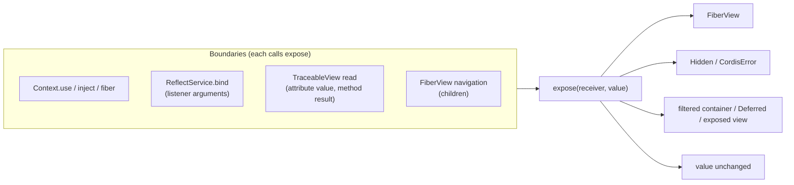

# Build Spec: Restricted Views

**Status**: ✅ Completed (Increments 1 to 5 done, with the PR #18 review fixes recorded as deviations) — D1, D2, D7, and D9 to D12 are accepted; the other [Decisions](#decisions) are proposed on #14 and #15

**Reference**: [#14 Restricted context: give a restricted component read-only views of fibers](https://github.com/uclatommy/pycordis/issues/14), [#15 Restricted context: host services give a restricted caller views, not host objects](https://github.com/uclatommy/pycordis/issues/15)

## Goal

Make sure that no value that reaches restricted code, through the context, an event, or a host
service, gives an unrestricted context, a provider record, or control of a fiber that the
restricted component does not own.

## Architecture

### One rule, one owner

Both issues need the same answer to one question: *what does a restricted receiver get for
this value?* One function owns that answer, and every boundary calls it:

```
expose(receiver: Context, value: object) -> object      # pycordis.traceable
```

The *scope* of the receiver is its def site, `receiver.shadow or receiver` (D9): its `_fiber`
and its `_restrictions` chain. This is the same authority as `Context._check_guarded` and
`FiberView.unwrap`, so a service method that acts for a restricted caller holds real objects,
and only the boundary filters what goes back to that caller.

- A scope with an empty restriction chain: `value` unchanged. The cost is one empty-tuple
  check, with no allocation.
- A value whose class has the hook `cordis_expose(value, receiver: Context) -> object`: the
  hook's result (D11). This is the one protocol for every type that the rule recognizes.
  `expose` reads the hook from `type(value)`, not from the value, so a `TraceableView` (whose
  `__class__` gives the service class) is not taken for its service: a `TraceableView` passes
  unchanged, because it filters at its own exits (see [Service boundary](#service-boundary)).
  `Fiber`, `Context`, and `Impl` define the hook as a method in their own modules, so
  `traceable.py` imports none of them; any other class sets it to an `Exposure` (D6):
  - `Fiber` → a `FiberView` for the scope (see [The fiber view](#the-fiber-view)).
  - `Context`: unchanged when it is *owned* (the chain of its def site has the scope's chain
    as a prefix, and `owns` is true for its `_fiber`); otherwise hidden.
  - `Impl`: hidden.
  - A class with `cordis_expose = Exposure(...)`: an exposed view of the object.
- A bound method whose `__self__` has a `cordis_expose` hook that is a method (`Fiber`,
  `Context`, `Impl`): hidden.
- `tuple`, `list`, `dict`, `set`, `frozenset`: a new container of the same type, with each
  element (and each dict key and value) passed through `expose`.
- `Deferred`: a new `Deferred` that settles with the exposed value, or with the same error.
  `add_done_callback` runs on the thread that completes the source, so a source that
  completes on another thread hands the exposure to the owner thread with
  `Scheduler.submit`. `expose` runs only on the owner thread.
- Any other object: unchanged. This is a documented gap, consistent with the trust model.

`expose` has one result for a hidden value: a `Hidden` placeholder whose every attribute
access, call, and iteration raises `CordisError` that names the hidden type. `expose` takes no
mode argument. A listener argument or a container element stays a `Hidden`, so the listener
is still called and dispatch does not change. The exit of a `TraceableView` (an attribute
value or a method result) raises that `CordisError` at once when its result is a `Hidden`;
that exit is the one place that converts a `Hidden` to an error.



### The fiber view

```
class FiberView:                                   # pycordis.fiber
    name, uid, state, error, children              # children: views for the same scope
    get_effects() -> list[EffectMeta]
    wait() -> Deferred[FiberView]; __await__       # resolve with the view, not the fiber
    dispose() / restart() / update(config, no_save=False)   # owned fibers only
    unwrap(ctx: Context) -> Fiber
```

- **Allow-list**: the view gives only the names above. Any other name raises `CordisError`
  that names the attribute. A new public `Fiber` attribute is hidden until someone adds it to
  the view, so a new attribute cannot open the guard again (#14 Problem section).
- **Owned**: one function in `pycordis.fiber` owns the rule, and both `FiberView` and
  `Context.cordis_expose` call it:

  ```
  owns(scope: Fiber, chain: tuple[Restriction, ...], target: Fiber) -> bool
  ```

  It is true when (a) the target is `scope` or a descendant of it, and (b) the target's
  `ctx._restrictions` has `chain` as a prefix, compared element by element by identity
  (`Restriction` objects that are equal are not the same restriction). Both facts are fixed
  when the target is created, so the view calls `owns` once, when the view is created, with
  one walk up the parent chain (`LIFE-CONFLUENT`).
- **Equality, not identity** (D10): each `expose` call gives a new view, and pycordis keeps no
  cache of views. Two views are equal, with the same hash, when they have the same target,
  the same scope fiber, and the same chain object. `view == ctx.fiber` and `fiber in seen`
  work in plugin code; `is` does not. A view is never equal to its `Fiber`. A view holds its
  scope fiber only while the plugin keeps the view.
- **`unwrap(ctx)`** returns the fiber when the def site of `ctx` (`ctx.shadow` or `ctx`)
  carries no restriction, which is the same authority as `Context._check_guarded`. Otherwise it
  raises `CordisError`. A host that calls `restrict(root, ...).use(plugin)` gets a view and calls
  `view.unwrap(root)`. A host-service method that receives a view from a restricted caller
  calls `view.unwrap(self.ctx)`, which succeeds at the service's def site.
- **Not a `Fiber` subclass**: a subclass that raises on inherited attributes breaks the Liskov
  substitution principle. `isinstance(view, Fiber)` is `False`.
- `Fiber.logger` is not in the allow-list: the `Logger` holds the real fiber. A plugin logs
  through `ctx.logger`.

### Context boundaries

`Context.use`, `Context.inject`, and `Context.fiber` pass their result through `expose` with
`self` as the receiver. pycordis code that creates or reads fibers uses private paths, so
internal code always holds real fibers: `_fiber` for reads, and one private use path of
`Context` for creation (the `ctx.use` and `inner.use` calls in `Entry`). That path keeps the
scheduler call and the call-site capture of `Context.use` in one place; it is not a second
copy of the registry call. The `ctx.fiber` guard (`_restrictions is not
self._fiber.ctx._restrictions`) is removed: a bare `restrict(...)` result returns a read-only
view of the host fiber, and a view has no `parent`, so `fiber.parent.fiber` is not reachable.
A shadow whose def site is unrestricted still gives the real fiber (D9).

### Listener arguments

```
ReflectService.bind(site: Context, callback: Callable[P, R]) -> Callable[P, R]
EventsService.on(ctx, name, listener, options=False, *, site: Context | None = None)
EventsService.once(ctx, name, listener, options=False, *, site: Context | None = None)
```

`bind`, which `EventsService.on` already calls once for each listener, passes each argument
through `expose` with `site` as the receiver. This is the one enforcement point for every
internal and user event. `ctx` is the context that the hook stores; `Context.on` and
`Context.once` give the use site (`self.use_site`), so that the stored hook keeps no def-site
link. `site` is the def site for `bind` only (D9); `Context.on` and `Context.once` give
`self`, and `None` means `ctx`. `site` is the one way the def site reaches `bind`: no other
parameter or attribute carries it. `install` (host-only listeners, with no fiber) does not
bind and does not change.

### Service boundary

```
@dataclass(frozen=True, slots=True)
class Exposure:                                    # pycordis.traceable
    hidden: frozenset[str] = frozenset()           # raise CordisError for a restricted caller
    safe: frozenset[str] = frozenset()             # pass unchanged, no filter
    def __call__(self, value: object, receiver: Context) -> object   # the cordis_expose hook
```

- **One protocol** (D6, D11): a class declares `cordis_expose = Exposure(hidden=..., safe=...)`.
  `Exposure` has the signature of the `cordis_expose` hook, so `expose` does one lookup for
  every type. Called, it gives the exposed view of `value` for the scope of `receiver`. A
  `TraceableView` reads the `Exposure` of its service class with `inspect.getattr_static` to
  get `hidden` and `safe`. A `cordis_` class attribute follows the hook convention
  (`cordis_tracker`); a lookup with a default is permitted because the attribute is optional
  on user-supplied objects.
- **Filter at the exits, not on each path**: a `TraceableView` has two exits,
  `TraceableView.__getattribute__` and `CallableTraceableView.__call__`. Every read path
  (property, plain attribute, shadowed method, `no_shadow` method, associated property,
  `cordis_invoke`) returns through one of them, so the filter is in those two places and
  nowhere else:
  - At the start of `__getattribute__`, a name in `hidden` raises `CordisError`.
  - At each exit, the value goes through `expose` unless its name is in `safe`; a `Hidden`
    result raises (see [One rule, one owner](#one-rule-one-owner)).
  - A callable that leaves `__getattribute__` (and is not a type) is wrapped, so that its
    result also goes through `expose` when it is called.
  - A new read path in `_read_attribute` is filtered without a change to the filter. Hook
    names (`cordis_original`) stay out of scope (trust model).
- **Boundary, not interior**: a method of the service runs with a `_Shadow` as `self`, also
  a `no_shadow` method when the scope is restricted. The
  body of `TraceableView.__getattribute__` divides into the unfiltered read and the filter at
  its exit; `_Shadow.__getattribute__` calls the unfiltered read directly, not
  `getattr(view, name)`. So `self.resolve(...)` in a loader method still returns real
  entries and fibers when a restricted plugin calls the method. Only the read from the view
  that restricted code holds is filtered.
- **Exposed view of a marked object**: an object whose class has an `Exposure` and no
  `Tracker` (`Entry`, `Group`, `EntryTree`, `ReloadResult`, `Logger`) reaches a restricted
  scope as a read-only forwarding view. It uses the same two exits and the same filter
  function as `TraceableView`; it adds no third copy of the filter. A method runs with the
  original object as `self`, `__class__` gives the original class (as `TraceableView` does,
  so `isinstance` holds), and a write raises `CordisError`. A marked service with a `Tracker`
  (`Loader`) applies its `Exposure` in its `TraceableView`.
- **Arguments that come in**: the filter does not change arguments. A service method that takes
  a `Fiber` (`Loader.entry_of`, `Loader.locate`) accepts a `FiberView` and unwraps it with
  `unwrap(self.ctx)`.
- **Logger**: `_BufferFilter` and `_RootFilter` read `record.cordis_fiber.ctx._root`, so a
  record keeps the real fiber. A restricted scope does not get it: `LoggerService` hides
  `buffer` and `exporter`, and `Logger` hides `extra`. `Logger` methods run on the original
  object, so `process` still adds the real fiber to each record.
- **Loader and Hmr run unrestricted** (D12): their own listeners (`Loader._on_status`,
  `_on_plugin`, `_on_commit`) read `fiber.parent`, so in a restricted context they get views
  and fail. The spec does not support that case; the `restrict` warning and the `Loader` and
  `Hmr` docstrings say so.

## File Structure

```
src/pycordis/
├── fiber.py            # MODIFY: FiberView; owns; Fiber.cordis_expose
├── traceable.py        # MODIFY: expose, Hidden, Exposure, the exposed view; filter at the two view exits;
│                       #         _Shadow reads the unfiltered path
├── events.py           # MODIFY: on/once take the keyword-only site for bind
├── context.py          # MODIFY: use/inject/fiber through expose; private use path; Context.cordis_expose
│                       #         (calls owns); on/once pass site=self; remove the fiber guard; restrict warning
├── reflect.py          # MODIFY: bind exposes arguments for a restricted scope; Impl.cordis_expose
├── logger.py           # MODIFY: Exposure on LoggerService (buffer, exporter) and Logger (extra)
├── loader/_entry.py, _group.py, _tree.py, _service.py   # MODIFY: Exposure declarations; Entry uses the
│                       #         private use path; entry_of/locate accept a view; Loader docstring (D12)
└── hmr/_service.py     # MODIFY: Exposure on ReloadResult; Hmr docstring (D12)
tests/
├── test_restrict.py    # MODIFY: escape paths, ownership, views, service filter, loader/hmr/logger cases
└── test_invariants.py  # MODIFY: seeded schedules with restricted listeners and lifecycle calls
docs/
└── architecture.md     # MODIFY: context-restriction row
```

## Implementation References

- **This repository**: `Context._check_guarded` (the def-site authority that `unwrap` reuses);
  `Context._derive` and `bind_fiber` (how a chain reaches each fiber context);
  `ReflectService.bind` and `EventsService.on` (the listener boundary); `get_traceable`,
  `_read_attribute`, `_finish`, `_trace_result`, `CallableTraceableView.__call__`, and
  `_Shadow.__getattribute__` in `traceable.py` (the service boundary and the interior path
  that must stay unfiltered); `Deferred.add_done_callback` and `Scheduler.submit` (the
  thread rule of an exposed `Deferred`);
  `Fiber.children`, `wait`, and `__await__`; `LoggerService.buffer`, `exporter`,
  `cordis_invoke`, and `_BufferFilter` / `_RootFilter` (the `cordis_fiber` record attribute);
  `Entry.live_fiber`, `inner_fiber`, `outer_fiber`, `Entry.parent`, `Group.ctx`,
  `EntryTree.ctx`, `Loader.entry_of`, `Loader.locate`, `Loader._on_status`;
  `ReloadResult.settled`.
- **Upstream**: none. Upstream has no restriction (the `context-restriction` row). Upstream
  `EventsService.emit` (`packages/core/src/events.ts`) sends a listener error to the caller, and
  `Fiber._updateStatus` emits `internal/status` before it notifies providers; this spec keeps
  both.

## Decisions

The maintainer accepted D1, D2, D7, and D9 to D12. D3 to D6 and D8 are proposed on #14 and
#15; they are confirmed or changed before the increment that uses them starts.

| ID | Question | Decision | Reason |
|---|---|---|---|
| D1 | View type (#14 Q1) | `FiberView` class, not a `Fiber` subclass; `Context.use`, `inject`, and `fiber` keep the `-> Fiber` annotation | A subclass breaks substitution. A new annotation (a `FiberLike` protocol) changes a public signature, so it waits for the promotion of `restrict`, with the minor increment |
| D2 | Ownership rule (#14 req. 4) | Subtree of the receiver's fiber **and** a chain that extends the receiver's chain, by identity | The issue's rule (the chain alone) lets sibling plugins under one `restrict` result dispose each other: they share one chain tuple, and equal `Restriction` objects compare equal |
| D3 | `get_effects()` of a host fiber (#14 Q2) | Given | Labels are names, not references; a status plugin needs them |
| D4 | `parent` of a view (#14 Q3) | Not given | `Fiber.parent` is a `Context`. Upward navigation is the leak that `fiber.parent.fiber` showed |
| D5 | Filter depth (#15 Q1, Q2) | Classes with a `cordis_expose` hook, builtin containers, and `Deferred`; other objects unchanged | A wrapper on every object breaks `isinstance` and identity for every caller, for no gain under the trust model |
| D6 | Marking (#15 Q3) | `cordis_expose = Exposure(hidden=..., safe=...)` class attribute; `Exposure` is a callable with the hook signature | A `Tracker` would also wrap the object for unrestricted callers, which changes the public `pycordis.loader` surface. One hook name for core types and marked classes gives `expose` one lookup and users one name |
| D7 | Authority of `loader` and `hmr` | Unchanged and documented: admitting `loader` gives the loader's authority over the tree (`create`, `update`, `remove`) | The filter stops leaked contexts and fibers; it is not a permission system for service methods |
| D8 | Host access to a restricted fiber | `FiberView.unwrap(ctx)`, checked at the def site of `ctx` | A host that uses a restricted context gets views too; it holds an unrestricted context |
| D9 | Which chain decides `expose` | The def site of the receiver (`receiver.shadow or receiver`), at every boundary, including `bind` | The same authority as `_check_guarded` and `unwrap`. A service method that acts for a restricted caller holds real objects; the boundary filters what goes back |
| D10 | View identity | Equality and hash by (target, scope fiber, chain object); no cache | A cache on the target is never dropped for the root fiber, so each disposed plugin scope would stay in memory |
| D11 | How `expose` recognizes `Fiber`, `Context`, and `Impl` | A `cordis_expose(value, receiver)` hook on each class, read from `type(value)` | `fiber.py` and `reflect.py` import `traceable.py`, and the module rules permit no import back; the rule for each type stays in its module. A new type adds a hook and does not change `expose` |
| D12 | `Loader` and `Hmr` in a restricted context | Not supported; documented | Their own listeners read `fiber.parent`. The use case is a host service, which runs unrestricted |

## Key Constraints

- **Contract**: `EFF-REVERT` gets stronger (no effect on a host fiber or a host context from
  restricted code). `LIFE-CONFLUENT` is kept because `owned` and the filter use only facts fixed
  at fiber creation, never the fiber that runs the current step. `LIFE-FAILURE` is kept: a hidden
  access in `apply` fails that fiber with no installed effects. The `mirror = true` functions
  (`_reload`, `_set_epoch`, `_unload`) and `_update_state` do not change: the filter is at the
  boundaries, not in the state machine.
- **Listener errors**: an access to a hidden value in a listener raises in that listener, and
  the error goes to the emitter, as every listener error does. #14 claimed `EFF-ISOLATE` here;
  that is not correct. See [Dependencies](#dependencies) for the existing defect that this makes
  more likely.
- **No restriction, no change**: an unrestricted receiver gets the same objects, with one empty
  check at each boundary and no allocation. The full suite passes with only the test changes in
  Increment 1 (tests that read `fiber.ctx` from a restricted `use`).
- **Two filter models, each stated**: a `FiberView` is an allow-list. It names what passes,
  and every other name raises; do not add a guard to `Fiber` attributes. The service boundary
  is not an allow-list: `expose` transforms only the types it recognizes (a `cordis_expose`
  hook, builtin containers, `Deferred`), `Exposure.hidden` names the members that raise, and
  an object it does not recognize passes unchanged (D5, trust model). The `restrict` warning
  states this gap; no docstring calls the service boundary an allow-list.
- **One place for each rule**: `owns` is the ownership rule, `expose` is the exposure rule, the
  two exits of a view are the service filter, and the `TraceableView` exit is the one place
  that converts a `Hidden` to an error. Code that needs one of these rules calls its owner.
- **Error text**: new messages name the attribute (`cannot read "ctx" of a fiber view`), the
  operation (`cannot dispose a fiber that this component does not own`), or the hidden type. No
  upstream text applies.
- **Owner thread**: a view delegates to `Fiber` methods, which keep `@owner_thread`. `expose`
  runs only on the owner thread; an exposed `Deferred` that completes on another thread
  settles through `Scheduler.submit`.
- **Trust model**: the `restrict` warning keeps the guard-not-sandbox text. Exception tracebacks
  in `view.error`, `gc`, frames, and `get_original` stay out of scope.

## Integration

- `pycordis/__init__.py` does not change. `FiberView`, `expose`, `Hidden`, and `Exposure` are in
  non-public modules (`pycordis.fiber`, `pycordis.traceable`), behind the same feature flag as
  `restrict`.
- `pycordis.loader` and `pycordis.hmr` are public modules. Their classes get a `cordis_expose`
  class attribute (additive), and `Loader.entry_of` and `locate` also accept a view. `Fiber`
  and `Context`, which `pycordis` exports, get a `cordis_expose` method (additive, a hook
  name). The keyword-only `site` of `EventsService.on` and `once` is additive. Behavior
  for unrestricted callers does not change, so a **patch** increment is enough. If D1 changes
  to a new return annotation, the change is breaking and needs `release/0.3.0`.
- Branch: `feature/restricted-views` from `develop`, merged through a pull request that closes
  #14 and #15.
- `conformance/ledger.toml`: no change (no upstream item).

## Testing

- ✅ `divergence("context-restriction")`: each #14 path raises `CordisError`, and no provider
  stays after the restricted plugin is disposed (`fiber.committed`, `runtime.fibers`, an
  `internal/plugin` fiber, `dispose` of a host fiber from `internal/status`), as one
  parametrized test
- ✅ The sibling paths found in review: `internal/listener` (a host `Context`),
  `internal/config` and `internal/commit` (host fibers), `internal/dispatch` (arguments in a
  tuple), `wait()` and `await` (resolve with the view), `Logger.extra` and `ctx.logger.buffer`
  (cases of the same parametrized test where the shape fits)
- ✅ Ownership: a plugin disposes, restarts, and updates a fiber it created, and a grandchild
  through a nested `restrict`; it cannot do so for a sibling under the same `restrict` result, a
  host fiber, or the root fiber (one parametrized test)
- ✅ The view gives `name`, `uid`, `state`, `error`, `children`, and `get_effects()` for a host
  fiber, and every other name raises with the attribute in the message
- ✅ Equality: two reads of the same fiber in one scope give equal views with equal hashes, a
  view is not equal to its `Fiber` or to a view of the same fiber for another scope; `unwrap`
  succeeds with an unrestricted context and with a shadow whose def site is unrestricted, and
  raises with a restricted one; `ctx.fiber` of a shadow whose def site is unrestricted is the
  real fiber
- ✅ `contract("LIFE-CONFLUENT")`: the seeded schedules in `tests/test_invariants.py` include a
  restricted listener of `internal/status` that calls `dispose` on the views it receives and
  catches the `CordisError` of a view that it does not own (an uncaught error reaches the
  emitter's `_update_state`, #16); every seed reaches the same quiescent state, and the seed
  is in the assertion message
- ✅ Direct reads: `ctx[key]` and `ctx.get` of a provided fiber, a list of fibers, a provided callable, and an accessor give views to a restricted plugin and real objects to the root (one parametrized test); a read of a host context fails the plugin, and no provider stays after it is disposed
- ✅ Service boundary: a test service that returns a `Fiber`, a host `Context`, an `Impl`, a
  container of fibers, and a `Deferred` of a fiber gives views or `CordisError` to a restricted
  caller and the real objects to an unrestricted one, through each read path (property, plain
  attribute, a stored callable, associated property, shadowed method, `no_shadow` method,
  `__call__`), as one parametrized test; `hidden` and
  `safe` names work; a service method that reads its own entries and their fibers works when
  a restricted plugin calls it
- ✅ An exposed `Deferred` whose source completes on another thread settles on the owner
  thread (in the thread tests: the thread is joined with a timeout, and the test asserts the
  join completed)
- ✅ The logger: a restricted plugin logs through `ctx.logger("x")`, the record reaches
  `ctx.logger.buffer` of the host with the real fiber, and `extra`, `buffer`, and `exporter`
  raise for the plugin
- ✅ `divergence("context-restriction")`: #15 acceptance (`live_fiber()`, `inner_fiber`,
  `outer_fiber`, the `ctx` of an entry's group) and `Hmr.reconcile(...).result().settled`; a
  restricted plugin still reads entry IDs, names, and states
- ✅ `uv run pytest`, `uv run ruff check .`, and `uv run ruff format --check .` pass; the
  unmarked slow tests section of the full suite is empty

## Documentation

- Docstrings: `FiberView` (purpose, the allow-list, the ownership rule, `unwrap`, an example),
  `expose`, `Hidden`, `Exposure` (with an example declaration); `Context.use`, `inject`, and
  `fiber` (the result in a restricted context); `ReflectService.bind`; `Loader.entry_of` and
  `locate` (a view is accepted); `LoggerService.buffer` and `exporter` (hidden for a restricted
  caller); `Loader` and `Hmr` (they run in an unrestricted context, D12). The `restrict`
  docstring: the warning lists only the gaps that stay (objects that are not recognized and
  not marked; the authority of an admitted service, D7; `Loader` and `Hmr` in a restricted
  context, D12), and the body states each boundary. Each increment removes the warning
  bullets and the body sentences that its change makes false, in the same increment; the
  last increment reviews the whole docstring.
- `docs/architecture.md`: the `context-restriction` row (see [Appendix A](#appendix-a-divergence-row)).
- `docs/user_guide.md`: none. The feature is behind a flag; the section comes with the
  promotion of `restrict`.
- `zensical.toml`: none by hand. `uv run python scripts/gen_ref_pages.py` adds this spec to
  the Build Specs nav.

## Dependencies

- **Prerequisite**: none in code. [Context Restriction](context_restriction.md)
  is merged.
- **Open defect (maintainer decision)**: an error from any `internal/status` listener leaves
  `Fiber._update_state` before `reflect.announce`. Reproduced at `develop`: when a listener of
  plugin A raises for the status change of plugin B, `root.use(B)` raises, B goes to `FAILED`
  with A's error, A stays `ACTIVE`, and a fiber that injects B's service stays `PENDING`. Upstream has the same order (`_updateStatus` emits before it notifies). By the
  "Bugs That Upstream Also Has" rule in Upstream Porting, it is reported in
  [#16](https://github.com/uclatommy/pycordis/issues/16), not fixed in this spec. This spec makes it more likely, because accesses that
  succeed today will raise in restricted listeners.
- **Required by**: the promotion of `restrict`, and the loader entry option for a restriction.
- **Runtime**: none. **Dev**: none new.

## Migration Strategy

### Increment 1: Fiber view and the context boundary
**Goal**: in a restricted context, `ctx.fiber`, `ctx.use`, and `ctx.inject` give `FiberView`
objects with the allow-list, the ownership rule (`owns`), equality, and `unwrap`.
**Files**: `fiber.py` (~110, `FiberView` and `owns`), `context.py` (~40, the private use path), `loader/_entry.py`
(~5), `test_restrict.py` (~140)
**Validation**: `uv run pytest tests/test_restrict.py tests/test_fiber.py tests/test_invariants.py tests/test_loader.py`;
manual: in `uv run python`, read `ctx.fiber.committed` and `ctx.fiber.runtime` in a restricted
plugin, dispose a sibling under the same `restrict` result, and `unwrap` the view with the root
**Docs**: `FiberView`; `Context.use`, `inject`, and `fiber`; in the `restrict` docstring, the
`ctx.fiber` sentence of the body and the warning bullets for `fiber.committed`,
`fiber.runtime.fibers`, and lifecycle methods (they stay open only through event arguments
and services)
**Status**: ✅ Completed
**Changed**:
- `fiber.py`: `owns(scope, chain, target)` and `FiberView` (allow-list, `__getattr__` error, equality and hash, owned-only `dispose`/`restart`/`update`, `wait`/`await` that resolve with the view, `unwrap`)
- `context.py`: `Context._def_site`, `_view_of`, and the private `_use`; `use`, `inject`, and `fiber` give a view when the def site is restricted; the `fiber` guard is removed; `Context.use`, `inject`, `fiber`, and `restrict` docstrings
- `loader/_entry.py`: `Entry` creates its fibers through `ctx._use`
- `tests/test_restrict.py`: view allow-list (with the dunder probe), `wait`/`await`, ownership, equality, and `unwrap` tests; four tests that read `.ctx` of a restricted `use` or the old `fiber` guard now use `unwrap` and the view
**Tests**:
- `uv run pytest tests/test_restrict.py tests/test_fiber.py tests/test_invariants.py tests/test_loader.py tests/test_docstrings.py`: 386 passed
- `uv run pytest` (full suite): 1478 passed; `ruff check` and `ruff format --check` clean
**Deviations**:
- `use`, `inject`, and `fiber` call a private `Context._view_of` that builds the view directly; Increment 2 replaces it with `expose`
- `FiberView.__getattr__` raises `AttributeError` for dunder names (protocol probes such as `copy`); every other missing name raises `CordisError`
- Ownership tests build the views of foreign fibers with `ctx._view_of`, because no public path gives them until the event arguments change in Increment 2
- `Context.fiber` of a shadow with an unrestricted def site and a restricted use site gives the real fiber (D9); a test that expected `CordisError` changed
- `ReflectService`'s `ctx.inject` call for `@inject` methods is unchanged: it drops the result, so a restricted context builds one unused view
- PR #18 review: `ctx[key]` and `ctx.get` are also context boundaries. A provided value with no service view, or an accessor value, reached a restricted plugin unfiltered, so `ctx["hostctx"].provide(...)` left a provider on the root after the plugin was disposed. Both reads pass the value through `traceable.screen`, which calls the service-view filter `_screen`; no second copy of the rule
- PR #18 review: `FiberView` raises `CordisError` on a write or delete of any attribute, so `view._owned = True` cannot grant `dispose`; `__copy__` and `__deepcopy__` return the view, because `copy` restores slots through `setattr`. The docstring says "every other public name"
**Manual validation**:
- Confirmed in `uv run python`: `a.committed` raises `CordisError`, and `a.unwrap(root)` gives the `Fiber`. Two views from one unbound `restrict` result have the root fiber as scope, so each owns the other; the sibling rule applies between plugins that run in their own fibers, and the ownership tests check it


### Increment 2: Exposure rule and listener arguments
**Goal**: `expose` owns the rule, and every listener that a restricted context registers gets
views and `Hidden` placeholders in place of fibers, contexts, and provider records.
**Files**: `traceable.py` (~80, `expose` and `Hidden`), `fiber.py` (~5, `cordis_expose`),
`reflect.py` (~20, `bind(site, ...)` and `Impl.cordis_expose`), `events.py` (~5, `site` on
`on` and `once`), `context.py` (~20, `use`/`inject`/`fiber` call `expose`,
`Context.cordis_expose` calls `owns`, `on`/`once` pass `site=self`), `test_restrict.py`
(~100), `test_invariants.py` (~40)
**Validation**: `uv run pytest tests/test_restrict.py tests/test_events.py tests/test_invariants.py tests/test_shadow.py`;
manual: in `uv run python`, a restricted `internal/plugin` listener reads `fiber.name` of a host
fiber and gets `CordisError` for `fiber.ctx`
**Docs**: `expose`, `Hidden`, `ReflectService.bind`, `Context.on` (the `listener` argument);
the `restrict` warning bullet for event arguments
**Status**: ✅ Completed
**Changed**:
- `traceable.py`: `expose` (hook lookup on `type(value)`, hidden methods of hooked objects, containers, `Deferred`) and `Hidden`
- `fiber.py`: `Fiber.cordis_expose` gives a `FiberView`; `extends(held, chain)` is the one prefix rule, and `owns` calls it
- `context.py`: `use`, `inject`, and `fiber` call `expose` (`_view_of` is removed); `Context.cordis_expose` (`extends` and `owns`); `on` and `once` pass `site=self`; `restrict` and `Context.on` docstrings
- `reflect.py`: `Impl.cordis_expose` gives a `Hidden`; `bind` exposes each positional argument for `site`
- `events.py`: `on` and `once` take the keyword-only `site`
- `tests/test_restrict.py`: listener arguments for six events (one parametrized test), owned contexts, `once`, containers (also with an unrestricted def site), `Hidden` and hidden methods, unrecognized objects, `Deferred`
- `tests/test_invariants.py`: 30 seeded schedules with a restricted `internal/status` listener that disposes every fiber it gets
- `tests/test_threading.py`: an exposed `Deferred` that completes on a worker settles on the owner thread
**Tests**:
- `uv run pytest tests/test_restrict.py tests/test_events.py tests/test_invariants.py tests/test_shadow.py tests/test_threading.py`: 450 passed
- `uv run pytest` (full suite): 1528 passed; `ruff check` and `ruff format --check` clean
**Deviations**:
- `bind(ctx, callback, *, site=None)` keeps `ctx` as the tracing context and takes `site` as the exposure receiver; the spec's single `site` parameter cannot carry both
- `expose` also handles the `Deferred` thread rule (`Scheduler.submit`), which the plan lists in Increment 3; its thread test is in this increment
- `Hidden` also refuses `__setattr__`, `__delattr__`, and indexing; `__class__` reads as `Hidden` so `isinstance` does not raise
- `extends(held, chain)` is a new function in `fiber.py` that `owns` and `Context.cordis_expose` share (one prefix rule)
- Ownership tests still call `expose(ctx, fiber)` for fibers that exist before the listener registers; no event gives their views
- The `internal/update` listener of a fiber runs only for that fiber's own update, so the listener-argument test has no host-object case for it; a bound method gets `Hidden` (unit test)
- `bind` exposes positional arguments only: events deliver no keyword arguments
- A restricted `internal/get` listener still gets a closure unchanged: `expose` does not recognize it (D5); the `restrict` warning names this gap
- PR #18 review: `Hidden` reads a protocol name (`__x__`) as any object does and defines `__reduce__`, so `copy`, `deepcopy`, and `pickle` give a `Hidden` of the same type; it holds only the type name, so nothing is exposed. The review proposed `AttributeError` for these names, which breaks `isinstance` (`__class__`) and still fails `copy`
- PR #18 review: a bound method is hidden only when the hook of its object replaces the object; a method of a `Context` that the scope owns passes, as the `restrict` warning states. A method of a `Fiber` or an `Impl` is always hidden
- PR #18 review: an exposed `Deferred` settles one scheduler step after its source, also on the owner thread; the `expose` docstring states it. `LIFE-CONFLUENT` holds, because it constrains the quiescent state, not the order of steps
**Manual validation**:
- Confirmed in `uv run python`: a restricted `internal/plugin` listener gets a `FiberView`, and reading `f.ctx` raises `CordisError`

### Increment 3: Service boundary filter
**Goal**: a service view whose scope is restricted filters every value at its two exits, with
`Exposure` as the `cordis_expose` hook of marked classes, while a service's own methods read
unfiltered through the shadow.
**Files**: `traceable.py` (~90, `Exposure`, the filter at the two exits, the unfiltered read
that `_Shadow` calls, the exposed view on the same filter, the `Deferred` thread rule),
`test_restrict.py` (~110), `test_threading.py` (~20)
**Validation**: `uv run pytest tests/test_restrict.py tests/test_traceable.py tests/test_service.py tests/test_threading.py`;
manual: in `uv run python`, a restricted plugin calls a test service whose method returns its own
fiber and a list of host fibers
**Docs**: `Exposure`; the module docstring of `pycordis.traceable`; the `restrict` warning
bullet for host services (it keeps only the services that are not marked)
**Status**: ✅ Completed
**Changed**:
- `traceable.py`: `Exposure` (the `cordis_expose` hook; a tracked object gives its `TraceableView`, any other object gives an exposed view)
- `traceable.py`: `_exit` and `_screen` are the one filter, called by `TraceableView.__getattribute__`, `CallableTraceableView.__call__`, and the exposed view; `_screen` is the one place that converts a `Hidden` to `CordisError`, and it wraps a callable that `expose` leaves unchanged
- `traceable.py`: `_read_view` and `_invoke_view` are the unfiltered paths; `_Shadow` and `_CallableShadow` call them, so a service method reads real objects
- `traceable.py`: `_ExposedView` forwards reads, runs methods on the original object, and raises on a write or delete
- `context.py`, `traceable.py`: the `restrict` warning and the module docstring state the service boundary
- `tests/test_restrict.py`: seven read paths, with the `no_shadow` method (one parametrized test), `hidden` and `safe` names, a service method that reads its own fibers, and a marked object with no `Tracker`
**Tests**:
- `uv run pytest tests/test_restrict.py`: 73 passed
- `uv run pytest` (full suite): 1538 passed; `ruff check` and `ruff format --check` clean
**Deviations**:
- `cordis_original`, `cordis_caller`, and `__class__` pass the exit unfiltered (the view protocol and the trust model); the plan named only `cordis_original`
- A `no_shadow` method runs with the view as `self`, so its own reads are filtered; the interior path is unfiltered only for shadowed methods. `LoggerService` uses `no_shadow`, and Increment 4 must keep its `cordis_invoke` working when `buffer` and `exporter` are hidden
- The `Deferred` thread rule and its thread test were done in Increment 2, so `test_threading.py` does not change
- A read of a service through `ReflectService.get` (a root-fiber context) builds the view from `ctx.use_site` and drops the shadow, so a shadowed root read still filters; the unrestricted def-site rule is tested at the `expose` level only
**Manual validation**:
- Confirmed in `uv run python`: a restricted caller gets `FiberView` objects from a service method and `CordisError` for a `hidden` name, and an unrestricted caller gets real fibers

### Increment 4: Loader, hmr, and logger declarations
**Goal**: the loader, hmr, and logger give a restricted caller views and no host context, and
accept views as arguments.
**Files**: `loader/_entry.py`, `_group.py`, `_tree.py`, `_service.py` (~25), `hmr/_service.py`
(~10), `logger.py` (~25), `test_restrict.py` (~90)
**Validation**: `uv run pytest tests/test_restrict.py tests/test_loader.py tests/test_hmr.py tests/test_logger.py`;
manual: the #15 reproduction in `uv run python` gives `CordisError` for both `provide` calls
**Docs**: `Loader.entry_of`, `locate`; `LoggerService.buffer`, `exporter`; `Logger`; the
`Loader` and `Hmr` class docstrings and the `restrict` warning (unrestricted context only, D12)
**Status**: ✅ Completed
**Changed**:
- `traceable.py`: `_interior` gives a `no_shadow` method a shadow that reads without the filter for a restricted scope (the view itself otherwise); `_shadow` is the one constructor of a shadow
- `loader/_entry.py`, `_group.py`, `_tree.py`: `Entry`, `EntryGroup`, and `EntryTree` (so `Group` and `Loader`) declare `cordis_expose = Exposure()`
- `loader/_service.py`: `entry_of` and `locate` accept a `FiberView` and unwrap it with `unwrap(self.ctx)`; `Loader` docstring states D7 and D12
- `hmr/_service.py`: `ReloadResult` declares `cordis_expose = Exposure()`; `Hmr` docstring states D7 and D12
- `logger.py`: `LoggerService` hides `buffer` and `exporter`; `Logger` hides `extra`
- `context.py`: the `restrict` warning names the marked classes, the authority of an admitted service, and D12
- `tests/test_restrict.py`: entry fiber views (three reads), no host context from an entry (four escapes), entry ids and states, `entry_of`/`locate` with a view, the logger, and `ReloadResult`; the service-method test also covers a `no_shadow` method (one parametrized test)
**Tests**:
- `uv run pytest tests/test_restrict.py tests/test_loader.py tests/test_hmr.py tests/test_logger.py`: 150 passed
- `uv run pytest` (full suite): 1550 passed; `ruff check` and `ruff format --check` clean; the new tests, and the `no_shadow` case of the service-method test, fail against the code before the change
**Deviations**:
- The `no_shadow` interior fix in `traceable.py` is not in the plan: with `buffer` hidden, `LoggerService.cordis_invoke` ran with the filtered view as `self` and gave `Logger` a `FiberView`, so a record lost its real fiber (the open point of Increment 3)
- `Entry`, `EntryGroup`, `EntryTree`, and `ReloadResult` declare an empty `Exposure()`: the generic filter already gives fibers as views and raises for a foreign context, so no member needs `hidden`
- `Loader.entry_of` and `locate` take the unwrap authority from `self.ctx`, so the guard is the def site of the loader, not a new check
- `Entry` has no `hidden` name for `loader`: the filter gives a `TraceableView` of the loader for the scope
**Manual validation**:
- Confirmed in `uv run python`: an entry that a restricted caller reads gives a `FiberView` from `live_fiber()`, and `live_fiber().ctx` and `parent.ctx.provide(...)` raise `CordisError`

### Increment 5: Close-out
**Goal**: the divergence row and the `restrict` warning describe the views, and the full suite
meets the standards.
**Files**: `architecture.md` (~2), `context.py` (~30, the `restrict` docstring)
**Validation**: `uv run pytest` (full suite, the unmarked slow tests section is empty),
`uv run ruff check .`, `uv run ruff format --check .`, `uv run python scripts/gen_ref_pages.py`
with no drift
**Docs**: `docs/architecture.md`; a review of the docstrings in `fiber.py`, `traceable.py`,
`context.py`, `reflect.py`, and `logger.py`; this spec moves to `completed/`
**Status**: ✅ Completed
**Changed**:
- `docs/architecture.md`: the `context-restriction` row is the row of Appendix A
- `context.py`: the `restrict` docstring reviewed; it already states each boundary and the gaps that stay, so it does not change
- `docs/build_specs/`: this spec moved to `completed/`, and its relative links point from the new directory
**Tests**:
- `uv run pytest` (full suite): 1550 passed, no unmarked slow tests; `ruff check` and `ruff format --check` clean
- After the PR #18 review fixes: 1559 passed, no unmarked slow tests; `ruff check`, `ruff format --check`, and `zensical build` clean. In `tests/test_restrict.py`, the new direct-read tests (6 and 2 cases), the owned-context method test, and the stronger view and `Hidden` tests fail against the code before the fixes
- `uv run python scripts/gen_ref_pages.py`: the only change is the nav entry that moves to Completed
**Deviations**:
- The review of the docstrings in `fiber.py`, `traceable.py`, `reflect.py`, and `logger.py` found no stale sentence, so none changed

## Code Standards

- [Contributing](../../contributing.md) and [Developer Guide](../../developer_guide.md): the pull
  request checklist, branches, and slow tests
- [Architecture](../../architecture.md): the semantic contract and the divergence table
- The instruction files in `.github/instructions/`: Python Coding Standards (enforcement points,
  fail fast, the "re-implements a rule another component owns" check), Docstrings & Markdown
  Style, Testing Standards (coverage without proliferation, seeded schedules, traceability
  markers), and Upstream Porting (divergence records, bugs that upstream also has)

This spec is scaffolding — do not cite it, its filename, or its increment numbers in source,
docstrings, comments, or test names. Docstrings state the present rule, not the change that
introduced it.

## Appendix A: Divergence Row

The row extends the existing `context-restriction` improvement; it is not a new divergence. It
replaces the row in `docs/architecture.md` in Increment 5.

| ID | Kind | Upstream | pycordis | Contract | Reason and evidence |
|---|---|---|---|---|---|
| `context-restriction` | improvement | No access rule; `ctx.root`, `ctx.reflect`, `ctx.registry`, `ctx.events`, and `ctx.fiber` are always public | `pycordis.context.restrict` gives a context whose inject keys, service and accessor reads and writes, and provide keys follow data rules, for every derived context; in a restricted context, `ctx.root`, `ctx.reflect`, `ctx.registry`, and `ctx.events` raise `CordisError`; `ctx.fiber`, `ctx.use`, `ctx.inject`, listener arguments, the values of a service view, and the values that `ctx[key]` and `ctx.get` read give a `FiberView` in place of a `Fiber`, and no context, provider record, or lifecycle method of a fiber that the component does not own | `LIFE-FAILURE`, `EFF-REVERT`, `LIFE-CONFLUENT` | A host states which services a plugin can use or replace, and a restricted plugin cannot register an effect that outlives it or end a fiber that it does not own. The ownership rule uses only facts fixed at fiber creation. A guard, not a sandbox: an object that is not recognized and not marked passes unchanged, as the `restrict` warning lists. Test: `divergence("context-restriction")` in `tests/test_restrict.py` |

## Appendix B: Corrections to the Issues and the Audit

| Source | Statement | Correction |
|---|---|---|
| #14 requirement 4 | Own subtree = "a fiber whose context carries the restriction chain of the receiving context" | Siblings share the chain. Use D2 |
| #14 Contract | `EFF-ISOLATE` kept: "an error from a hidden attribute stays in the listener" | `emit` sends the error to the emitter; see [Key Constraints](#key-constraints) and [Dependencies](#dependencies) |
| #14 Required behavior 1 | Only `Fiber` arguments of listeners | Also `Context` (`internal/listener`), arguments inside containers (`internal/dispatch`), `wait()` and `await` results, and the logger (`Logger.extra`, `buffer`) |
| #14 requirement 3 | A list of hidden attributes | An allow-list (see [The fiber view](#the-fiber-view)) |
| #15 requirement 1 | A filter on view values | Plus: `Deferred` results (`Hmr.reconcile`), the shadow interior path that must stay unfiltered, and views as arguments |
| #15 requirement 3 | Marking by decorator, `Tracker`, or class attribute | Class attribute `cordis_expose = Exposure(...)`, the same hook as the core types (D6) |
| #14 "New" row | One view for each (fiber, receiver scope), so `is` works | Equality and hash, no cache (D10) |
| #14 requirement 4, #14 "New" row (`unwrap`) | The receiver's chain | The def site of the receiver (D9) |
| Context Restriction, Appendix B, last row | `internal/update`, `internal/commit`, and `internal/config` reach only the subject's own context | Correct for `internal/update` only (`_route_update_listener` puts the listener in the fiber's own `update_hooks`). `internal/commit` and `internal/config` go through the shared `EventsService` and reach host fibers (reproduced at `develop`) |
