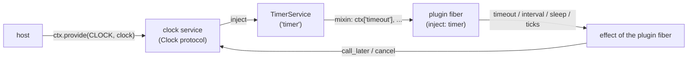

# Build Spec: Timer Service

**Status**: ✅ Completed — both increments done; spec 2 of 3 (see [Dependencies](#dependencies))

## Goal

Add `pycordis.timer`, a service whose timers (`timeout`, `interval`, `throttle`, `debounce`,
and their wait forms) are effects of the calling fiber, so that a timer stops when its plugin
unloads, and a clock protocol that the host supplies as a service.

## Why This

A timer that a plugin starts and does not stop runs after the plugin unloads. With the core
alone, each plugin wraps its timer in `ctx.effect`, and each plugin test needs its own fake time.
The timer service does this once, and its clock protocol gives host and plugin tests
deterministic time. The cost and benefit of this item are in the
[core port follow-ups](core_port.md#follow-ups) (item 4).

## Architecture

### The clock is a service

The host provides a clock as the service `clock`, and `TimerService` injects it. This uses the
library's own dependency rule: the timer service loads only when a clock exists, and a change of
clock reloads the timer service and, through `LIFE-ORDER`, unloads every fiber that injects
`timer` first, which stops its timers. No global time source exists in the library.



### Clock protocol

```
class Clock(Protocol):
    def now(self) -> float: ...                                   # seconds, monotonic
    def call_later(self, delay: float, callback: Callable[[], None]) -> Callable[[], None]: ...

CLOCK: Key[Clock] = Key("clock")
```

`call_later` returns a function that cancels the call. A `delay <= 0` means "due now". The
clock runs `callback` on the owner thread of the root context, and a cancelled call never runs.
The module ships two clocks:

- `ManualClock`: time moves only when the host or a test calls `advance(seconds: float) ->
  None`, which runs the due callbacks in deadline order on the calling thread. The caller calls
  it on the owner thread. While a callback runs, `now()` gives its deadline, as the `FakeClock`
  fixture does. A host with a frame loop calls it each frame with the elapsed time. Tests use it
  in place of fake timers.
- `ThreadingClock(scheduler: Scheduler)`: one daemon worker thread that keeps a heap of
  deadlines under a `threading.Condition` and hands each due callback to `Scheduler.submit`.
  `now()` is `time.monotonic()`. `close(timeout: float | None = None) -> None` stops and joins
  the worker. For headless hosts.

### Timer service

`TimerService(Service)` has `provide = "timer"` and `inject = ["clock"]`, reads the clock once
in its constructor, and mixes its timer methods into the context. A plugin reads
`ctx["timeout"]` through the service view (`TraceableView` in `traceable.py`), so `self.ctx` in
a timer method is the context of the plugin, and `self.ctx.effect` registers the timer on the
plugin's fiber.

```
TimerService.timeout(callback: Callable[[], object], delay: float) -> EffectHandle
TimerService.sleep(delay: float) -> Deferred[None]
TimerService.interval(callback: Callable[[], object], delay: float) -> EffectHandle
TimerService.ticks(delay: float) -> Ticks
TimerService.throttle[**P](callback: Callable[P, object], delay: float, trailing: bool = True) -> Scheduled[P]
TimerService.debounce[**P](callback: Callable[P, object], delay: float) -> Scheduled[P]

Scheduled[**P].__call__(*args: P.args, **kwargs: P.kwargs) -> None
Scheduled[**P].dispose() -> Deferred[None] | None          # the effect handle of the timer
Ticks.__aiter__() -> Self;  __anext__() -> Deferred[None]
Ticks.aclose() -> Deferred[None];  athrow(error: BaseException) -> Deferred[None]
```

## File Structure

```
src/pycordis/
└── timer.py            # NEW: public module pycordis.timer
tests/
└── test_timer.py       # NEW: index.spec.ts cases and the Python-only clock tests
conformance/
├── upstream.json       # REGENERATE: core, loader, and timer items
└── ledger.toml         # MODIFY: "timer" in the package list; timer entries
docs/
├── user_guide.md       # MODIFY: section "Timers"
├── architecture.md     # MODIFY: module map, divergence rows
└── api/timer.md        # GENERATED by scripts/gen_ref_pages.py
```

## Implementation References

- **Upstream** (`packages/timer/src/index.ts`): `TimerService.timeout`, `interval`, `throttle`,
  `debounce`, and `_schedule`; the async iterator of `interval` with its `done` state and its
  queue of pending reads (`nextTasks`).
- **Upstream tests** (`packages/timer/tests/index.spec.ts`): 22 cases with fake timers
  (3 `ctx.timeout()`, 10 `ctx.interval()`, 6 `ctx.throttle()`, 3 `ctx.debounce()`); each
  `vi.advanceTimersByTimeAsync` maps to a `ManualClock.advance` call. The `withContext` helper
  maps to: provide a `ManualClock`, `use(TimerService)`, then `use` a plugin with
  `inject = ["timer"]`.
- **This repository**: `Context.effect` and `EffectHandle` (`fiber.py`) for each timer;
  `Context.mixin` (`context.py`) for the context properties; `Service` with `provide` and
  `inject` (`service.py`, `registry.py`); `TraceableView` (`traceable.py`) for the use-site
  context of a method; `Deferred` (`deferred.py`) for the wait forms; `Scheduler.submit` and
  `ImmediateScheduler.run_until_quiet` (`scheduler.py`) for `ThreadingClock` and its test;
  `Fiber.logger` (`fiber.py`) and `Fiber._log_error` as the pattern for logged callback errors;
  the `FakeClock` fixture (`tests/conftest.py`) as the reference for `ManualClock` ordering.

## Key Constraints

- Delays are seconds as `float`, as in `time` and `threading` and in
  `ImmediateScheduler.run_until_quiet`. Upstream uses milliseconds (divergence `timer-api`).
- Delay validation: every timer method raises `ValueError` for a negative delay, and `interval`
  and `ticks` also for a delay of `0` (with `ManualClock`, a zero interval makes `advance` loop
  without end). `timeout(callback, 0)` and `sleep(0)` are valid. `ManualClock.advance` raises
  `ValueError` for a negative step.
- Each timer is one effect of the calling fiber, with the upstream label (`ctx.timeout()`,
  `ctx.interval()`, `ctx.throttle()`, `ctx.debounce()`), so `Fiber.get_effects()` shows it.
  `sleep` uses the label `ctx.timeout()` and `ticks` uses `ctx.interval()`.
- Method forms, with separate names for the wait forms because Python has no overload on the
  type of the first argument (divergence `timer-api`):

  | Upstream | pycordis | Returns |
  |---|---|---|
  | `timeout(callback, delay)` | `timeout(callback, delay)` | `EffectHandle` |
  | `timeout(delay)` | `sleep(delay)` | `Deferred[None]` |
  | `interval(callback, delay)` | `interval(callback, delay)` | `EffectHandle` |
  | `interval(delay)` | `ticks(delay)` | `Ticks` |
  | `throttle(callback, delay, noTrailing)` | `throttle(callback, delay, trailing=True)` | `Scheduled` |
  | `debounce(callback, delay)` | `debounce(callback, delay)` | `Scheduled` |

- `timeout` reverts its own effect before it calls `callback`, so after the timer fires,
  `get_effects()` does not show it, and a call of the handle does nothing. `sleep` reverts its
  effect when its `Deferred` completes.
- `interval` and `ticks` schedule each tick at the previous deadline plus `delay`, not at
  `now()` plus `delay`, so a late tick does not move the later ticks. One `ManualClock.advance`
  over `n * delay` fires `n` ticks.
- `throttle` reads the time from `Clock.now()`; the first call always runs. A call of a
  `Scheduled` cancels its pending trailing or debounced call before it schedules a new one.
  After `dispose`, or after the fiber unloads, a call does nothing.
- Callback errors (divergence `timer-callback-errors`): an `Exception` from a callback that the
  clock runs (`timeout`, `interval`, a trailing `throttle` call, `debounce`) is caught and
  logged with the logger of the calling fiber; the other timers continue. The leading call of
  `throttle` runs inside the caller's call, so its error goes to the caller.
- A `sleep` that is pending when its fiber unloads rejects with `CordisError("Context has been
  disposed")`, the upstream text.
- `Ticks` keeps the upstream state machine of the `interval` iterator: a queue of pending reads
  and one terminal state.
    - A tick resolves the oldest pending read. A tick with no pending read is lost; ticks are
      not buffered.
    - `aclose()` rejects every pending read and every later read with `StopAsyncIteration`,
      stops the timer, and returns a resolved `Deferred`. It carries no return value (Python
      `aclose` has no argument), so the value of "return with concurrent reads" is not ported.
    - `athrow(error)` rejects every pending read and every later read with `error`, stops the
      timer, and returns a `Deferred` that rejects with `StopAsyncIteration` (the upstream
      `{done: true}`). This differs from an async generator, whose `athrow` raises `error`.
    - When the fiber unloads in no terminal state, the pending and later reads reject with
      `CordisError("Context has been disposed")`. A terminal state does not change after it is
      set.
- `async for` over `Ticks` in a lifecycle task works because `__anext__` returns a `Deferred`
  and a `Deferred` that rejects with `StopAsyncIteration` ends the loop. An abrupt exit from
  `async for` (`break`, or an exception in the body) does not close an iterator in Python, so
  the upstream cases "break return" and "break throw" use `contextlib.aclosing`; their ledger
  entries note it.
- `TimerService` mixes `timeout`, `sleep`, `interval`, `ticks`, `throttle`, and `debounce` into
  the context with `Context.mixin`, so a plugin reads `ctx["timeout"]`. `Context` gets no new
  methods.
- The deprecated `setTimeout` and `setInterval` are not ported: the `deprecated-aliases` row gets
  them.
- `ManualClock.advance` runs a callback that is due at the same time as another in the order of
  `call_later`. A callback that `advance` runs can call `call_later`, and a new call that is due
  inside the same `advance` runs in it. At the end, `now()` is the start plus the step.
  Deadlines are floats: tests use delays that are exact in binary (`0.5`, `0.25`, `1.0`) or the
  same sums on both sides.
- `ThreadingClock`: the cancel function sets a flag that the submitted step reads on the owner
  thread, so a call that the worker has already submitted does not run after its cancel
  (`EFF-REVERT`). `call_later` after `close` raises `CordisError`. The host calls `close` after
  the root context is disposed; the root disposal already cancels every timer of the service.

## Integration

- `pycordis.timer` is a public module (the public-module rule is set by Increment 1 of the
  [Declarative Loader](declarative_loader.md) spec). It exports `TimerService`, `Clock`,
  `CLOCK`, `ManualClock`, `ThreadingClock`, `Scheduled`, and `Ticks`.
- `pycordis/__init__.py` does not change.
- `conformance/ledger.toml`: `timer` in the package list, and every timer item reviewed. IDs
  have the package prefix, for example `timer/index.spec.ts::ctx.timer::ctx.timeout()::basic support`
  and `timer/src/index.ts:TimerService.timeout`. `TimerService.setTimeout` and `setInterval`
  are `diverged` with `deprecated-aliases`. "return with concurrent reads", "break return", and
  "break throw" are `adapted` with `timer-api` and a note.
- Release: an additive change, so the next release is a patch increment. The work goes on
  `feature/timer` from `develop`.

## Testing

- ✅ Each of the 22 upstream cases has a test with its `upstream` marker, with `ManualClock` and
  `ImmediateScheduler`; cases that differ only in input (for example "disposed" and "disposed
  with noTrailing") are one parametrized test with one marker for each case
- ✅ `timeout` and `interval` stop when their effect handle is called and when the fiber unloads;
  `get_effects()` shows each timer with its label, and a fired `timeout` is gone from it
- ✅ `sleep` resolves at its deadline and rejects with the upstream message when the fiber unloads
- ✅ `ticks`: concurrent reads, a lost tick, `aclose`, `athrow`, and a fiber unload with pending
  reads, each with the result of the later reads
- ✅ `throttle` in trailing and no-trailing modes, and `debounce`; both do nothing after `dispose`
- ✅ Delay validation: one parametrized test over each method and the invalid delays
- ✅ `divergence("timer-callback-errors")`, `contract("EFF-ISOLATE")`: a callback that raises is
  logged (`caplog`), and a timer of another fiber that is due in the same `advance` fires
- ✅ A change of the `clock` service reloads `TimerService`, and the timers of a plugin that
  injects `timer` do not fire on the old clock
- ✅ `ManualClock.advance` runs callbacks in deadline order, ties in `call_later` order, including
  a callback that a callback schedules
- ✅ `ThreadingClock` runs the callback on the owner thread through `Scheduler.submit`: the test
  waits with `ImmediateScheduler.run_until_quiet(timeout=...)`, not `time.sleep`; a call that is
  cancelled after it is due does not run; `close` joins the worker, and the test asserts that
  the worker is not alive. Mark it `slow` if its call time is 0.1 s or more
- ✅ `contract("EFF-REVERT")`: seeded random sequences of timer creation, `advance`, and fiber
  disposal never fire a callback of a disposed fiber; the seed is in the assertion message
- ✅ `uv run pytest`, `uv run ruff check .`, and `uv run ruff format --check .` pass; coverage of
  `pycordis.timer` meets the `fail_under` of `pyproject.toml`

## Documentation

- `docs/user_guide.md`: a section "Timers": provide a clock, use the timer service, why a timer
  stops with its plugin, and the choice between `ManualClock` and `ThreadingClock`
- `docs/architecture.md`: the module map (`timer` → `pycordis/timer.py`), the `timer-api` and
  `timer-callback-errors` rows, and the `deprecated-aliases` row
- Docstrings of every public name in `pycordis.timer`, with an example for `TimerService` and for
  each clock; `uv run python scripts/gen_ref_pages.py` writes `docs/api/timer.md` and its nav
  entry in `zensical.toml`

## Dependencies

- **Sequence**: spec 2 of 3. The specs are done one at a time, in this order:
  [Declarative Loader](declarative_loader.md), Timer Service, [Module Reload](module_reload.md).
  Each spec changes `conformance/ledger.toml` and regenerates `conformance/upstream.json`, so two
  specs on separate feature branches at the same time conflict in those files.
- **Prerequisite**: Increment 1 of the [Declarative Loader](declarative_loader.md) spec (the
  package list in the inventory, the prefixed IDs, the public-module rule, and the scanner
  support for `export default <name>`: the scanner at the tracked revision rejects
  `timer/src/index.ts` with "unnamed default export"). No code in this spec uses the rest of
  that spec; only the sequence puts it first.
- **Required by**: none. The Module Reload spec does not use the timer service.
- **Runtime**: none (standard library: `threading`, `heapq`, `time`).
- **Dev**: none new.

## Migration Strategy

### Increment 1: Clock protocol and the callback timers
**Goal**: `ManualClock`, `ThreadingClock`, and `TimerService` with `timeout`, `interval`,
`throttle`, and `debounce`.
**Files**: `timer.py` (~250), `test_timer.py` (~300), `conformance/ledger.toml`,
`conformance/upstream.json`
**Validation**: `uv run pytest tests/test_timer.py tests/test_conformance.py`; manual: provide a
`ManualClock` in `uv run python`, use the timer service, start a `timeout`, dispose the fiber,
and `advance` past the deadline
**Docs**: docstrings; `docs/architecture.md` module map and the `timer-api`,
`timer-callback-errors`, and `deprecated-aliases` rows; `scripts/gen_ref_pages.py` output
**Status**: ✅ Completed

**Changed**:
- `src/pycordis/timer.py`: `Clock`, `CLOCK`, `ManualClock`, `ThreadingClock`, `Scheduled`, and `TimerService` with `timeout`, `interval`, `throttle`, and `debounce`; the private `TimerService._every` is the periodic timer that `ticks` will use
- `tests/test_timer.py`: 12 upstream cases (9 test functions), the clock tests, the callback-error tests, the clock-change test, and the seeded `EFF-REVERT` schedule test
- `conformance/ledger.toml`: `timer` in the package list; 25 reviewed timer entries; 13 entries stay `pending` for the wait forms
- `conformance/upstream.json`: regenerated with the `timer` package
- `docs/architecture.md`: module map entry, the `timer-api` and `timer-callback-errors` rows, and the `deprecated-aliases` row with `setTimeout` and `setInterval`
- `zensical.toml`, `docs/api/timer.md`: generated by `scripts/gen_ref_pages.py`

**Tests**:
- `tests/test_timer.py`: 69 passed; full suite: 1142 passed
- Regression: `tests/test_conformance.py`, `tests/test_inventory.py`, `tests/test_docstrings.py`, `tests/test_package.py`, `tests/test_doc_examples.py` pass; coverage of `pycordis.timer` is 100%
- `uv run ruff check .` and `uv run ruff format --check .` are clean

**Deviations**:
- `ThreadingClock.close` raises `TimeoutError` when the worker is still alive after `timeout`, so that a failed stop is not silent; the spec does not state it
- `timer.py` and `test_timer.py` are larger than the estimate (about 500 and 600 lines), mostly docstrings and parametrized cases
- The ported cases use delays that are exact in binary (for example `0.75` for 600 ms), as the spec allows
- The ledger entries `TimerService.timeout` and `TimerService.interval` stay `pending`: each has a wait form that Increment 2 adds

### Increment 2: Wait forms and close-out
**Goal**: `sleep` and `ticks` work in lifecycle tasks, the `EFF-REVERT` schedule test covers the
timers, and the user guide describes them.
**Files**: `timer.py` (~120), `test_timer.py` (~200)
**Validation**: `uv run pytest`; the full-suite unmarked slow tests section is empty; zero
`pending` timer entries in the ledger
**Docs**: `docs/user_guide.md` section; review of every `pycordis.timer` docstring
**Status**: ✅ Completed

**Changed**:
- `src/pycordis/timer.py`: `TimerService.sleep` and `TimerService.ticks`, the public `Ticks` iterator, and the `sleep` and `ticks` mixins; `_every` takes an `unload` hook that runs after the timer is cancelled
- `tests/test_timer.py`: 10 upstream cases for the wait forms (9 test functions), the `sleep` and `ticks` Python-only tests, `sleep` and `ticks` in the delay-validation tests, and both in the seeded `EFF-REVERT` schedule test
- `conformance/ledger.toml`: zero `pending` timer entries; the wait-form cases are `ported` or `adapted` (`timer-api`), and `TimerService.timeout` and `TimerService.interval` are `adapted`
- `docs/user_guide.md`: section "Timers" with a runnable example, the method table, the unload rules, and the choice of clock

**Tests**:
- `tests/test_timer.py`: 88 passed; full suite: 1161 passed; the unmarked slow tests section is empty
- Regression: `tests/test_conformance.py`, `tests/test_inventory.py`, `tests/test_docstrings.py`, `tests/test_package.py`, `tests/test_doc_examples.py` pass; coverage of `pycordis.timer` is 100%
- `uv run ruff check .` and `uv run ruff format --check .` are clean

**Deviations**:
- `timer.py` grows by about 190 lines (estimate 120), mostly docstrings
- The message item `timer/message:Context has been disposed` is `ported` without a marker, as the other message items are

## Code Standards

- [Contributing](../../contributing.md): the test and docstring standards, with the pull request
  checklist
- [Developer Guide](../../developer_guide.md): the upstream review procedure, slow tests, and
  release rules
- [Architecture](../../architecture.md): the semantic contract, conformance, and the divergence
  table
- The instruction files in `.github/instructions/`: Python Coding Standards, Docstrings &
  Markdown Style, Testing Standards, and Upstream Porting

This spec is scaffolding — do not cite it, its filename, or its increment numbers in source,
docstrings, comments, or test names. Docstrings state the present rule, not the change that
introduced it.

## Appendix A: Divergences

The maintainer approved these rows. Each goes to the divergence table in `docs/architecture.md`
in the increment that implements it.

| ID | Kind | Upstream | pycordis | Contract | Reason and evidence |
|---|---|---|---|---|---|
| `timer-api` | adaptation | Delays in milliseconds, with a delay below 1 ms clamped to 1 ms; `timeout(delay)` and `interval(delay)` overloads; `noTrailing`; a wrapper function with a `dispose` property; `return(value)` on the iterator; the global timers of the runtime | Delays in seconds; a negative delay, and a zero `interval` or `ticks` delay, raise `ValueError`; `sleep(delay)` and `ticks(delay)`; `trailing=True`; a `Scheduled` object; `aclose()` with no value; a `Clock` that the host provides as the service `clock` | — | Python time units, no overload on argument type, Python iterator protocol, and host neutrality: the library has no global clock. The upstream cases pass with `ManualClock` |
| `timer-callback-errors` | improvement | An error from a timer callback is uncaught and goes to the runtime | The timer service logs it with the logger of the calling fiber, and the other timers continue | `EFF-ISOLATE` | A failed callback of one plugin does not stop `ManualClock.advance` or the scheduler drain for other plugins. Test: `divergence("timer-callback-errors")` |
| `deprecated-aliases` (existing row) | omission | Add `TimerService.setTimeout` and `setInterval` | Not ported | — | No vestigial API |
