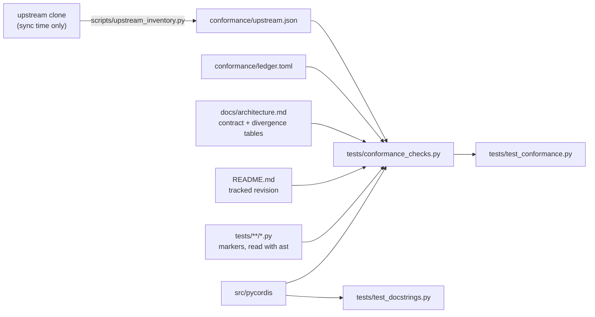

# Build Spec: Upstream Conformance

**Status**: ⬜ Not started — reviewed, ready to implement

## Goal

Make the agreement between pycordis, the semantic contract, and upstream a property that the test
suite checks, so that no upstream change goes unreviewed and no difference from upstream exists
without recorded evidence.

## Why This

The project permits pycordis to differ from upstream where Python gives a better result, and
requires it to differ where upstream breaks the contract. Freedom of this kind lets the two
implementations drift apart without notice. The checks below detect drift without requiring the
code to copy upstream structure: they compare behavior inventories, not lines.

## Architecture



The inventory is the only input that needs upstream, and it is committed, so every check runs in
CI with no network access. Each check is deterministic: the same files give the same result, and
`uv run pytest tests/test_conformance.py` alone gives the same result as the full suite, because
the checks read the test markers from the source files, not from the collected session.

Each check is a pure function in `tests/conformance_checks.py` that takes parsed data and returns
a list of failure messages. `tests/test_conformance.py` runs each check on the committed data and
asserts an empty list, and runs it on minimal bad inputs and asserts the expected failure.

| Mechanism | Detects |
|---|---|
| Revision | `upstream.json` was generated from a revision other than the one in `README.md` |
| Inventory coverage | An inventory item with no ledger entry; a ledger entry with no inventory item |
| Hash pinning | A reviewed item (status other than `pending`) whose upstream hash changed after its review |
| Status consistency | A status and divergence ID that do not agree; a stale `pending` |
| Target resolution | A symbol entry whose pycordis target does not import |
| Marker coverage | A `ported` or `adapted` case with no running test; a marker that names an unknown ID; a marker argument that is not a string literal |
| Vocabulary | A reviewed error message, event name, or state name that does not occur in `src/` and has no divergence |
| Contract coverage | A contract ID with no running `contract`-marked test and not in `[contract] pending` |
| Divergence evidence | A divergence row without the evidence that its kind requires; a row that no entry or marker uses |
| Docstring guard | A docstring that names upstream or its languages |

## File Structure

```
conformance/
├── upstream.json              # NEW: generated inventory (no upstream code)
└── ledger.toml                # NEW: one entry per inventory item, plus [contract]
scripts/upstream_inventory.py  # NEW: clone path -> upstream.json; --ledger-stubs
tests/
├── conformance_checks.py      # NEW: check functions, marker scan, Markdown table reader
├── test_conformance.py        # NEW: runs every check on committed and on bad data
├── test_inventory.py          # NEW: scanner tests on inline TypeScript snippets
└── test_docstrings.py         # NEW: docstring guard
pyproject.toml                 # MODIFY: register upstream / contract / divergence markers
```

`tests/conftest.py` does not change: the static marker scan does the validation, so a
collection-time check would duplicate it.

## Implementation References

### Inventory (`scripts/upstream_inventory.py`)

- **CLI**: `uv run python scripts/upstream_inventory.py <clone> [--out PATH] [--ledger-stubs]`.
  It reads `<clone>/packages/core/{src,tests}/*.ts` and the clone `HEAD` (`git rev-parse`), and
  writes `{"revision": str, "items": {id: {"kind": str, "hash": str, "text"?: str}}}` with sorted
  keys. `text` exists only for vocabulary items. `--ledger-stubs` prints, as TOML, the entries
  that `conformance/ledger.toml` does not have yet, with `status = "pending"` and no hash.
- **Entry points** (imported by `tests/test_inventory.py` with
  `importlib.util.spec_from_file_location`, because `scripts/` is not a package):
  `scan_source(path: str, text: str) -> list[Item]`, `scan_spec(path: str, text: str) ->
  list[Item]`, `vocabulary(src: dict[str, str]) -> list[Item]`, `normalize(text: str) -> str`,
  `digest(text: str) -> str`. `Item` is a frozen dataclass with `id`, `kind`, `span: tuple[int,
  int]`, and `text: str | None`.
- **Scanner**: a small tokenizer that knows strings, template literals (with nested `${ }`
  braces), regular-expression literals versus division, and comments, and counts braces. The
  standard library has no TypeScript parser, and the scanner needs only item boundaries. It
  raises `ValueError` with the file and offset on any construct it cannot place, so a new upstream
  construct stops the sync instead of being skipped.
- **Item kinds and IDs** (`<path>` is relative to `packages/core`):

  | Kind | ID | Boundary |
  |---|---|---|
  | `case` | `<spec file>::<describe titles…>::<title>` (`fiber.spec.ts::Fiber::…`) | one `it(…)` call |
  | `symbol` | `<path>:<name>` (`src/fiber.ts:Fiber`, `tests/utils.ts:sleep`) | every top-level declaration, exported or not; declarations that merge under one name (`class CordisError` + `namespace CordisError`) are one item |
  | `member` | `<path>:<class>.<member>` (`src/fiber.ts:Fiber._unload`) | each method, accessor, and constructor; overload signatures belong to their implementation's item; a computed key keeps its source text (`Context.[symbols.root]`) |
  | `rest` | `<path>:<rest>` | all text of a file outside every other item (imports, `describe` bodies outside `it`, top-level statements) |
  | `message` | `message:<template>` | each thrown error message, and each value of a `CordisError.Code` table |
  | `event` | `event:<name>` | each `internal/*` key of the `Events` interface in `events.ts` |
  | `state` | `state:<name>` | each member of `FiberState` |

  Fields, `static { }` blocks, and type-only members stay in their class's `symbol` item.
  Type-only declarations (`interface`, `type`, `declare module`) are `symbol` items like any
  other; their usual ledger status is `not-applicable`. `src/index.ts` (re-exports only) gives
  one `rest` item.
- **Partition**: the `case`, `symbol`, `member`, and `rest` items of a file cover each of its
  non-comment tokens exactly once. A class's `symbol` hash excludes the text of its `member`
  items, so a method change stales one item only.
- **`it.each`**: one `case` item per table row, with the title formatted as vitest formats it
  (`%s` only; any other placeholder, or a table that is not a literal array of primitives, raises
  `ValueError`). All rows share the hash of the call.
- **Message template**: the literal parts of the message, with each `${…}` or `+ expr` part as
  `{}` (`service "{}" has been registered at <{}>`).
- **Hash**: SHA-256 of `normalize(text)` — comments removed and whitespace runs collapsed, so a
  reformat or a comment edit is not a change.
- **Counts at `68c9d99`**: 203 `case` items (185 `it` calls; the 10 `it.each` calls give 28
  rows), about 130 `symbol` and `member` items, 1 `message` item from `CordisError.Code` plus
  about 15 thrown messages, 10 `event` items, 6 `state` items.

### Ledger (`conformance/ledger.toml`)

```toml
[contract]
pending = ["LIFE-PROGRESS"]

[items."src/fiber.ts:Fiber._unload"]
status = "ported"
target = "pycordis.fiber.Fiber._unload"
hash = "…"
mirror = true
```

- Keys are TOML quoted keys; the stub writer escapes `"` and `\` in IDs.
- `status`: `pending`, `ported`, `adapted`, `diverged`, `not-applicable`. `hash` is required
  for every status except `pending`, and forbidden on `pending`. `note` is required for
  `not-applicable`.
- `divergence`: required for `adapted` (a row of kind `adaptation`) and for `diverged` (kind
  `improvement`, `correction`, or `omission`); forbidden otherwise.
- `target`: only on `symbol` and `member` entries, a dotted pycordis name that
  `importlib.import_module` plus attribute access resolves. A `case` entry has no target: its
  `upstream` marker is the only link. `mirror` defaults to `false`.

### Marker scan (`tests/conformance_checks.py`)

- `ast` over `tests/**/*.py`. A marker counts when it is a decorator
  `@pytest.mark.<name>("<ID>", …)` on a test function or class, or a
  `pytest.param(…, marks=…)` entry in a `parametrize` decorator. Each ID argument is a string
  literal; any other argument is a failure.
- A test is *running* when it has no `skip` mark and no `skipif` mark with a literal `True`
  condition. `xfail` does not count as running.
- **Tables**: the contract and divergence tables in `docs/architecture.md` stay the single source.
  The reader finds each table by its exact header row (`| ID | Guarantee | Paper |` and
  `| ID | Kind | Upstream | pycordis | Contract | Reason and evidence |`) and strips backticks
  from cells.

### Rules for the checks

- **Stale `pending`**: an `upstream` marker that names a `pending` case, or a `pending` symbol
  entry with a `target`. A contract ID in `[contract] pending` that has a running `contract` test
  is stale too. The release increment of the core port requires zero `pending` entries.
- **Vocabulary**: applies to reviewed entries only (a `pending` vocabulary item is not checked).
  A `message` occurs when a string literal or f-string in `src/` (read with `ast`, f-string
  fields as `{}`) has the same template. An `event` occurs as a string literal. A `state` occurs
  as a member name of an `enum.Enum` subclass.
- **Divergence evidence**:

  | Kind | Evidence the check requires |
  |---|---|
  | `adaptation` | At least one `adapted` entry names the row, and each such `case` entry has a running `upstream` test |
  | `improvement` | The Contract cell names known contract IDs, and a running test is marked `divergence("<ID>")` |
  | `correction` | As `improvement`, and the Reason cell has a link to an issue or a pull request in `github.com/cordiverse/cordis` |
  | `omission` | A non-empty Reason cell |

  A row that no ledger entry and no marker names fails as vestigial.
- **Failure messages** name the item and the action: "review the upstream change to
  `src/fiber.ts:Fiber._unload`, then copy hash `…` into its ledger entry".

## Key Constraints

- `src/` does not change for the checks: no runtime registry of upstream names, no decorators.
  The mapping lives in `conformance/` and in test markers.
- `tomllib`, `json`, `ast`, `hashlib`, and `re` only; no new dependency. The `git rev-parse`
  subprocess runs only in the script, never in the suite.
- `upstream.json` holds IDs, hashes, and the vocabulary strings, never code bodies.
- A hash is copied only after a review. `--ledger-stubs` never writes a hash.
- The docstring guard reads module, class, function, and async-function docstrings with `ast`.
  It fails on `upstream`, `TypeScript`, and `JavaScript` as case-insensitive words, on `Promise`,
  `Proxy`, and `WeakMap` as case-sensitive words, and on `\.ts\b`. It does not read `#` comments,
  which can name contract and divergence IDs.

## Integration

- `docs/architecture.md#conformance`: add `pending` and its rules, the revision check, the item
  kinds, and the literal-marker rule; correct anything else that the implementation changes.
- `docs/developer_guide.md#port-an-upstream-change` and `.claude/skills/port-upstream/SKILL.md`:
  use `--ledger-stubs` for new items.
- `docs/contributing.md` (traceability markers) and
  `.github/instructions/upstream-porting.instructions.md`: marker IDs are string literals; symbol
  IDs have the `src/` prefix.
- The protected-test rule in `docs/architecture.md#conformance` and in
  `.github/instructions/testing-standards.instructions.md` names the conformance check modules;
  keep that list in agreement with the modules this spec creates.
- No public API change. No new guide page.

## Testing

- ✅ Each check fails on a minimal bad input with a message that names the item, and passes on the
  committed data — one parametrized test over `(check, bad input, expected fragment)`.
- ✅ The scanner gives the expected items for inline snippets — one parametrized test: nested
  `describe`, `it.each` rows, a brace inside a string and inside a template literal, a regular
  expression literal, a class with members, overloads, a computed member key, a `static { }`
  block, merged class and namespace, and a thrown template message.
- ✅ The partition property holds for each snippet (asserted in the same test).
- ✅ The scanner raises `ValueError` on an `it.each` table that is not a literal.
- ✅ The hash does not change under reformatting or a comment edit, and changes when a token
  changes.
- ✅ The docstring guard fails on each banned term (parametrized), does not fail on a `#` comment,
  and passes on `src/pycordis`.
- ✅ The full suite stays under the fast-suite budget; mark slow tests per the standards.

## Dependencies

- **Runtime**: none. **Dev**: none new.

## Migration Strategy

### Increment 1: Docstring guard
**Goal**: `test_docstrings.py` rejects every docstring in `src/pycordis` that names upstream or
its languages, so that each module the core port adds is checked from its first commit.
**Files**: `tests/test_docstrings.py` (~60)
**Validation**: `uv run pytest tests/test_docstrings.py`
**Status**: ⬜ Pending

### Increment 2: Markers and contract coverage
**Goal**: The three markers are registered, the static marker scan validates `contract` and
`divergence` IDs, and every contract ID has a running test or is in `[contract] pending`.
**Files**: `pyproject.toml`, `tests/conformance_checks.py` (~120),
`tests/test_conformance.py` (~60), `conformance/ledger.toml` (contract section)
**Validation**: `uv run pytest tests/test_conformance.py`
**Status**: ⬜ Pending

### Increment 3: Inventory scanner
**Goal**: `scripts/upstream_inventory.py` writes `upstream.json` for the tracked revision.
**Files**: `scripts/upstream_inventory.py` (~250), `tests/test_inventory.py` (~120),
`conformance/upstream.json`
**Validation**: `uv run pytest tests/test_inventory.py`; manual: run the script on a clone at the
tracked revision and confirm 203 `case` items and 10 `event` items
**Status**: ⬜ Pending

### Increment 4: Ledger checks
**Goal**: Revision, coverage, hash, status, target, and marker checks pass, with every inventory
item `pending` (the core port has not started).
**Files**: `scripts/upstream_inventory.py` (`--ledger-stubs`, ~30),
`tests/conformance_checks.py` (~120), `tests/test_conformance.py` (~60),
`conformance/ledger.toml`
**Validation**: `uv run pytest tests/test_conformance.py`; manual: change one hash in
`upstream.json` of an entry set to `ported` in a scratch copy and see the hash check fail
**Status**: ⬜ Pending

### Increment 5: Vocabulary and divergence evidence
**Goal**: The vocabulary check and the per-kind divergence evidence check pass.
**Files**: `tests/conformance_checks.py` (~80), `tests/test_conformance.py` (~30)
**Validation**: `uv run pytest tests/test_conformance.py`; manual: add a divergence row of kind
`correction` with no link and see the check fail
**Status**: ⬜ Pending

## Code Standards

- [Architecture](../architecture.md) — the contract, conformance, and divergence rules
- [Developer Guide](../developer_guide.md) — the upstream review procedure
- [Contributing](../contributing.md) — the test and docstring standards

This spec is scaffolding — do not cite it, its filename, or its increment numbers in source,
docstrings, comments, or test names. Docstrings state the present rule, not the change that
introduced it.

## Follow-ups

1. **Differential trace tests**: one scenario format (a list of `use`, `provide`, `dispose`, and
   `update` operations) that a Python driver and a Node driver run against pycordis and upstream,
   comparing the `internal/*` event trace, the fiber states, and the effect label trees. A
   difference passes only when the scenario names the divergence that explains it. It needs
   Node and an upstream clone, so it runs as a separate CI job, not in pytest. This is the
   strongest check, because it compares behavior on scenarios that upstream does not test,
   including seeded random ones.
