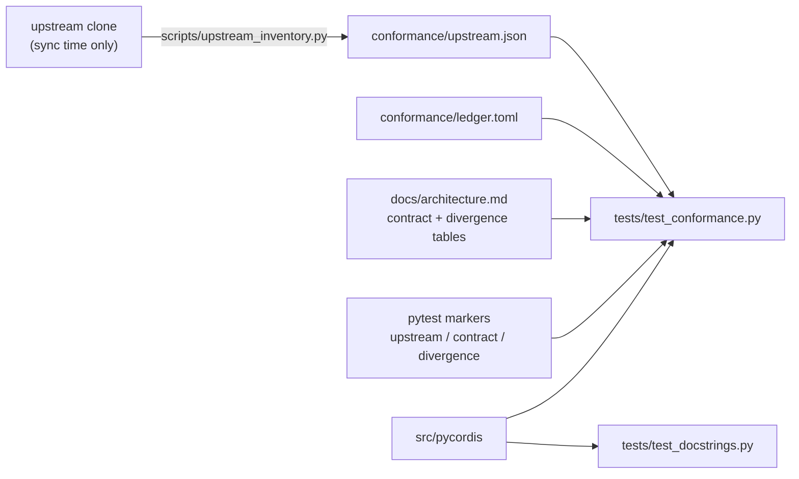

# Build Spec: Upstream Conformance

**Status**: ⬜ Not started — awaiting review

## Goal

Make the agreement between pycordis, the semantic contract, and upstream a property that the test
suite checks, so that no upstream change goes unreviewed and no difference from upstream exists
without recorded evidence.

## Why This

The project permits pycordis to differ from upstream where Python gives a better result, and
requires it to differ where upstream breaks the contract. Freedom of this kind lets the two
implementations drift apart without notice. The checks below detect drift without requiring the
code to copy upstream structure: they compare behavior inventories, not lines.

## Architecture



The inventory is the only input that needs upstream, and it is committed, so every check runs in
CI with no network access. Each check is deterministic: the same files give the same result.

| Mechanism | Detects |
|---|---|
| Inventory coverage | An upstream test case, symbol, message, event, or state with no ledger entry |
| Hash pinning | An upstream item that changed after its review |
| Target resolution | A ledger entry whose pycordis symbol or test does not exist |
| Marker coverage | A `ported` case with no running test; a marker that names an unknown ID |
| Vocabulary | An upstream error message, event name, or state name that does not occur in `src/` and has no divergence |
| Contract coverage | A contract ID with no `contract`-marked test |
| Divergence evidence | A divergence row without the evidence that its kind requires |
| Docstring guard | A docstring that names upstream, TypeScript, or the port |

## File Structure

```
conformance/
├── upstream.json              # NEW: generated inventory (no upstream code)
└── ledger.toml                # NEW: one entry per inventory item
scripts/upstream_inventory.py  # NEW: clone path -> upstream.json
tests/
├── test_conformance.py        # NEW: every check except the docstring guard
├── test_inventory.py          # NEW: scanner tests on inline TypeScript snippets
├── test_docstrings.py         # NEW: docstring guard
└── conftest.py                # MODIFY: marker validation at collection
pyproject.toml                 # MODIFY: register upstream / contract / divergence markers
```

## Implementation References

- **Inventory items**: test cases from `describe` / `it` nesting in `packages/core/tests/*.spec.ts`
  (ID `<file>::<describe path>::<title>`); exported classes, functions, and class members from
  `packages/core/src/*.ts` (ID `<module>:<qualified name>`); string literals of thrown errors, the
  `internal/*` event names, and the members of `FiberState`.
- **Hash**: SHA-256 of the item's source text with comments removed and whitespace runs
  collapsed, so that a reformat is not a change.
- **Scanner**: a small tokenizer that knows strings, template literals, regular expressions, and
  comments, and counts braces. The standard library has no TypeScript parser, and the scanner
  needs only the item boundaries.
- **Ledger entry**: `status` (`pending`, `ported`, `adapted`, `diverged`, `not-applicable`),
  `target` (a pycordis qualified name, or a test node ID), `divergence`, `hash`, `mirror`
  (default `false`), `note`.
- **Tables**: the contract and divergence tables in `docs/architecture.md` stay the single source.
  The check reads them as Markdown tables with fixed column headers.
- **Existing patterns**: `tests/conftest.py` (report hooks), `scripts/gen_ref_pages.py` (a script
  that writes a tracked file that CI checks).

## Key Constraints

- `src/` does not change for the checks: no runtime registry of upstream names, no decorators.
  The mapping lives in `conformance/` and in test markers.
- `tomllib` and `json` only; no new dependency.
- `pending` is the status of an item that the core port has not reached. The check fails on a
  `pending` entry whose target exists with a running test (a stale `pending`), and the release
  increment of the core port requires zero `pending` entries. A contract ID can be listed in
  `[contract] pending` in the ledger with the same rules.
- `upstream.json` holds IDs, hashes, and the vocabulary strings, never code bodies.
- A failure message names the item and the action to take ("review the upstream change to
  `fiber.ts:Fiber._unload`, then copy hash …").
- The docstring guard reads docstrings with `ast` (module, class, function), and fails on
  `upstream`, `TypeScript`, `JavaScript`, `.ts`, `Promise`, `Proxy`, and `WeakMap`. It does not
  read `#` comments, which can name contract and divergence IDs.

## Integration

- `docs/architecture.md#conformance` already describes the checks; correct it if the
  implementation differs.
- `docs/developer_guide.md#port-an-upstream-change` and the `port-upstream` skill use the
  inventory script.
- No public API change.

## Testing

- ✅ Each check fails on a minimal bad input and passes on the committed data (parametrized over
  the check kinds where the input shape is the same).
- ✅ The scanner gives the expected items for inline snippets: nested `describe`, `it.skip`,
  template-literal titles, a brace inside a string, a class with members, a thrown message.
- ✅ The hash does not change under reformatting or a comment edit, and changes when a token
  changes.
- ✅ The docstring guard fails on each banned term, and passes on `src/pycordis`.
- ✅ The full suite stays under the fast-suite budget; mark slow tests per the standards.

## Dependencies

- **Runtime**: none. **Dev**: none new.

## Migration Strategy

### Increment 1: Docstring guard
**Goal**: `test_docstrings.py` rejects every docstring in `src/pycordis` that names upstream,
TypeScript, or the port, so that each module the core port adds is checked from its first
commit.
**Files**: `tests/test_docstrings.py` (~50)
**Validation**: `uv run pytest tests/test_docstrings.py`
**Status**: ⬜ Pending

### Increment 2: Markers and contract coverage
**Goal**: The three markers are registered and validated, and every contract ID has a test or is
listed as pending.
**Files**: `pyproject.toml`, `tests/conftest.py` (~40), `tests/test_conformance.py` (~80),
`conformance/ledger.toml` (contract section)
**Validation**: `uv run pytest tests/test_conformance.py`
**Status**: ⬜ Pending

### Increment 3: Inventory scanner
**Goal**: `scripts/upstream_inventory.py` writes `upstream.json` for the tracked revision.
**Files**: `scripts/upstream_inventory.py` (~200), `tests/test_inventory.py` (~120),
`conformance/upstream.json`
**Validation**: `uv run pytest tests/test_inventory.py`; manual: run the script on a clone at the
tracked revision and compare its case count with `grep -c` on the spec files
**Status**: ⬜ Pending

### Increment 4: Ledger checks
**Goal**: Coverage, hash, target, and marker checks pass, with every inventory item `pending`
(the core port has not started).
**Files**: `tests/test_conformance.py` (~120), `conformance/ledger.toml`
**Validation**: `uv run pytest tests/test_conformance.py`
**Status**: ⬜ Pending

### Increment 5: Vocabulary and divergence evidence
**Goal**: The vocabulary check and the per-kind divergence evidence check pass.
**Files**: `tests/test_conformance.py` (~80)
**Validation**: `uv run pytest tests/test_conformance.py`; manual: add a divergence row of kind
`correction` with no link and see the check fail
**Status**: ⬜ Pending

## Code Standards

- [Architecture](../architecture.md) — the contract, conformance, and divergence rules
- [Developer Guide](../developer_guide.md) — the upstream review procedure
- [Contributing](../contributing.md) — the test and docstring standards

This spec is scaffolding — do not cite it, its filename, or its increment numbers in source,
docstrings, comments, or test names. Docstrings state the present rule, not the change that
introduced it.

## Follow-ups

1. **Differential trace tests**: one scenario format (a list of `use`, `provide`, `dispose`, and
   `update` operations) that a Python driver and a Node driver run against pycordis and upstream,
   comparing the `internal/*` event trace, the fiber states, and the effect label trees. A
   difference passes only when the scenario names the divergence that explains it. It needs
   Node and an upstream clone, so it runs as a separate CI job, not in pytest. This is the
   strongest check, because it compares behavior on scenarios that upstream does not test,
   including seeded random ones.
