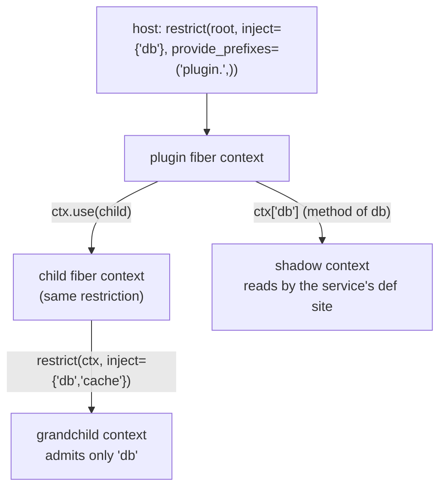

# Build Spec: Context Restriction

**Status**: 📝 Draft — not started; spec 4 of 4 (see [Dependencies](#dependencies))

**Reference**: [#8 Feature request: context view that restricts which keys a component can inject and provide](https://github.com/uclatommy/pycordis/issues/8)

## Goal

Let a host give a component a restricted context that limits the service keys it can inject,
read, and provide, for the component and every fiber it creates, behind a feature flag.

## Why This

A host that loads plugins it did not write has no way to state which services a plugin can use
or replace. A host wrapper around the context does not reach child fibers or service calls. The
restriction is a **guard, not a sandbox**: it stops accidental and undeclared access, and fails
fast. It does not stop hostile code, which can reach other objects through `gc`,
`sys._getframe`, or module globals. The maintainer accepted this position on #8.

## Architecture

### The rule and the restricted context

```
@dataclass(frozen=True)
class Rule:
    names: frozenset[str]          # exact names; a Key[T] becomes its name
    prefixes: tuple[str, ...]      # for example "plugin."
    def admits(self, name: str) -> bool

restrict(ctx: Context, *, inject: Iterable[Keyable | str] = (), inject_prefixes: Iterable[str] = (),
         provide: Iterable[Keyable | str] = (), provide_prefixes: Iterable[str] = ()) -> Context
```

`restrict` returns a derived context that carries a restriction: one `Rule` for inject and
reads, and one for provide. `pycordis/__init__.py` does not export `restrict` or `Rule` (the
feature flag). The rule is data, never a predicate: `LIFE-CONFLUENT` needs the same answer in
every schedule, and an error can show a data rule.

### Inheritance and intersection

The restriction is stored in the context chain, as the isolation table is, so every context that
a restricted context derives (`use`, `inject`, `isolate`, `intercept`, `extend`, a fiber's own
context) carries it. A `restrict` call on a restricted context adds a second restriction. A key
is admitted only when every restriction in the chain admits it, so a component can make its
restriction stricter, but never wider. An error names the restriction that rejects.



### Enforcement points

| Operation | Enforcement point | Result outside the rule |
|---|---|---|
| A declared inject key | The one helper that every path that sets `Fiber.inject` calls: fiber attach and `Fiber._replace` | The fiber goes to `FAILED` before `apply`; `fiber.error` names the key and the rule |
| A read (`ctx[key]`, `ctx.get`, a mixin accessor) | `ReflectService.admit` from [Checked Get](checked_get.md), at the def site, before the root shortcut | `CordisError` that names the service key and the rule; a mixin accessor names its source service (`timer`), not the accessor (`sleep`) |
| `provide`, `accessor`, `mixin` | The effect setup in `ReflectService.provide`, `accessor`, and `mixin` | The effect raises; in `apply` the fiber fails and reverts, as `LIFE-FAILURE` requires |
| `ctx.root`, `ctx.reflect`, `ctx.registry`, `ctx.events` | Properties on `Context` | `CordisError` in a restricted context; no change in other contexts |
| Paths that the audit finds | Per the audit (Appendix B) | Per the audit |

`accessor` and `mixin` names are in the provide rule because an accessor takes precedence over a
service of the same name: an accessor at a host key would replace every read of that key.

## File Structure

```
src/pycordis/
├── context.py          # MODIFY: restrict, Rule, restriction in the chain, guarded attributes
├── reflect.py          # MODIFY: read rule in admit; provide rule in provide, accessor, mixin
├── fiber.py            # MODIFY: inject check helper, called at attach and in _replace
├── registry.py, events.py, service.py, traceable.py, logger.py, timer.py,
│   loader/*.py, hmr/*.py   # MODIFY: internal uses of root, reflect, registry, events
tests/
├── test_restrict.py    # NEW: Python-only restriction tests
└── test_invariants.py  # MODIFY: restricted fibers in the LIFE-FAILURE schedules
docs/
├── architecture.md     # MODIFY: divergence row
└── build_specs/context_restriction.md   # Appendix B: the audit
```

## Implementation References

- **This repository**: `Context._derive` and the `_isolates` chain (how a table reaches every
  derived context); `Context.with_shadow`, `shadow`, and `use_site`, and the def-site rule in
  `ReflectService.read`; `ReflectService.admit` from [Checked Get](checked_get.md);
  `ReflectService.provide`, `accessor`, `mixin`, and `_forward`; `Fiber._attach` (its `except`
  that records the error and leaves the fiber `FAILED`); `Fiber._replace` (it sets `inject`
  again); `RegistryService.inject` and `run_inject_methods` (the paths that create fibers with
  `inject`); `key_name` in `keys.py`.
- **Upstream**: none. Upstream has no access rule, and `ctx.root`, `ctx.reflect`,
  `ctx.registry`, and `ctx.events` are always public.

## Key Constraints

- **Guard, not sandbox**: the `restrict` docstring has a `!!! warning` admonition that says the
  restriction does not stop hostile code, and that untrusted code must run in another process.
- **No restriction, no change**: an unrestricted context keeps every result. The cost is one
  `None` check at each enforcement point. The guarded attributes are properties; internal code
  reads private names (`_root`, `_reflect`, `_registry`, `_events`), so the cost of a property
  is only on a host or plugin read.
- **Inject check, not a wait**: a fiber with an inject key outside the rule goes to `FAILED`. It
  does not stay `PENDING`, because a fiber that waits for a key it can never use would wait with
  no report. It loads again only through `update` or a replacement, as `LIFE-FAILURE` says.
- **Error content**: every error names the key and the rule (its names and prefixes), so a host
  status view shows the cause from `fiber.error` alone (the #8 feedback). These messages are new;
  no upstream text applies.
- **Service calls**: a method of an allowed service reads at the service's def site, so it is
  not restricted by the caller. A `provide`, `accessor`, or `mixin` call in a service method
  registers on the calling fiber, so it follows the caller's provide rule.
- **Root reads**: the read rule applies before the root shortcut of `admit`, so a restricted
  plugin cannot read a service that only the root provides.
- **Events and other operations**: `on`, `emit`, `effect`, `use`, timers, and the scheduler are not
  restricted. The #8 feedback confirmed that event names need no rule in this spec.
- **Audit gate**: a path that lets a restricted component register an effect that outlives the
  component (as `ctx.root.provide` does today) must close before release. A read path can stay
  open with a documented gap. If an effect path cannot close without a breaking change to the
  public API, the restriction waits for that change (the #8 feedback).
- **Audit candidates** (Increment 1 confirms or rejects each one):
    - `ctx.fiber.runtime.fibers`: the other fibers of the same component, whose contexts can be
      unrestricted
    - service values that expose a context or a fiber (loader entries, hmr), and
      `get_original` in the non-public module `pycordis.traceable`
    - global listeners (`options.is_global`) and listeners on internal events
    - `ctx.isolate(name, label)` with a label that the host uses
    - `ctx.scheduler.submit`: work that runs after the component is disposed
    - `fiber.parent` and `fiber.children`

## Integration

- `pycordis/__init__.py` does not change (the feature flag). `pycordis.context` is not a public
  module.
- The guarded attributes change only in a restricted context, which only the flagged API can
  create, so the change is not breaking. Release: a patch increment in `0.2.x`, after
  [Checked Get](checked_get.md). If the audit needs a breaking change, that change goes in
  `0.2.0` with Checked Get, or this spec waits for the next minor release.
- Promotion (an export, `Context.restrict` as a method, and a user guide section) is a separate
  change. A loader entry option for the restriction is a second divergence from the upstream
  loader schema and gets its own spec.
- The work goes on `feature/context-restriction` from `develop`, and merges through a pull
  request.
- `conformance/ledger.toml`: no change (no upstream item).

## Testing

- ✅ Inject outside the rule, one parametrized test over each path that sets `inject`
  (component `inject`, an `@inject` method, `ctx.inject(deps, callback)`, a replacement): the
  fiber is `FAILED`, `fiber.error` names the key and the rule, and its siblings and parent stay
  `ACTIVE`
- ✅ `contract("LIFE-FAILURE")`: `provide`, `accessor`, and `mixin` outside the rule in `apply`
  leave the fiber `FAILED` with no installed effects; the seeded schedules in
  `tests/test_invariants.py` include restricted fibers that break their rule, and the seed is in
  the assertion message
- ✅ Reads: `ctx[key]`, `ctx.get`, and a mixin accessor outside the rule raise, including a
  service that only the root provides; the mixin error names the source service (one
  parametrized test)
- ✅ Inheritance: a child fiber, an `isolate` context, and an `extend` context carry the
  restriction; a nested `restrict` admits only the intersection and cannot widen it
- ✅ A method of an allowed service reads its own injected service when the caller's rule does
  not list that service
- ✅ `divergence("context-restriction")`: `ctx.root`, `ctx.reflect`, `ctx.registry`, and
  `ctx.events` raise in a restricted context and work in an unrestricted one
- ✅ Each effect path that the audit closes has a test that the restricted component cannot
  register an effect that outlives it
- ✅ An unrestricted context passes the full suite with no test change
- ✅ `uv run pytest`, `uv run ruff check .`, and `uv run ruff format --check .` pass; the
  unmarked slow tests section of the full suite is empty

## Documentation

- Docstrings: `restrict` (the guard-not-sandbox warning, an experimental warning, the
  inheritance rule, each enforcement point, the error content, and an example) and `Rule`. The
  docstrings of `Context.root`, `reflect`, `registry`, and `events` state the restricted-context
  rule. The API page of `pycordis.context` is generated.
- `docs/architecture.md`: the `context-restriction` row (see
  [Appendix A](#appendix-a-divergences)). The Design Principles section gets no change: the
  restriction is opt-in.
- `docs/user_guide.md`: none. The feature is behind a flag; the section comes with the promotion.
- This spec: Appendix B holds the audit result.
- `zensical.toml`: none (no new page).

## Dependencies

- **Sequence**: spec 4 of 4. The order is [Pump Budget](completed/pump_budget.md),
  [Step Reports](step_reports.md), [Checked Get](checked_get.md), Context Restriction.
- **In parallel**: Increment 1 (the audit) is read-only and runs during
  [Checked Get](checked_get.md), so that a breaking change it finds can join `0.2.0`.
- **Prerequisite**: [Checked Get](checked_get.md) (`ReflectService.admit` and the checked
  `ctx.get`). Increments 2 to 4 start after Checked Get merges.
- **Required by**: the later loader entry option.
- **Runtime**: none.
- **Dev**: none new.

## Migration Strategy

### Increment 1: Audit of the escape paths
**Goal**: a table in Appendix B of every path from a restricted component to an unrestricted
context, fiber, or core service, with its class (effect outlives the component, read gap, or
reachable only through a non-public module) and its plan (close, document, or out of scope).
**Files**: this spec, Appendix B (~60); throwaway probe scripts in a scratch directory, not in
the repository
**Validation**: each candidate in Key Constraints has a row; each "effect outlives" row has a
closing plan that needs no breaking change, or the maintainer has decided it
**Docs**: Appendix B of this spec
**Status**: ⏳ Not started

### Increment 2: Rule, restrict, and the inject check
**Goal**: `restrict` returns a context whose restriction reaches every derived context, and a
fiber with an inject key outside the rule fails at attach.
**Files**: `context.py` (~80), `fiber.py` (~20), `test_restrict.py` (~150)
**Validation**: `uv run pytest tests/test_restrict.py tests/test_fiber.py tests/test_replace.py`;
manual: in `uv run python`, restrict the root to `inject={"db"}`, use a component that injects
`cache`, and read `fiber.state` and `fiber.error`
**Docs**: the `restrict` and `Rule` docstrings
**Status**: ⏳ Not started

### Increment 3: Read and provide rules
**Goal**: reads and `provide`, `accessor`, and `mixin` calls outside the rule fail, with the
`LIFE-FAILURE` schedules.
**Files**: `reflect.py` (~40), `test_restrict.py` (~120), `test_invariants.py` (~40)
**Validation**: `uv run pytest tests/test_restrict.py tests/test_reflect.py tests/test_invariants.py tests/test_timer.py`;
manual: in `uv run python`, a restricted plugin without `timer` in its rule calls `ctx["sleep"]`,
and the error names `timer`
**Docs**: the `restrict` docstring (each enforcement point)
**Status**: ⏳ Not started

### Increment 4: Close the escape paths and close out
**Goal**: the guarded attributes raise in a restricted context, every "close" row of Appendix B
is closed, and the divergence row is in place.
**Files**: `context.py` (~40), internal callers in about 10 modules (~60 renames),
`test_restrict.py` (~80), `architecture.md`
**Validation**: `uv run pytest`; the full-suite unmarked slow tests section is empty; manual: in
`uv run python`, a restricted plugin calls `ctx.root.provide(...)` and gets `CordisError`
**Docs**: `docs/architecture.md` row; the docstrings of the guarded attributes; review of every
docstring in `context.py` and `reflect.py`
**Status**: ⏳ Not started

## Code Standards

- [Contributing](../contributing.md): the test and docstring standards, with the pull request
  checklist
- [Developer Guide](../developer_guide.md): branches, slow tests, and release rules
- [Architecture](../architecture.md): the semantic contract (`LIFE-FAILURE`, `EFF-REVERT`,
  `LIFE-CONFLUENT`) and the divergence table
- The instruction files in `.github/instructions/`: Python Coding Standards (enforcement points,
  fail fast), Docstrings & Markdown Style, Testing Standards, and Upstream Porting (divergence
  records)

This spec is scaffolding — do not cite it, its filename, or its increment numbers in source,
docstrings, comments, or test names. Docstrings state the present rule, not the change that
introduced it.

## Appendix A: Divergences

The maintainer approved this row on #8. It goes to the divergence table in
`docs/architecture.md` in Increment 4.

| ID | Kind | Upstream | pycordis | Contract | Reason and evidence |
|---|---|---|---|---|---|
| `context-restriction` | improvement | No access rule; `ctx.root`, `ctx.reflect`, `ctx.registry`, and `ctx.events` are always public | `pycordis.context.restrict` gives a context whose inject, read, and provide keys follow data rules, for every derived context; in a restricted context, `ctx.root`, `ctx.reflect`, `ctx.registry`, and `ctx.events` raise `CordisError` | `LIFE-FAILURE`, `EFF-REVERT` | A host states which services a plugin can use or replace. A restricted plugin cannot register an effect on the root, which would outlive the plugin. A guard, not a sandbox. Test: `divergence("context-restriction")` in `tests/test_restrict.py` |

## Appendix B: Audit

Increment 1 fills this table.

| Path | Class | Plan |
|---|---|---|
