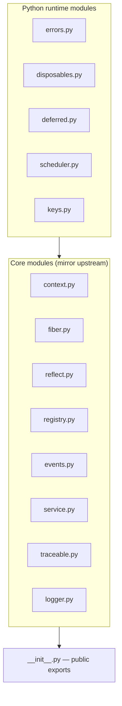
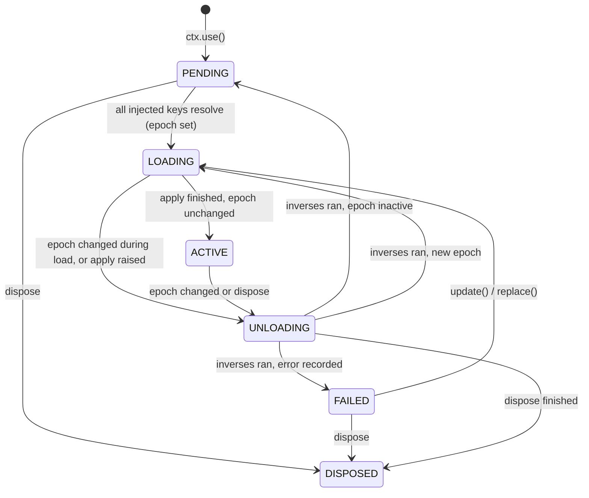

# Build Spec: pycordis Core Port

**Status**: 🔄 In progress — Increment 13 is complete except the release (merge to `master`, publish, and tag)

## Goal

Implement the Cordis programming model in Python as `pycordis` `v0.1.0`: keep every
semantic-contract property, give the upstream result in every upstream test scenario of
`packages/core`, use a scheduler model that needs no event loop, and give a public contract that
host applications can adopt.

## Why This

Python applications that load plugins at runtime (panels, tools, services, node libraries)
usually register into global tables that only append. Such registrations have no inverse, so a
plugin cannot be unloaded or reloaded without a process restart, and a provider that leaves
breaks its dependents. Cordis solves this with fibers that own revertible effects and declare
their dependencies, and its calculus proves recovery, ordering, progress, and confluence. A
Python implementation that keeps the
[semantic contract](../architecture.md#semantic-contract) gives Python hosts the same
guarantees, and the conformance ledger shows each upstream change that needs review.

## Architecture

### Keep the contract, conform to upstream, design for Python

Each upstream module in `packages/core/src` has one Python module with the same
responsibilities and state names. Behavior is correct when it keeps the contract properties and
gives the upstream result in each upstream test scenario. Only the fiber state machine and the
epoch digest copy the upstream control flow (`mirror = true` in the ledger); the other modules
use the clearest Python that gives the same results. Intended differences are the rows of
[Appendix A](#appendix-a-divergences), each with a kind. Any other difference in behavior is a
bug.



### Async model without an event loop

The Promise-based upstream lifecycle runs on a scheduler:

- A **task** is a native coroutine that a pycordis scheduler drives on the owner thread with
  `send`/`throw`. asyncio is not used.
- A **`Deferred[T]`** is the only awaitable that a task can await, apart from a `Fiber`. Any
  thread can complete it. A task that awaits an incomplete `Deferred` parks. When the `Deferred`
  completes, the task goes back on the ready queue through the scheduler's thread-safe submit
  path.
- An upstream microtask hop (`await Promise.resolve()`) is one scheduler step. Upstream order is
  kept inside a task: a `ctx.use()` call returns before the new fiber's `apply` runs.
- `ImmediateScheduler` drains the ready queue when the outermost pycordis call returns, so a
  top-level `ctx.use()` returns at quiescence. A `Deferred` that completes during a drain queues
  its task in that drain and does not start a nested drain. Tests and headless hosts use it.
  `FramePumpScheduler` runs at most a fixed number of steps per `pump()` call and never blocks. A
  host with a frame loop pumps it once per frame.
- The scheduler holds every parked task strongly until the task resumes. Python runs the `finally` blocks of a suspended coroutine when it is
  collected, so a task that only a `Deferred` callback holds could run teardown at collection.

### Fiber lifecycle

The states and transitions are those of upstream `FiberState`. The epoch digest decides every
transition, as in upstream `Fiber._refresh` / `_setEpoch` / `_reload` / `_unload` /
`_getState`. A raising `apply` sets the epoch to `INACTIVE`, so the fiber unloads its collected
effects before it reaches `FAILED`:



The root fiber (`uid` 0) is always `ACTIVE`. Its `dispose` is `restart`: it reverts every root
effect and leaves the root in use, as the upstream `Fiber` constructor's root branch does.

## File Structure

The repository scaffold (`pyproject.toml`, `LICENSE`, `README.md`, docs site,
`tests/conftest.py`) exists. This spec adds:

```
src/pycordis/
├── __init__.py           # MODIFY: public exports
├── context.py            # NEW: Context, extend / isolate / intercept, item access
├── fiber.py              # NEW: Fiber, FiberState, EffectHandle, effect(), lifecycle
├── reflect.py            # NEW: ReflectService, Impl, locate(), accessor / mixin
├── registry.py           # NEW: RegistryService, Component forms, Inject, @inject, replace()
├── service.py            # NEW: Service base: provide on construct, hooks, intercept merge
├── events.py             # NEW: EventsService, internal/* events
├── logger.py             # NEW: LoggerService over stdlib logging
├── traceable.py          # NEW: tracker, def-site / use-site views
├── keys.py               # NEW: Key[T] typed handle
├── scheduler.py          # NEW: Scheduler protocol, task trampoline, Immediate / FramePump
├── deferred.py           # NEW: Deferred[T], from_future()
├── disposables.py        # NEW: DisposableList
└── errors.py             # NEW: CordisError, ValidationError, call-site notes
tests/
├── conftest.py           # MODIFY: ported upstream helpers, FakeClock, run fixture
├── test_<upstream>.py    # NEW: one per packages/core/tests/*.spec.ts (17 files)
├── test_effect_forms.py  # NEW: Python-only effect forms
├── test_scheduler.py     # NEW: drain / pump / submit / park-resume
├── test_threading.py     # NEW: owner-thread assertion, cross-thread Deferred completion
└── test_invariants.py    # NEW: randomized-schedule calculus invariants
docs/
├── user_guide.md         # NEW: concepts and host integration
└── architecture.md       # MODIFY: module map, divergence rows
README.md                 # MODIFY: first release, usage pointer
zensical.toml             # MODIFY: user guide nav entry
GitVersion.yml            # NEW: version calculation from the branch structure
.github/workflows/
├── build.yml             # NEW: reusable: version, build, archive checks
├── release.yml           # NEW: build, publish to PyPI, tag
└── ci.yml                # MODIFY: calls build.yml
conformance/ledger.toml   # MODIFY: entries for each ported upstream item
```

## Implementation References

- **Upstream source of truth**: `cordiverse/cordis` `packages/core/src/*.ts` and
  `packages/core/tests/*.spec.ts` at revision `68c9d9917871d8680bc7ccb9034b9284d5102433` define
  the behavior to conform to. The paper (arXiv `2608.25512`) defines the contract; for example,
  the dependents guard in `Fiber._unload` keeps `LIFE-ORDER` (Theorem 70).
- **Lifecycle core**: `Fiber._refresh`, `_setEpoch`, `_reload`, `_unload`, `_checkImpl`,
  `_replace`, `_updateState`, `_getState`, `update`, `restart`, `await` in `fiber.ts`, and the
  root branch of the `Fiber` constructor. Port each as an `async def` task that keeps the
  upstream structure (`mirror = true`): `LIFE-ORDER` and `LIFE-COHERENT` depend on it.
- **Effect execution**: `Fiber._execute` and `Fiber.effect` in `fiber.ts`, covering each return
  form, the `epoch` guard on async iteration, the dispose-once wrapper, the `then` of the
  returned `AsyncDisposable` (the port is `EffectHandle.__await__`), and child effect metadata.
- **Provision and release**: `ReflectService.provide`, `notify`, `get`, `_getImpl`, the
  `handler.get` trap, and `locate` in `reflect.ts`. A provider's disposal waits on
  `impl.release` until its dependents leave.
- **Context**: the `Context` constructor (core services, root fiber), `extend`, `isolate`,
  `intercept`, `Context.is`, and the `Context.filter` hook that `EventsService` reads from an
  event's `this` argument, in `context.ts` and `events.ts`.
- **Registry**: `RegistryService.use`, `_forward`, `_create`, `replace`, and `Inject.resolve` in
  `registry.ts`. `replace` moves live fibers to the new component through `Fiber._replace`.
- **Service base**: `Service` constructor, `[symbols.extend]`, `[symbols.mergeIntercept]`, and
  `[symbols.resolveIntercept]` in `service.ts`.
- **Traceable views**: `getTraceable`, `createTraceable`, `createShadow`, `withProps` in
  `utils.ts`. The view is the port of the Proxy. The `spec` handling of `__class__` in
  `unittest.mock` shows how `isinstance` can be true for a forwarding object.
- **Config validation errors**: `ValidationError` (with its static `formatPath`) in `fiber.ts`,
  which upstream raises from `resolveConfig`.
- **Name and test mapping**: [Port an Upstream Change](../developer_guide.md#port-an-upstream-change).

## Key Constraints

### Boundaries

- No runtime dependencies; no imports of `asyncio` or of any host application or GUI toolkit.
  Config validation is duck-typed (see below), so pydantic is not imported.
- Python `>=3.12`. PEP 695 generic syntax is allowed.
- MIT license; `LICENSE` keeps the upstream copyright line.

### Context and access

- `Key[T]` is a typed handle with a `name: str`. Every API that takes a key also takes a plain
  `str` (the upstream names).
- `ctx[key]` is checked access and mirrors the upstream Proxy `get` trap, including its
  `internal/get` waterfall. It raises `CordisError` with the upstream messages:
  `cannot get property "<name>" without inject` and
  `cannot get required service "<name>" in inactive context`. At a context whose def-site fiber
  has no runtime (the root), access is unchecked, as upstream: `ctx[key]` returns the provider's
  value whether or not the provider is `ACTIVE`, or `None` when there is no provider. The static
  type of `ctx[key]` is `T` for a `Key[T]` and `Any` for a `str`; the docstring states the root
  exception.
- `ctx.get(self, key: Keyable[T], strict: bool = True) -> T | None` mirrors
  `ReflectService.get`: it returns `None` when there is no provider, and with `strict=True` also
  when the provider's fiber is not `ACTIVE`.
- Attribute-style service access (`ctx.foo`) is not ported. `Context` members are explicit,
  statically typed methods that forward to the core services (`get`, `set`, `provide`,
  `accessor`, `mixin`, `effect`, `inject`, `use`, `on`, `once`, `emit`, `parallel`, `serial`,
  `bail`, `waterfall`), and read-only typed attributes for the instance attributes that the
  upstream `Context` constructor sets (`root`, `fiber`, `reflect`, `registry`, `events`,
  `logger`). Names that `accessor` / `mixin` register resolve only through `ctx[name]`.
- Derived-context signatures: `extend(self, **meta: object) -> Self`,
  `isolate(self, name: str, label: object | None = None) -> Self`,
  `intercept(self, name: str, config: object) -> Self`. `Context.is(value)` is
  `isinstance(value, Context)`.
- Key access accepts `Key[T]` or `str` throughout: `Keyable[T] = Key[T] | str`. `Key[T]` has
  `__init__(self, name: str)` and a read-only `name`. A `Key`'s equality and `hash` follow its
  name (`Key("a") == "a"`, `hash(Key("a")) == hash("a")`), so both spellings resolve to the same
  `Impl`. Public signatures:
  - `Context.effect(self, fn: Callable[[], EffectForm], label: str = "anonymous") ->
    EffectHandle` — ports the upstream `Fiber.effect` overloads to one entry point.
    `EffectHandle` is a `Disposer` (calling it runs the effect's inverses, each at most once)
    with `__await__`: awaiting it resolves to a disposer when the effect's setup finishes
    (at once for a sync form), as the upstream `AsyncDisposable.then` does.
  - `Context.use(self, component: Component, config: object = None) -> Fiber` — inside a task,
    the call returns before `apply` runs. `fiber.wait() -> Deferred[Fiber]` ports
    `Fiber.await`: it resolves with the fiber when no load or unload is in progress, and rejects
    with the recorded error when the fiber is `FAILED`. A fiber that waits in `PENDING` for a
    provider resolves at once. `Fiber.__await__` forwards to `wait()`.
  - `Fiber.update(self, config: object, no_save: bool = False) -> Deferred[None] | None` —
    `None` when an `internal/update` listener vetoes the restart; an invalid config raises
    `ValidationError` from the call. `Fiber.restart(self) -> Deferred[None]`.
    `Fiber.dispose(self) -> Deferred[None]`.
  - `RegistryService.replace(self, old: Component, new: Component) -> list[Fiber]`.
  - `Context.set(self, key: Keyable[T], value: T) -> None`.
  - `Context.provide(self, key: Keyable[T], value: T) -> Disposer` — ports
    `ReflectService.provide`, whose upstream disposer is the `() => void`.
- Derived contexts (`extend`, `isolate`, `intercept`) are new `Context` objects that point to
  their parent. Isolation and intercept tables are chained mappings (`collections.ChainMap` or
  equivalent). A key is read from the nearest table that owns it, as the upstream
  `Object.hasOwn` + prototype walks do.
- Upstream symbol-keyed hooks become `cordis_`-prefixed attributes: `cordis_init`,
  `cordis_check`, `cordis_invoke`, `cordis_extend`, `cordis_merge_intercept`,
  `cordis_resolve_intercept`, `cordis_metadata`, `cordis_tracker`, `cordis_filter`. Do not add
  dunder names. Internal symbols (`receiver`, `original`, `decorator`, `initHooks`,
  `checkProto`, `effect`) become private attributes.
- The tables that upstream tests read through `ctx[Context.isolate]` and
  `ctx[Context.intercept]` are readable through public read-only mappings on `Context`, like the
  shadow and caller introspection below.

### Effects

- `ctx.effect(fn, label="anonymous")` accepts a callable that returns one of: `None`, a disposer
  callable, a sync iterator of disposers, an async iterator of disposers, or a coroutine that
  returns a disposer — the upstream forms. Any other return raises `TypeError("Invalid effect")`.
  Every form returns an `EffectHandle`.
- `Disposer = Callable[[], Deferred[None] | None]`. Returning a `Deferred` is the port of the
  upstream `Promise`-valued dispose; a disposer that does not wait returns `None`.
- The inverses that one effect collects run newest first, and an inverse that returns a
  `Deferred` makes the next one wait for it (the chain in upstream `Fiber.effect`'s `dispose`).
  Separate effects of one fiber dispose concurrently (see `_unload` below).
- A disposer runs at most once. A second call does nothing (upstream `runner.epoch` guard). An
  async iterator stops at the first iteration boundary after its effect is disposed, and its
  `aclose()` runs so that `finally` blocks execute.
- An effect belongs to the fiber that created it, not to the returned handle: the fiber holds
  the effect's resources, so they live exactly as long as the fiber, and no internal link to
  them is a weak reference. Dropping a handle can therefore neither close resources early nor
  trigger teardown at collection. Disposal is explicit: pycordis adds no finalizer (the upstream
  core has none) and its types do not implement `__del__`.
- Root disposal reverts every root effect (it is a root restart, as upstream). An effect that
  an inverse registers on the root during that teardown stays registered, as upstream; pycordis
  also logs it with its label at level `DEBUG`, so the host sees an effect that root disposal
  did not revert (divergence `root-late-effect`).
- A coroutine or async generator can await only a `Deferred` or an object whose `__await__`
  forwards to one (`Fiber`, `EffectHandle`). Awaiting any other object raises `TypeError` at
  the `await`.
  `Deferred.from_future(concurrent.futures.Future)` connects work that runs on other threads.
- `Fiber._unload` starts disposers in reverse registration order. Synchronous disposers run one
  after another. Disposers that return a `Deferred` complete concurrently, as upstream
  `Promise.all` does. A disposer exception is logged with the effect label and does not stop the
  others.
- Error context: `ctx.use()` and `ctx.effect()` capture their call site at low cost (frame
  objects, not formatted strings). On an exception, the formatted call site is attached with
  `BaseException.add_note` (the port of `composeError` / `buildOuterStack`).

### Lifecycle and services

- State names, the epoch digest (`"<revision>:<impl uid>…"`), the `INACTIVE` sentinel, and the
  transitions match `fiber.ts`. Provider identity is the `Impl.uid`, never value equality. A
  provider that changes its value in place with `ctx.set` is not observed (upstream behavior).
- A duplicate `provide` in one realm raises `service "<name>" has been registered at <fiber>`.
- A fiber unloads only after every dependent of its provisions has unloaded (`impl.dependents` /
  `_release`). A provision's disposer waits on `impl.release` before it removes itself.
- An exception from `apply` is logged. The fiber's collected effects are disposed, and the fiber
  goes to `FAILED`. It loads again only through `update()` — which clears the recorded error and
  restarts through the default path of the `internal/update` waterfall — or through
  `RegistryService.replace()`. A direct `restart()` on a failed fiber re-raises the recorded
  error instead of recovering (upstream `_setEpoch` returns early while an error is stored).
- Component forms: a function `(ctx, config)`, a class whose `__init__(self, ctx, config)` is the
  constructor form (`inspect.isclass`), or an object with `apply(ctx, config)`. Metadata
  attributes: `name`, `Config`, `inject` (a list of names or keys, or a dict from name to
  intercept config), `provide` (a `str` or a list), `intercept`. Components set these attributes
  directly on the function, class, or object, as upstream does; pycordis adds no metadata
  decorator. `@inject(name, config)` ports the upstream class and method decorator, including
  method-level init hooks. On a subclass, the decorator copies the inherited `inject` mapping
  before it adds a name (upstream `checkProto`); it never changes the base class's mapping. The
  insertion order of `inject` is the order of the epoch digest. `Component` is a public type
  alias for the three forms.
- `Config` is either an object with a `model_validate` callable (pydantic-compatible) or a
  callable transform `(raw) -> validated` (upstream `Component.Transform`). A failure becomes a
  pycordis `ValidationError` whose message uses the upstream `formatPath` layout.
  `ValidationError` subclasses `TypeError`, as upstream `ValidationError extends TypeError` does.
  Issue paths are read from the validator error's `errors()` method when it has one.
- `EventsService` keeps the upstream event names (`internal/plugin`, `internal/status`,
  `internal/service`, `internal/update`, `internal/config`, `internal/get`, `internal/set`,
  `internal/listener`, `internal/dispatch`, `internal/commit`, `internal/replace`) and dispatch
  modes. `parallel` and `serial` return a `Deferred`. `parallel` reports listener failures as one
  `ExceptionGroup` (the port of `AggregateError`). A dispatch with no listener allocates
  nothing, because `ctx[key]` runs the `internal/get` waterfall on each access.
- The fiber logger is `logging.getLogger("pycordis." + fiber.name)`. The fiber logs `apply` and
  disposer errors to it; `LoggerService` exposes it. The library adds no handlers.
- Traceable views: a service opts in with `cordis_tracker` (`property`, `associate`,
  `no_shadow`). Access through a context returns a view:
  - The tracked property (normally `ctx`) reads as the use-site context.
  - Methods run with the use-site context, so an effect that a service method creates when it is
    called through a view belongs to the caller's fiber.
  - `isinstance(view, ServiceClass)` is true.
  - The def site decides resolution. The use site decides isolate, intercept, and effects.
  - The shadow chain and the caller context are readable through a public introspection
    attribute (one on the view, one on the context), so the upstream tests that walk
    `ctx[symbols.shadow]` and read `symbols.caller` port without private access.
  - Only these semantics are required, not a specific mechanism. `test_associate.py`,
    `test_shadow.py`, and `test_invoke.py` (translated from upstream) check them.
- Deprecated upstream aliases (`ctx.plugin`, `EventsService.dispatch`) are not ported.

### Scheduling and threads

- Every `Context`, `Fiber`, and core-service method asserts that it runs on the owner thread. A
  call from another thread raises `CordisError("WRONG_THREAD")`. Only two operations are
  permitted from other threads: `Scheduler.submit(fn)` and `Deferred` completion.
- `ImmediateScheduler.run_until_quiet(timeout)` also blocks on parked `Deferred`s, so a headless
  host can finish deferred teardown before it exits. `FramePumpScheduler.pump(max_steps)` never
  blocks.
- An empty `pump()` returns in constant time and allocates nothing, because a frame-loop host
  calls it on every frame.
- Signatures: `Scheduler.submit(self, fn: Callable[[], None]) -> None`;
  `FramePumpScheduler.pump(self, max_steps: int) -> int` (the number of steps it ran);
  `ImmediateScheduler.run_until_quiet(self, timeout: float | None = None) -> None`, raising
  `TimeoutError` past `timeout`. `Deferred[T]`: `done() -> bool`, `result() -> T` (raises the
  rejection error, or `CordisError("DEFERRED_PENDING")` while incomplete; it never blocks),
  `resolve(self, value: T) -> None`, `reject(self, error: BaseException) -> None`,
  `__await__() -> Generator[Any, None, T]`,
  `from_future(cls, future: concurrent.futures.Future[T]) -> Deferred[T]`.

### Host contract

These are the public guarantees that a host application builds on. Each is part of the public API
and is tested through it.

- **Scheduler selection**: the host creates the root `Context` with a scheduler. A frame-loop host
  can drain a `FramePumpScheduler` to quiescence once (for example, before its first frame) and
  then pump it per frame.
- **Thread-safe submit**: `Scheduler.submit(fn)` is the one entry point for work that starts on
  other threads (file watchers, worker pools). `fn` runs on the owner thread at the next step.
- **Registry adapters**: a host registry that wants revertible entries exposes
  `add(entry) -> Disposer` and is called through `ctx.effect` on the caller's fiber. The user
  guide documents this pattern; the library provides no host registry.
- **Read-only introspection**: `fiber.name`, `fiber.state`, `fiber.uid`, `fiber.inject`,
  `fiber.committed`, `fiber.provisions`, `fiber.parent`, `fiber.children`,
  `fiber.get_effects()` (a tree of effect labels), `fiber.error` (the last `apply` exception, or
  `None`), and the `internal/status` event. A host builds status views and component APIs from
  these without private access. pycordis stores no host data on a fiber; a host that associates
  data with fibers keys its own table by the fiber.

### Release

- **GitVersion owns the version.** It calculates the version from the branch structure (GitFlow
  workflow), never from commit messages. A branch `release/<version>` sets the version from its
  name; `master` increments the patch number; `develop` and feature branches give pre-release
  versions. The person who names the release branch decides the compatibility level: in `0.x`, a
  breaking change to the public API (the names that `pycordis/__init__.py` exports) increments
  the minor number, and any other change increments the patch number. `GitVersion.yml` sets
  `next-version: 0.1.0`, because the repository has no tag yet.
- **Pin GitVersion to an exact 6.x version** in the workflow. Defaults differ between major
  versions, so the documented behavior applies only to the pinned version.
- **A release pull request merges with a merge commit**, never squash or rebase. On `master`,
  GitVersion reads the release version from the merge commit message
  (`track-merge-message`); a squash or rebase merge removes the branch name from history, so
  `master` gives a patch increment of the last tag.
- **`pyproject.toml` keeps the placeholder `0.0.0`.** The publish job sets the calculated
  version with `uv version <version> --frozen` on its checkout before `uv build`, and does not
  commit the change. `--frozen` keeps `uv.lock` unchanged, so the repository's `uv lock --check`
  stays valid. `pycordis.__version__` reads the installed distribution version, so it needs no
  change; a development checkout reports `0.0.0`.
- **One reusable build workflow.** `build.yml` (`on: workflow_call`) is the only place that
  calculates the version and builds: it checks out with `fetch-depth: 0` (GitVersion needs the
  history and the tags), runs GitVersion, sets the version, runs `uv build`, checks the
  archives, uploads `dist/` as a workflow artifact, and gives the version as a job output. It
  fails if the wheel has no `pycordis/py.typed`, if either archive has no license file, or if
  the wheel contains `tests/`. `ci.yml` calls it on every push and pull request, so a broken
  `GitVersion.yml` fails CI before a release needs it. It has `contents: read` only.
- **One release workflow, three jobs, on push to `master`.** GitHub does not start a workflow
  from a tag that `GITHUB_TOKEN` creates, so a `v*` tag cannot trigger the publish.
  `release.yml` has a `build` job (calls `build.yml`), a `publish` job (downloads the artifact
  and uploads it to PyPI), and a `tag` job that creates `vX.Y.Z` on the built commit only after
  a successful upload. A failed upload leaves no tag. If the `tag` job fails after a successful
  upload, re-run only the failed job: a full re-run calculates the same version, and PyPI
  rejects a second upload of it.
- **PyPI trusted publishing (OIDC).** No stored token. The upload step runs in `release.yml`
  itself, not in `build.yml`, because PyPI does not accept a reusable workflow as a trusted
  publisher. The `publish` job runs in the GitHub environment `pypi` with `id-token: write`;
  only the `tag` job has `contents: write`; every other job has `contents: read`.
- **Serialized runs.** One `concurrency` group for `release.yml` with
  `cancel-in-progress: false`, so two merges cannot calculate the same version.
- **Pull requests and `develop` never publish.** Only `release.yml` uploads, and it runs only
  on `master`.
- **Pin actions by commit SHA**, as `ci.yml` does.
- **Verify before you write the config**, against the GitVersion documentation for the version
  that the workflow installs: the version on `master` after a merge of `release/<version>`, the
  version for a direct commit to `master`, and the behavior of a repository with no tag.
- **Manual steps that no workflow can do**: make sure that the name `pycordis` is free on PyPI,
  and register the pending trusted publisher for it (workflow `release.yml`, environment
  `pypi`); create the `pypi` environment on GitHub; add the `build` job of `ci.yml` to the
  required checks of `master`; and make sure that no tag ruleset blocks `GITHUB_TOKEN` from
  creating `v*` tags.

## Integration

- `pycordis/__init__.py` exports the public API: `__version__` (present), `Context`, `Fiber`,
  `FiberState`, `Key`, `Service`, `Deferred`, `Scheduler`, `ImmediateScheduler`,
  `FramePumpScheduler`, `CordisError`, `ValidationError`, `EffectHandle`, `inject`, and the
  `Disposer`, `Keyable`, and `Component` type aliases (public signatures use them).
- `docs/user_guide.md` (new nav entry in `zensical.toml`): concepts (context, fiber, effect,
  service, key), choosing a scheduler, the host contract, and the coeffect rule: bind a service
  at a key for the lifetime of its provider, and keep a value that changes often inside a stable
  service that publishes change events, because a rebind reloads every dependent.
- `docs/architecture.md`: the module map and one divergence row for each divergence in
  [Appendix A](#appendix-a-divergences), added in the increment that implements it.
- `conformance/ledger.toml`: each increment changes the `pending` entries of the upstream items
  that it implements to their reviewed status, with the target, the divergence ID, the hash,
  and `mirror = true` for the fiber state machine and the epoch digest.
- Release: zero `pending` ledger entries and an empty `[contract] pending`. The merge of
  `release/0.1.0` into `master` publishes `0.1.0` to PyPI and creates the tag `v0.1.0` (see
  [Release](#release)).

## Testing

- ✅ Each of the 17 upstream `packages/core/tests/*.spec.ts` files (associate, component,
  decorator, dispose, events, fiber, intercept, invoke, isolate, logger, reflect, replace,
  service-dispose, service, shadow, update, utils) has a `tests/test_<name>.py` whose tests carry
  the `upstream` markers of the cases they translate. An upstream case that pycordis does not
  follow has a `diverged` ledger entry and a test marked with its divergence. A module is
  complete when it holds every translatable upstream case: `test_utils.py` by Increment 1,
  `test_events.py` by Increment 3, `test_dispose.py` and `test_reflect.py` by Increment 5,
  `test_component.py`, `test_service.py`, and `test_intercept.py` by Increment 6,
  `test_fiber.py` and `test_isolate.py` by Increment 7, `test_update.py` and
  `test_service_dispose.py` by Increment 8, `test_replace.py` by Increment 8b, `test_associate.py`, `test_shadow.py`, and
  `test_invoke.py` by Increment 9, and `test_logger.py` and `test_decorator.py` by Increment 10.
  A module shared before its upstream dependencies exist holds the subset that runs and grows in
  the increment that unblocks the rest.
- ✅ The upstream test helpers (`tests/utils.ts`: `withTimers`, `sleep`, `event`, `Counter`,
  `getHookSnapshot`, `Filter`, `Session`; and the `Events` entries of `events.types.ts`) port
  into fixtures and small classes in `tests/conftest.py`, not into a separate helpers module.
  A `FakeClock` fixture replaces `withTimers`: `sleep(ms) -> Deferred[None]`, and `advance(ms)`
  completes each due `Deferred` in deadline order and drains the scheduler after each one (the
  port of `vi.advanceTimersByTimeAsync` / `vi.runAllTimersAsync`). A `run` fixture drives an
  async upstream test body as a task to quiescence. `vi.fn` / `mock.fn` become small recording
  fakes. No wall-clock waiting.
- ✅ Effect forms: a disposer, a sync iterator, an async generator that awaits a `Deferred`, and
  a coroutine each register and dispose in LIFO order, and awaiting each form's `EffectHandle`
  resolves when its setup finishes. An invalid return (including a context manager) raises
  `TypeError`. Awaiting an object that is not a `Deferred`, `Fiber`, or `EffectHandle` raises
  `TypeError` (parametrized).
- ✅ A disposer called twice runs once. An exception in one disposer is logged, and the other
  disposers still run. Dropping the handle returned by `ctx.effect()` does not dispose the
  effect.
- ✅ Root disposal reverts every root effect (`contract("EFF-REVERT")`). An effect that an
  inverse registers on the root during that teardown stays registered and is logged at level
  `DEBUG` (`divergence("root-late-effect")`).
- ✅ Inside a task, `ctx.use()` returns before the child's `apply` runs. `ImmediateScheduler`
  reaches quiescence when the outermost call returns. `fiber.wait()` resolves with the fiber
  while it waits in `PENDING` for a provider.
- ✅ `FramePumpScheduler.pump(n)` runs at most `n` steps. `pump()` on an empty queue returns `0`
  in constant time. A `tracemalloc` check supports the no-allocation intent: after a warm-up
  call, a window containing only `pump()` reports no new traces. If the interpreter adds noise
  on a platform, that check warns and the timing assertion still gates.
- ✅ A call from a second thread raises `WRONG_THREAD` (`divergence("owner-thread")`). A
  `Deferred` completed on a worker thread resumes its parked task at the next owner-thread step.
  `submit` from a worker thread runs its function on the owner thread.
- ✅ A provider stays `UNLOADING`, with its effects in place, until the teardown of its dependent
  finishes reading the service. Then the provider's inverses run (`contract("LIFE-ORDER")`).
- ✅ A dependent in `LOADING` whose provider is replaced exits through `UNLOADING` and reloads
  against the new provider. No iteration runs against two resolutions
  (`contract("LIFE-COHERENT")`).
- ✅ An `apply` that raises gives `FAILED` through `UNLOADING`, with `fiber.error` set, every
  effect collected before the raise disposed, and no state change in the parent or siblings.
  `update()` recovers the fiber (`contract("LIFE-FAILURE")`, `divergence("host-introspection")`).
- ✅ `RegistryService.replace(old, new)` moves live fibers to the new component and reloads them;
  the inverses of the old component run first.
- ✅ Introspection: `get_effects()` returns the label tree in registration order, and
  `fiber.children` covers the live fibers of each runtime across reloads
  (`divergence("host-introspection")`).
- ✅ Invariant suite (`test_invariants.py`, seeded `random.Random`, parametrized over seeds):
  random interleavings of `use` / `dispose` / provider replacement over a small component pool
  whose `apply` functions do not raise satisfy all of these, each test marked with its contract
  ID:
  - (a) `EFF-REVERT`: disposing a fiber restores every provider table and event-hook table to
    the state without it;
  - (b) `LIFE-ORDER`: a provider never runs inverses while a dependent is installed;
  - (c) `LIFE-PROGRESS`: every schedule reaches quiescence;
  - (d) `LIFE-CONFLUENT`: at quiescence, the context's observable structure matches that of a static load of the
    same components in pool listing order (the test fixture lists the pool, the reference load
    uses that order): the same fiber tree, the same fiber for each key from `ctx.get`, and the
    same effect labels per fiber in registration order;
  - (e) `EFF-ISOLATE`: components that provide and read different keys reach the same state
    when their steps interleave as when they run one after the other;
  - (f) `REG-WELLFORMED`: after every step, a key has at most one provider in a realm, and each
    `fiber.parent` names a live fiber.

  Mark the module `slow` if a seed measures ≥ 0.1 s.
- ✅ The error note on a failed `apply` names the `ctx.use()` call site.
- ⬜ The release pipeline is checked by its runs, not by pytest: the `build` job of `ci.yml`
  passes on every push, the scratch-clone GitVersion check gives the versions in
  [Release](#release), and the first merge to `master` publishes `0.1.0` and tags `v0.1.0`.

## Documentation

Each increment's **Docs** line names the pages and docstrings it changes; this section lists
the pages as a whole.

- **Docstrings**: every public module, class, and function that an increment adds or changes.
  The API reference is generated from them, so `gen_ref_pages.py` adds the new modules to the
  nav.
- **`docs/architecture.md`**: one divergence row in the increment that implements each
  divergence in [Appendix A](#appendix-a-divergences); the module map in Increment 13.
- **`docs/user_guide.md`** (new, with a `zensical.toml` nav entry): Increment 13, as
  [Integration](#integration) describes.
- **`docs/developer_guide.md`** (Release section) and **`docs/getting_started.md`** (Install
  section): Increment 12.
- **`README.md`**: the usage pointer in Increment 13.
- **Final review** (Increment 13): every guide agrees with the code, and every exported name
  has a complete docstring.

## Dependencies

- **Prerequisite**: the [Upstream Conformance](completed/conformance.md) spec is complete before
  Increment 1. It registers the `upstream`, `contract`, and `divergence` markers (`pyproject.toml`
  sets `--strict-markers`, so a marked test fails collection without them), and it supplies
  `conformance/upstream.json` and the `pending` ledger stubs that each increment reviews.
- **Runtime**: none.
- **Dev**: `pytest`, `ruff` (present). The `model_validate` config tests use a stdlib fake
  validator (a class whose `model_validate` raises an exception carrying an `errors()` method),
  not a validator dependency.
- **Docs**: `zensical`, `mkdocstrings[python]`, `pymdown-extensions` (present).
- **Release (CI only)**: GitVersion, run by `build.yml`, and the PyPI publish action, run by
  `release.yml`. Neither is a project dependency.

## Migration Strategy

Validate each increment with the command that it names, then `uv run ruff check .` and
`uv run ruff format --check .`. Each increment adds the divergence rows and docstrings for what
it implements.

### Increment 1: Disposables, Deferred, ImmediateScheduler
**Goal**: `DisposableList`, `Deferred`, the task trampoline, and `ImmediateScheduler` work alone.
**Files**: `disposables.py` (~70), `deferred.py` (~90), `scheduler.py` (~150), `errors.py`
(~60), `tests/conftest.py` (`FakeClock`, `run`), `test_utils.py`, `test_scheduler.py`
**Validation**: `uv run pytest tests/test_utils.py tests/test_scheduler.py`
**Status**: ✅ Completed

**Changed**:
- `src/pycordis/errors.py`: `CordisError`, and `CallSite` (`capture`, `format`, `annotate`) that adds a call site to an exception as a note
- `src/pycordis/disposables.py`: `DisposableList` with `push`, `unshift`, `delete`, `clear`, `len`, and snapshot iteration
- `src/pycordis/deferred.py`: `Deferred` with `resolve`, `reject`, `result`, `done`, `add_done_callback`, `resolved`, `from_future`, and `__await__` (always one scheduler step)
- `src/pycordis/scheduler.py`: `Scheduler` base class (`submit`, `call`, `hold`, `release`), `ImmediateScheduler` (`run_until_quiet`), the task trampoline, and `spawn`
- `tests/conftest.py`: `FakeClock`, and the `scheduler`, `clock`, and `run` fixtures
- `conformance/ledger.toml`: the 12 `DisposableList` and call-site items and the 6 `utils.spec.ts` cases are reviewed
- `docs/architecture.md`: divergence row `error-notes`

**Tests**:
- `tests/test_utils.py` (11 tests) and `tests/test_scheduler.py` (25 tests): 36 pass
- Re-run for regression: `tests/test_conformance.py`, `tests/test_inventory.py`, `tests/test_docstrings.py` (139 pass in all)
- The task-hold test fails when `Scheduler.hold` is disabled

**Deviations**:
- `ValidationError` is not in `errors.py`. Config validation needs it, so it is added with the registry
- `CallSite` stores `(code, line number)` pairs, not frame objects, so it does not keep local variables alive
- `Scheduler` is an abstract base class, not a `Protocol`: it holds the parked tasks that keep a suspended coroutine alive. `call()` is the span of an outermost call, which `ImmediateScheduler` uses to drain
- `scheduler.py` imports `deferred.py`, because the task trampoline must recognize a `Deferred`. This differs from the rule that runtime modules import only `errors`. `deferred.py` imports only `errors`, so there is no cycle
- Divergence rows `async-model`, `async-effects`, and the other adaptation rows are not added yet: no ledger entry names them, and the divergence check rejects a row that nothing names. Each row is added with the first item that it covers
- `run` returns the task's `Deferred`, so a test can advance the clock before it reads the result
- Owner-thread checks are not added yet (planned for the threading increment)
- `ImmediateScheduler.run_until_quiet` documents the owner-thread rule but does not assert it

**Manual validation**:
- A task that awaits a `Deferred` parks in an `ImmediateScheduler`, and resolving the `Deferred` resumes it (confirmed by the user)

### Increment 2: Context and effects
**Goal**: `Context` with `extend` / `isolate` / `intercept`, the root `Fiber`, the fiber logger,
and `ctx.effect` in every return form, with `EffectHandle`, LIFO dispose, dispose-once, root
restart, and call-site notes.
**Files**: `context.py` (~120), `fiber.py` (effect part, ~220), `keys.py` (~30),
`test_effect_forms.py`, `test_dispose.py`
**Validation**: `uv run pytest tests/test_effect_forms.py tests/test_dispose.py`
**Status**: ✅ Completed

**Changed**:
- `src/pycordis/keys.py`: `Key[T]` (equality and hash follow the name) and the `Keyable[T]` alias
- `src/pycordis/context.py`: `Context(scheduler)` with `root`, `fiber`, `scheduler`, `extend`, `isolate`, `intercept`, `effect`, and the read-only mappings `meta`, `isolates`, `intercepts`
- `src/pycordis/fiber.py`: `Fiber` (root only), `FiberState`, `EffectHandle`, `EffectMeta`, `Disposer`, `EffectForm`, `INACTIVE`; `effect()` in every return form with the call-site note, the `root-late-effect` log, and `get_effects()`
- `src/pycordis/fiber.py`: the root lifecycle (`_get_state`, `_update_state`, `_refresh`, `_set_epoch`, `_reload`, `_unload`), `wait()`, `restart()`, and `dispose()` (the root restart)
- `src/pycordis/scheduler.py`: `start`, which runs the first step of a task at once
- `src/pycordis/disposables.py`: the remover that `push` and `unshift` return gives `None`, as its signature states
- `tests/conftest.py`: the `root` fixture
- `conformance/ledger.toml`: reviewed the `Context` items, the effect and state items of `fiber.ts`, the 13 runnable `dispose.spec.ts` cases, the two effect messages, and the six states; `EFF-REVERT` leaves `[contract] pending`
- `docs/architecture.md`: divergence rows `async-effects`, `fiber-wait`, `hook-names`, `root-late-effect`

**Tests**:
- `tests/test_dispose.py` (13 upstream cases in 9 tests), `tests/test_effect_forms.py` (16 tests, one parametrized over five effect forms, with the `EFF-REVERT` contract test and the `root-late-effect` divergence test), `tests/test_context.py` (7), `tests/test_keys.py` (2)
- Full suite: 187 pass, which includes `tests/test_conformance.py`, `tests/test_inventory.py`, `tests/test_docstrings.py`, `tests/test_utils.py`, and `tests/test_scheduler.py`

**Deviations**:
- The lifecycle methods that the root restart needs are ported now, without `internal/*` events, provisions, `inject`, and the dependents guard. The ledger items `_getState`, `_updateState`, `_setEpoch`, `_refresh`, `_reload`, and `_unload` stay `pending` until they are complete
- `dispose.spec.ts` cases "dispose by component" (needs `ctx.use`) and "yield dispose" (needs `ctx.on`) stay `pending`
- `tests/test_context.py` and `tests/test_keys.py` are not in the file list; they test the public derivation API and `Key`
- The spec does not name the read-only tables. They are `Context.meta` (the values of `extend`), `Context.isolates`, and `Context.intercepts`
- `Fiber.dispose` is a method that calls `restart`; the non-root form replaces it with the unload of the fiber's effect
- The test for awaiting an object that is not a `Deferred`, `Fiber`, or `EffectHandle` is not added again: `tests/test_scheduler.py` owns that rule
- `DisposableList.push` and `unshift` returned a remover that gave a `bool`; the effect code treated that value as a pending `Deferred`. The remover now gives `None`
- Errors that a disposer raises during teardown are logged with the effect label but carry no call-site note
- Owner-thread checks are not added yet (planned for the threading increment)

**Manual validation**:
- A root context registers effects, reverts them newest first with `handle()`, and `fiber.dispose()` leaves the root `ACTIVE` (confirmed by the user)

### Increment 3: Events
**Goal**: `EventsService` with every dispatch mode, listener effects, `cordis_filter`, and the
`internal/*` event names, so that the core services can emit and run waterfalls.
**Files**: `events.py` (~200), `test_events.py`
**Validation**: `uv run pytest tests/test_events.py`
**Docs**: `docs/architecture.md` divergence rows; docstrings of `events.py` and the `Context` dispatch methods
**Status**: ✅ Completed

**Changed**:
- `src/pycordis/events.py`: `EventsService` (`emit`, `bail`, `serial`, `parallel`, `waterfall`, `on`, `once`, `listener_counts`), `EventOptions`, `Hook`, `is_bailed`, and the `EventName`, `DispatchMode`, `Listener`, and `InternalEventName` aliases
- `src/pycordis/context.py`: `Context.events`, shared by every derived context, and the methods `on`, `once`, `emit`, `bail`, `serial`, `parallel`, `waterfall`
- `tests/conftest.py`: `event`, `Symbol`, `Recorder`, `Session`, `Filter`, `hook_snapshot`
- `conformance/ledger.toml`: reviewed 29 `events.spec.ts` cases as ported and 2 as diverged, the `events.ts` items that are complete, the `events.types.ts` items, and the two event messages
- `docs/architecture.md`: divergence rows `async-model`, `exception-group`, `event-dispatch-args`, `deprecated-aliases`

**Tests**:
- `tests/test_events.py`: 51 tests that carry the 29 runnable upstream cases, and Python-only tests for bail results, async `serial`, prepend, global listeners, `internal/dispatch`, and `internal/listener`
- Full suite: 238 pass, which includes `tests/test_conformance.py`, `tests/test_inventory.py`, and `tests/test_docstrings.py`

**Deviations**:
- `this` is the keyword `this=` and an event name is any hashable object (user-approved). Listeners never receive `this`. This is the divergence `event-dispatch-args`
- The listeners of `internal/update` (the fiber listener hook and the default waterfall step) and of `internal/config` are not registered yet: nothing dispatches those events until `Fiber.update` and config resolution exist (Increment 8 and 5). The ledger items `EventsService`, `EventsService.constructor`, `EventsService.on`, and `EventsService.once` stay `pending`
- `EventsService.on` does not wrap the listener with the traceable view (`reflect.bind`): it needs `traceable.py` (Increment 9)
- The events cases `skips a listener disposed by an earlier component during dispatch` and the five `internal/update` cases need `ctx.use` and `Fiber.update`, so they stay `pending`. The `tests/events.spec.ts` helper items stay `pending` for the same reason
- `EventsService.listener_counts()` is added for tests and host status views, because the hook table is private. It is not in the plan
- Only the `internal/dispatch` event item is reviewed; the other ten `event:internal/*` items stay `pending` until their events are emitted
- `Context.on` and the other methods take `EventOptions | bool`, where the `bool` is `prepend`; `EventOptions.is_global` replaces `global`, which is a Python keyword

**Manual validation**:
- A root context registers a listener with `ctx.on`, dispatches with `emit`, runs a `waterfall` chain, and `listener_counts()` shows the removal (confirmed by the user)

### Increment 4: Reflect — provide, get, set, notify, isolation
**Goal**: `ReflectService` with `Impl`, `locate`, checked and lenient access (with the
`internal/get` / `internal/set` waterfalls and unchecked root access), `accessor` / `mixin`, and
realm-scoped provision with duplicate detection.
**Files**: `reflect.py` (~260), `test_reflect.py` (the cases that need no component loading)
**Validation**: `uv run pytest tests/test_reflect.py`
**Docs**: `docs/architecture.md` divergence row; docstrings of `reflect.py` and the `Context` access methods
**Status**: ✅ Completed

**Changed**:
- `src/pycordis/reflect.py`: `ReflectService` (`read`, `write`, `get`, `set`, `provide`, `notify`, `accessor`, `mixin`), `Impl`, and `Accessor`
- `src/pycordis/context.py`: `Context.reflect`, `get`, `set`, `provide`, `accessor`, `mixin`, `declare_realm`, and item access (`ctx[key]`, `ctx[key] = value`)
- `src/pycordis/fiber.py`: `Fiber.provisions`
- `src/pycordis/keys.py`: `key_name`, which turns a `Key` or `str` into the service name
- `conformance/ledger.toml`: reviewed `Context.is()`, `Property`, `ReflectService.accessor`, and five items of `reflect.ts` that a Python context does not need
- `docs/architecture.md`: divergence row `service-access`

**Tests**:
- `tests/test_reflect.py`: 47 pass (one upstream case, the `EFF-REVERT` contract test over 20 seeds, and Python-only tests)
- Full suite: 285 pass, which includes `tests/test_conformance.py`, `tests/test_inventory.py`, and `tests/test_docstrings.py`

**Deviations**:
- Checked access is not added: `locate`, the two access error messages, and the `internal/get` and `internal/set` waterfalls need a fiber with a runtime (user-approved, planned for Increment 5). `ctx[key]` is unchecked
- `ReflectService.set` does not check `cannot set property "<name>" in multiple fibers`, and `notify` does not refresh fibers: no non-root fiber exists to test them (Increment 5)
- `Impl.check` and the `check` argument of `provide` are not added: nothing reads them before the `Service` base (Increment 6)
- `Context.__setitem__` is added, because an accessor setter and a service write have no other entry point
- `Context.declare_realm` is added: the default realm of a service name lives in the root context, and `ReflectService` cannot write it through the read-only `isolates` mapping
- The core mixins of the upstream constructor (`reflect`, `fiber`, `registry`, `events`) are not registered: `Context` has explicit methods
- Ledger items `ReflectService`, `.constructor`, `.get`, `._getImpl`, `.set`, `.provide`, `.notify`, `.mixin`, `Impl`, and `module ./context.ts` stay `pending` until the deferred parts and the traceable views exist; the other five `reflect.spec.ts` cases need `ctx.use`
- `ReflectService.mixin` accepts only a service key as its source, not an object
- Provider removal uses `Scheduler.start`, so `impl.release` is set before the removal returns

**Manual validation**:
- A root context provides a service, reads it through `get`, `ctx[key]`, and a mixin, isolates a realm, hears `internal/service` on removal, and has no provisions afterward (confirmed by the user)

### Increment 5: Registry and core loading
**Goal**: `ctx.use` / `ctx.inject` in the three component forms with `Config` validation, and the
epoch-driven `_refresh` / `_set_epoch` / `_reload` / `_unload` for a component that loads,
provides, injects, and unloads cleanly — without the dependents guard or the failure paths.
**Files**: `registry.py` (~200), `fiber.py` (lifecycle, ~200), `test_component.py`,
`test_dispose.py`, `test_reflect.py`
**Validation**: `uv run pytest tests/test_component.py tests/test_dispose.py
tests/test_reflect.py`
**Docs**: `docs/architecture.md` divergence rows; docstrings of `registry.py`, `Context.use`, and the new `Fiber` members
**Status**: ✅ Completed

**Changed**:
- `src/pycordis/registry.py`: `Component`, `Applicable`, `Runtime`, `resolve_inject`, and `RegistryService` (`use`, `inject`, `resolve`, `get`, `has`, `keys`, `values`, `entries`, `for_each`, `unregister`, `next_uid`, `len`)
- `src/pycordis/fiber.py`: non-root `Fiber` (uid, child context, `internal/plugin`, `ctx.use()` effect, `dispose`, `name`, `committed`, `inject`, `runtime`), the epoch digest in `_refresh`, `_check_impl`, `internal/status` and provider announcement in `_update_state`, `_apply` (function, class, and `cordis_init`), `_resolve` (the `internal/config` waterfall), and `resolve_config`
- `src/pycordis/errors.py`: `ValidationError` and `Issue`
- `src/pycordis/reflect.py`: `locate`, checked `read` with the `internal/get` waterfall, the `internal/set` waterfall in `write`, the `in multiple fibers` check in `set`, fiber refresh in `notify`, and `find` and `announce`
- `src/pycordis/context.py`: `registry`, `use`, `inject`, `bind_fiber`, `isolated_since`, and the root listener of `internal/config`
- `src/pycordis/events.py`: `EventsService.install`, and a waterfall without listeners that calls its final function at once
- `conformance/ledger.toml`: 59 entries reviewed (18 `component.spec.ts`, `dispose.spec.ts`, and `reflect.spec.ts` cases; the state-machine items `_getState`, `_updateState`, `_setEpoch`, `_refresh` with `mirror = true`; `ValidationError`, `resolveConfig`, `locate`, and the registry items; six events)
- `docs/architecture.md`: divergence row `config-schema`; row `service-access` covers checked access and the `internal/get` and `internal/set` arguments

**Tests**:
- `tests/test_component.py` (43 pass: 10 `component.spec.ts` cases, `dispose by component`, the three forms, names, `inject` spellings and errors, shared runtimes, `internal/plugin` and `internal/status`, config validation, loading by injection, and the call-site note), `tests/test_reflect.py` (58 pass, 5 `reflect.spec.ts` cases and Python-only tests of checked access, listeners, realms, and `set`), `tests/test_dispose.py` (14 pass, includes `yield dispose`)
- Full suite: 340 pass, which includes `tests/test_conformance.py`, `tests/test_inventory.py`, `tests/test_docstrings.py`, `tests/test_events.py`, `tests/test_effect_forms.py`, and `tests/test_scheduler.py`
- Disabling the checked-access error, or the realm check in `locate`, fails a test. A digest that leaves out the provider `uid` fails no test yet: a provider change always passes through `INACTIVE` until `replace` exists (Increment 7 and 8)

**Deviations**:
- `ctx.plugin` and `registry.plugin` are not ported: ledger status `diverged` with `deprecated-aliases`
- The `access error` case does not assert JavaScript stack lines, `access check` does not read `prototype`, and `service injection` does not check logger warnings (the logger is Increment 10). A check of `ctx.meta` replaces the last one. These cases are `adapted` with `service-access`
- `internal/get` and `internal/set` listeners get no `error` argument (row `service-access`)
- `RegistryService.use` and `inject` take the calling context as the first argument, like `ReflectService`
- `Fiber.parent` is the `Context` that created the fiber
- `EventsService.install`, `Context.bind_fiber`, `Context.isolated_since`, `ReflectService.find`, and `ReflectService.announce` are added; the plan does not list them
- The dependents tracking, the wait in `_unload`, `_forward`, and the alias table are not added (user-approved, Increment 8). The ledger items `Fiber`, `_reload`, `_unload`, `_replace`, `update`, `RegistryService.use`, `.get`, `.has`, `.replace`, and `._forward` stay `pending`
- `Fiber._checkImpl` stays `pending` because `Impl.check` needs the `Service` base (Increment 6)
- `dispose.spec.ts` `yield dispose` had no remaining blocker, so it is ported here
- Three tests of `tests/test_events.py` compare listener counts with a baseline snapshot, because a root has the listener of `internal/config`
- Owner-thread checks are not added yet (planned for the threading increment)

### Increment 6: Service base
**Goal**: The `Service` base with provide on construct, the `cordis_*` hooks, and intercept merge
and resolve.
**Files**: `service.py` (~100), `test_service.py`, `test_intercept.py`, `test_component.py`
**Validation**: `uv run pytest tests/test_service.py tests/test_intercept.py
tests/test_component.py`
**Docs**: `docs/architecture.md` divergence row; docstrings of `service.py`
**Status**: ✅ Completed

**Changed**:
- `src/pycordis/service.py`: `Service` (constructor that provides `self` under its name or its `provide` attribute, `cordis_filter`, `cordis_merge_intercept`, `cordis_resolve_intercept(caller=None)`); an optional `cordis_check` and `cordis_init` are read from the subclass
- `src/pycordis/reflect.py`: `Impl.check`, the `check` argument of `ReflectService.provide`, and `Located.fiber`
- `src/pycordis/fiber.py`: `Fiber._check_impl` calls `Impl.check`; a false result or an exception hides the provider, and an exception is logged
- `src/pycordis/context.py`: the `check` argument of `Context.provide`, and `Context.intercept_layers`
- `conformance/ledger.toml`: reviewed `Fiber._checkImpl`, `Service.[symbols.filter]`, `.[symbols.mergeIntercept]`, `.[symbols.resolveIntercept]`, 3 `service.spec.ts` cases, 2 `hasInstance` cases, and 6 `intercept.spec.ts` cases
- `docs/architecture.md`: divergence row `intercept-caller`

**Tests**:
- `tests/test_service.py` (16 pass: 5 upstream cases, and Python-only tests of the name, the `check` hook with its log, and `cordis_filter`), `tests/test_intercept.py` (7 pass: 6 upstream cases and the default caller)
- Full suite: 363 pass, which includes `tests/test_conformance.py`, `tests/test_inventory.py`, and `tests/test_docstrings.py`
- A reversed order of intercept layers, a `check` result that is ignored, and an `inject` configuration for the fiber's own provision each fail a test

**Deviations**:
- `cordis_resolve_intercept` takes an explicit `caller` context (user-approved, divergence `intercept-caller`). Increment 9 removed the argument and the divergence row
- `intercept.spec.ts` `take injected config from the def site` stays `pending`: it needs the use-site view of Increment 9. Its test goes in `tests/test_intercept.py` then
- `service.spec.ts` `traceable effect (with inject)` and `(without inject)` wait for Increment 9, and `dispose dependents before provider`, `... restarts`, and `... isolated provider` wait for Increment 8; they stay `pending`
- The tracker, the callable form (`cordis_invoke`), `cordis_extend`, and `Service.[Symbol.hasInstance]` are not added: they belong to the traceable view (Increment 9). Ledger items `Service`, `Service.constructor`, `.[symbols.extend]`, `.[Symbol.hasInstance]`, `Impl`, and `ReflectService.provide` stay `pending`
- `Fiber._check_impl` logs a failed check to the fiber logger of the provider; `LoggerService` is Increment 10
- `Service` is not exported from `pycordis/__init__.py` yet (release increment)
- The `test_component.py` file needed no change: its `Service.init` case was ported in Increment 5

**Manual validation**:
- A root context provides a `Service` subclass, resolves intercept configuration from two `intercept` layers, and resolves the `inject` configuration inside an `inject` callback (confirmed by the user)

### Increment 7: Fiber lifecycle semantics
**Goal**: `FAILED` from a raising `apply` (through `UNLOADING`), reload on a provider change,
required-key absence parking a fiber at `PENDING`, `fiber.wait()`, and `internal/status` per
provider — the upstream `fiber.spec.ts` and `isolate.spec.ts` cases that do not need the
dependents guard.
**Files**: `fiber.py`, `reflect.py`, `registry.py` (~80 total), `test_fiber.py`,
`test_isolate.py`
**Validation**: `uv run pytest tests/test_fiber.py tests/test_isolate.py tests/test_component.py
tests/test_dispose.py`
**Docs**: None: the increment adds tests and ledger entries for behavior that the docstrings of `Fiber` already describe
**Status**: ✅ Completed

**Changed**:
- `tests/test_fiber.py`: new; inertia, failure, disposal sequences, `restart`, and the validation of a config on first load
- `tests/test_isolate.py`: new; the six `isolate.spec.ts` cases
- `conformance/ledger.toml`: 16 cases reviewed as `ported` (10 `fiber.spec.ts`, 6 `isolate.spec.ts`) and 2 as `adapted` with `config-schema`
- `src/`: no change; the state machine of Increment 5 already gives the lifecycle of this increment

**Tests**:
- `tests/test_fiber.py` (14 pass, includes a parametrized test for the three dispose sequences and one for `wait` after a sync or async failure), `tests/test_isolate.py` (6 pass)
- Full suite: 383 pass, which includes `tests/test_conformance.py`, `tests/test_inventory.py`, and `tests/test_docstrings.py`; `tests/test_component.py` and `tests/test_dispose.py` re-run with no change
- With the check `if self._error is not None` removed from `Fiber._set_epoch`, the test of a failed fiber that does not load again fails

**Deviations**:
- The `inertia` and `Object.hasOwn` assertions are not ported: they check private state of a JavaScript prototype chain
- The contract tests for `LIFE-FAILURE` and `LIFE-COHERENT` are not marked: they must drive seeded random schedules (Increment 11), so the IDs stay in the pending list of the ledger
- The 10 `fiber.spec.ts` cases that call `Fiber.update` stay `pending` (3 config validation cases and 7 update cases), because `update` is Increment 8
- The `internal/status` listener records changes of one fiber by identity, in place of the prototype check of upstream
- `ValidationError.issues` is a tuple, so the test compares with `tuple(issues)`

**Manual validation**:
- A root context parks an `inject` fiber at `PENDING`, loads it on `provide`, parks it again on dispose, and a raising component ends `FAILED` then `DISPOSED` (confirmed by the user)

### Increment 8: Dependents guard and update
**Goal**: The provider waits for its dependents, the provision's disposer waits on release, and
`Fiber.update` works with its `internal/update` listeners.
**Files**: `fiber.py`, `context.py`, `events.py` (~120 total), `test_update.py`,
`test_service_dispose.py`
**Validation**: `uv run pytest tests/test_update.py tests/test_service_dispose.py
tests/test_service.py tests/test_events.py tests/test_fiber.py`
**Docs**: Docstrings of `Fiber.update`, `Fiber.update_hooks`, and `EventsService.install`; the divergence row `update-result`
**Status**: ✅ Completed

**Changed**:
- `fiber.py`: `_reload` records the fiber in `Impl.dependents`; `_unload` waits while a provision has dependents, then releases the providers it used; `update` validates, commits, runs the `internal/update` waterfall, and always returns a `Deferred`
- `context.py`: the root installs the `internal/listener` router (an `internal/update` listener belongs to the fiber that registers it) and the default `internal/update` step that runs the listeners of the updating fiber
- `events.py`: `install` takes `prepend` and registers a global listener
- `docs/architecture.md`: divergence row `update-result`
- `conformance/ledger.toml`: 61 items reviewed (`Fiber._reload` and `Fiber._unload` as `ported` with `mirror = true`, `Fiber.update` and `event:internal/update` as `adapted`, and the ported cases)

**Tests**:
- `tests/test_update.py` (16 pass, includes `internal/commit` with `no_save`, `update` of a disposed fiber, and an asynchronous listener), `tests/test_service_dispose.py` (27 pass), `tests/test_fiber.py` (24 pass, 10 new), `tests/test_service.py` (3 new), `tests/test_events.py` (5 new)
- Full suite: 444 pass, which includes `tests/test_conformance.py`, `tests/test_inventory.py`, and `tests/test_docstrings.py`
- With the wait removed from `Fiber._unload`, 16 tests of `tests/test_service_dispose.py` fail; with `self._error = None` removed from `Fiber.update`, 3 tests of `tests/test_fiber.py` fail

**Deviations**:
- The spec moves `RegistryService.replace`, the alias table, and `test_replace.py` to Increment 8b (user-approved)
- `Fiber.update` always returns a `Deferred` (user-approved, divergence `update-result`)
- The `LIFE-ORDER` tests are not marked as contract tests: they must drive seeded random schedules (Increment 11), so the ID stays in the pending list of the ledger
- Cases that upstream starts in one synchronous block (`skips superseded loads`, `update config while injected service reloads`) run inside one task, because `ImmediateScheduler` drains after each top-level call
- The `Object.hasOwn` assertions of `update config while injected service reloads` are not ported: they check the prototype chain of a JavaScript wrapper
- `test_events.py` compares the `internal/listener` count with its baseline, because the root now installs one listener for that event

**Manual validation**:
- `update` runs the component again with the new config and calls an `internal/update` listener, and a provider stays open until its consumer finishes its teardown (confirmed by the user)

### Increment 8b: Replace
**Goal**: `RegistryService.replace` moves live fibers to a new component, and `get`, `has`, and `use` follow a replaced component through its aliases.
**Files**: `registry.py`, `fiber.py` (~80 total), `test_replace.py`
**Validation**: `uv run pytest tests/test_replace.py tests/test_component.py tests/test_fiber.py`
**Docs**: Docstrings of `RegistryService.replace` and the `internal/replace` event
**Status**: ✅ Completed

**Changed**:
- `registry.py`: `RegistryService` takes the scheduler; `replace` moves the live fibers of a component to a new one inside one scheduler call; `_forward` follows the alias table for `get`, `has`, and `use`; `_create` builds a `Runtime`
- `fiber.py`: `Fiber._replace` moves a fiber to a new runtime and `inject`, emits `internal/replace`, clears the error, and refreshes the epoch
- `context.py`: the root passes its scheduler to `RegistryService`
- `conformance/ledger.toml`: 24 items reviewed as `ported` (the 16 `replace.spec.ts` cases, `Fiber._replace`, `RegistryService.replace`, `._forward`, `._create`, `.use`, `.get`, `.has`, and `event:internal/replace`)

**Tests**:
- `tests/test_replace.py` (20 pass): the 16 upstream cases (the two pending-fiber cases are one parametrized test), a parametrized test of the `TypeError` for an invalid `old` or `new`, a test of a replace with the same component, and a test that a disposed fiber does not move
- Full suite: 464 pass, which includes `tests/test_conformance.py`, `tests/test_inventory.py`, and `tests/test_docstrings.py`; `tests/test_component.py` and `tests/test_fiber.py` re-run with no change
- With `self._error = None` removed from `Fiber._replace`, the test of a failed fiber fails

**Deviations**:
- `RegistryService.__init__` takes a `Scheduler` (the plan did not list it), so that `replace` moves all fibers before the scheduler drains, as the synchronous loop of upstream does
- The alias table is a `dict`, not a weak map: a bound `apply` method has no lifetime that a weak reference can follow, so the table holds replaced runners strongly
- `Fiber._replace` is not `mirror = true`: it is a short sequence that does not carry the epoch algorithm


### Increment 9: Traceable views
**Goal**: Def-site / use-site views with `cordis_tracker`, `isinstance`, use-site effect
attribution, and the shadow and caller introspection.
**Files**: `traceable.py` (~220), `service.py` (remove the `caller` argument of `cordis_resolve_intercept`), `test_associate.py`, `test_shadow.py`, `test_invoke.py`, `test_intercept.py` (the def-site case; the other cases read the view)
**Validation**: `uv run pytest` (the view changes effect attribution for every earlier module)
**Docs**: Docstrings of `pycordis.traceable`, `Context.shadow`, `Context.use_site`, `Context.with_shadow`, `Context.provide`, `Context.on`, `ReflectService.bind`, `Service`, and `Accessor`; the divergence row `traceable-view`; the row `intercept-caller` is removed
**Status**: ✅ Completed

**Changed**:
- `traceable.py`: new; `Tracker`, `get_traceable`, `TraceableView` and `CallableTraceableView` (the view), a shadow object for the `self` of a method, and `Overlay` (the `self` of a method that a mixin forwards)
- `context.py`: `shadow`, `use_site`, and `with_shadow`; `extend`, `isolate`, and `intercept` keep the shadow; `use`, `inject`, `provide`, `accessor`, `mixin`, `on`, and `once` act on the use site; `accessor` callbacks take a receiver
- `reflect.py`: `read` resolves at the def site and returns a view; `get` returns a view for the use site; `has_property`; `Accessor.get` and `Accessor.set` take the receiver; a mixin forwards methods with an `Overlay` as `self`
- `service.py`: the constructor sets the tracker (`property="ctx"`, `associate=<name>`); a subclass that defines `cordis_invoke` is callable; `cordis_extend`; `cordis_resolve_intercept` has no argument and reads `cordis_caller`
- `events.py`: `on` binds the listener with `ReflectService.bind`, so a traceable argument reaches the listener as its view for the listener's context
- `fiber.py`: `_check_impl` calls `check` with the view of the service for the injecting fiber; `Service` passes `cordis_check` unbound
- `docs/architecture.md`: divergence row `traceable-view`; the row `intercept-caller` is removed
- `conformance/ledger.toml`: 48 items reviewed (25 cases, 10 `src/utils.ts` symbols, 5 `src/service.ts` symbols, and 5 `src/reflect.ts` symbols; `getPropertyDescriptor` is `not-applicable`, the 6 `adapted` intercept cases are now `ported`, and `ReflectService.bind`, `EventsService.on`, and `EventsService.once` are `adapted`); the `accessor injection` case has a note

**Tests**:
- `tests/test_associate.py` (6 pass), `tests/test_shadow.py` (8 pass), `tests/test_invoke.py` (3 pass), `tests/test_traceable.py` (13 pass), `tests/test_intercept.py` (9 pass, 1 new for the def-site case and 1 for a hook on a view), `tests/test_service.py` (22 pass, 3 new for effect attribution; the check-hook test asserts the context of the hook), `tests/test_events.py` (1 new for a traced listener argument)
- Full suite: 504 pass, which includes `tests/test_conformance.py`, `tests/test_inventory.py`, and `tests/test_docstrings.py`; `tests/test_reflect.py` and `tests/test_fiber.py` re-run with the new `Accessor` signature
- With the def-site lookup in `ReflectService._checked` replaced by the use site, `test_an_associated_access_follows_the_fiber_of_the_service` fails; with `Context.use` passing the shadow context on, `test_a_component_created_through_a_view_gets_a_context_without_shadow` fails; without the bind in `EventsService.on`, without the view in `Fiber._check_impl`, or with `Overlay` writes sent to the service, the matching new assertion fails

**Deviations**:
- New divergence `traceable-view` (adaptation): a forwarding view in place of the Proxy. `cordis_extend` reads from its parent by delegation in place of the prototype chain
- `Accessor.get` and `Accessor.set` take a receiver argument (user-approved); the callers in `tests/test_reflect.py` changed
- The `check` of `Context.provide` takes one argument, the view of the service (user-approved); `ReflectService.bind` and the listener binding of `EventsService.on` are added in this increment (user-approved). The ledger items `ReflectService` and `ReflectService.constructor` stay `pending`
- The `logger.buffer` assertion of `strips service shadow before creating components` is replaced by the state and the error of the two fibers, because the logger is Increment 10
- `property injection` does not port the call `ctx.foo.baz()` with a `this` value: a stored Python function is not bound. The test checks that the view gives the stored function
- `associated type - accessor injection` uses the service name `"bar"` as the mixin source. Upstream passes an object, which `ctx[source]` cannot resolve, and its inner callback never runs because nothing provides `bar` (confirmed by a run of upstream at the tracked revision); the Python test provides `bar` and runs the callback. A forwarded setter stores its state on the extended object, as upstream does when the callback runs
- The `<rest>` and helper items of the test files stay `pending`, as in the earlier increments
- `tests/conftest.py` gets the `Counter` helper of `tests/utils.ts`

**Tests (review)**:
- Added `tests/test_context.py` (shadow derivation through `extend`, `isolate`, and `intercept`, and one level of shadow), `tests/test_traceable.py` (hook write and delete on a view, a property without a setter), and a stronger accessor assertion in `tests/test_reflect.py` (a plain access has no receiver)
- Full suite: 504 pass; no unmarked slow tests; no test removed, because no sibling test duplicated another

**Manual validation**:
- A view of a service for an extended context reports `isinstance` true, the use-site context as `ctx`, and the def-site context as `cordis_caller` (confirmed by the user)

**Follow-up (not started)**: Report to upstream — decision pending
- Defect: `ReflectService.mixin` with an object `source` reads `ctx[source]`. The object becomes the key `"[object Object]"`, so a checked read throws `cannot get property "[object Object]" without inject`, a root read gives `undefined`, and a write throws `TypeError: Reflect.set called on non-object`. The upstream case `associate.spec.ts::Association::associated type - accessor injection` passes without a real check: its outer assertion passes because of that error, and its inner `ctx.inject(['bar'], …)` never runs because nothing provides `bar` (the fiber stays `PENDING`, and `await` resolves at once)
- Evidence: a probe test run against upstream at the tracked revision, with the dependencies of `packages/core` only. With `bar` provided as a `Service`, the inner block runs and gives `undefined`, then `101`
- No contract property covers it, so pycordis keeps the upstream behavior for an object source (a `TypeError`) until the user decides. The ledger entry of the case has a note
- Suggested report: one GitHub issue, not a pull request, because the intended result is unclear. Draft:
  - Title: `mixin()` with an object source reads `ctx["[object Object]"]`; `associated type - accessor injection` passes without running its inner block
  - Body: at the tracked revision, the `mixin<T extends {}>(source: T, …)` overload builds accessors whose getter reads `ctx[source]`. That gives the three results above. In `tests/associate.spec.ts`, the outer `expect(() => session.bar).to.throw()` passes only because of that error, and the inner callback never runs. Attach the probe spec
  - Suggested direction: support object sources (`typeof source === 'string' ? ctx[source] : source`), or remove the overload; and make the case fail when its callback does not run (for example with `expect.assertions(n)`)
- If the user reports it: add the issue link to the ledger note. If upstream fixes it: review the changed item, change the pycordis `mixin` and the test, and copy the new hash. If the user decides to fix it in pycordis first: add a `correction` divergence row with the issue link and a test marked `divergence`

### Increment 10: Logger and @inject
**Goal**: `LoggerService` over the fiber logger, and the `@inject` decorator with its
method-level init hooks and inherited `inject` mappings.
**Files**: `logger.py` (~80), `registry.py` (~40), `test_logger.py`, `test_decorator.py`
**Validation**: `uv run pytest tests/test_logger.py tests/test_decorator.py`
**Docs**: Docstrings of `pycordis.logger`, `Context.logger`, `Fiber.logger`, and `inject`; the divergence rows `stdlib-logging` and `logger-format`
**Status**: ✅ Completed

**Changed**:
- `logger.py`: new; `LoggerService` (callable, `debug`/`info`/`warning`/`error`, `exporter`, `buffer`, `buffer_size`), `Logger` (a `LoggerAdapter` that adds the fiber and flattens an `ExceptionGroup`), `ColorFormatter`, `color_code`, `colorize`, and a router handler that fills the buffers
- `context.py`: `Context.logger` gives the view of the root's `LoggerService` for the calling context
- `fiber.py`: `Fiber.logger` is a `Logger`, so each record carries its fiber; `_apply` starts a fiber for each decorated method of a class instance, before it runs `cordis_init`
- `registry.py`: `inject(name, config)` for classes and methods; `RegistryService.run_inject_methods`
- `docs/architecture.md`: divergence rows `stdlib-logging` and `logger-format`
- `conformance/ledger.toml`: 35 items reviewed (11 logger cases, the decorator case, the `@Inject` message, 22 `src/logger.ts` items, `src/registry.ts:Inject`); the `<rest>` and `setup` items of the two test files stay `pending`

**Tests**:
- `tests/test_logger.py` (23 pass), `tests/test_decorator.py` (10 pass)
- Full suite: 537 pass, which includes `tests/test_conformance.py`, `tests/test_inventory.py`, and `tests/test_docstrings.py`
- Review added tests for the level methods of the service, the `extra` of a caller, the default `buffer_size`, and a decorated method of a plain class. No test was removed, because no sibling test duplicated another

**Deviations**:
- The buffer is not an effect of the root fiber (user-approved to add a library handler): one router handler on `pycordis` gives each record to the buffer of the root of its fiber. A buffer effect on the root fiber would add an entry to `get_effects()` of every root, and a root `dispose` would end it
- `Intercept.level` is not ported; the host sets levels with `logging` (row `logger-format`)
- The logger name is `fiber.name`, not its hyphenated form
- An error with a `cause` logs once; `logging` prints the cause chain
- The upstream cases that log at `debug` or `info` set the level of the `pycordis` logger first
- `Fiber.logger` gives a `Logger` in place of a `logging.Logger`
- A decorated method runs when its own fiber loads, so it can run after `cordis_init`; only the start of the fiber comes before `cordis_init`

**Manual validation**:
- In `uv run python`, the buffer, the names, a colored exporter, a failed component, an `ExceptionGroup`, and the detach of an exporter gave the expected output (confirmed by the user)

### Increment 11: FramePumpScheduler, threading, host contract
**Goal**: Bounded `pump()`, thread-safe `submit`, owner-thread assertions, the introspection
contract, and the randomized invariant suite.
**Files**: `scheduler.py` (~80), `fiber.py` (introspection, ~30), `test_threading.py`,
`test_invariants.py`
**Validation**: `uv run pytest tests/test_scheduler.py tests/test_threading.py
tests/test_invariants.py` (mark each test the **unmarked slow tests** summary lists). Manual: in
`uv run python`, create a root context with `FramePumpScheduler`, `use` a component that
provides a service and one that injects it, pump, and read `fiber.state` and `get_effects()`
for both.
**Docs**: Docstrings of `Scheduler.assert_owner`, `FramePumpScheduler`, `Fiber.children`, and the thread rule of `Context` and `Fiber`; the divergence rows `owner-thread` and `host-introspection`
**Status**: ✅ Completed

**Changed**:
- `scheduler.py`: `Scheduler` keeps the owner thread and has `assert_owner()`; `FramePumpScheduler` with a thread-safe `submit` and `pump(max_steps)`; `owner_thread(attribute)` decorator; `ImmediateScheduler.run_until_quiet` asserts the owner thread
- `context.py`, `events.py`, `reflect.py`, `registry.py`, `fiber.py`: each public method of `Context`, `Fiber`, `EventsService`, `ReflectService`, and `RegistryService` raises `CordisError("WRONG_THREAD")` from another thread
- `fiber.py`: `Fiber.children`, a snapshot tuple of the live child fibers in creation order
- `docs/architecture.md`: divergence rows `owner-thread` and `host-introspection`
- `conformance/ledger.toml`: `[contract] pending` is empty; the seven contract IDs have running tests

**Tests**:
- `tests/test_scheduler.py` (`pump` cases and the empty-pump timing and allocation check), `tests/test_threading.py` (19 pass), `tests/test_invariants.py` (240 pass: 8 properties over 30 seeds), `tests/test_fiber.py` (introspection case)
- Full suite: 803 pass, which includes `tests/test_conformance.py`, `tests/test_inventory.py`, and `tests/test_docstrings.py`; the summary lists no unmarked slow test
- A test of the invariant suite fails when the provider wait for dependents in `Fiber._unload` is disabled (45 failures); the change was reverted
- The submit-from-another-thread test of `ImmediateScheduler` moved from `tests/test_scheduler.py` to `tests/test_threading.py`, where it covers both schedulers

**Deviations**:
- `LoggerService` has no owner-thread check: logging from a worker thread is valid, and `logging` is thread-safe. `next_uid` and `resolve` of the registry have no check, because only internal code calls them
- The invariant model runs the schedule to quiescence after it disposes a provider slot, so that a later `use` of a provider of the same key does not conflict with the unloading provider (a realm has one provider for a key; the second one fails to load, as upstream does). Other calls interleave freely
- `replace` in the invariant model happens once for each provider slot
- `fiber.children` follows the parent fiber that owns the child, not `runtime.fibers`; `Runtime.fibers` stays the list of one component
- `LIFE-FAILURE` and `LIFE-COHERENT` have their own random-schedule tests; the failure test compares the siblings with a run that has no failing component

**Manual validation**:
- In `uv run python`, a `FramePumpScheduler` root with a provider and a dependent, pumped once, gave `ACTIVE` for both fibers and the expected `get_effects()` and `children` (confirmed by the user)
- A mutation that disables the dependents wait in `ReflectService._release` fails 4 tests of `test_reflect.py` and `test_service_dispose.py`: the guard is live code. The random invariant suite does not withdraw a single service, so fixed-order tests cover that path

### Increment 12: Automated release pipeline
**Goal**: A merge to `master` calculates the version with GitVersion, publishes the build to
PyPI, and creates the tag; `ci.yml` runs the same version calculation and build on every push.
**Files**: `GitVersion.yml` (~20), `.github/workflows/build.yml` (~50),
`.github/workflows/release.yml` (~45), `.github/workflows/ci.yml` (~5),
`docs/developer_guide.md` (Release section), `docs/getting_started.md` (Install section)
**Validation**: The `build` job of `ci.yml` passes on `develop` with a `0.1.0-alpha.<n>`
version, and the archive check fails on a wheel that has no `py.typed`. The pinned GitVersion CLI, run in a scratch clone outside the
repository, gives these versions: `develop` gives `0.1.0-alpha.<n>`; a `release/0.1.0` branch
gives `0.1.0-beta.<n>`; `master` after a `--no-ff` merge with the GitHub pull request message
(`Merge pull request #1 from <owner>/release/0.1.0`) gives `0.1.0`; and after the tag `v0.1.0`
and one more commit, `master` gives `0.1.1`. `uv version 0.1.0 --frozen && uv build` in that
clone gives `pycordis-0.1.0` archives, and `uv lock --check` still passes. `uv run python
scripts/gen_ref_pages.py && uv run zensical build --strict` gives no warnings. The first real
publish is the validation of Increment 13.
**Docs**: The Release section of the developer guide (the release branch name sets the version;
a release pull request merges with a merge commit; no manual tag; a direct fix on `master`
publishes the next patch version; re-run only the failed `tag` job; the manual PyPI and GitHub
steps); the Install section of the getting started guide (`pip install pycordis`; replace the
git-pin instructions and the name-collision warning, which no longer match the facts once the
name is published).
**Status**: ✅ Completed

**Changed**:
- `GitVersion.yml`: GitFlow workflow, `next-version: 0.1.0`, `track-merge-message` and `mode: ContinuousDeployment` on `master`
- `.github/workflows/build.yml`: reusable; pinned GitVersion 6.8.2, `uv version --frozen`, `uv build`, archive check, `dist` artifact, `version` output
- `.github/workflows/release.yml`: `build`, `publish` (environment `pypi`, OIDC), and `tag` jobs on push to `master`; serialized by one concurrency group
- `.github/workflows/ci.yml`: new `build` job that calls `build.yml`
- `docs/developer_guide.md`: Release section and one-time setup list
- `docs/getting_started.md`: Install section uses `pip install pycordis`

**Tests**:
- No pytest change. Scratch clone with GitVersion 6.8.2: `develop` gave `0.1.0-alpha.41`, `release/0.1.0` gave `0.1.0-beta.1`, `master` after the `--no-ff` merge gave `0.1.0`, after the tag `v0.1.0` plus one commit gave `0.1.1`, and a merge of `release/0.2.0` gave `0.2.0`
- `uv version 0.1.0 --frozen && uv build` gave `pycordis-0.1.0` archives; `uv lock --check` passes
- The archive check script of `build.yml` passes on the good wheel and exits 1 on a wheel without `py.typed`
- `gen_ref_pages.py` and `zensical build --strict`: no warnings

**Deviations**:
- `master` needs `mode: ContinuousDeployment`: with the default mode the merge gave `0.1.0-43`, which PyPI reads as a post-release
- The `build` job of `ci.yml` on `develop` is not run yet: it needs a push
- The checkout action in `build.yml` is pinned by SHA (v7), not by tag as `ci.yml` does

**Manual validation**:
- The archive check fails on a wheel without `py.typed` (confirmed by the user)

### Increment 13: First release
**Goal**: The public exports, the user guide, the completed module map and divergence table, and
the first publish: the merge of `release/0.1.0` into `master` publishes `0.1.0` and tags
`v0.1.0`.
**Files**: `__init__.py`, `docs/user_guide.md`, `docs/architecture.md`, `zensical.toml`,
`README.md`
**Validation**: `uv run pytest` (full suite, with zero `pending` ledger entries; the close-out
check that marks every test the **unmarked slow tests** summary lists); `uv run python
scripts/gen_ref_pages.py && uv run zensical build --strict` with no warnings. After the merge
(merge commit) of `release/0.1.0` into `master`: the `release.yml` run is green,
`pip install pycordis==0.1.0` in a clean environment gives `pycordis.__version__ == "0.1.0"`,
and the tag `v0.1.0` exists. After the merge of `master` into `develop`, remove `next-version`
from `GitVersion.yml`: the tag `v0.1.0` supplies the base version.
**Docs**: `docs/user_guide.md` and its nav entry; the module map and the divergence table in
`docs/architecture.md`; the usage pointer in `README.md`; a check that the developer guide and
the getting started guide agree with the released workflow; and a docstring review of every
public name that `pycordis/__init__.py` exports.
**Status**: 🔄 Code, tests, and docs complete; the release steps wait for the maintainer

**Changed**:
- `src/pycordis/__init__.py`: exports the public API with a module docstring that names the start points
- `src/pycordis/fiber.py`: `resolve_config` raises `TypeError("Async config validation is not supported")` for an awaitable result
- `src/pycordis/reflect.py`: one helper builds the `already declared as <kind>` error
- `conformance/ledger.toml`: all 77 `pending` entries reviewed; 0 `pending` remain
- `docs/user_guide.md`: concepts, schedulers, host contract, and the binding rule; nav entry in `zensical.toml`
- `docs/architecture.md`: Module Map section; `docs/README.md` and `README.md`: user guide link, install, usage
- `docs/api/index.md`: module table and the map from the paper's definitions to pycordis names, with LaTeX math
- `zensical.toml`, `docs/javascripts/mathjax.js`, and `docs/javascripts/vendor/mathjax/`: `pymdownx.arithmatex` with a vendored MathJax 3.2.2 `tex-svg.js`; `.gitattributes` marks the vendor folder

**Tests**:
- `test_events.py`: one upstream case ported (a listener that an earlier listener disposed is skipped)
- `test_component.py`: a parametrized test for an awaitable validator result; it fails without the `fiber.py` change
- `test_package.py`: `__all__` equals the pinned public API and `import *` gives it; each exported class and function has a docstring
- `test_doc_examples.py`: the Python examples of `README.md` and `docs/user_guide.md` run in order; an example with a wrong signature fails it
- Full suite: 826 passed; no unmarked slow tests; `ruff check` and `ruff format --check` clean; `zensical build --strict` has no warnings

**Deviations**:
- `Issue` is also exported: `ValidationError.issues` holds `Issue` objects
- The API overview page covers the paper's formal model (added at the maintainer's request); the site serves its own MathJax copy, so math needs no outside host
- The async validator check and the ported event case close two items that the ledger listed as `pending`
- `CordisError.constructor` is `not-applicable`: the Python error has no `code`. This is a public-surface difference without a divergence row; it needs your decision
- The release steps are not done: they are your actions (release branch, pull request, merge, `next-version` removal, install check)

## Code Standards

- [Architecture](../architecture.md) — design principles and the divergence table
- [Developer Guide](../developer_guide.md) — workflow, checks, slow tests, and release rules
- Source docstrings — the API reference builds from them

This spec is scaffolding — do not cite it, its filename, or its increment numbers in source,
docstrings, comments, or test names. Docstrings state the present rule, not the change that
introduced it.

## Follow-ups

Each item is a separate spec.

1. **Module reload helper**: a port of the module dependency classification of upstream
   `@cordisjs/hmr`, so that a host can reload a Python module and replace its components through
   `RegistryService.replace`.
2. **Declarative loader**: a port of the upstream loader's reconciliation of a configuration tree
   (enable, disable, and per-component config).
3. **Upstream sync**: review each later upstream revision with the `port-upstream` skill.

## Appendix A: Divergences

Each row becomes a row of the divergence table in `docs/architecture.md` in the increment that
implements it.

| ID | Kind | Upstream | pycordis | Contract | Reason and evidence |
|---|---|---|---|---|---|
| `service-access` | adaptation | `ctx.foo` through Proxy | `ctx[key]` (checked), `ctx.get(key)` (lenient), `Key[T]`, typed core-service attributes | — | Static typing; no `__getattr__` fallback |
| `async-model` | adaptation | Promise, microtasks | `Deferred` + scheduler task trampoline | — | A GUI main thread with a frame loop has no event loop |
| `async-effects` | adaptation | `AsyncIterable`, `Promise<Disposable>`, thenable `AsyncDisposable` | Async generator / coroutine that awaits `Deferred`; `EffectHandle.__await__` | — | Same semantics without asyncio |
| `fiber-wait` | adaptation | `ctx.use()` is `PromiseLike`; `fiber.await()` | `fiber.wait()` returns `Deferred[Fiber]`; `Fiber.__await__` | — | `await` is a keyword; explicit wait for sync code |
| `config-schema` | adaptation | Standard Schema | `model_validate` or callable transform | — | No runtime dependencies; pydantic-compatible |
| `hook-names` | adaptation | `Service.init`, `Context.filter`, `symbols.*`, `Context.is` | `cordis_*` attributes; `isinstance(value, Context)` | — | No symbols in Python; no new dunders |
| `error-notes` | adaptation | `composeError` string changes | `BaseException.add_note` | — | Native Python mechanism |
| `exception-group` | adaptation | `AggregateError` | `ExceptionGroup` | — | Native Python type |
| `stdlib-logging` | adaptation | `LoggerService` (reggol) | `LoggerService` over stdlib `logging` | — | Integration with host logging |
| `logger-format` | omission | `Logger.format`, formatters, `LoggerLevel`, exporter level table | Not ported | — | `logging` gives the same function |
| `owner-thread` | improvement | Single-threaded runtime | Owner-thread assertion + `submit` | `REG-WELLFORMED` | Python hosts have worker threads; a call from a wrong thread fails at once instead of corrupting the registry. Test: `divergence("owner-thread")` in `test_threading.py` |
| `host-introspection` | improvement | `state`, `uid`, `parent`, `getEffects()` are public; children live on `runtime.fibers` | Also `fiber.error`; `fiber.children` as a view over the runtime's fibers | `LIFE-FAILURE` | A host status view reads the failure cause and the fiber tree without the runtime registration internals. Test: `divergence("host-introspection")` |
| `root-late-effect` | improvement | An effect registered on the root during root teardown stays, with no report | It stays and is logged at `DEBUG` with its label | `EFF-REVERT` | The host sees the one effect that root disposal does not revert. Test: `divergence("root-late-effect")` |
| `deprecated-aliases` | omission | `ctx.plugin` / `registry.plugin`, `events.dispatch` | Not ported | — | No vestigial API |
