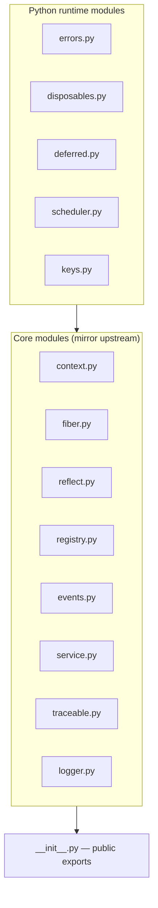
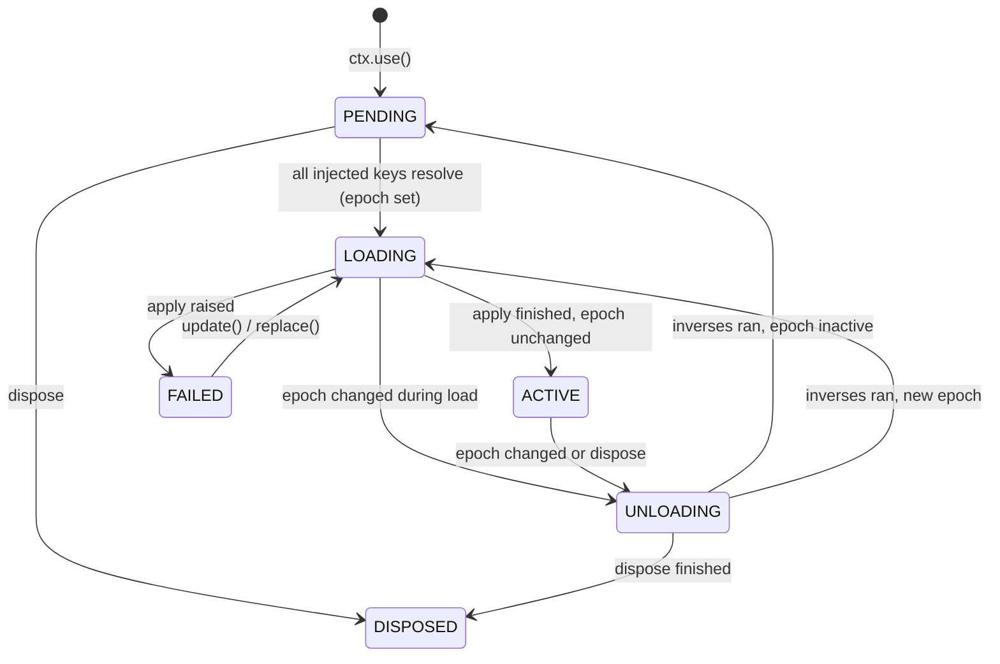

# Build Spec: pycordis Core Port

**Status**: ⬜ Not started — reviewed (2026-11-14), awaiting execution approval

## Goal

Implement the Cordis programming model in Python as `pycordis` `v0.1.0`: keep every
semantic-contract property, give the upstream result in every upstream test scenario of
`packages/core`, use a scheduler model that needs no event loop, and give a public contract that
host applications can adopt.

## Why This

Python applications that load plugins at runtime (panels, tools, services, node libraries)
usually register into global tables that only append. Such registrations have no inverse, so a
plugin cannot be unloaded or reloaded without a process restart, and a provider that leaves
breaks its dependents. Cordis solves this with fibers that own revertible effects and declare
their dependencies, and its calculus proves recovery, ordering, progress, and confluence. A
Python implementation that keeps the
[semantic contract](../architecture.md#semantic-contract) gives Python hosts the same
guarantees, and the conformance ledger shows each upstream change that needs review.

## Architecture

### Keep the contract, conform to upstream, design for Python

Each upstream module in `packages/core/src` has one Python module with the same
responsibilities and state names. Behavior is correct when it keeps the contract properties and
gives the upstream result in each upstream test scenario. Only the fiber state machine and the
epoch digest copy the upstream control flow (`mirror = true` in the ledger); the other modules
use the clearest Python that gives the same results. Intended differences are the rows of
[Appendix A](#appendix-a-divergences), each with a kind. Any other difference in behavior is a
bug.



### Async model without an event loop

The Promise-based upstream lifecycle runs on a scheduler:

- A **task** is a native coroutine that a pycordis scheduler drives on the owner thread with
  `send`/`throw`. asyncio is not used.
- A **`Deferred[T]`** is the only awaitable that a task can await, apart from a `Fiber`. Any
  thread can complete it. A task that awaits an incomplete `Deferred` parks. When the `Deferred`
  completes, the task goes back on the ready queue through the scheduler's thread-safe submit
  path.
- An upstream microtask hop (`await Promise.resolve()`) is one scheduler step. Upstream order is
  kept: `ctx.use()` returns before the fiber's `apply` runs.
- `ImmediateScheduler` drains the ready queue when the outermost pycordis call returns. Tests and
  headless hosts use it. `FramePumpScheduler` runs at most a fixed number of steps per `pump()`
  call and never blocks. A host with a frame loop pumps it once per frame.

### Fiber lifecycle

The states and transitions are those of upstream `FiberState`. The epoch digest decides every
transition, as in upstream `Fiber._refresh` / `_setEpoch`:



## File Structure

The repository scaffold (`pyproject.toml`, `LICENSE`, `README.md`, docs site,
`tests/conftest.py`) exists. This spec adds:

```
src/pycordis/
├── __init__.py           # MODIFY: public exports
├── context.py            # NEW: Context, extend / isolate / intercept, item access
├── fiber.py              # NEW: Fiber, FiberState, effect(), lifecycle, update / restart
├── reflect.py            # NEW: ReflectService, Impl, locate(), accessor / mixin
├── registry.py           # NEW: RegistryService, Component forms, Inject, @inject, replace()
├── service.py            # NEW: Service base: provide on construct, hooks, intercept merge
├── events.py             # NEW: EventsService, internal/* events
├── logger.py             # NEW: LoggerService over stdlib logging
├── traceable.py          # NEW: tracker, def-site / use-site views
├── keys.py               # NEW: Key[T] typed handle
├── scheduler.py          # NEW: Scheduler protocol, task trampoline, Immediate / FramePump
├── deferred.py           # NEW: Deferred[T], from_future()
├── disposables.py        # NEW: DisposableList
└── errors.py             # NEW: CordisError, ValidationError, call-site notes
tests/
├── test_<upstream>.py    # NEW: one per packages/core/tests/*.spec.ts (17 files)
├── test_effect_forms.py  # NEW: Python-only effect forms
├── test_scheduler.py     # NEW: drain / pump / submit / park-resume
├── test_threading.py     # NEW: owner-thread assertion, cross-thread Deferred completion
└── test_invariants.py    # NEW: randomized-schedule calculus invariants
docs/
├── user_guide.md         # NEW: concepts and host integration
└── architecture.md       # MODIFY: module map, divergence rows
README.md                 # MODIFY: first release, usage pointer
```

## Implementation References

- **Upstream source of truth**: `cordiverse/cordis` `packages/core/src/*.ts` and
  `packages/core/tests/*.spec.ts` at revision `68c9d9917871d8680bc7ccb9034b9284d5102433` define
  the behavior to conform to. The paper (arXiv `2608.25512`) defines the contract; for example,
  the dependents guard in `Fiber._unload` keeps `LIFE-ORDER` (Theorem 70).
- **Lifecycle core**: `Fiber._refresh`, `_setEpoch`, `_reload`, `_unload`, `_checkImpl`,
  `_replace`, `update`, `restart` in `fiber.ts`. Port each as an `async def` task that keeps the
  upstream structure (`mirror = true`): `LIFE-ORDER` and `LIFE-COHERENT` depend on it.
- **Effect execution**: `Fiber._execute` and `Fiber.effect` in `fiber.ts`, covering each return
  form, the `epoch` guard on async iteration, the dispose-once wrapper, and child effect metadata.
- **Provision and release**: `ReflectService.provide`, `notify`, `_getImpl`, and `locate` in
  `reflect.ts`. A provider's disposal waits on `impl.release` until its dependents leave.
- **Registry**: `RegistryService.use`, `_forward`, `_create`, `replace`, and `Inject.resolve` in
  `registry.ts`. `replace` moves live fibers to the new component through `Fiber._replace`.
- **Service base**: `Service` constructor, `[symbols.extend]`, `[symbols.mergeIntercept]`, and
  `[symbols.resolveIntercept]` in `service.ts`.
- **Traceable views**: `getTraceable`, `createTraceable`, `createShadow`, `withProps` in
  `utils.ts`. The view is the port of the Proxy. The `spec` handling of `__class__` in
  `unittest.mock` shows how `isinstance` can be true for a forwarding object.
- **Config validation errors**: `ValidationError` (with its static `formatPath`) in `fiber.ts`,
  which upstream raises from `resolveConfig`.
- **Name and test mapping**: [Port an Upstream Change](../developer_guide.md#port-an-upstream-change).

## Key Constraints

### Boundaries

- No runtime dependencies; no imports of `asyncio` or of any host application or GUI toolkit.
  Config validation is duck-typed (see below), so pydantic is not imported.
- Python `>=3.12`. PEP 695 generic syntax is allowed.
- MIT license; `LICENSE` keeps the upstream copyright line.

### Context and access

- `Key[T]` is a typed handle with a `name: str`. Every API that takes a key also takes a plain
  `str` (the upstream names).
- `ctx[key]` is strict and mirrors the upstream Proxy `get` trap. It raises `CordisError` with
  the upstream messages: `cannot get property "<name>" without inject` and
  `cannot get required service "<name>" in inactive context`. `ctx.get(key)` is lenient and
  mirrors `ReflectService.get` (returns `None`); its static type is `T | None`. The static type
  of `ctx[key]` is `T`.
- Attribute-style service access (`ctx.foo`) is not ported. `Context` members are explicit,
  statically typed methods that forward to the core services (`get`, `set`, `provide`,
  `accessor`, `mixin`, `effect`, `inject`, `use`, `on`, `once`, `emit`, `parallel`, `serial`,
  `bail`, `waterfall`). Names that `accessor` / `mixin` register resolve only through
  `ctx[name]`.
- Key access accepts `Key[T]` or `str` throughout: `Keyable[T] = Key[T] | str`. `Key[T]` has
  `__init__(self, name: str)` and a read-only `name`. A `Key`'s equality and `hash` follow its
  name (`Key("a") == "a"`, `hash(Key("a")) == hash("a")`), so both spellings resolve to the same
  `Impl`. Public signatures:
  - `Context.effect(self, fn: Callable[[], EffectForm], label: str = "anonymous") -> Disposer` —
    ports the upstream `Fiber.effect` overloads to one entry point; the returned disposer runs
    the effect's inverses (each still at most once).
  - `Context.use(self, component: Component, config: object = None) -> Fiber` — like upstream,
    the call returns before `apply` runs. `fiber.wait()` resolves when the fiber reaches
    `ACTIVE` and rejects with the recorded error when it reaches `FAILED` (the guarantee the
    upstream `Fiber & PromiseLike<Fiber>` return type gives).
  - `Context.set(self, key: Keyable[T], value: T) -> None`.
  - `Context.provide(self, key: Keyable[T], value: T) -> Disposer` — ports
    `ReflectService.provide`, whose upstream disposer is the `() => void`.
- Derived contexts (`extend`, `isolate`, `intercept`) are new `Context` objects that point to
  their parent. Isolation and intercept tables are chained mappings (`collections.ChainMap` or
  equivalent). A key is read from the nearest table that owns it, as the upstream
  `Object.hasOwn` + prototype walks do.
- Upstream symbol-keyed hooks become `cordis_`-prefixed attributes: `cordis_init`,
  `cordis_check`, `cordis_invoke`, `cordis_extend`, `cordis_merge_intercept`,
  `cordis_resolve_intercept`, `cordis_metadata`, `cordis_tracker`. Do not add dunder names.

### Effects

- `ctx.effect(fn, label="anonymous")` accepts a callable that returns one of: `None`, a disposer
  callable, a sync iterator of disposers, an async iterator of disposers, or a coroutine that
  returns a disposer — the upstream forms. Any other return raises `TypeError("Invalid effect")`.
  The return type is `Disposer` for every form, including the async ones (the async iterator /
  coroutine forms discard their awaitable result).
- `Disposer = Callable[[], Deferred[None] | None]`. Returning a `Deferred` is the port of the
  upstream `Promise`-valued dispose; a disposer that does not wait returns `None`. `Fiber.wait()`
  returns `Deferred[None]` (`None` when the fiber reaches `ACTIVE`, the exception when it reaches
  `FAILED`).
- A disposer runs at most once. A second call does nothing (upstream `runner.epoch` guard). An
  async iterator stops at the first iteration boundary after its effect is disposed, and its
  `aclose()` runs so that `finally` blocks execute.
- An effect belongs to the fiber that created it, not to the returned handle: the fiber holds
  the effect's resources, so they live exactly as long as the fiber, and no internal link to
  them is a weak reference. Dropping a handle can therefore neither close resources early nor
  trigger teardown at collection. Disposal is explicit: pycordis adds no finalizer (the upstream
  core has none) and its types do not implement `__del__`. An effect still registered when the
  root fiber's disposal finishes is a host leak: pycordis logs it at level `DEBUG` and does not
  attempt to revert it.
- A coroutine or async generator can await only a `Deferred` or a `Fiber` (whose `__await__`
  forwards to `fiber.wait()`). Awaiting any other object raises `TypeError` at the `await`.
  `Deferred.from_future(concurrent.futures.Future)` connects work that runs on other threads.
- `Fiber._unload` starts disposers in reverse registration order. Synchronous disposers run one
  after another. Disposers that return a `Deferred` complete concurrently, as upstream
  `Promise.all` does. A disposer exception is logged with the effect label and does not stop the
  others.
- Error context: `ctx.use()` and `ctx.effect()` capture their call site at low cost (frame
  objects, not formatted strings). On an exception, the formatted call site is attached with
  `BaseException.add_note` (the port of `composeError` / `buildOuterStack`).

### Lifecycle and services

- State names, the epoch digest (`"<revision>:<impl uid>…"`), the `INACTIVE` sentinel, and the
  transitions match `fiber.ts`. Provider identity is the `Impl.uid`, never value equality. A
  provider that changes its value in place with `ctx.set` is not observed (upstream behavior).
- A duplicate `provide` in one realm raises `service "<name>" has been registered at <fiber>`.
- A fiber unloads only after every dependent of its provisions has unloaded (`impl.dependents` /
  `_release`). A provision's disposer waits on `impl.release` before it removes itself.
- An exception from `apply` is logged. The fiber's collected effects are disposed, and the fiber
  goes to `FAILED`. It loads again only through `update()` — which clears the recorded error and
  restarts through the default path of the `internal/update` waterfall — or through
  `RegistryService.replace()`. A direct `restart()` on a failed fiber re-raises the recorded
  error instead of recovering (upstream `_setEpoch` returns early while an error is stored).
- Component forms: a function `(ctx, config)`, a class whose `__init__(self, ctx, config)` is the
  constructor form (`inspect.isclass`), or an object with `apply(ctx, config)`. Metadata
  attributes: `name`, `Config`, `inject` (a list of names or keys, or a dict from name to
  intercept config), `provide` (a `str` or a list), `intercept`. Components set these attributes
  directly on the function, class, or object, as upstream does; pycordis adds no metadata
  decorator. `@inject(name, config)` ports the upstream class and method decorator, including
  method-level init hooks.
- `Config` is either an object with a `model_validate` callable (pydantic-compatible) or a
  callable transform `(raw) -> validated` (upstream `Component.Transform`). A failure becomes a
  pycordis `ValidationError` whose message uses the upstream `formatPath` layout.
  `ValidationError` subclasses `TypeError`, as upstream `ValidationError extends TypeError` does.
  Issue paths are read from the validator error's `errors()` method when it has one.
- `EventsService` keeps the upstream event names (`internal/plugin`, `internal/status`,
  `internal/service`, `internal/update`, `internal/config`, `internal/get`, `internal/set`,
  `internal/listener`, `internal/dispatch`, `internal/commit`, `internal/replace`) and dispatch
  modes. `parallel` and `serial` return a `Deferred`. `parallel` reports listener failures as one
  `ExceptionGroup` (the port of `AggregateError`).
- `LoggerService` exposes the fiber logger as `logging.getLogger("pycordis." + fiber.name)`. The
  library adds no handlers.
- Traceable views: a service opts in with `cordis_tracker` (`property`, `associate`,
  `no_shadow`). Access through a context returns a view:
  - The tracked property (normally `ctx`) reads as the use-site context.
  - Methods run with the use-site context, so an effect that a service method creates when it is
    called through a view belongs to the caller's fiber.
  - `isinstance(view, ServiceClass)` is true.
  - The def site decides resolution. The use site decides isolate, intercept, and effects.
  - The shadow chain and the caller context are readable through a public introspection
    attribute (one on the view, one on the context), so the upstream tests that walk
    `ctx[symbols.shadow]` and read `symbols.caller` port without private access.
  - Only these semantics are required, not a specific mechanism. `test_associate.py`,
    `test_shadow.py`, and `test_invoke.py` (translated from upstream) check them.
- Deprecated upstream aliases (`ctx.plugin`, `EventsService.dispatch`) are not ported.

### Scheduling and threads

- Every `Context`, `Fiber`, and core-service method asserts that it runs on the owner thread. A
  call from another thread raises `CordisError("WRONG_THREAD")`. Only two operations are
  permitted from other threads: `Scheduler.submit(fn)` and `Deferred` completion.
- `ImmediateScheduler.run_until_quiet(timeout)` also blocks on parked `Deferred`s, so a headless
  host can finish deferred teardown before it exits. `FramePumpScheduler.pump(max_steps)` never
  blocks.
- An empty `pump()` returns in constant time and allocates nothing, because a frame-loop host
  calls it on every frame.
- Signatures: `Scheduler.submit(self, fn: Callable[[], None]) -> None`;
  `FramePumpScheduler.pump(self, max_steps: int) -> int` (the number of steps it ran);
  `ImmediateScheduler.run_until_quiet(self, timeout: float | None = None) -> None`, raising
  `TimeoutError` past `timeout`. `Deferred[T]`: `result() -> T`,
  `resolve(self, value: T) -> None`, `reject(self, error: BaseException) -> None`,
  `__await__() -> Generator[Any, None, T]`,
  `from_future(cls, future: concurrent.futures.Future[T]) -> Deferred[T]`.

### Host contract

These are the public guarantees that a host application builds on. Each is part of the public API
and is tested through it.

- **Scheduler selection**: the host creates the root `Context` with a scheduler. A frame-loop host
  can drain a `FramePumpScheduler` to quiescence once (for example, before its first frame) and
  then pump it per frame.
- **Thread-safe submit**: `Scheduler.submit(fn)` is the one entry point for work that starts on
  other threads (file watchers, worker pools). `fn` runs on the owner thread at the next step.
- **Registry adapters**: a host registry that wants revertible entries exposes
  `add(entry) -> Disposer` and is called through `ctx.effect` on the caller's fiber. The user
  guide documents this pattern; the library provides no host registry.
- **Read-only introspection**: `fiber.name`, `fiber.state`, `fiber.uid`, `fiber.inject`,
  `fiber.committed`, `fiber.provisions`, `fiber.parent`, `fiber.children`,
  `fiber.get_effects()` (a tree of effect labels), `fiber.error` (the last `apply` exception, or
  `None`), and the `internal/status` event. A host builds status views and component APIs from
  these without private access. pycordis stores no host data on a fiber; a host that associates
  data with fibers keys its own table by the fiber.

## Integration

- `pycordis/__init__.py` exports the public API: `__version__` (present), `Context`, `Fiber`,
  `FiberState`, `Key`, `Service`, `Deferred`, `Scheduler`, `ImmediateScheduler`,
  `FramePumpScheduler`, `CordisError`, `ValidationError`, `inject`, and the `Disposer` type
  alias.
- `docs/user_guide.md` (new nav entry in `zensical.toml`): concepts (context, fiber, effect,
  service, key), choosing a scheduler, the host contract, and the coeffect rule: bind a service
  at a key for the lifetime of its provider, and keep a value that changes often inside a stable
  service that publishes change events, because a rebind reloads every dependent.
- `docs/architecture.md`: the module map and one divergence row for each divergence in
  [Appendix A](#appendix-a-divergences), added in the increment that implements it.
- `conformance/ledger.toml`: the entries for the upstream items that each increment implements,
  added in that increment (once the conformance tooling exists).
- Release: version `0.1.0` in `pyproject.toml`, tag `v0.1.0`.

## Testing

- ⬜ Each of the 17 upstream `packages/core/tests/*.spec.ts` files (associate, component,
  decorator, dispose, events, fiber, intercept, invoke, isolate, logger, reflect, replace,
  service-dispose, service, shadow, update, utils) has a `tests/test_<name>.py` whose tests carry
  the `upstream` markers of the cases they translate. An upstream case that pycordis does not
  follow has a `diverged` ledger entry and a test marked with its divergence. A module is
  complete when it holds every translatable upstream case: `test_utils.py` by Increment 1,
  `test_dispose.py` and `test_component.py` by Increment 4, `test_fiber.py` by Increment 5, and
  `test_reflect.py` and `test_isolate.py` by Increment 7. A module shared before its upstream
  dependencies exist holds the subset that runs and grows in the increment that unblocks the
  rest.
- ⬜ The upstream test helpers (`tests/utils.ts`: `withTimers`, `sleep`, `event`, `Counter`,
  `getHookSnapshot`, `Filter`, `Session`; and the `Events` entries of `events.types.ts`) port
  into fixtures and small classes in `tests/conftest.py`, not into a separate helpers module.
  A fake-timer case becomes explicit `pump()` steps and manual `Deferred` completions; no
  wall-clock waiting.
- ⬜ Effect forms: a disposer, a sync iterator, an async generator that awaits a `Deferred`, and
  a coroutine each register and dispose in LIFO order. An invalid return (including a context
  manager) raises `TypeError`. Awaiting an object that is not a `Deferred` raises `TypeError`
  (parametrized).
- ⬜ A disposer called twice runs once. An exception in one disposer is logged, and the other
  disposers still run. Dropping the handle returned by `ctx.effect()` does not dispose the
  effect, and root disposal logs each still-registered effect at level `DEBUG` without
  reverting it.
- ⬜ `ctx.use()` returns before `apply` runs. `ImmediateScheduler` reaches quiescence when the
  outermost call returns.
- ⬜ `FramePumpScheduler.pump(n)` runs at most `n` steps. `pump()` on an empty queue returns `0`
  in constant time. A `tracemalloc` check supports the no-allocation intent: after a warm-up
  call, a window containing only `pump()` reports no new traces. If the interpreter adds noise
  on a platform, that check warns and the timing assertion still gates.
- ⬜ A call from a second thread raises `WRONG_THREAD`. A `Deferred` completed on a worker thread
  resumes its parked task at the next owner-thread step. `submit` from a worker thread runs its
  function on the owner thread.
- ⬜ A provider stays `UNLOADING`, with its effects in place, until the teardown of its dependent
  finishes reading the service. Then the provider's inverses run.
- ⬜ A dependent in `LOADING` whose provider is replaced exits through `UNLOADING` and reloads
  against the new provider. No iteration runs against two resolutions.
- ⬜ An `apply` that raises gives `FAILED`, with `fiber.error` set and every effect collected
  before the raise disposed. `update()` recovers the fiber.
- ⬜ `RegistryService.replace(old, new)` moves live fibers to the new component and reloads them;
  the inverses of the old component run first.
- ⬜ Introspection: `get_effects()` returns the label tree in registration order, and
  `fiber.children` covers the live fibers of each runtime across reloads.
- ⬜ Invariant suite (`test_invariants.py`, seeded `random.Random`, parametrized over seeds):
  random interleavings of `use` / `dispose` / provider replacement over a small component pool
  satisfy all of these, each test marked with its contract ID:
  - (a) `EFF-REVERT`: disposing a fiber restores every provider table and event-hook table to
    the state without it;
  - (b) `LIFE-ORDER`: a provider never runs inverses while a dependent is installed;
  - (c) `LIFE-PROGRESS`: every schedule reaches quiescence;
  - (d) `LIFE-CONFLUENT`: at quiescence, the context's observable structure matches that of a static load of the
    same components in pool listing order (the test fixture lists the pool, the reference load
    uses that order): the same fiber tree, the same fiber for each key from `ctx.get`, and the
    same effect labels per fiber in registration order.
  Mark the module `slow` if a seed measures ≥ 0.1 s.
- ⬜ The error note on a failed `apply` names the `ctx.use()` call site.

## Dependencies

- **Runtime**: none.
- **Dev**: `pytest`, `ruff` (present). The `model_validate` config tests use a stdlib fake
  validator (a class whose `model_validate` raises an exception carrying an `errors()` method),
  not a validator dependency.
- **Docs**: `zensical`, `mkdocstrings[python]`, `pymdown-extensions` (present).

## Migration Strategy

Validate each increment with the command that it names, then `uv run ruff check .` and
`uv run ruff format --check .`. Each increment adds the divergence rows and docstrings for what
it implements.

### Increment 1: Disposables, Deferred, ImmediateScheduler
**Goal**: `DisposableList`, `Deferred`, the task trampoline, and `ImmediateScheduler` work alone.
**Files**: `disposables.py` (~70), `deferred.py` (~90), `scheduler.py` (~150), `errors.py`
(~60), `test_utils.py`, `test_scheduler.py`
**Validation**: `uv run pytest tests/test_utils.py tests/test_scheduler.py`
**Status**: ⬜ Pending

### Increment 2: Context and effects
**Goal**: `Context` with `extend` / `isolate` / `intercept`, the root `Fiber`, and `ctx.effect` in
every return form, with LIFO dispose, dispose-once, and call-site notes.
**Files**: `context.py` (~120), `fiber.py` (effect part, ~200), `keys.py` (~30),
`test_effect_forms.py`, `test_dispose.py`
**Validation**: `uv run pytest tests/test_effect_forms.py tests/test_dispose.py`
**Status**: ⬜ Pending

### Increment 3: Reflect — provide, get, set, notify, isolation
**Goal**: `ReflectService` with `Impl`, `locate`, strict and lenient access, `accessor` /
`mixin`, and realm-scoped provision with duplicate detection.
**Files**: `reflect.py` (~260), `test_reflect.py` (the cases that need no component loading)
**Validation**: `uv run pytest tests/test_reflect.py`
**Status**: ⬜ Pending

### Increment 4: Registry and core loading
**Goal**: `ctx.use` / `ctx.inject` in the three component forms with `Config` validation, and the
epoch-driven `_refresh` / `_set_epoch` / `_reload` / `_unload` for a component that loads,
provides, injects, and unloads cleanly — without the dependents guard or the failure paths.
**Files**: `registry.py` (~200), `fiber.py` (lifecycle, ~200), `test_component.py`,
`test_dispose.py`
**Validation**: `uv run pytest tests/test_component.py tests/test_dispose.py`
**Status**: ⬜ Pending

### Increment 5: Fiber lifecycle semantics
**Goal**: `FAILED` from a raising `apply`, reload on a provider change, required-key absence
parking a fiber at `PENDING`, and `internal/status` per provider — the upstream
`fiber.spec.ts` cases that do not need the dependents guard.
**Files**: `fiber.py`, `reflect.py`, `registry.py` (~80 total), `test_fiber.py`
**Validation**: `uv run pytest tests/test_fiber.py tests/test_component.py tests/test_dispose.py`
**Status**: ⬜ Pending

### Increment 6: Dependents guard, update, restart, replace
**Goal**: The provider waits for its dependents, the provision's disposer waits on release, and
`update` / `restart` / `RegistryService.replace` work.
**Files**: `fiber.py`, `reflect.py`, `registry.py` (~120 total), `test_update.py`,
`test_replace.py`, `test_service_dispose.py`
**Validation**: `uv run pytest tests/test_update.py tests/test_replace.py
tests/test_service_dispose.py`
**Status**: ⬜ Pending

### Increment 7: Events and the Service base
**Goal**: `EventsService` with every dispatch mode and `internal/*` hook. The `Service` base with
`cordis_*` hooks and intercept merge and resolve. Complete `test_reflect.py` and add
`test_isolate.py`: their upstream cases load components and services, which exist from here.
**Files**: `events.py` (~200), `service.py` (~100), `test_events.py`, `test_service.py`,
`test_intercept.py`, `test_reflect.py`, `test_isolate.py`
**Validation**: `uv run pytest tests/test_events.py tests/test_service.py
tests/test_intercept.py tests/test_reflect.py tests/test_isolate.py`
**Status**: ⬜ Pending

### Increment 8: Traceable views, logger, @inject
**Goal**: Traceable def-site / use-site views, `LoggerService`, and the `@inject` decorator with
its method-level init hooks.
**Files**: `traceable.py` (~220), `logger.py` (~80), `test_associate.py`, `test_shadow.py`,
`test_invoke.py`, `test_logger.py`, `test_decorator.py`
**Validation**: `uv run pytest` (the view changes effect attribution for every earlier module)
**Status**: ⬜ Pending

### Increment 9: FramePumpScheduler, threading, host contract
**Goal**: Bounded `pump()`, thread-safe `submit`, owner-thread assertions, the introspection
contract, and the randomized invariant suite.
**Files**: `scheduler.py` (~80), `fiber.py` (introspection, ~30), `test_threading.py`,
`test_invariants.py`
**Validation**: `uv run pytest tests/test_scheduler.py tests/test_threading.py
tests/test_invariants.py` (mark each test the **unmarked slow tests** summary lists). Manual: in
`uv run python`, create a root context with `FramePumpScheduler`, `use` a component that
provides a service and one that injects it, pump, and read `fiber.state` and `get_effects()`
for both.
**Status**: ⬜ Pending

### Increment 10: First release
**Goal**: The public exports, the user guide, the completed module map and divergence table, and
tag `v0.1.0`.
**Files**: `__init__.py`, `docs/user_guide.md`, `docs/architecture.md`, `zensical.toml`,
`README.md`, `pyproject.toml`
**Validation**: `uv run pytest` (full suite; the close-out check that marks every test the
**unmarked slow tests** summary lists); `uv run python scripts/gen_ref_pages.py && uv run
zensical build --strict` with no warnings.
**Status**: ⬜ Pending

## Code Standards

- [Architecture](../architecture.md) — design principles and the divergence table
- [Developer Guide](../developer_guide.md) — workflow, checks, slow tests, and release rules
- Source docstrings — the API reference builds from them

This spec is scaffolding — do not cite it, its filename, or its increment numbers in source,
docstrings, comments, or test names. Docstrings state the present rule, not the change that
introduced it.

## Follow-ups

Each item is a separate spec.

1. **Module reload helper**: a port of the module dependency classification of upstream
   `@cordisjs/hmr`, so that a host can reload a Python module and replace its components through
   `RegistryService.replace`.
2. **Declarative loader**: a port of the upstream loader's reconciliation of a configuration tree
   (enable, disable, and per-component config).
3. **Conformance tooling**: the inventory, ledger, and checks in
   [Upstream Conformance](conformance.md). It is a prerequisite of Increment 1.
4. **Upstream sync**: review each later upstream revision with the `port-upstream` skill.

## Appendix A: Divergences

Each row becomes a row of the divergence table in `docs/architecture.md` in the increment that
implements it.

| ID | Kind | Upstream | pycordis | Reason |
|---|---|---|---|---|
| `service-access` | adaptation | `ctx.foo` through Proxy | `ctx[key]` (strict), `ctx.get(key)` (lenient), `Key[T]` | Static typing; no `__getattr__` fallback |
| `async-model` | adaptation | Promise, microtasks | `Deferred` + scheduler task trampoline | A GUI main thread with a frame loop has no event loop |
| `async-effects` | adaptation | `AsyncIterable`, `Promise<Disposable>` | Async generator / coroutine that awaits `Deferred` | Same semantics without asyncio |
| `fiber-wait` | adaptation | `ctx.use()` is `PromiseLike` | `fiber.wait()` returns `Deferred`; `Fiber.__await__` | `await` is a keyword; explicit wait for sync code |
| `config-schema` | adaptation | Standard Schema | `model_validate` or callable transform | No runtime dependencies; pydantic-compatible |
| `hook-names` | adaptation | `Service.init`, `symbols.*` | `cordis_*` attributes | No symbols in Python; no new dunders |
| `error-notes` | adaptation | `composeError` string changes | `BaseException.add_note` | Native Python mechanism |
| `exception-group` | adaptation | `AggregateError` | `ExceptionGroup` | Native Python type |
| `stdlib-logging` | adaptation | `LoggerService` (reggol) | `LoggerService` over stdlib `logging` | Integration with host logging |
| `owner-thread` | improvement | Single-threaded runtime | Owner-thread assertion + `submit` | Python hosts have worker threads; a call from a wrong thread fails at once instead of corrupting the registry (`REG-WELLFORMED`) |
| `host-introspection` | improvement | `state`, `uid`, `parent`, `getEffects()` are public; children live on `runtime.fibers` | Also `fiber.error`; `fiber.children` as a view over the runtime's fibers | A host status view reads the failure cause (`LIFE-FAILURE`) and the fiber tree without the runtime registration internals |
| `deprecated-aliases` | omission | `ctx.plugin`, `events.dispatch` | Not ported | No vestigial API |
