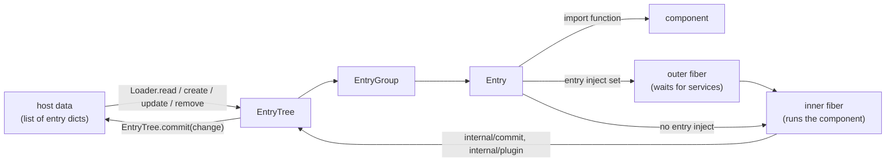

# Build Spec: Declarative Loader

**Status**: 🚧 In progress (Increment 2 of 5 done); spec 1 of 3 (see [Dependencies](#dependencies))

## Goal

Add `pycordis.loader`, a service that keeps a tree of plugin entries (a component name, a
config, and per-entry options) and reconciles the fiber tree with it, so that a host whose plugin
set comes from data gives the data and the loader makes the `use`, `dispose`, and `update` calls.

## Why This

Without a loader, each host that reads its plugin set from data writes its own reconciler. A
short reconciler is easy to write, but the upstream loader exists because of the cases a short one
misses: an entry whose component disposes itself, an entry that moves between groups, an entry
that waits for a service before it loads, a rename while the old fiber unloads, and a partial
failure. The cost and benefit of this item are in the
[core port follow-ups](completed/core_port.md#follow-ups) (item 2).

## Architecture

### Port the reconciliation, not the file format

The loader takes a parsed tree of entries (lists and dicts). It does not read, parse, watch, or
write files. A host that saves runtime changes overrides `EntryTree.commit`, which receives each
change after it is applied. Upstream `@cordisjs/include` (the file format, write-back, and
patches) is not ported.



### Entry lifecycle

An `Entry` holds the options of one tree node and at most two fibers. When the entry has its own
`inject`, an outer fiber injects those services and creates the inner fiber as its child, so the
component loads only when the services exist, also when the component does not declare them.
`name` always selects the component. `group: True` marks the entry as a structure: it is always
enabled, its config must be a list of child entries, and its verdict goes to its children. The
`Group` component is named `"pycordis.loader:Group"`, as upstream tests name `@cordisjs/group`.
The rules of `Entry.update` decide between five results: no change, an in-place `Fiber.update`
(config change), an in-place intercept change, an in-place move, and a rebuild (dispose, then
create, for a change of `name`, `inject`, or `isolate`, or for a move that changes the entry
context or the owner tree).

### Python design decisions

- **No expressions**: `disabled` is a `bool` and every option value is plain data. Upstream
  evaluates JavaScript expressions in `disabled`, `config`, `inject`, and `intercept`
  (divergence `loader-expressions`).
- **Isolation rebuilds**: an entry's `isolate` option derives the entry context through
  `Context.isolate`. A change to `isolate` rebuilds the entry. Upstream moves the live provider to
  the new realm in place (divergence `loader-isolate-rebuild`).
- **Import by Python name**: an entry `name` is `"package.module"` or `"package.module:attribute"`.
  The default import function uses `importlib`, and a host can inject its own
  (divergence `loader-import`).
- **Entry link**: `Loader.entry_of(fiber)` finds the entry of a fiber. `Fiber` gets no `entry`
  attribute (divergence `loader-entry-link`).
- **One public module**: `pycordis.loader` is the only public name. Its implementation modules
  start with `_`, and `scripts/gen_ref_pages.py` writes a package page from a public package's
  `__init__.py`.

- **Tree-owned entry fibers**: the outer or inner fiber of an entry is a child of the fiber of
  the tree that holds the entry, not of the group fiber (divergence `loader-tree-owner`). The
  entry context has the isolation, intercepts, and `meta` of its group's context, bound to the
  tree fiber (`Context.bind_fiber` is the pattern). A group that unloads disposes its members
  through `EntryGroup.stop`, which removes each entry from the store first. A pycordis `Context`
  cannot change its parent and a `Fiber` cannot change its owner, so this design gives the
  upstream move results with no new core operation.
- **Moves**: a move inside one tree keeps the fiber running when the new group context has the
  same isolation, intercept layers, and `meta` as the old one, compared by identity. Any other
  move inside the tree rebuilds the entry (`loader-isolate-rebuild`). A move to another tree
  changes the owner fiber, so it rebuilds the entry (`loader-cross-tree-rebuild`).
- **Plain dict options**: `EntryOptions` is a `TypedDict(total=False)`. `read`, `create`, and
  `update` copy the dicts that the host passes, so the loader owns its options and a later
  change to a host dict has no effect. A host can still read the data back unchanged, with unknown
  keys, and with absent fields different from `None`. `EntryTree.commit` receives copies.

## File Structure

```
src/pycordis/
├── context.py               # MODIFY: a live intercept layer for an entry context
└── loader/                  # NEW: public module pycordis.loader
    ├── __init__.py          # re-exports the public names; module docstring
    ├── _service.py          # Loader service, the internal/* listeners, wait, entry_of
    ├── _tree.py             # EntryTree, EntryChange, default import function
    ├── _group.py            # EntryGroup, Group component
    └── _entry.py            # Entry, EntryOptions, EntryValidationError, isolate derivation
scripts/upstream_inventory.py  # MODIFY: inventory of the packages in the package list
scripts/gen_ref_pages.py     # MODIFY: a page for a public package's __init__.py
conformance/
├── upstream.json            # REGENERATE: core plus loader items
└── ledger.toml              # MODIFY: [inventory] package list; loader entries
tests/
├── test_inventory.py        # MODIFY: package list and prefixed IDs
├── loader_fakes.py          # NEW: RecordingLoader (records commits), module table import
├── test_loader.py           # NEW: index.spec.ts cases
├── test_loader_commit.py    # NEW
├── test_loader_evaluate.py  # NEW: the entry inject and verdict cases
├── test_loader_group.py     # NEW
├── test_loader_import.py    # NEW
├── test_loader_isolate.py   # NEW: isolate.spec.ts and isolate-provide.spec.ts
├── test_loader_rebuild.py   # NEW
├── test_loader_validate.py  # NEW
└── test_loader_contract.py  # NEW: seeded tree-change schedules
```

## Implementation References

- **Upstream** (`packages/loader/src`): `Loader` in `index.ts` (six listeners on five
  `internal/*` events, `Service.check` for the `await` intercept, `showLog`, `locate`); `EntryTree` in
  `config/tree.ts` (`create`, `update`, `remove`, `resolve`, `resolveGroup`, `import`, the
  `EntryChange` reports, cross-tree moves); `EntryGroup` and `Group` in `config/group.ts`;
  `Entry` in `config/entry.ts` (`update`, `refresh`, `init`, `_init`, `_start`, `_reconcile`,
  `dispose`, the `outer` component); `validateOptions` in `config/utils.ts`; `patchIsolate` in
  `config/isolate.ts` for the isolate derivation only.
- **Upstream tests** (`packages/loader/tests`): `MockLoader` in `utils.ts` is the model for
  `tests/loader_fakes.py`: a loader whose import function reads a table of components, and whose
  `commit` records each change. `MockLoader.read` is the model for `Loader.read`.
- **This repository**: `RegistryService.use(ctx, component, config, call_site)` and
  `resolve_inject` (`registry.py`) for the inner and outer fibers; `Fiber.update(config,
  no_save=True)`, `Fiber.restart`, `Fiber.wait`, `Fiber.state`, and `Fiber.committed`
  (`fiber.py`); `Context.extend`, `Context.isolate`, `Context.intercept`, and
  `Context.intercept_layers` (`context.py`); `ReflectService.notify(ctx, ["loader"])` for the
  `loader` service check; `Service`, `cordis_check`, and `cordis_resolve_intercept`
  (`service.py`) for the `await` option; `ValidationError` and `Issue` (`errors.py`) for entry
  options; `Context.logger` for the `loader` log messages.

## Key Constraints

### Public surface

- `Loader(EntryTree, Service)`: `Loader(ctx, config: LoaderConfig | None = None, *,
  import_function: ImportFunction | None = None)`; provides `"loader"`. `LoaderConfig` holds
  `package: str | None` (the anchor of a relative name) and `enable_logs: bool`.
- `Loader.read(data: Sequence[Mapping[str, object]]) -> Deferred[None]`: replaces the root group data, reconciles,
  and completes after `wait()`. It is a Python addition with no upstream symbol: upstream reads
  data through its config file package, and `MockLoader.read` is the model.
- `Loader.wait() -> Deferred[None]`, `Loader.entry_of(fiber: Fiber) -> Entry | None`,
  `Loader.locate(fiber: Fiber | None = None) -> str | None`.
- `EntryTree` (abstract; a component can subclass it for a nested tree, as `commit.spec.ts`
  "cross-tree moves" does): `create(options: Mapping[str, object], parent: str | None = None,
  position: int | None = None) -> Deferred[str]`, `update(id: str, options: Mapping[str,
  object], parent=…, position: int | None = None) -> Deferred[None]`, `remove(id: str) -> None`, `resolve(id: str) -> Entry`,
  `resolve_group(id: str | None) -> EntryGroup`, `entries() -> Iterator[Entry]`,
  `commit(change: EntryChange) -> None` (abstract; `Loader.commit` does nothing).
- `update` tells "no move" from "move to the root group" (upstream `undefined` versus `null`): the
  default of `parent` is a private sentinel, and `None` is the root group.
- `EntryChange` is a frozen dataclass: `id: str`, `group: EntryGroup`, `moved_from: EntryGroup |
  None` (upstream `from`, a Python keyword), `options: EntryOptions | None`, `legacy:
  EntryOptions | None`. `options` and `legacy` are copies, so a host can keep them.
- `EntryValidationError(ValidationError)` has the title "invalid entry options" and the issue
  paths of `validateOptions`.

### Contract

The loader adds one row to the semantic contract table in `docs/architecture.md`. It has no
paper reference, because the loader is an extension of the programming model.

| ID | Guarantee | Paper |
|---|---|---|
| `LOAD-OPTIONS` | The loader changes the options of an entry only for a host call (`create`, `update`, a move, `remove`) or when the entry's own component disposes its own fiber. The loss of a group, a tree, or a dependency, and a rebuild, never change the options of an entry that stays in the tree. | — (loader extension) |

The loader also keeps `LIFE-ORDER`, `LIFE-COHERENT`, and `LIFE-CONFLUENT` for the fibers that it
creates, with the tests in [Testing](#testing). The row enters `docs/architecture.md` in the
increment that adds its marked test, because the conformance checks reject a contract ID that
has no running test.

### Entry options

- `EntryOptions` fields: `id`, `name`, `config`, `group`, `disabled`, `inject`, `intercept`,
  `isolate`. `None` in an update deletes a field, as `Entry.merge` does. An `id` must not contain
  the separator `:`. Every loader message keeps the upstream text (`cannot resolve entry …`,
  `entry … is not a group`, `entry … already exists in the target tree`, the
  `validateOptions` messages); a message of a feature that is not ported has the divergence of
  that feature.
- The boundary copy is a new dict for each entry and, for a group, a new child list with a copy
  of each child entry. The value of a component's `config` is not copied: it can hold objects
  that cannot be copied, and the component's `Config` owns it.
- The loader finds an entry's options in its own group data by identity, never with
  `list.index` or `in`, which compare by value: two entries can have equal options.
- The translated tests compare reported options with `==` on dicts, as upstream compares with
  `deep.equal`.
- `disabled` accepts only `bool` or `None`. A value that upstream reads as an expression fails
  validation.
- An entry without an `id` gets a random eight-character hex `id` that the tree does not use.

### Import

- The import function is `Callable[[str], object | Deferred[object]]`, a constructor argument of
  `Loader` with the `importlib` function as the default. A `Deferred` result lets a test hold an
  import open, so that the rename-during-import cases of `rebuild.spec.ts` port.
- The default function imports the module part with `importlib.import_module`, relative to the
  `package` config of the loader for a name that starts with `.`, and reads the attribute path
  after `:`. A module without `:` is the component itself when it has an `apply` function.
- A `ModuleNotFoundError` whose `name` is the module of the entry is the error of the entry name.
  Any other import error belongs to the component. Both are logged on the entry, and the entry
  does not start.
- The upstream Node resolution helper (`resolve.ts`, `internal.ts`) is not ported: ledger status
  `not-applicable`.

### Lifecycle

- The loader owns the fibers that it creates. A component that disposes its own fiber sets
  `disabled: True` on its entry and reports the change, as the seven cases of the upstream
  `internal/plugin` listener decide. A removal by the loader, a parent unload, and a tree disposal
  are not reported as a self-dispose. With tree-owned fibers, the "parent unload" case reads the
  state of the fiber of the entry's group, not `fiber.parent`; a member that its group stops is
  already out of the store, so the "removed by the loader" case also covers it.
- `internal/commit` from an inner fiber writes the new config to the entry options and reports
  it. `internal/config` from an inner fiber is not changed (no expressions), but the loader keeps
  the upstream listener order so that a validation error stays the error of `Fiber.update`.
- `Loader.wait()` returns a `Deferred` that completes when no entry has an import, a rebuild, or a
  fiber in `LOADING` or `UNLOADING`. Upstream reads the private fiber task (`inertia`); pycordis
  reads `Fiber.state` and keeps the fiber task private. With the `await` intercept option, the
  `loader` service check fails while that is not true, and the loader calls
  `ReflectService.notify(ctx, ["loader"])` when it becomes true.
- `Loader.entry_of(fiber)` gives the entry of the entry's own inner fiber only; `locate` walks up
  the parent fibers, as upstream `locate` does. The loader removes its link to a fiber when the
  fiber is disposed, so a disposed fiber is not kept alive.
- With `enable_logs`, the loader logs `apply`, `unload`, and `reload` of each non-group entry to
  the `loader` logger, as `showLog` does.
- Every method runs on the owner thread (`owner_thread`), as the core services do.

### Intercept and isolation

- An entry's `intercept` option is a live layer of the inner context: an update changes the layer
  in place, and the component keeps running, as in "updates intercept in place". The core gets
  one method for this on `Context` (for example
  `Context.intercept_layer(layer: Mapping[str, object]) -> Self`), because the intercept chain is
  private to `context.py`. The outer fiber does not see the layer.
- The `isolate` option maps a service name to `True` (a realm of the entry) or to a label (a realm
  shared by every entry with that label). The entry context derives from the group context (bound
  to the tree fiber) with one `Context.isolate` call for each name. A change to `isolate` rebuilds the entry, also a
  change that no service of the entry uses. Each case whose assertions count calls or disposals
  across an `isolate` change is `diverged` with `loader-isolate-rebuild`: this is most of
  `isolate.spec.ts` (for example "add isolate on injector (irrelevant)" expects no disposal)
  and all of `isolate-provide.spec.ts`. Each gets a replacement test that asserts the rebuild
  result.

### Not ported

- Source locations, outer stack frames, and `traceValidation`: they serve the config file include
  only (divergence `loader-locations`).
- `envData`, `CORDIS_SHARED`, and the `exit` event: process management for the upstream command
  line (divergence `loader-process`).

### Conformance

- Inventory IDs of a package other than core take the package directory as a prefix:
  `loader/src/config/entry.ts:Entry.update`, `loader/group.spec.ts::Group: basic support::initialize`.
  Core IDs do not change.
- The package list is in `conformance/ledger.toml` (`[inventory] packages`), which the inventory
  script and the conformance checks both read. Core is always in the inventory.
- Translated cases of a package other than core go in `tests/test_<package>_<name>.py` for
  `<name>.spec.ts`, and in `tests/test_<package>.py` for `index.spec.ts`, because the upstream
  packages reuse test file names.
- The inventory scanner rejects three loader files at the tracked revision: `rebuild.spec.ts`
  and `resolve.spec.ts` ("it.each row is not a primitive literal": rows `undefined` and
  `['settings']`), and `src/index.ts` ("unnamed default export": `export default Loader`).
  Increment 1 extends the scanner for these forms, with a scanner test for each.
- Classification of expression cases: a case whose assertions still hold when each expression
  is replaced by plain data is ported with that data. A case that tests the evaluation itself
  (most of `evaluate.spec.ts`, "Loader: disabled js expression", "Loader: config
  interpolation") is `diverged` with `loader-expressions`.
- `import.spec.ts`: "leave a module imported by another one to Node" is `adapted`
  (`loader-import`), with a translated test of a component whose own import fails. "keep the
  hints of Node after the first line" checks Node message text and outer stack frames, and is
  `diverged` with `loader-locations`.
- Move cases (`group.spec.ts` "Group: transfer", `commit.spec.ts` "cross-tree moves" and
  "file-driven moves", `isolate.spec.ts` "Service Isolation: transfer", `evaluate.spec.ts`
  "re-evaluates %s in the new parent context after a move"): a case whose assertions hold is
  `ported`. A case that counts calls or disposals across a rebuild is `diverged` with
  `loader-isolate-rebuild` or `loader-cross-tree-rebuild`. A case that reads the parent of an
  entry fiber is `adapted` with `loader-tree-owner`.

## Integration

- `pycordis.loader` is a public module. The public API is what `pycordis/__init__.py` exports
  plus the public modules `pycordis.loader`, `pycordis.timer`, and `pycordis.hmr`. `import
  pycordis` does not import them, and no core module imports them.
- `pycordis.loader` exports `Loader`, `LoaderConfig`, `EntryTree`, `EntryGroup`, `Group`,
  `Entry`, `EntryOptions`, `EntryChange`, `EntryValidationError`, and `ImportFunction`.
- `pycordis/context.py` gets the live intercept layer method. `pycordis/__init__.py` does not
  change.
- `conformance/ledger.toml`: every loader inventory item reviewed. `resolve.spec.ts`,
  `internal.ts`, and `resolve.ts` items are `not-applicable`.
- Release: an additive change, so the next release is a patch increment. The work goes on
  `feature/loader` from `develop`, merged through a pull request.

## Testing

- ✅ Each upstream case in `packages/loader/tests` has a test with its `upstream` marker, or a
  `diverged` or `not-applicable` ledger entry with a reason
- ✅ `Group` cases: enable and disable of the inner and outer groups, transfer between enabled
  and disabled groups, and config updates that settle the children
- ✅ `commit` reports: a create with its assigned `id`, an update with the previous options, a
  move with its target group, a removal, a config change from `Fiber.update` inside the component,
  and no report for a child fiber that disposes itself
- ✅ Self-dispose of a component sets `disabled: True` and reports it; a parent unload and an
  entry removal do not
- ✅ An entry with `inject` stays pending until the services exist, and keeps its options when a
  dependency is lost and recovered
- ✅ A rename during an import or during the disposal of the old fiber loads the latest name only
  once (import function that returns a `Deferred`)
- ✅ An intercept update changes the running component's intercept without a reload
- ✅ An `isolate` change rebuilds the entry in the new realm (`divergence("loader-isolate-rebuild")`)
- ✅ A move between groups with the same context keeps the fiber running; a move into a group
  with a different isolation rebuilds the entry; a move to another tree rebuilds it under the
  target tree's fiber (`divergence("loader-cross-tree-rebuild")`)
- ✅ An entry fiber is a child of its tree's fiber, and a moved entry stays loaded when its old
  group is disabled or removed (`divergence("loader-tree-owner")`)
- ✅ `LOAD-OPTIONS`: after a move out of a group, the removal or disabling of that group, the loss
  and recovery of a dependency, and a rebuild, the options of the entry are unchanged and `commit`
  gets no report for it; a self-dispose of the component is the only unrequested change
  (`contract("LOAD-OPTIONS")`, and `divergence("loader-move-dispose")` for the move-then-remove
  case, which fails with the upstream behavior)
- ✅ A host dict changed after `read` or `create` does not change the loader state, and a
  reported `options` dict is not the dict the loader keeps
- ✅ A `disabled` value that is not a `bool` fails validation (`divergence("loader-expressions")`)
- ✅ A missing entry module and a missing module that the component imports are told apart
  (`divergence("loader-import")`)
- ✅ `LIFE-CONFLUENT`: seeded random sequences of `create`, `update`, move, `remove`, and disable,
  applied with different interleavings of scheduler steps, reach the same entry tree, fiber tree,
  and fiber states; the seed is in the assertion message. The same sequences check
  `LOAD-OPTIONS`: an entry's options differ from the host's last data only after a self-dispose
- ✅ `uv run pytest`, `uv run ruff check .`, and `uv run ruff format --check .` pass; coverage of
  `pycordis.loader` meets the `fail_under` of `pyproject.toml`

## Documentation

- `docs/user_guide.md`: a section "Load plugins from data": the entry fields, groups, the import
  function and the `module:attribute` name, what the host does to save changes (`commit`), the
  rule that the loader copies the host data and owns the fibers it creates, and which moves keep
  a component running
- `docs/architecture.md`: the `LOAD-OPTIONS` row of the semantic contract table, the module map
  (upstream packages `loader` → `pycordis/loader/`), design
  principle 2 (the reference implementation is the core package and the ported packages), the
  conformance section (the package list and the prefixed IDs), and the divergence rows of
  [Appendix A](#appendix-a-divergences)
- `docs/developer_guide.md` (Release), `docs/contributing.md`, `README.md`, and
  `.github/copilot-instructions.md` (rule 4 and Versioning): the public modules are public API,
  in each place that defines the public API as what `pycordis/__init__.py` exports
- `.github/instructions/upstream-porting.instructions.md`: the test file names and ID prefixes of
  a package other than core
- Docstrings of every public name in `pycordis.loader`, its module docstring (the package page),
  and the new `Context` method; the API pages and nav are generated by `scripts/gen_ref_pages.py`
  (which writes `docs/api/loader.md` from `loader/__init__.py`), so `zensical.toml` needs no
  hand edit. The script docstring states the package-page rule

## Dependencies

- **Sequence**: spec 1 of 3. The specs are done one at a time, in this order: Declarative
  Loader, [Timer Service](timer_service.md), [Module Reload](module_reload.md). Each spec changes
  `conformance/ledger.toml` and regenerates `conformance/upstream.json`, so two specs on
  separate feature branches at the same time conflict in those files.
- **Prerequisite** (before Increment 2): the upstream check of the move scenario is done. At the
  tracked revision, 143 loader tests pass (all except `resolve.spec.ts`, which needs the YAML
  loader hook). In a scratch test, an entry `x` moves out of group `A` to group `B` or to the
  root group:
  - Disable `A`: `x` keeps running. No defect.
  - Remove `A`: upstream disposes `x`, writes `disabled: true` to its options, and reports that
    change to `commit`. The disposal of the inner fiber is still an effect of the `A` fiber,
    and the self-dispose check reads `fiber.parent`, which is now the new group, so the loader
    takes the disposal for a self-dispose. A host that saves `commit` reports then stores
    `disabled: true` for an entry that nobody disabled.
  - Decision: pycordis does not copy this result. Under `loader-tree-owner`, `x` stays running
    and its options do not change. The loader gets the contract ID `LOAD-OPTIONS` (see
    [Contract](#contract)), and the divergence is the `improvement` row `loader-move-dispose` in
    [Appendix A](#appendix-a-divergences). The maintainer will probably not report the defect
    to upstream (draft in [Follow-ups](#follow-ups)), so the row does not depend on an issue
    link. The spec does not post the report.
- **Required by**: Increment 1 of this spec (the package list in the inventory, the
  public-module rule) comes before any work in the Timer Service spec. The complete spec comes
  before any work in the Module Reload spec.
- **Runtime**: none (standard library: `importlib`, `random`, `dataclasses`).
- **Dev**: none new.

## Migration Strategy

### Increment 1: Inventory of other packages and public modules
**Goal**: The inventory and the ledger cover `packages/loader` with prefixed IDs, and the project
rules name the public modules.
**Files**: `scripts/upstream_inventory.py` (~120: package list, prefixed IDs, `it.each` rows
that are `undefined` or arrays, `export default <name>`), `tests/test_inventory.py` (~60),
`conformance/ledger.toml` (package list and `pending` loader stubs), `conformance/upstream.json`
(regenerated), `tests/conformance_checks.py` (if a check assumes core paths)
**Validation**: `uv run pytest tests/test_inventory.py tests/test_conformance.py`; every core ID
and hash in `upstream.json` is unchanged (`git diff` shows only added items)
**Docs**: `docs/architecture.md` (principle 2, conformance), `docs/developer_guide.md`,
`docs/contributing.md`, `.github/copilot-instructions.md` rule 4,
`.github/instructions/upstream-porting.instructions.md`
**Status**: ✅ Completed

**Changed**:
- `scripts/upstream_inventory.py`: `build_inventory(clone, revision, packages)` reads core and each listed package; `main` reads the list from `[inventory] packages` of the ledger
- `scripts/upstream_inventory.py`: IDs of another package have the prefix `<package>/` (sources at any depth under `src`, cases, and `message:`, `event:`, `state:` items); core IDs do not change
- `scripts/upstream_inventory.py`: `it.each` rows can be `undefined`, `null`, an array of primitives (title text `[ 'a', 1 ]`), or an object of primitives (title with `$name`); `it.runIf(cond)('title', …)` is a case; `export default Name` is the symbol `default`
- `conformance/ledger.toml`: `[inventory] packages = ["loader"]` and 326 `pending` loader entries
- `conformance/upstream.json`: regenerated; 326 loader items added, the 457 core items are byte-equal to the earlier file
- `docs/architecture.md`, `docs/developer_guide.md`, `docs/contributing.md`, `.github/copilot-instructions.md`, `.github/instructions/upstream-porting.instructions.md`: package list, prefixed IDs, test file names of a package, and the public modules in the public API rule

**Tests**:
- `tests/test_inventory.py`: new scanner cases (row forms, `it.runIf`, `export default Name`, bad object-row titles), `test_package_items_take_the_package_directory_as_prefix`, and the build test now uses the `packages/core` layout
- `tests/test_inventory.py`: also `test_main_reads_the_package_list_from_the_ledger`, more rejection cases for rows and `it.runIf`; the scanner now rejects an incomplete `it.each` or `it.runIf` call with a `ValueError` (it raised `IndexError`)
- `uv run pytest tests/test_inventory.py tests/test_conformance.py tests/test_docstrings.py`: 118 passed
- `tests/conformance_checks.py` is unchanged: its checks read `kind`, not the ID prefix

**Deviations**:
- The scanner also rejected `it.runIf` and object rows with `$code` titles (`resolve.spec.ts`), not only the forms that the spec names; the rows of `resolve.spec.ts` are objects, not `undefined` or `['settings']`
- `.github/` is excluded from git in this repository (`.git/info/exclude`), so the two `.github` edits do not appear in `git status`

### Increment 2: Entry tree, groups, and commit reports
**Goal**: A flat or grouped tree of entries without `inject` loads, updates, moves, and removes
its components under the tree fiber, and reports each change through `commit`.
**Files**: `loader/__init__.py`, `_service.py`, `_tree.py`, `_group.py`, `_entry.py` (~450
total), `scripts/gen_ref_pages.py` (~10), `tests/loader_fakes.py`, `test_loader.py` (basic
support, failure, recovery, nested config), `test_loader_group.py`, `test_loader_commit.py`,
`test_loader_validate.py`, `test_loader_import.py`
**Validation**: `uv run pytest tests/test_loader*.py tests/test_docstrings.py`;
`uv run python scripts/gen_ref_pages.py` writes `docs/api/loader.md` and no page for a `_`
module; manual: create a `Loader` in `uv run python`, `read` a two-entry tree, and dispose one
fiber from inside its component
**Docs**: docstrings of the new public names; `docs/architecture.md` module map, the
`LOAD-OPTIONS` contract row (with its marked test in `test_loader_commit.py`), and the
`loader-import`, `loader-entry-link`, `loader-locations`, `loader-process`,
`loader-tree-owner`, `loader-cross-tree-rebuild`, and `loader-move-dispose` rows
**Status**: ✅ Completed

**Changed**:
- `src/pycordis/loader/_entry.py`: `EntryOptions`, `EntryValidationError`, `validate_options`, the option copy helpers, and `Entry` (verdict for `disabled`, update with the four results, init, import, start under the tree fiber)
- `src/pycordis/loader/_group.py`: `EntryGroup` (create, remove, unlink, update, stop) and the `Group` component
- `src/pycordis/loader/_tree.py`: `EntryTree` (create, update with moves and cross-tree moves, remove, resolve, entries), `EntryChange`, `ImportFunction`, and the `importlib` import function
- `src/pycordis/loader/_service.py`: `Loader`, `LoaderConfig`, `read`, `wait`, `entry_of`, `locate`, and the `internal/plugin`, `internal/commit`, and `internal/update` listeners
- `src/pycordis/loader/__init__.py`: the public names and the package page text
- `scripts/gen_ref_pages.py`: a public package gives one page from its `__init__.py`
- `docs/architecture.md`: module map, the `LOAD-OPTIONS` row, and eight divergence rows
- `conformance/ledger.toml`: 169 loader entries reviewed (cases, the symbols of Increment 2, the location and expression items, and the Node resolution items)

**Tests**:
- `tests/loader_fakes.py` (`RecordingLoader`, `Mock`) and a `loader` fixture in `tests/conftest.py`
- `tests/test_loader.py`, `test_loader_group.py`, `test_loader_commit.py`, `test_loader_validate.py`, `test_loader_import.py`: 80 tests
- `uv run pytest`: 922 passed; coverage of `pycordis.loader` is 99%
- `uv run ruff check .` and `uv run ruff format --check .` are clean

**Deviations**:
- The `loader-expressions` divergence row is added in this increment, not in Increment 3: the validation test needs it
- The move rule compares the isolation, intercept, and `meta` mappings of two group contexts by the identity of each value (`_same_scope` in `_entry.py`), not by the identity of the layers. The rule is only tested with equal scopes until Increment 4 adds the context method
- Entry `inject`, `intercept`, and `isolate` are validated and stored, but have no effect until Increments 3 and 4. No Increment 2 test uses them at runtime
- `Group.update`, `EntryGroup.update`, and `Entry.update` are coroutines (they are awaited inside tasks). A host calls the `EntryTree` methods, which return `Deferred`
- `EntryTree.create` and `EntryTree.update` raise `EntryValidationError` and `ValueError` at the call, not through the `Deferred`
- The `Loader` sets `cordis_tracker` to `None`, so `ctx["loader"]` gives the loader itself and not a view. Its methods always act for the loader's own context
- Case "transfers the entry to the store of the target tree" and "transfers the members of a moved group" are `diverged` (`loader-cross-tree-rebuild`): the component loads again after the move
- `Entry.pending` (the task that loads the component) is public, because `Loader.wait` reads it from another module
- The recovery cases of `index.spec.ts` use a component that declares `inject`, with plain config data, not an entry `inject`
- Not done in this increment: `Group: intercept::initialize` and the other cases that use entry `inject`, `intercept`, or `isolate` stay `pending`

### Increment 3: Entry inject, rebuilds, and the await check
**Goal**: An entry with `inject` waits for its services in an outer fiber, a change of `name` or
`inject` rebuilds the entry once, and the `await` intercept holds the `loader` service.
**Files**: `_entry.py`, `_service.py` (~250), `test_loader_evaluate.py`, `test_loader_rebuild.py`,
`test_loader.py` (intercept config, pending update, parent teardown, replaced component)
**Validation**: `uv run pytest tests/test_loader*.py tests/test_replace.py`
**Docs**: `loader-expressions` row; docstrings of `Entry` and `Loader.wait`
**Status**: ⬜ Not started

### Increment 4: Intercept layer and isolation
**Goal**: An intercept update changes a running component in place, and an `isolate` change or a
move into a group with a different context rebuilds the entry in its new realm.
**Files**: `context.py` (~30), `_entry.py` (~80), `test_loader_isolate.py`,
`test_loader_evaluate.py` (intercept cases), `test_context.py` or `test_intercept.py` (the new
method)
**Validation**: `uv run pytest tests/test_loader*.py tests/test_intercept.py tests/test_isolate.py`
**Docs**: `loader-isolate-rebuild` row; docstring of the new `Context` method
**Status**: ⬜ Not started

### Increment 5: Contract schedules and close-out
**Goal**: The `LIFE-CONFLUENT` schedule test covers the loader, and the guides describe it.
**Files**: `test_loader_contract.py` (~120)
**Validation**: `uv run pytest`; the full-suite unmarked slow tests section is empty; zero
`pending` loader entries in the ledger
**Docs**: `docs/user_guide.md` section; review of every `pycordis.loader` docstring; check of
`docs/architecture.md` against the code
**Status**: ⬜ Not started

## Code Standards

- [Contributing](../contributing.md): the test and docstring standards, with the pull request
  checklist
- [Developer Guide](../developer_guide.md): the upstream review procedure, slow tests, and
  release rules
- [Architecture](../architecture.md): the semantic contract, conformance, and the divergence
  table
- The instruction files in `.github/instructions/`: Python Coding Standards, Docstrings &
  Markdown Style, Testing Standards, and Upstream Porting

This spec is scaffolding — do not cite it, its filename, or its increment numbers in source,
docstrings, comments, or test names. Docstrings state the present rule, not the change that
introduced it.

## Appendix A: Divergences

The maintainer approved the designs of `loader-expressions` and `loader-isolate-rebuild` in the
design review of this spec, and of `loader-tree-owner` and `loader-cross-tree-rebuild` in the
review of the move design, and of `loader-move-dispose` with the contract row `LOAD-OPTIONS`.
The other rows need approval before their increment.
Each row goes to the divergence table in `docs/architecture.md` in the increment that implements
it.

| ID | Kind | Upstream | pycordis | Contract | Reason and evidence |
|---|---|---|---|---|---|
| `loader-expressions` | omission | JavaScript expressions in `disabled`, `config`, `inject`, and `intercept`, evaluated against the entry context | `disabled` is a `bool`; every option value is plain data | — | No `eval` of config data in a library; a host that needs a condition computes the tree before it calls the loader |
| `loader-isolate-rebuild` | omission | A change of `isolate`, or a move into a group with a different isolation, moves the live provider to the new realm and notifies both sides; a change that no service of the entry uses reloads nothing | A change of `isolate`, or a move that changes the isolation, intercepts, or `meta` of the entry context, rebuilds the entry | — | The in-place move needs a core API that only the loader uses; a rebuild keeps `LIFE-ORDER` with no new core state |
| `loader-tree-owner` | adaptation | An entry fiber is a child of its group's fiber; a move swaps the parent of the entry context, and the disposal stays with the old group fiber | An entry fiber is a child of its tree's fiber; a group stops its members explicitly | — | A pycordis context cannot change its parent, and a fiber cannot change its owner; the move cases pass with no new core operation |
| `loader-cross-tree-rebuild` | omission | A move to another tree keeps the fiber running | A move to another tree rebuilds the entry under the target tree's fiber | — | The owner fiber changes, and a fiber cannot change its owner |
| `loader-import` | adaptation | Import by module specifier, resolved through Node and a project helper | Import by `module` or `module:attribute` through an injected function; `importlib` by default | — | Python import names; the upstream cases with a component table, and "leave a module imported by another one to Node", pass |
| `loader-entry-link` | adaptation | `fiber.entry` property on `Fiber` | `Loader.entry_of(fiber)` | — | No attributes added to a core class from outside it |
| `loader-locations` | omission | Source locations of entry options, outer stack frames, `traceValidation` | Not ported | — | They serve the config file include, which pycordis does not port |
| `loader-process` | omission | `envData`, `CORDIS_SHARED`, the `exit` event | Not ported | — | Process management of the upstream command line |
| `loader-move-dispose` | improvement | After a move out of group A, the removal of A disposes the moved entry, and the loader reports that as a self-dispose: it writes `disabled: true` to the entry options and calls `commit` | The moved entry keeps running, and its options and `commit` reports do not change | `LOAD-OPTIONS` | Upstream breaks `LOAD-OPTIONS` here (reproduction in [Follow-ups](#follow-ups)). The kind is `improvement` because no upstream issue exists, and a `correction` needs a link to one. The test marked `divergence("loader-move-dispose")` asserts the pycordis result. If the maintainer reports the defect, the kind changes to `correction` and the issue link goes in this cell |

## Follow-ups

### Report the move-then-remove defect to upstream

**Status**: ⬜ Draft only. The maintainer decides when and how to report it, and will probably
not report it. Nothing is posted. The divergence `loader-move-dispose` does not depend on this
report. If the issue is filed, change that row to `correction` and add the issue link.

The reproduction was run at the tracked revision. The issue text below names no pycordis
detail, so it is ready to paste.

**Title**: A removed group disposes an entry that was moved out of it, and the loader records
`disabled: true` for that entry

**Body**:

> **Version**: `cordiverse/cordis` at `68c9d9917871d8680bc7ccb9034b9284d5102433`
> (`@cordisjs/loader` 1.0.0-rc.10)
>
> **What happens**
>
> `EntryTree.update(id, {}, parent)` moves an entry to another group without a reload. After
> that, removing the group that the entry left disposes the entry's fiber. The `internal/plugin`
> listener of `Loader` takes this disposal for a self-dispose: it sets `options.disabled = true`
> and calls `commit()`. A host that persists `commit()` reports stores `disabled: true` for an
> entry that nobody disabled. Disabling the old group instead of removing it does not trigger
> this.
>
> **Reproduction** (a new case in `packages/loader/tests`, with the `MockLoader` of `utils.ts`)
>
> ```ts
> it('does not mistake the disposal for a self-dispose', async () => {
>   const root = new Context()
>   await root.use(MockLoader)
>   const loader = root.loader as any as MockLoader
>   loader.mock('foo', () => {})
>   await loader.read([
>     { id: 'a', name: '@cordisjs/group', group: true, config: [{ id: 'x', name: 'foo' }] },
>     { id: 'b', name: '@cordisjs/group', group: true, config: [] },
>   ])
>
>   await loader.update('x', {}, 'b')
>   await loader.await()
>   loader.changes = []
>
>   loader.remove('a')
>   await loader.await()
>   await sleep()
>
>   expect(loader.store['x']!.options).to.deep.equal({ id: 'x', name: 'foo' })
>   expect(loader.changes.filter(change => change.id === 'x')).to.have.length(0)
>   loader.expectFiber('x')
> })
> ```
>
> The test fails at the first assertion: the options of `x` are
> `{ id: 'x', name: 'foo', disabled: true }`. The same happens when `x` moves to the root group,
> and `commit()` receives a change for `x` with `disabled: true`.
>
> **Cause**
>
> `Fiber` ties its own disposal to the fiber of the context that created it:
> `this.dispose = parent.fiber.effect(...)`. A move changes the prototype of the entry context but
> not this link, so the inner fiber of `x` stays an effect of the fiber of `a`. When `a` goes
> away, that fiber is disposed. The listener then tests whether the disposal is a self-dispose.
> Its case 5 (the parent is unloading) reads `fiber.parent.fiber`, which is now the fiber of `b`,
> so it does not match. Case 6 (the entry is removed by the loader) does not match either,
> because `x` is still in the store.
>
> **Possible direction**
>
> Record the fiber that owns the inner fiber when `Entry._start` creates it, and use that fiber
> in case 5, so that the loss of the owner is not reported as a self-dispose. Whether the entry
> should also keep running after the move (so that the removal of `a` does not dispose it) is
> your decision; the minimal change stops the wrong `disabled: true` write.
