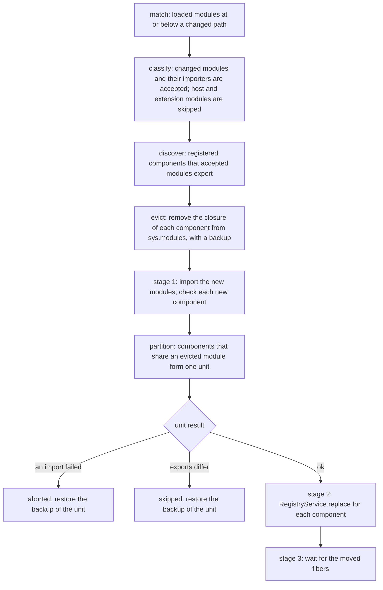

# Build Spec: Module Reload

**Status**: 📝 Draft — reviewed, not started; spec 3 of 3 (see [Dependencies](#dependencies))

## Goal

Add `pycordis.hmr`, a service that takes a set of changed file paths, decides which loaded Python
modules must reload together, imports them again, and moves the live fibers of their components
to the new code through `RegistryService.replace`, or reports why a change cannot apply without a
restart.

## Why This

`RegistryService.replace` swaps one component for another, but a host must still find the
modules that a change affects, evict and import them in an order that does not mix old and new
code, find the new component, and keep the old code when an import fails. This service does that
work. It is for development tools and interactive hosts; a production host can restart. The cost
and benefit of this item are in the [core port follow-ups](completed/core_port.md#follow-ups)
(item 1).

## Architecture

### Transaction stages

`Hmr.reconcile(changes)` runs one transaction at a time. `changes` is a callable that returns the
changed paths, and it runs inside the transaction.



Stages 1 and 2 change only `sys.modules` and the registry, so an aborted unit leaves the running
system as it was. Stage 3 does not roll back: a new component whose `apply` raises leaves its
fiber `FAILED`, as at a first load, and the next change of its file retries it.

### Python design decisions

- **A service**: `Hmr` is a `Service` that provides `"hmr"`. Its start (`cordis_init`) finds the
  host modules and records the first module graph. One `Hmr` is active in each process, because
  `sys.modules` belongs to the process (divergence `hmr-modules`).
- **Modules by name**: a module is its `sys.modules` name, and its file is
  `module.__spec__.origin`. An import after eviction finds the module through `sys.path` again,
  so a module that moved needs no resolution step. The upstream Node resolution, package
  manifest, and CommonJS handling is not ported (divergence `hmr-resolution`).
- **Module graph from `ast`**: by default the edges of a module are the `import` and
  `from ... import` statements of its source, found with `ast`, with relative imports resolved
  against `__package__`, plus an edge from a submodule to its parent package. A host can pass
  its own graph function. An `importlib.import_module` call is not an edge, as upstream treats a
  dynamic import.
- **Old graph from a cache**: a file that changed holds the new source, so the old edges of a
  module cannot come from its file. The service records the edges of a module when it first
  sees the module: at start, and at the end of each transaction for the modules that the
  transaction imported. A reconcile uses the cache for the old graph and calls the graph
  function for the new graph.
- **Graph scope**: the graph covers the modules whose files are below one of the `scope`
  directories of the service config (default: the working directory), and are not below a
  directory of `sysconfig.get_paths()` (`stdlib`, `platstdlib`, `purelib`, `platlib`). A module
  outside the graph never reloads, as upstream treats a builtin. The exclusion is necessary
  because a uv environment is usually `.venv` below the working directory.
- **Components by attribute**: a component of a module is a value in the module namespace, or
  the module itself, that `RegistryService.has` knows. Its replacement is the value of the same
  attribute in the new module. Upstream uses the default export of each module
  (divergence `hmr-modules`).
- **Nested transactions by caller fiber**: pycordis has no execution context that follows a
  task. A call is inside the running transaction when it runs during the synchronous part of
  the transaction (`changes`, the imports, stage 2), or when the fiber of its use-site context
  (`self.ctx` in a traceable view of the service) is a fiber that the transaction moves, or is
  below one. The upstream cases give the same results (divergence `hmr-modules`).
- **No watcher**: the host calls `reconcile` with the changed paths from its own watcher
  (divergence `hmr-watch`).

## File Structure

```
src/pycordis/
└── hmr/                    # NEW: public module pycordis.hmr
    ├── __init__.py         # re-exports the public names; module docstring
    ├── _service.py         # Hmr service, the transaction queue, the stages, the results
    ├── _graph.py           # source_graph, the edge cache, closure, classification, partition
    └── _modules.py         # sys.modules eviction, backup, restore, component discovery
tests/
├── hmr_fixtures.py         # NEW: writes plugin packages under tmp_path, puts them on sys.path
├── test_hmr_graph.py       # NEW: edges of source_graph (Python-only)
├── test_hmr_reconcile.py   # NEW: reconcile.spec.ts cases
└── test_hmr.py             # NEW: index.spec.ts cases (with the loader)
conformance/
├── upstream.json           # REGENERATE: core, loader, timer, and hmr items
└── ledger.toml             # MODIFY: "hmr" in the package list; hmr entries
```

## Implementation References

- **Upstream** (`packages/hmr/src/index.ts`): `Hmr.reconcile` and `_reconcile` (the transaction
  queue, the stages, the result), `Hmr[Service.init]` (host modules), `_match`, `_analyze`
  (accepted and declined modules), `_discover`, `_partition` (the union-find over shared evicted
  modules), `closure`, the restore rules for modules outside every unit and for modules first
  loaded in stage 1, and the `Hmr.Result`, `Abort`, `Skip`, and `SkipReason` types. `_locate`,
  `_moved`, `covers`, and `locatePackage` are resolution: `diverged` with `hmr-resolution`.
  `Hmr.Config` and `_watch`: `diverged` with `hmr-watch`. `src/error.ts` `handleError` formats
  bundler errors: `not-applicable`. `runtime/*.ts` is Node module-loader internals:
  `not-applicable`, except the `activate` message `another HMR instance is active in this
  thread` (`runtime/patches.ts`), which is the source of the single-instance rule.
- **Upstream tests** (`packages/hmr/tests`): `reconcile.spec.ts` (transaction, unit, abort, and
  skip cases) and `index.spec.ts` (loader entries during a reload). `modules.spec.ts`,
  `patches.spec.ts`, `resolution.spec.ts`, and `internal.spec.ts` test Node internals:
  `not-applicable`. `watch.spec.ts` needs the file system service: `diverged` with `hmr-watch`.
- **This repository**: `RegistryService.replace`, `has`, `get`, and `resolve` (`registry.py`);
  the `internal/replace` event; `Fiber.wait` and `Fiber.uid` (`fiber.py`); `Deferred` and
  `start` (`deferred.py`, `scheduler.py`) for the queue and stage 3; `Service` and
  `cordis_init` (`service.py`); the traceable view (`traceable.py`) for the use-site context of a
  call; the `Loader` of `pycordis.loader` for the `index.spec.ts` cases.

## Key Constraints

### Public API

- `Hmr(ctx: Context, config: HmrConfig | None = None, *, graph: ModuleGraph | None = None)`;
  provides `"hmr"`. A second `Hmr` while one is active fails at start with
  `CordisError("another HMR instance is active in this process")`.
- `HmrConfig` (frozen dataclass): `scope: tuple[str, ...]` (default: the working directory at
  service start) and `host_modules: frozenset[str]` (default empty).
- `type ModuleGraph = Callable[[ModuleType], Collection[str] | None]`: the names of the modules
  that a loaded module imports, or `None` for a module outside the graph.
  `source_graph(scope: Iterable[str]) -> ModuleGraph` is the default, and a host can wrap it.
- `Hmr.reconcile(changes: Callable[[], Iterable[str | os.PathLike[str]] | Deferred[Iterable[str | os.PathLike[str]]]]) -> Deferred[ReloadResult]`.
- `ReloadResult(settled: list[Fiber], aborted: list[Abort], skipped: list[Skip])`,
  `Abort(modules: list[str], error: BaseException)`, `Skip(modules: list[str], reason: SkipReason)`:
  frozen dataclasses; `modules` holds module names.
- `SkipReason(StrEnum)`: `HOST_MODULE = "host-module"`, `EXTENSION_MODULE = "extension-module"`,
  `AMBIGUOUS_EXPORT = "ambiguous-export"`.

### Module graph

- `import a.b` gives edges to `a` and `a.b`. `from a import b` gives an edge to `a`, and to
  `a.b` when `a.b` is a module. Imports inside functions and inside `if` blocks are edges.
- A submodule has an edge to its parent package: the import system imports the parent first,
  and a new parent package has no attribute for a submodule that stayed in `sys.modules`.
- A module with no source file (built-in, frozen, namespace package, bytecode only) has no
  edges.

### Classification

- A changed module is a loaded module whose file is a changed path or is below a changed
  directory; a match is on whole path segments. A changed path is absolute and is normalized
  with `os.path.normpath`, not resolved through links. Any other value raises `TypeError` with
  the upstream text `invalid root "<path>", expected an absolute path` (the path as
  `json.dumps` writes it).
- Accepted: every changed module, and every module in the graph that imports an accepted module,
  also when no component uses it, so that a later import gets the new code.
- Skipped with a reason: a host module (`SkipReason.HOST_MODULE`), and an extension module whose
  file suffix is in `importlib.machinery.EXTENSION_SUFFIXES` (`SkipReason.EXTENSION_MODULE`).
- Host modules: the graph closure of `__main__` at service start (none when `__main__` has no
  file), plus the `host_modules` of the config. A host module never reloads, because the host
  holds its objects.

### Components

- An exporter of a component is a (module, attribute) pair. The modules of a component and its
  entries follow `_reconcile` (`urls`, `entries`, the outermost module).
- A new value that is not a component (also a missing attribute, read as `None`) aborts the unit
  with `CordisError` and the upstream text
  `invalid component at <module>, expect function or object with an "apply" method, received <type name>`.
- `SkipReason.AMBIGUOUS_EXPORT`: the exporters of one component now hold different values for
  it. `ambiguous-import` is not ported (`hmr-resolution`): an import by name has one result.
- A replacement that is the old value (`is`), for example a component that an accepted module
  imports by name from a module that did not reload, is not replaced, and its fibers do not
  restart.

### Eviction and restore

- Eviction removes a module from `sys.modules` and the submodule attribute from its parent
  package (`import a.b` sets `a.b`). The backup keeps both, and a restore puts both back.
- `importlib.invalidate_caches()` runs before stage 1, so that the finders see new files.
- A failed import removes the failed module from `sys.modules` itself, so the upstream sweep of
  failed module jobs has no equivalent (`not-applicable`).
- A module that stage 1 loads for the first time stays loaded, unless it imports a restored
  module; then it is evicted, because it ran against the new version.
- An evicted module outside every unit is restored with the kept units it imports, and stays
  evicted when it also imports a committed unit.
- At the end of a transaction, the edge cache holds the new edges of the committed and newly
  loaded modules, and the old edges of the restored modules.

### Transactions

- `reconcile` returns `Deferred[ReloadResult]`. A call while a transaction runs waits for it. A
  call from inside the running transaction (see [Python design decisions](#python-design-decisions))
  rejects with `CordisError("cannot start a transaction inside another transaction")`. A call
  from a moved fiber after the transaction ends runs normally.
- An exception from `changes`, or a rejection of the `Deferred` that it returns, rejects the
  transaction with that exception and leaves `sys.modules` as it was.
- An import error, an exception from `RegistryService.replace`, and a rejection of `Fiber.wait`
  in stage 3 do not reject the transaction. The first two go to the service logger at warning
  level; the fiber logs its own failure. A moved component logs `reload component at <module>`
  at info level.
- Imports run on the owner thread and block it for the time of the import. The docstring of
  `reconcile` states this.
- `ReloadResult.settled` lists the moved fibers that still exist after stage 3 (`uid` is not
  `None`); a fiber that another restarted fiber disposed is not in the list.

### Host limits

These go in the docstring of `Hmr` and in the user guide, because a host cannot see them in the
API:

- An object that the host holds, and a name that a host module imported with
  `from plugin import name`, keep the old code.
- Module globals of a reloaded module start again from the module source. A C extension does not
  reload.
- `sys.modules` belongs to the process, so a reload also affects other root contexts and other
  libraries that imported the module.
- Python checks a bytecode cache file against the source modification time in whole seconds
  and the source size: a change in the same second that keeps the size can load the old
  bytecode. `tests/hmr_fixtures.py` sets `sys.dont_write_bytecode` with `monkeypatch`.
- The old edges of a module that was imported after the last transaction and changed before
  the next one come from its new source.
- A call to `reconcile` through a reference that is not a traceable view (a service object that
  the host keeps outside a context) is not found as a nested call; if a moved fiber waits for
  it, stage 3 does not end.

## Integration

- `pycordis.hmr` is a public module (the public-module rule is set by Increment 1 of the
  [Declarative Loader](declarative_loader.md) spec). It exports `Hmr`, `HmrConfig`,
  `ReloadResult`, `Abort`, `Skip`, `SkipReason`, `ModuleGraph`, and `source_graph`.
- `pycordis.hmr` does not import `pycordis.loader`. The `index.spec.ts` tests use both.
- `conformance/ledger.toml`: `hmr` in the package list, and every hmr item reviewed. IDs have
  the package prefix (`hmr/src/index.ts:Hmr._partition`,
  `hmr/reconcile.spec.ts::Hmr.reconcile::replaces a service`). Cases that test Node module jobs,
  `data:` URLs, `require()`, or loader internals are `not-applicable`; the package, manifest,
  and link cases are `diverged` with `hmr-resolution`; every other case has a test.
- Release: an additive change, so the next release is a patch increment. The work goes on
  `feature/hmr` from `develop`.

## Testing

- ✅ Each upstream case in `reconcile.spec.ts` and `index.spec.ts` has a test with its
  `upstream` marker, or a `diverged` or `not-applicable` ledger entry with a reason
- ✅ Graph (`source_graph`, one parametrized test): `import a.b`, `from a import b` where `a.b`
  is a module, relative imports, imports inside functions, and the submodule-to-parent edge give
  the expected edges; a module outside `scope` and a module below a `sysconfig` directory give
  `None`
- ✅ A module that removed an import keeps its old edges for the classification of the
  transaction that reloads it
- ✅ A component in a changed module, and a component whose dependency module changed, move to
  the new code with their fiber identity and config
- ✅ A component that an accepted module imports by name from a module that did not change does
  not restart
- ✅ A changed module that no component uses is evicted, and its next import gets the new code
- ✅ A unit whose import raises, or whose new attribute is not a component, is aborted:
  `sys.modules` and the fibers are as before, and a later transaction retries it
- ✅ Components that share a changed module abort together; a unit that imports nothing of a
  failed unit still applies
- ✅ A host module and an extension module are skipped, and the other changes apply
- ✅ Two exporters that held one component and now hold different values are skipped
  (`AMBIGUOUS_EXPORT`)
- ✅ Transactions run one at a time; a nested call from `changes` and from the `apply` of a
  moved fiber rejects with the upstream message; the same call after the transaction resolves
- ✅ A second `Hmr` fails at start while one is active, and starts after the first is disposed
- ✅ A relative path and a non-path value reject with `TypeError`, and the modules stay loaded
- ✅ A loader entry keeps its inner fiber, its config, and its `disabled` state across a reload
  (`index.spec.ts`)
- ✅ `LIFE-FAILURE`: a new component whose `apply` raises leaves its fiber `FAILED` with the error,
  and no installed effects; the test runs seeded interleavings of `reconcile`, `dispose`, and
  `FramePumpScheduler.pump` step counts, with the seed in the assertion message
- ✅ `REG-WELLFORMED`: after an aborted unit, every key has the provider it had before the
  transaction
- ✅ The tests that write modules under `tmp_path` remove their `sys.path` entry and their
  modules from `sys.modules` after the test, and write no bytecode; tests with a measured call
  time of 0.1 s or more carry `@pytest.mark.slow`
- ✅ `uv run pytest`, `uv run ruff check .`, and `uv run ruff format --check .` pass; coverage of
  `pycordis.hmr` meets the `fail_under` of `pyproject.toml`

## Documentation

- `docs/user_guide.md`: a section "Reload modules": what reloads together, how a host gives the
  changed paths, the meaning of `settled`, `aborted`, and `skipped`, and the host limits above
- `docs/architecture.md`: the module map (`hmr` → `pycordis/hmr/`) and the `hmr-modules`,
  `hmr-resolution`, and `hmr-watch` rows
- Docstrings of every public name in `pycordis.hmr`, with an example for `Hmr.reconcile`; the API
  pages and nav are generated

## Dependencies

- **Sequence**: spec 3 of 3. The specs are done one at a time, in this order:
  [Declarative Loader](declarative_loader.md), [Timer Service](timer_service.md), Module Reload.
  Each spec changes `conformance/ledger.toml` and regenerates `conformance/upstream.json`, so two
  specs on separate feature branches at the same time conflict in those files.
- **Prerequisite**: the [Declarative Loader](declarative_loader.md) spec is complete (Increment 1
  for the package list and the public-module rule; the loader for the `index.spec.ts` cases).
  This spec does not use the [Timer Service](timer_service.md); only the sequence puts it first.
- **Runtime**: none (standard library: `ast`, `importlib`, `sys`, `sysconfig`).
- **Dev**: none new.

## Migration Strategy

### Increment 1: Module graph and ledger stubs
**Goal**: `source_graph` gives the edges of a loaded module, and the hmr inventory items are in
the ledger as `pending` entries.
**Files**: `hmr/__init__.py`, `hmr/_graph.py` (~120), `tests/test_hmr_graph.py`,
`conformance/ledger.toml`, `conformance/upstream.json`
**Validation**: `uv run pytest tests/test_hmr_graph.py tests/test_conformance.py tests/test_inventory.py`
**Docs**: docstrings of `ModuleGraph` and `source_graph`; none in the guides yet, because no
service uses them
**Status**: ⬜ Not started

### Increment 2: One unit: evict, import, replace, wait
**Goal**: `Hmr.reconcile` reloads the changed modules and their importers, moves the fibers of
their components, aborts a unit whose import fails, and runs transactions one at a time.
**Files**: `hmr/_service.py`, `hmr/_modules.py`, `hmr/_graph.py` (~250 total),
`tests/hmr_fixtures.py`, `tests/test_hmr_reconcile.py`, `conformance/ledger.toml`
**Validation**: `uv run pytest tests/test_hmr_reconcile.py tests/test_replace.py`; manual: in
`uv run python`, write a plugin module to a temporary directory, use its component, change the
file, and call `reconcile`
**Docs**: docstrings; `docs/architecture.md` module map and the `hmr-modules`,
`hmr-resolution`, and `hmr-watch` rows
**Status**: ⬜ Not started

### Increment 3: Units, skips, and nested calls
**Goal**: The partition into units, the restore rules for modules outside every unit and for
modules first loaded in stage 1, the skip reasons, the nested-call rule, and the single-instance
rule.
**Files**: `hmr/_service.py`, `hmr/_graph.py`, `hmr/_modules.py` (~150 total),
`tests/test_hmr_reconcile.py`, `conformance/ledger.toml`
**Validation**: `uv run pytest tests/test_hmr_graph.py tests/test_hmr_reconcile.py tests/test_replace.py`
**Docs**: docstrings of `Skip`, `SkipReason`, and `Hmr` (host limits)
**Status**: ⬜ Not started

### Increment 4: Loader entries and close-out
**Goal**: The `index.spec.ts` cases pass with the loader, the contract tests cover reloads, and
the user guide describes the service.
**Files**: `tests/test_hmr.py` (~150), `conformance/ledger.toml`
**Validation**: `uv run pytest`; the full-suite unmarked slow tests section is empty; zero
`pending` hmr entries in the ledger
**Docs**: `docs/user_guide.md` section; review of every `pycordis.hmr` docstring
**Status**: ⬜ Not started

## Code Standards

- [Contributing](../contributing.md): the test and docstring standards, with the pull request
  checklist
- [Developer Guide](../developer_guide.md): the upstream review procedure, slow tests, and
  release rules
- [Architecture](../architecture.md): the semantic contract, conformance, and the divergence
  table
- The instruction files in `.github/instructions/`: Python Coding Standards, Docstrings &
  Markdown Style, Testing Standards, and Upstream Porting

This spec is scaffolding — do not cite it, its filename, or its increment numbers in source,
docstrings, comments, or test names. Docstrings state the present rule, not the change that
introduced it.

## Appendix A: Divergences

The maintainer approved the `ast` module graph, the edge cache, the caller-fiber rule for nested
calls, and one instance in each process in the design review of this spec. The rows need
approval before Increment 2. Each goes to the divergence table in `docs/architecture.md` in the
increment that implements it.

| ID | Kind | Upstream | pycordis | Contract | Reason and evidence |
|---|---|---|---|---|---|
| `hmr-modules` | adaptation | Modules by URL in the Node caches; edges from the module loader; the default export as the component; `native-addon` skip reason; one instance in each thread; a nested call found through the async context | Modules by `sys.modules` name; edges from `ast` over the modules in `scope`, cached when first seen, or a host function; components by module attribute; `extension-module` skip reason; one instance in each process; a nested call found through the caller fiber | — | The Python import system and the pycordis scheduler. The upstream transaction, unit, abort, skip, and nested-call cases pass |
| `hmr-resolution` | omission | Resolution of moved modules through package manifests and links; `ambiguous-import` skip reason; `require()` modules; `data:` URLs; the sweep of failed module jobs | An import by name finds a moved module; a failed import leaves no module | — | Python has no package manifests or module jobs, and an import by name has one result |
| `hmr-watch` | omission | A file watcher through the `fs` service, with a debounce and a retry of failed batches | The host calls `reconcile` with the changed paths | — | The file system service is not ported; a host has its own watcher |
