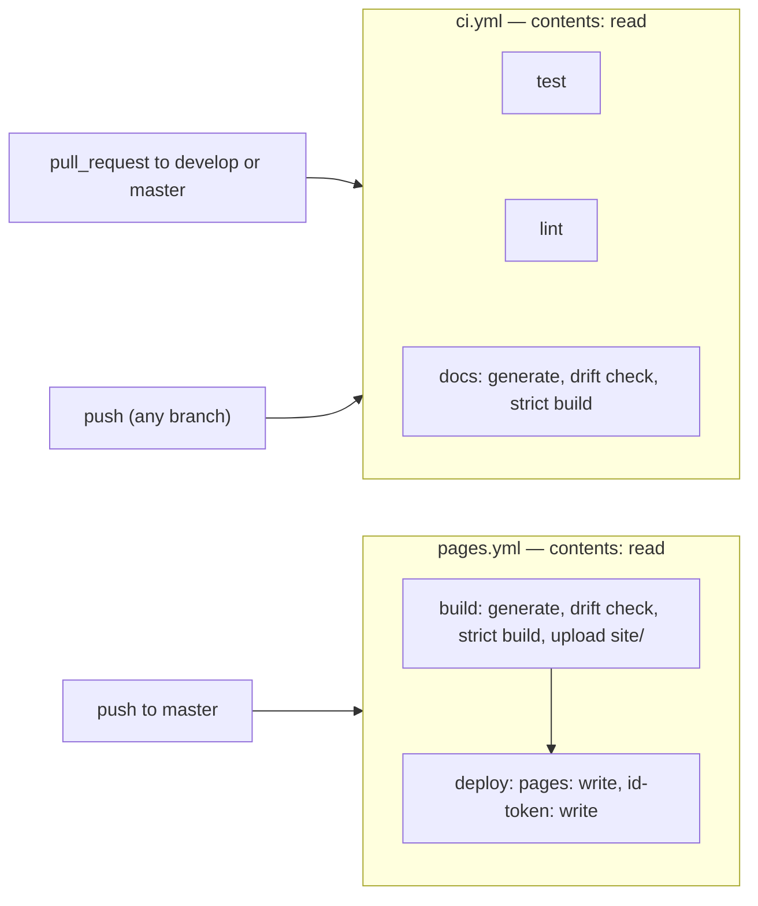

# Build Spec: Pages and CI

**Status**: 🟡 In progress — Increment 1 implemented on `feature/ci-tests-lint`, CI validation pending

## Goal

Run the tests, lint, and a strict docs build on every push and pull request, and publish the
documentation site to GitHub Pages from `master` only.

## Architecture

### Two workflows, one publisher

The repository uses gitflow: `master` holds releases, `develop` holds integrated work, and
`feature/*`, `release/*`, and `hotfix/*` branches merge into them. The published site shows the
latest release, so only `master` publishes. At authoring time `origin` has `master` only, so the
first increment also creates `develop` with `git push origin origin/master:refs/heads/develop`.
`origin/main` is a stale branch outside this workflow; this spec does not delete it, and no
trigger names it.

`ci.yml` checks every branch and every pull request to `develop` or `master`. `pages.yml` is the
only workflow that has `pages: write`, and only a push to `master` triggers it. A `develop` or
feature branch runs `ci.yml` and never reaches a deploy job.

An in-repo pull request emits both events for its head commit, so `ci.yml` runs twice for that
commit. Duplicate runs are an accepted decision: the suite takes seconds, and a `branches-ignore`
filter on the `push` trigger would add a rule that must match the branch naming.
`pull_request` also fires when a pull request closes without merging, which starts a run that no
merge needs.



| Workflow | Triggers | Workflow `permissions` | Job `permissions` |
|---|---|---|---|
| `ci.yml` | `push` (all branches), `pull_request` with `branches: [develop, master]` | `contents: read` | none added |
| `pages.yml` | `push` with `branches: [master]` | `contents: read` | `deploy`: `pages: write`, `id-token: write` |

- `pages.yml` has no `workflow_dispatch` trigger, because a manual dispatch can select any
  branch. To run a failed publish again, re-run the run of the `master` push.
- `deploy-pages` gets an OIDC token, so the `deploy` job also needs `id-token: write`.
  `pages: write` alone is not sufficient.
- The `deploy` job sets `environment: github-pages`. When the Pages source is GitHub Actions, the
  environment's deployment-branch rule allows only `master`. This is a second guard after the
  trigger filter.
- `pages.yml` sets `concurrency: { group: pages, cancel-in-progress: false }`. A deploy that is
  running always finishes. `ci.yml` groups by `${{ github.workflow }}-${{ github.ref }}` and
  cancels a superseded run.

### The docs build is one gated sequence

The `docs` job in `ci.yml` and the `build` job in `pages.yml` run the same steps in this order:

1. `uv run python scripts/gen_ref_pages.py`
2. Drift check: `git diff --exit-code` and an empty `git status --porcelain`
3. `uv run zensical build --strict`

The generator rewrites the `API_NAV` and `BUILD_SPECS_NAV` sections of the tracked
`zensical.toml`. When a commit adds a module or a build spec and does not have the regenerated
nav, the generator changes `zensical.toml` and step 2 fails. `pages.yml` runs the same check
before the upload, so a direct push to `master` cannot publish a stale nav.

`docs/api/<module>.md` pages stay generated build output. `.gitignore` ignores `docs/api/*`
except `index.md`, and `docs/README.md` documents them as "not committed". Each build makes the
pages again from `src/`, so a page cannot be stale. The nav entries that point to the pages are
in `zensical.toml`, which step 2 checks. Thus the requirement "a merge never publishes a stale
nav" applies to one tracked file, not to the pages.

!!! info "API stubs stay uncommitted"
    A stub contains only `::: <module>` and follows from the module path. To commit the stubs
    would add one more file to each module change and give no more protection than the
    `zensical.toml` check.

`--strict` makes every warning fail the build, and that includes the link warnings from
`[project.validation.links] not_found = "warn"`. The current tree builds with "No issues found".

### uv in CI

- Install: `astral-sh/setup-uv` with `version: "0.9.3"` (the uv that wrote `uv.lock` revision 3)
  and `python-version` set per job. The action sets `UV_PYTHON`, and uv gets that interpreter.
  `actions/setup-python` is not used.
- Sync: `uv sync --frozen`. `[tool.uv] default-groups` installs `dev` and `docs`. The `lint` job
  also runs `uv lock --check`, because `--frozen` does not compare `uv.lock` with
  `pyproject.toml`.
- Cache: `enable-cache: true` on `setup-uv`, keyed on `uv.lock`. The action prunes the cache
  after the job. The cache from `actions/setup-python` is not used: it does not know uv's cache
  layout.
- Python: the `test` job has a matrix of `"3.12"` (the floor that `requires-python = ">=3.12"`
  sets) and `"3.13"` (the newest version in the `pyproject.toml` classifiers), with
  `fail-fast: false`. `uv.lock` is a universal lock for `>=3.12`, so `uv sync --frozen` works on
  both. The `lint`, `docs`, and `build` jobs run on 3.12 only.

### Slow tests in CI

CI runs the full suite, `uv run pytest`, with no marker filter. The `tests/conftest.py` docstring
gives the reason: only a full-suite run gives an authoritative **unmarked slow tests** report.
`-m "not slow"` stays a local fast loop. The report is visible in the job log and is not a gate,
because the call time on a shared runner is not stable enough to fail a build at 0.1 s.

The threshold has three homes, and they must agree: `SLOW_THRESHOLD_S` in `tests/conftest.py`
(the value that applies), the `slow` marker text in `[tool.pytest.ini_options] markers` of
`pyproject.toml`, and the "Slow Tests" section of `docs/developer_guide.md` (the published
policy). This spec does not change the value.

### Pages wiring

- Artifact: `actions/upload-pages-artifact` with `path: site`, and the default artifact name
  `github-pages`. `actions/deploy-pages` reads that name by default, so neither job sets a name.
- Jobs: `build` uploads the artifact. `deploy` has `needs: build`, `environment: { name:
  github-pages, url: ${{ steps.deployment.outputs.page_url }} }`, and one `deploy-pages` step.
- `actions/configure-pages` is not used. `site_url` in `zensical.toml` gives the base URL, and
  the build reads nothing else from that action.
- `zensical.toml` gets `site_url = "https://uclatommy.github.io/pycordis/"`, so that canonical
  links and the sitemap use the project subpath.
- Enable the source with the API, not with the settings UI, because the API call can be
  repeated and verified:
  `gh api -X POST repos/uclatommy/pycordis/pages -f build_type=workflow`. Verify with
  `gh api repos/uclatommy/pycordis/pages --jq .build_type`, which returns `workflow`. At
  authoring time, `GET .../pages` returns 404 (Pages is not enabled).
- Verify the published site with `curl -fsS` (which fails on a non-2xx status) piped to
  `grep -F "pycordis is a Python port of the core package"`. That text is the first body sentence
  of `docs/README.md` (after the page title), and it is in the built `site/index.html`.

## File Structure

```
.github/workflows/
├── ci.yml          # new: test, lint, docs jobs
└── pages.yml       # new: build and deploy jobs, master only
zensical.toml       # site_url
docs/
├── README.md       # published URL; strict build command
└── developer_guide.md  # "Continuous Integration" section
```

## Implementation References

- Docs build order and the generated nav markers: `scripts/gen_ref_pages.py` (module docstring,
  `replace_section`) and the header comment of `zensical.toml`
- Local checks that CI repeats: "Checks" in `docs/developer_guide.md` and the "Pull Request
  Checklist" in `docs/contributing.md`
- Slow-test report: `pytest_runtest_logreport` and `pytest_terminal_summary` in
  `tests/conftest.py`
- Public and private paths: the managed block that `.github/bin/attach.sh` writes to
  `.git/info/exclude` (`/.github/*`, `!/.github/workflows/`, `/.vscode/`)

## Key Constraints

- Before you write YAML, confirm the managed block: `git check-ignore .github/workflows/ci.yml`
  exits 1 (not ignored). Do not change the managed block, `.git/info/exclude`, or `attach.sh`.
  That exit code states the same fact the last "Testing" bullet asserts: `.github/workflows/` is in
  the public clone and no other `.github/` path is, because `git status` hides a directory whose
  contents are all ignored.
- No CI step writes under `.github/instructions/`, `.github/skills/`, or `.vscode/`. Those paths
  are not in the public clone. The drift check (`git status --porcelain` empty) fails a job that
  leaves any untracked file that is not ignored.
- Lint is `uv run ruff check .` and `uv run ruff format --check .`. `black` is not in the `dev`
  group, so no step runs it.
- No change to `src/` and no runtime dependency. CI tooling comes from GitHub Actions and the
  existing `dev` and `docs` groups. No step imports `asyncio`.
- Only `pages.yml` has `pages: write` or `id-token: write`, and only on its `deploy` job.
- Pin each action to a major version tag that you verify against its repository at
  implementation time. Do not copy versions from memory.
- After each edit under `docs/`, `uv run python scripts/gen_ref_pages.py && uv run zensical build
  --strict` reports no issues.
- Duplicate `ci.yml` runs for a pull request head commit stay (see Architecture). Do not add a
  `branches-ignore` filter.
- Before each push, run `git status --porcelain .github` and `git ls-files .github`. They report
  the working tree state the public clone will get, which is the state the "Testing" checklist
  asserts.

## Integration

- `docs/developer_guide.md`: a "Continuous Integration" section after "Checks". It states which
  workflow runs which check, that CI runs the full suite and the fast loop is local only, and
  that a nav drift fails the `docs` job and the fix is to run the generator and commit
  `zensical.toml`.
- `docs/README.md`: the published URL under "Build the Documentation", and `--strict` in the
  build command, so that a local build applies the same gate as CI.
- `zensical.toml`: `site_url`.
- No public API change and no release.

## Testing

- ✅ `ci.yml` passes on a feature branch push and on a pull request to `develop` (needs `develop`
  on `origin`, which Increment 1 creates)
- ✅ A commit that adds a build spec and does not have the regenerated `zensical.toml` fails the
  `docs` job at the drift check
- ✅ A push to a branch other than `master` starts no `pages.yml` run
- ✅ `gh api repos/uclatommy/pycordis/pages --jq .build_type` returns `workflow`
- ✅ `https://uclatommy.github.io/pycordis/` returns 2xx and contains the home-page sentence
- ✅ `git status --porcelain` in the local clone shows nothing under `.github/` other than
  `.github/workflows/`

## Dependencies

- Required: none new. `pytest` and `ruff` (`dev`), `zensical`, `mkdocstrings[python]`, and
  `pymdown-extensions` (`docs`) are in the lock.
- CI only (not Python packages): `actions/checkout`, `astral-sh/setup-uv`,
  `actions/upload-pages-artifact`, `actions/deploy-pages`.

## Migration Strategy

Each increment pushes to the public repository. Do the push only after the user confirms the
increment's diff.

### Increment 1: CI tests and lint

**Goal**: `ci.yml` runs the full test suite on Python 3.12 and 3.13, and lint, on every push and
pull request.

**Files**: `.github/workflows/ci.yml` (~50). Also creates `develop` on `origin` with the push
command in Architecture, because a pull request needs a target branch.

**Validation**: `gh run watch --exit-status "$(gh run list --workflow ci.yml --branch <branch> --limit 1 --json databaseId --jq '.[0].databaseId')"`

**Status**: 🟡 Implemented — `ci.yml` exists on `feature/ci-tests-lint` and passes the same
commands locally; the **Validation** run is pending the push confirmation

**Changed**:

- `.github/workflows/ci.yml`: `test` job (3.12/3.13 matrix, `fail-fast: false`, full
  `uv run pytest`) and `lint` job (`uv lock --check`, `ruff check`, `ruff format --check`);
  `push` on all branches, `pull_request` to `develop`/`master`, workflow `permissions`
  `contents: read`, cancel-in-progress concurrency per `${{ github.workflow }}-${{ github.ref }}`

**Tests**:

- No new tests; the `test` job runs the existing suite. Local run of the job commands
  (`uv sync --frozen`, `uv lock --check`, `uv run pytest`, `uv run ruff check .`,
  `uv run ruff format --check .`) passes on 3.12; the 3.13 leg runs in CI.

**Deviations**:

- `origin/develop` already exists at `origin/master`, so the branch-creating push in
  Architecture is not run.
- `astral-sh/setup-uv` publishes no moving major tag above `v7` (verified via its tags API), so
  it is pinned to the commit SHA its README documents for `v10.3.3`; `actions/checkout` uses the
  moving `v7` tag as planned.

### Increment 2: Strict docs gate with nav drift check

**Goal**: The `docs` job in `ci.yml` fails on a stale generated nav or on any docs build
warning, and the guides document the CI checks.

**Files**: `.github/workflows/ci.yml` (+~20), `zensical.toml` (+1), `docs/developer_guide.md`
(+~15), `docs/README.md` (+~4)

**Validation**: the `gh run watch --exit-status` command from Increment 1. It passes on the
branch head. For the failure case, push a scratch branch with one commit that adds a spec without
its regenerated nav: the `docs` job runs on that push and fails at the drift check. Delete the
scratch branch after the run.

**Status**: ⬜ Pending

### Increment 3: Publish to GitHub Pages from master

**Goal**: A push to `master` builds the site and deploys it, and the published URL serves the home
page.

**Files**: `.github/workflows/pages.yml` (~50). One repository setting: the Pages source is
GitHub Actions (the `gh api -X POST` call above; it is outward-facing, so get confirmation
before you run it)

**Procedure**: this spec publishes by merging the feature branch locally and pushing `master`
directly, because no branch protection rule exists yet (see Follow-ups). Later updates to
`master` follow the branch workflow in Architecture and reach Pages through their merge.

**Validation**: `curl -fsS https://uclatommy.github.io/pycordis/ | grep -F "pycordis is a Python port of the core package"`

**Status**: ⬜ Pending

## Code Standards

- [Contributing](../contributing.md) — documentation rules and the pull request checklist
- [Developer Guide](../developer_guide.md) — checks, slow tests, and the docs build
- Docstrings & Markdown Style — present tense, admonitions, and blank lines between list and
  metadata lines

This spec is scaffolding — do not cite it, its filename, or its increment numbers in source,
docstrings, comments, or test names. Docstrings state the present rule, not the change that
introduced it.

## Follow-ups

- Branch protection rules on `develop` and `master` that require the `test`, `lint`, and `docs` checks
