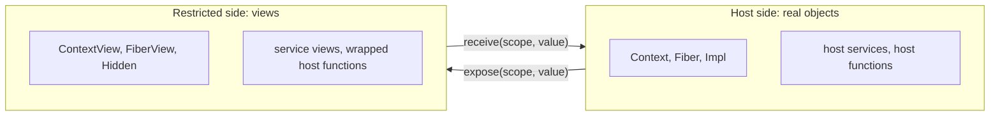

# Build Spec: Restricted Views

**Status**: 🔄 Reopened — Increments 1 to 10 are done. Increments 11 and 12 remove the filters of the real `Context` and close out. Every decision is accepted, and Increment 11 is ready to start (see [Decisions](#decisions))

**Reference**: [#14 Restricted context: give a restricted component read-only views of fibers](https://github.com/uclatommy/pycordis/issues/14), [#15 Restricted context: host services give a restricted caller views, not host objects](https://github.com/uclatommy/pycordis/issues/15), [#19 Restricted context: make an unfiltered boundary impossible by construction](https://github.com/uclatommy/pycordis/issues/19)

## Goal

Make sure that no value of a type that the boundary recognizes or that its class marks, which
reaches restricted code through the context, an event, a callback, or a host service, gives
an unrestricted context, a provider record, or control of a fiber that the restricted
component does not own, and that a new member or a new crossing cannot skip the filter.

## Architecture

### Why the design changed

Increments 1 to 5 put one filter call at each exit (`screen` or `expose` in `Context.use`,
`ctx[key]`, `bind`, the view exits). Each review found exits with no call: event results,
`meta`, `intercepts`, accessors, callbacks, the `next_` argument of a waterfall listener, and
`isolates`. Three causes give all of them:

1. **Restricted code holds the same `Context` object as pycordis code.** Each public member
   must decide at run time whether to filter, and pycordis code must use a private copy of a
   member that filters (`_use` in `Entry`). A new member is open by default.
2. **Two directions, two unrelated mechanisms.** `expose` filters values that go to restricted
   code, and `bind` filters listener arguments. A callable crosses in one direction and then
   carries values in the other direction (`next_`, a callback, a value that a listener
   returns), so each callable path needed its own rule.
3. **No check that the list of exits is complete.** The boundary test lists exits by hand.

The design below makes the restricted side a separate set of objects (views), and puts every
crossing between the two sides through two functions. pycordis code never holds a view, and
restricted code never holds a real `Context`, `Fiber`, or provider record.



### The boundary: two functions

```
expose(scope: Context, value: object) -> object      # pycordis.traceable: host → restricted
receive(scope: Context, value: object) -> object     # pycordis.traceable: restricted → host
```

`scope` is a real context; its *scope* is its def site, `scope.shadow or scope` (D9): its
`_fiber` and its `_restrictions` chain. When the chain is empty, both functions return `value`
unchanged, with one empty-tuple check and no allocation.

`expose` (D26) keeps the type rules of Increments 1 to 5 and adds callables:

| Value | `expose` gives |
|---|---|
| A class with a `cordis_expose` hook (read from `type(value)`) | The hook's result: `Fiber` → `FiberView`; `Context` → `ContextView` when the scope owns it, else `Hidden`; `Impl` → `Hidden`; a class with an `Exposure` → its exposed view |
| A bound method whose `__self__` has a method hook that replaces the object | `Hidden` |
| A service view (`TraceableView`) | The view of the same service for the scope (`get_traceable`), so an effect registered through it belongs to the restricted fiber (D29) |
| A view or a wrapper that `expose` made for any scope | Unchanged (a value from another scope reaches `expose` only after `receive`) |
| A function form (D16: `FunctionType`, `MethodType`, `BuiltinFunctionType`, `functools.partial`) | A wrapper: a call passes each argument, positional and keyword, through `receive`, and the result through `expose` |
| `tuple`, `list`, `dict`, `set`, `frozenset` | A new container of the same type, each element, key, and value exposed |
| `Deferred`, coroutine, generator, async generator | A wrapper that gives each later value through `expose` (D17, D21) |
| Any other object | Unchanged (the trust model; D5) |

`receive` (D26) is the inverse:

| Value | `receive` gives |
|---|---|
| A `FiberView`, `ContextView`, `Hidden`, exposed view, or service view, for any scope | The real object that it shows; no view needs a map (D10) |
| A wrapper that `expose` made | The host function that it wraps |
| A function form of the restricted side | A wrapper: a call passes each argument through `expose`, and the result through `receive` |
| A container | A new container, each element received |
| `Deferred`, coroutine, generator, async generator | A wrapper that gives each later value through `receive` (D21) |
| Any other object | Unchanged |

- **One wrapper class** for both directions; it compares equal to, and hashes as, the function
  that it wraps, and the wrapper of an `async def` function is marked with
  `inspect.markcoroutinefunction` (D15 rule, kept in D26). The class has `__slots__` with no
  `__weakref__` slot (D44): a new wrapper is made for each crossing, so a weak reference to it
  would die at once. `weakref.ref`, `WeakSet`, and `WeakValueDictionary` raise `TypeError` for
  a wrapper instead.
- **A container crosses as a copy** (D45): `expose` and `receive` give a new container, so a
  change that one side makes to a container after the crossing is not visible to the other
  side. The `restrict` docstring states it.
- **No cache, no state** (D10): each call gives a new view or wrapper. A view knows its target,
  so `receive` needs no map. A value that restricted code gets and gives back is the real
  object again, in any later call, not only in the same call.
- **`Hidden` holds its target** in a private slot, so `receive` can give it back (D30):
  `Hidden(kind: str, target: object)`. No public name reads it; the trust model already
  permits `object.__getattribute__` and `get_original`. `copy.copy` and `copy.deepcopy` give
  the same `Hidden`, as for `FiberView`; a pickled `Hidden` keeps only the type name, and
  `receive` of it raises `CordisError` (D36).
- **A value that crosses between two restricted scopes** goes through `receive` of the source
  scope, then `expose` of the target scope. The two scopes never share a view.
- **Read exits raise**: a read from a view (a member of a `ContextView`, an attribute or a call
  result of a service view or an exposed view) raises `CordisError` for a `Hidden` result. An
  argument of a restricted function stays a `Hidden`, so a listener is still called. One
  function in `traceable.py`, `_read_exit(scope: Context, name: str, value: object) -> object`,
  gives `expose(scope, value)` and raises `CordisError` that names `name` when the result is
  a `Hidden`. `_read_exit` replaces `_screen` and `_screen_result` in Increment 6, and the
  public `screen` calls `_read_exit` until Increment 11 removes it with the other filters of
  the real `Context` (D28).

### The plugin-facing context

```
class ContextView:                                 # pycordis.context
    def __init__(self, target: Context) -> None    # only Context.cordis_expose creates one
    # forwards the members of its member table; every other name raises CordisError

def real_context(ctx: Context | ContextView) -> Context    # pycordis.context, not exported

@overload
def restrict(ctx: Context, *, ...) -> Context
@overload
def restrict(ctx: ContextView, *, ...) -> ContextView
```

- **Restricted code holds only views** (D24). A restricted component gets
  `expose(fiber.ctx, fiber.ctx)` from `Fiber._apply`, which is the one place where pycordis
  starts a component with a context. An `inject` callback from restricted code is a `receive`
  wrapper, so it exposes its own context. An owned context in any other value is a
  `ContextView` through the `expose` rule. `restrict(view)` gives a `ContextView` of the
  derived context; the host gets a real `Context` from `restrict(root, ...)`.
- **Scope of a view** (D35): a `ContextView` holds one real context, its target, and every
  crossing of the view uses the target as the scope. `Context.cordis_expose` creates a view
  only for an owned context, whose fiber is the scope's fiber or a descendant and whose chain
  extends the scope's chain, so a view never has more authority than the code that got it.
- **Back to the real context** (D37): `real_context` gives the target of a `ContextView`, or
  `ctx` itself. It is the one rule for that conversion: `receive` calls it for a
  `ContextView`, and so does pycordis code that gets a context from the component side
  (`_stored_context` in `traceable.py`, `_call_method` in `registry.py`, `TimerService`).
- **Member table** (D25): one mapping in `context.py`, from each public member name of
  `Context` to one kind. A name that is not in the table raises `CordisError` that names it.

  | Kind | A read or call gives |
  |---|---|
  | `cross` | The member of the real context, with each argument through `receive` and the result through `_read_exit(target, name, ...)` |
  | `guard` | `CordisError` (`root`, `reflect`, `registry`, `events`; `intercept_layer` and `intercept_through`, D43; and members that only pycordis calls, such as `bind_fiber` and `with_shadow`) |
  | `pass` | The member of the real context unchanged (`isolates`, D31; `scheduler`, D33; a `bool` or a `str` result) |

  Two `cross` members have one more rule each:

  - `use` passes its `component` argument unchanged (D32). The registry keys a runtime by
    its component, and `_apply` gives the component its exposed context, so a wrapper is not
    necessary and would become the key that a host `use` of the same component finds.
  - `emit`, `bail`, `serial`, `parallel`, and `waterfall` raise `CordisError` for an
    `internal/` event name (D34). pycordis emits those events on the real context.

- **Completeness test**: the set of public members of `Context` equals the keys of the member
  table. The public members are the public names of `dir(Context)` and the public instance
  attributes of a root context (`vars(Context(scheduler))`, which gives `scheduler`). A new
  public member of `Context` fails the test until someone classifies it. This is the check
  that a list of exits by hand did not have.
- **Equality, not identity** (D10, D35): two views of the same context are equal, with the
  same hash. `isinstance(view, Context)` is `False` (D1).
- **Call sites**: `use`, `inject`, and `effect` record the line of their caller
  (`CallSite.capture`). The `ContextView` member adds frames, and the capture skips them: the
  recorded line is the line in the component, not a line in `context.py`.
- **The real `Context` filters nothing** (D28). `use`, `inject`, `fiber`, `ctx[key]`, `get`,
  `bail`, `serial`, `waterfall`, `meta`, `intercepts`, and `intercept_layers` give real
  objects. `root`, `reflect`, `registry`, and `events` do not raise. The restriction rules for
  inject and provide keys (`_check_read`, `_check_provide`, the fiber's inject check) stay on
  the real context: they are permission checks, not exits.
- **pycordis code on the component side**: restricted code can build `Service` and
  `TimerService` with a `ContextView`. `Service` calls public members only. `TimerService`
  needs its real fiber for `effect` and for the logger of a failed callback, so it reads the
  fiber of `real_context(self.ctx)`. The loader classes are not in this list: they read
  private members of their context and run unrestricted (D12).

### The fiber view

```
class FiberView:                                   # pycordis.fiber
    name, uid, state, error, children              # children: views for the same scope
    get_effects() -> list[EffectMeta]
    wait() -> Deferred[FiberView]; __await__       # resolve with the view, not the fiber
    dispose() / restart() / update(config, no_save=False)   # owned fibers only
```

- **Allow-list**: the view gives only the names above. Any other name raises `CordisError`
  that names the attribute (#14 Problem section).
- **Owned**: `owns(scope, chain, target)` in `pycordis.fiber` is the one ownership rule;
  `FiberView` and `Context.cordis_expose` call it. It is true when the target is `scope` or a
  descendant of it, and the target's `ctx._restrictions` has `chain` as a prefix, by identity
  (D2). Both facts are fixed when the target is created (`LIFE-CONFLUENT`).
- **Arguments go through `receive`**: `update(config)` passes `config` through `receive`.
- **No `unwrap`** (D28): host code never gets a view, because every crossing to the host calls
  `receive`. `Loader.entry_of` and `locate` take a `Fiber` only.
- **Not a `Fiber` subclass** (D1). `Fiber.logger` is not in the allow-list.

### Calls into restricted code

pycordis gives values to restricted code through a function that restricted code registered,
so `receive` wraps it when it crosses: `ContextView.on`, `once`, `accessor`, `provide`
(`check`), `inject` (`callback`), `effect` (`execute`), and a callable argument of a
service-view call. The component of `use` is the exception: `_apply` exposes its context
(D32).

pycordis also calls the `cordis_filter(ctx)` hook of the `this` argument of a dispatch, with
the context of each listener. The hook must read `ctx.isolates` of contexts that the component
does not own, so `expose` cannot serve it (a `Hidden` gives no `isolates`). A restricted
filter gets a realm view in place of each context (D38):

```
class RealmView:                                          # pycordis.traceable
    isolates: Mapping[str, object]                        # every other name raises CordisError

def realm_filter(scope: Context, this: object) -> object  # pycordis.traceable
```

- `realm_filter` gives `this` unchanged when the scope is unrestricted or `this` has no
  `cordis_filter`. Otherwise it gives an object whose `cordis_filter(ctx)` calls
  `this.cordis_filter(RealmView(ctx))`. It is the one rule for a restricted filter.
- It has two callers: the dispatch members of `ContextView` (`this` after `receive`, with the
  view's target as the scope), and the exit of a service view whose def site is restricted
  (the `cordis_filter` hook, with the def site as the scope). `EventsService._resolve` does
  not change.
- A host filter object that a restricted component gives as `this` also gets realm views.
  `Service.cordis_filter` reads only `isolates`, so it gives the same result.

Thus:

- A listener gets its arguments through `expose`, also `next_` of a waterfall (a host
  function, so a wrapper whose result is exposed). A value that the listener returns goes
  through `receive`, so a listener that returns `next_()` gives the host the real result.
- An accessor `get` gets a `Hidden` for a host context and a `ContextView` for its own, and the
  `receiver` view is traced for the scope (D29).
- In the final state, `ContextView.on` and `once` pass the listener through `receive`, so
  `ReflectService.bind(ctx, callback)` traces arguments only, as in an unrestricted context,
  and `EventsService.on` and `once` have no `site` (D28, Increment 11). Until then, `bind`
  keeps its `site` and wraps the listener with `receive(site, ...)` (Increment 6), so the
  listener crossing works before `ContextView` exists. From Increment 8 to Increment 11, a
  listener registered through `ContextView.on` is wrapped twice. That is correct: `expose` of
  a view and `receive` of a real object give the value unchanged, so the second crossing
  changes nothing. Increment 11 removes the `bind` wrapper.

### Service views in both directions

A service view is the crossing for a service (D27). Which side is restricted decides the
direction:

| Reader (use site) | Service (def site) | Arguments | Result |
|---|---|---|---|
| Restricted | Host | `receive(use site)` | `expose(use site)` |
| Host | Restricted | `expose(def site)` | `receive(def site)` |
| Restricted A | Restricted B | `receive(A)`, then `expose(B)` | `receive(B)`, then `expose(A)` |

- **Exits**: `TraceableView.__getattribute__` and `CallableTraceableView.__call__`, as in
  Increment 3. `Exposure.hidden` and `safe` apply at the exit of the service that declares
  them.
- **Direction fixed at creation** (D40): `create_traceable` reads the def site of the service
  once (`real_context` of the context that `_stored_context` gives) and stores whether it is
  restricted in a slot of the view. The def site of a service is fixed when the service is
  built. An exit then reads two slots: the use-site chain and that flag. When both are empty,
  the read is the unfiltered path, with no allocation.
- **`cordis_caller`** (D39): a reader from outside gets it through the exit: an owned context
  gives a `ContextView`, any other context raises. Only `cordis_original` and `__class__` pass
  the exit unfiltered (the view protocol; trust model). An interior read (through a
  `_Shadow`) gives the real def site when the def site is unrestricted, as `LoggerService`
  needs, and a `ContextView` of it when the def site is restricted, as for `ctx`.
- **Interior**: a method of a service runs with a `_Shadow` as `self`. When the def site is
  restricted, the shadow's `ctx` is a `ContextView` for the def site, because the method body
  is restricted code. This applies to every path that gives a method its `self`:
  `_create_shadow` (shadowed methods and properties), `_interior` (`no_shadow` methods), and
  `_invoke_view` (`cordis_invoke`). When the def site is unrestricted, the shadow reads real
  objects (`_read_view`), as in Increments 3 and 4. pycordis service classes that a
  restricted component can provide read their real context with `real_context` (D37).
- **Exposed view** (`_ExposedView`) of a marked object with no `Tracker` uses the same exits.
  Its protocol operations (`__len__`, `__iter__`, `__getitem__`, `__contains__`, `__bool__`)
  return through `_read_exit`; two views of the same target for the same scope are equal
  (D16).

### Filter forms

- **Function forms only** (D16): `expose` and `receive` wrap the function forms in the tables.
  Any other callable object passes as its type rule gives it, so `isinstance`, attributes, and
  identity hold, and its results are not filtered (the "not recognized" gap).
- **Later values** (D21): a coroutine gives a wrapper coroutine whose result is exposed; a
  generator a wrapper that exposes each item and the return value and forwards `send`,
  `throw`, and `close`; an async generator the same with `asend`, `athrow`, and `aclose`. A
  wrapper is a native coroutine or generator, so a task can still await it.
- **Completion on the owner thread** (D17, D23): the done callback of a `Deferred` settles the
  exposed `Deferred` at once when `Scheduler.is_owner()` is true, also for a source that is
  already done. A completion on another thread hands the exposure to the owner thread with
  `Scheduler.submit`. `Scheduler.is_owner() -> bool` is the one owner-thread check, and
  `assert_owner` calls it.

### Loader, hmr, and logger

- **Loader and Hmr run unrestricted** (D12): their own listeners read `fiber.parent`. The
  `restrict` warning and the `Loader` and `Hmr` docstrings say so.
- **Logger**: `_BufferFilter` and `_RootFilter` read `record.cordis_fiber.ctx._root`, so a
  record keeps the real fiber. `LoggerService` hides `buffer` and `exporter`, and `Logger`
  hides `extra`. `Logger` methods run on the original object.
- The `Exposure` declarations of Increment 4 (`Entry`, `EntryGroup`, `EntryTree`,
  `ReloadResult`) do not change.

### Gap policy

No gap of `restrict` breaks a property of the semantic contract: an effect that restricted code
registers on any fiber belongs to that fiber and reverts with it (`EFF-REVERT`), and the
lifecycle properties do not read the boundary. A gap weakens only the promise of the
`context-restriction` divergence row. The threat model is fixed: loaded plugins are trusted,
and `restrict` stops accidental and undeclared access and fails fast; it is not a sandbox.
Zero gaps would need process isolation, which the project does not use.

Each gap, also one that a later review finds, gets these tests in order (D41). The first test
that decides the gap gives the answer.

1. **Unrestricted behavior first**: a fix that changes the behavior of unrestricted code or
   an upstream result is not used.
2. **Accidental or deliberate**: a path that needs deliberate code (a reserved `cordis_`
   name, `get_original`, `gc`, frames, private slots) is in the trust model. It is
   documented and not fixed.
3. **One enforcement point**: an accidental path that one rule at the boundary closes is
   closed. A fix that needs a rule for each type is not used ("lists known-bad cases"); the
   path stays open and is documented.
4. **Fail fast, not silent**: a fix that changes a result with no error is not used. A fix that
   raises is used. When no such fix exists, the path stays open and is documented.
5. **Host permission**: authority that the host grants on purpose is not a gap.

The classification of the known gaps:

| Class | Gaps | Answer |
|---|---|---|
| Closed, tested | Every row of the crossing test, D38, D39, D43, D44 | A crossing-test case for each |
| Open (D18) | A value of a type that the boundary does not recognize and that its class does not mark (any other object, a callable object that is not a function form, a container subclass); `StepReport.fiber` | Listed in the `restrict` warning; follow-up issue |
| Trust model | `get_original`, `cordis_original`, a `cordis_` hook that restricted code defines, `gc`, frames, private slots, tracebacks and the other contents of an exception that crosses (D46) | One sentence in the `restrict` warning |
| Host permission (D42) | The config of `use`, `isolates` labels, an admitted `loader` or `hmr` | Stated in the `restrict` docstring |
| Stated rule, not a gap | A container crosses as a copy (D45); a wrapper is equal to its function, not identical (D26) | Stated in the `restrict` docstring |

The spec is ready for a change of the boundary when every known gap has a class in this
table. A later review changes the design only when a finding fails test 1 or 4, or when one
enforcement point closes it.

## File Structure

```
src/pycordis/
├── traceable.py        # MODIFY: expose and receive; one wrapper class; later-value wrappers; Hidden holds
│                       #         its target; _read_exit; service views apply the direction table, fixed at
│                       #         creation; cordis_caller through the exit; RealmView, realm_filter; screen removed
├── context.py          # MODIFY: ContextView, its member table, and real_context; Context.cordis_expose gives a
│                       #         ContextView; restrict overloads; filters, guards, and _use removed from Context
├── fiber.py            # MODIFY: _apply gives the component its exposed context; FiberView.update receives its
│                       #         config; FiberView.unwrap removed
├── reflect.py          # MODIFY: bind receives the listener result, then traces only (site removed)
├── registry.py         # MODIFY: _call_method reads real_context
├── events.py           # MODIFY: on/once lose site
├── scheduler.py        # MODIFY: Scheduler.is_owner; assert_owner calls it
├── timer.py            # MODIFY: TimerService reads its fiber through real_context
└── loader/_entry.py, _service.py   # MODIFY: Entry uses the public use; entry_of/locate take a Fiber only
tests/
├── test_restrict.py    # MODIFY: completeness test, crossing test, filter forms; superseded tests removed
├── test_invariants.py  # MODIFY: seeded schedules with restricted listeners that use views
├── test_scheduler.py   # MODIFY: is_owner
├── test_timer.py       # MODIFY: a restricted component provides TimerService
└── test_threading.py   # MODIFY: owner-thread and worker-thread completion of an exposed Deferred
docs/
└── architecture.md     # MODIFY: context-restriction row
```

## Implementation References

- **This repository**: `expose`, `_expose`, `_screen`, `_screen_result`, `_exit`,
  `TraceableView`, `CallableTraceableView`, `_Shadow`, `_ExposedView`, `_stored_context`, and
  `get_traceable` in `traceable.py` (the code that the two functions replace or reuse);
  `Context.cordis_expose`, `_def_site`, `_check_guarded`, `_use`, and `restrict` in
  `context.py`; `Fiber._apply`, `owns`, `extends`, and `FiberView` in `fiber.py`;
  `ReflectService.bind`, `read`, `write`, and `Accessor` in `reflect.py`;
  `RegistryService.use` (the `_internal` runtime map keyed by component), `inject`, and
  `_call_method` in `registry.py`; `TimerService` and `_run_logged` in `timer.py`;
  `EventsService.on`, `once`, and `_resolve` (`cordis_filter` of `this`);
  `Scheduler.assert_owner`, `submit`, and `observe_steps`; `CallSite.capture`;
  `Deferred.add_done_callback` (runs at once for a done source, on the calling thread);
  `Service.__init__` and `cordis_filter`; `Loader.entry_of` and `locate`.
- **Upstream**: none. Upstream has no restriction (the `context-restriction` row). Upstream
  `EventsService.emit` (`packages/core/src/events.ts`) sends a listener error to the caller, and
  `Fiber._updateStatus` emits `internal/status` before it notifies providers; this spec keeps
  both.

## Decisions

The maintainer accepted every decision in the table. D13 to D15, D19, D20, and D22 were
accepted for the design of one filter at each exit; the table states which decision replaces
each one, and D8 is replaced by D28. A decision that implementation finds wrong is changed in
this table before the code changes. A new gap is decided with the [Gap policy](#gap-policy)
(D41).

| ID | Question | Decision | Reason |
|---|---|---|---|
| D1 | View type (#14 Q1) | `FiberView` and `ContextView` are classes, not subclasses; `Context.use`, `inject`, and `fiber` keep the `-> Fiber` annotation | A subclass breaks substitution. A new annotation (a protocol) changes a public signature, so it waits for the promotion of `restrict`, with the minor increment |
| D2 | Ownership rule (#14 req. 4) | Subtree of the scope's fiber **and** a chain that extends the scope's chain, by identity | Sibling plugins under one `restrict` result share one chain tuple, and equal `Restriction` objects compare equal |
| D3 | `get_effects()` of a host fiber (#14 Q2) | Given | Labels are names, not references; a status plugin needs them |
| D4 | `parent` of a view (#14 Q3) | Not given | `Fiber.parent` is a `Context`. Upward navigation is the leak that `fiber.parent.fiber` showed |
| D5 | Filter depth (#15 Q1, Q2) | Classes with a `cordis_expose` hook, builtin containers, function forms, `Deferred`, coroutines, and generators; other objects unchanged | A wrapper on every object breaks `isinstance` and identity for every caller, for no gain under the trust model |
| D6 | Marking (#15 Q3) | `cordis_expose = Exposure(hidden=..., safe=...)` class attribute; `Exposure` is a callable with the hook signature | One hook name for core types and marked classes gives `expose` one lookup and users one name |
| D7 | Authority of `loader` and `hmr` | Unchanged and documented: admitting `loader` gives the loader's authority over the tree | The boundary stops leaked contexts and fibers; it is not a permission system for service methods |
| D8 | Host access to a restricted fiber | Replaced by D28: the host gets real objects from every crossing | — |
| D9 | Which chain decides | The def site of the scope (`scope.shadow or scope`) | The same authority as the inject and provide checks |
| D10 | View identity | A `FiberView` has equality and hash by (target, scope fiber, chain object), a `ContextView` by its target (D35); no cache | A cache on the target is never dropped for the root fiber; a view knows its target, so `receive` needs no map |
| D11 | How `expose` recognizes `Fiber`, `Context`, and `Impl` | A `cordis_expose(value, receiver)` hook on each class, read from `type(value)` | The module rules permit no import back from `traceable.py`; the rule for each type stays in its module |
| D12 | `Loader` and `Hmr` in a restricted context | Not supported; documented | Their own listeners read `fiber.parent`. The use case is a host service, which runs unrestricted |
| D13 | Event results | Replaced by D25 and D28 | `bail`, `serial`, and `waterfall` are `cross` members of `ContextView`; pycordis calls the real methods |
| D14 | `meta`, `intercepts`, `intercept_layers` | Replaced by D25 and D28 | `cross` members; pycordis reads them on the real context |
| D15 | Calls into restricted code; equality of the bound callable | Replaced by D26 | `receive` wraps every restricted function; the wrapper equals its function |
| D16 | Filter forms | Wrap function forms only; wrap coroutines and generators; forward protocol operations of an exposed view; `target == view` stays with the target | A value that is read must behave as the value |
| D17 | A settled `Deferred` | The done callback settles at once on the owner thread; a completion on another thread uses `Scheduler.submit` | The step exists only to keep `expose` off a foreign thread, and `expose` has no side effects |
| D18 | Paths that stay open | Two classes, listed in the `restrict` warning: a value of a type that the boundary does not recognize and that its class does not mark (D5: any other object, a callable object that is not a function form, a subclass of a filtered container), and the `StepReport.fiber` of `observe_steps` (D33). `declare_realm` does not change. A bound method of a class with an `Exposure` is a function form, so `expose` wraps it (D26); Increment 7 confirms it with a test, and it is not a gap | Gap policy test 3: a generic fix wraps every object or needs a rule for each type, and no single point knows who registered a step observer. The host marks a class with `Exposure` to close the first class for that class; both go to a follow-up issue |
| D19 | Callable arguments (`next_`) | Replaced by D26 | `expose` wraps a host function |
| D20 | Accessor arguments not traced | Replaced by D29 | A view with the host reader's use site lets restricted code register effects on the host's fiber |
| D21 | Where coroutines and generators are filtered | In `expose` and `receive`, as for a `Deferred` | Every crossing applies one rule |
| D22 | A value that a restricted callback returns | Replaced by D26 | `receive` gives back the real object of every view |
| D23 | The owner-thread check | Public `Scheduler.is_owner() -> bool`; `assert_owner` calls it | One owner-thread rule; an additive public method keeps a patch increment |
| D24 | What restricted code holds | Only views: `Fiber._apply` gives the component `expose(fiber.ctx, fiber.ctx)`, an owned context is a `ContextView`, and `restrict` accepts and returns a view | pycordis code then never holds a view, so it needs no private copies of public members |
| D25 | Members of `ContextView` | One member table with the kinds `cross`, `guard`, and `pass`; a name not in the table raises; a test checks that the table covers every public member of `Context` | An allow-list that the owner checks finds a new member at once (Bug Remediation: "lists known-bad cases") |
| D26 | The crossing rule | Two functions, `expose` (host → restricted) and `receive` (restricted → host); each wraps a function form of the other side so that its arguments and result cross back; no state | One rule for listeners, `next_`, accessors, callbacks, and returned values |
| D27 | Service views | The view applies the direction table: a restricted reader receives its arguments and gets exposed results; a host reader of a restricted service exposes its arguments and receives the results; two restricted scopes compose | A host that calls a service of a restricted component gives that code host objects too |
| D28 | The real `Context` | No filters, no guards for `root`, `reflect`, `registry`, `events`; `_use`, `_check_guarded`, `screen`, `bind(site=...)`, `EventsService.on(site=...)`, `FiberView.unwrap`, and the view arguments of `Loader.entry_of` and `locate` are removed | Each one exists only because restricted code and pycordis code hold the same object (No Vestigial Code) |
| D29 | A service view that crosses to a restricted scope | `get_traceable` for the scope | An effect that restricted code registers through the view belongs to the restricted fiber (`EFF-REVERT`) |
| D30 | How `receive` restores a `Hidden` | `Hidden` holds its target in a private slot | No map, no state; the trust model already permits `object.__getattribute__` |
| D31 | `isolates` | A `pass` member | Its values are realm labels, compared by identity; a label that the host gives is the host's choice, as a config to `use` is (D42) |
| D32 | The `component` argument of `ContextView.use` | Passes unchanged; `_apply` exposes the component's context | The registry keys a runtime by its component (`_internal`); a wrapper would become the key, and a host `use` of the same component would run through the restricted scope's wrapper |
| D33 | `scheduler` | A `pass` member; `observe_steps` gives real fibers in `StepReport.fiber`, and the `restrict` warning lists it (D18) | `owner_thread("ctx.scheduler")`, `restrict`, and `TimerService` read it; a guard breaks every restricted-defined service with an owner-thread method |
| D34 | A restricted dispatch of an `internal/` event | `emit`, `bail`, `serial`, `parallel`, and `waterfall` of a `ContextView` raise `CordisError` | `receive` would give host listeners (loader, hmr, status plugins) the real fiber of a view that restricted code emits; pycordis emits these events on the real context |
| D35 | The scope of a `ContextView` | The context that it shows; equality and hash by that context | An owned context has the scope's fiber or a descendant and a chain that extends the scope's, so the view never gives more authority; `restrict(view)` needs no second rule |
| D36 | Copies of a `Hidden` | `copy.copy` and `copy.deepcopy` give the same `Hidden`; a pickled `Hidden` keeps only the type name, and `receive` of it raises `CordisError` | A copy that kept the target in its arguments would pickle the host object |
| D37 | How pycordis code gets the real context from the component side | `real_context(ctx: Context \| ContextView) -> Context` in `pycordis.context`; `receive`, `_stored_context`, `_call_method`, and `TimerService` call it | `_call_method` gets the `ContextView` from `_apply` and builds a `TraceableView` from it; `TimerService` needs its real fiber. One owner for the conversion |
| D38 | `cordis_filter` of a restricted `this` | `realm_filter` gives the hook a `RealmView` of each listener context, with `isolates` only | The hook needs the realm labels of contexts that the component does not own. With the direction table alone, a restricted-provided `Service` as `this` would get a `Hidden` and raise in every emitter, also an unrestricted one |
| D39 | `cordis_caller` of a service view | Goes through the exit for a reader from outside; an interior read follows the def-site rule of `ctx` | It gives the reader's own real context. Without the real-context guards (D28), `ctx["svc"].cordis_caller.root` would give the root |
| D40 | When a service view finds its direction | Once, in `create_traceable`, stored in a slot | A def-site lookup at each exit would add work to every service read in an unrestricted application |
| D41 | How a gap is decided | The five tests of the [Gap policy](#gap-policy), in order | No gap breaks a contract property (every effect still belongs to a fiber and reverts with it); a gap weakens only the promise of the divergence row, so each gap is decided against that promise, not against zero gaps |
| D42 | Host permissions | The config that the host gives to `use`, the realm labels of `isolates`, and the authority of an admitted `loader` or `hmr` (D7) are not gaps | The host grants each one on purpose (Gap policy test 5) |
| D43 | `intercept_layer` and `intercept_through` in a `ContextView` | `guard` members; `intercept(name, config)` stays `cross` | `receive` copies the mapping of `intercept_layer`, which breaks its documented live updates, and `InterceptLink` gives pycordis code a view (against D24). Both exist for live loader configuration, which a restricted context does not support (D12). One guard closes both (Gap policy tests 3 and 4) |
| D44 | Weak references to a wrapper | The wrapper class has no `__weakref__` slot, so a weak reference raises `TypeError` | A new wrapper is made for each crossing, so a weak reference would die at once and a host service would lose a restricted callback with no error (Gap policy test 4) |
| D45 | Containers that cross | A new container; the `restrict` docstring states it | It is the D5 rule, not a gap. A host service that expects to see later changes to a container from a restricted caller sees a copy |
| D46 | Exceptions that cross | Pass unchanged; trust model | Reading the frames of a traceback is deliberate (Gap policy test 2). pycordis's own errors carry text or validation issues, never a fiber or a context |

## Key Constraints

- **Contract**: no contract property changes (see [Gap policy](#gap-policy)). `EFF-REVERT`
  holds for every effect, and the restriction promise on top of it gets stronger: restricted
  code registers no effect on a host fiber or a host context through a recognized or marked
  value, also through a service view (D29) or `cordis_caller` (D39). `EFF-ISOLATE` is kept: a
  dispatch with a restricted-provided service as `this` reaches the listeners of the service's
  realm (D38). `LIFE-CONFLUENT` is kept because ownership and the boundary use only facts
  fixed at fiber creation. `LIFE-FAILURE` is kept: a hidden access in `apply` fails that fiber
  with no installed effects. The `mirror = true` functions (`_reload`, `_set_epoch`,
  `_unload`) and `_update_state` do not change.
- **Listener errors**: an access to a hidden value in a listener raises in that listener, and
  the error goes to the emitter (see [Dependencies](#dependencies), #16).
- **No restriction, no change**: an unrestricted context gives real objects, with one empty
  check at `Fiber._apply`, two slot reads at each service-view exit (D40), and no allocation.
  `Context` members get no new check.
- **Two filter models, each stated**: `FiberView` and `ContextView` are allow-lists. The
  boundary for other values is not: `expose` transforms only the types in its table, and an
  object it does not recognize passes unchanged (D5, trust model). No docstring calls the
  boundary an allow-list.
- **One place for each rule**: `owns` is the ownership rule; `expose` and `receive` are the
  crossing rule; the member table is the `ContextView` rule; `_read_exit` converts a `Hidden`
  to an error; `real_context` gives the real context of a view. Code that needs one of these
  rules calls its owner.
- **A real context has no guard** (D28): a real `Context` that reaches restricted code gives
  `root`. Each path that gives a method or a hook its `self` or its context is a crossing
  (see [Service views in both directions](#service-views-in-both-directions)), or it is listed
  in the `restrict` warning (D18). So the guards are removed only after every such path
  crosses: the service-view increment comes before the increment that removes them.
- **Exceptions to the boundary are listed and tested**: the boundary has these exceptions
  and no others. Each has a case in the crossing test, so a new exception fails the review of
  that test, not a later audit.

  | Exception | Rule |
  |---|---|
  | The component of `ContextView.use` (D32) | Passes unchanged; `_apply` exposes its context |
  | `internal/` dispatch (D34) | Raises in a `ContextView` |
  | `real_context` (D37) | Called only by `receive`, `_stored_context`, `_call_method`, and `TimerService` |
  | `cordis_filter` (D38) | Gets `RealmView` objects through `realm_filter` |
  | `cordis_original`, `__class__` of a service view | Pass the exit (view protocol; trust model) |
  | `isolates`, `scheduler` (D31, D33) | `pass` members |
  | `intercept_layer`, `intercept_through` (D43) | `guard` members |
  | The open paths of D18 | Listed in the `restrict` warning, with no test (they are gaps; see [Gap policy](#gap-policy)) |
- **Error text**: messages name the attribute (`cannot read "ctx" of a fiber view`), the member
  (`cannot read "root" in a restricted context`), the operation, or the hidden type.
- **Owner thread**: views delegate to methods that keep `@owner_thread`. `expose` and
  `receive` run only on the owner thread.
- **Trust model**: the `restrict` warning keeps the guard-not-sandbox text. Exceptions that
  cross the boundary in either direction, and their tracebacks (also `view.error`), `gc`,
  frames, private slots, `get_original` and `cordis_original`, and a `cordis_` hook that
  restricted code defines on purpose (such as a `cordis_expose` method, which gets the real
  receiver) stay out of scope (D46). A `cordis_` name is a reserved hook name, so code
  reaches these only on purpose.

## Integration

- `pycordis/__init__.py` does not change. `FiberView`, `ContextView`, `real_context`,
  `expose`, `receive`, `Hidden`, `Exposure`, `RealmView`, and `realm_filter` are in non-public
  modules, behind the same feature flag as `restrict`.
- Public additions: `Scheduler.is_owner`; a `cordis_expose` class attribute on loader and hmr
  classes, and a `cordis_expose` method on `Fiber` and `Context` (hook names). D28 removes only
  names that this unreleased work added (`EventsService.on(site=...)`, the view arguments of
  `Loader.entry_of` and `locate`, `FiberView.unwrap`). Behavior for unrestricted callers does
  not change, so a **patch** increment is enough. If D1 changes to a new return annotation,
  the change is breaking and needs `release/0.3.0`.
- Branch: Increments 1 to 5 are on `release/0.2.1`; Increments 6 to 12 continue there, and PR
  #18 to `master` stays open until Increment 12. It closes #14, #15, and #19.
- `conformance/ledger.toml`: no change (no upstream item).

## Testing

- ✅ `divergence("context-restriction")`: each #14 path raises `CordisError`, and no provider
  stays after the restricted plugin is disposed (one parametrized test)
- ✅ The sibling paths of the first review: `internal/listener`, `internal/config`,
  `internal/commit`, `internal/dispatch`, `wait()` and `await`, `Logger.extra` and
  `ctx.logger.buffer`
- ✅ Ownership: dispose, restart, and update of an owned fiber and a grandchild; refused for a
  sibling, a host fiber, and the root fiber (one parametrized test)
- ✅ The view allow-list, and equality of views
- ✅ `contract("LIFE-CONFLUENT")`: seeded schedules with a restricted `internal/status`
  listener that disposes the views it receives; the seed is in the assertion message
- ✅ Service boundary through each read path, `hidden` and `safe`, and a service method that
  reads its own fibers; the loader, hmr, and logger cases of Increment 4
- ✅ An exposed `Deferred` whose source completes on another thread settles on the owner thread
- ⬜ **Completeness**: the member table of `ContextView` has exactly the public members of
  `Context` (with `scheduler`), and a name not in the table raises (one test)
- ⬜ **Crossing test** in `tests/test_restrict.py`, one parametrized test with one case for
  each crossing: each `cross` member of `ContextView` that gives a value, each `guard` member,
  a dispatch of an `internal/` name, a listener argument, `next_` of an `internal/get`
  listener, a listener that returns `next_()`, an `async def` listener of `serial` that
  returns a view, an accessor `get` and `set`, a provide `check`, an `@inject` method of a
  restricted component class, a callback argument of a service-view call (positional and
  keyword), a host reader of a restricted service (argument and result, for a shadowed, a
  `no_shadow`, and a `cordis_invoke` method), `cordis_caller` of a host service read from a
  restricted scope (it raises for a context that the scope does not own, also through
  `.root`), and two restricted scopes. It also has one case for each tested exception in
  [Key Constraints](#key-constraints): the D32 component, the `internal/` refusal, each
  `real_context` caller, `cordis_original` and `__class__`, the `pass` members, and
  `cordis_filter` (a restricted-provided `Service` as `this` of an unrestricted `emit` reaches
  only the listeners of its realm, a case that also carries `contract("EFF-ISOLATE")`; a
  restricted `this` with its own `cordis_filter` gets `RealmView` objects, and `.provide` on
  one raises). Each case uses the same host fiber and
  host context, asserts a view, a `Hidden`, `CordisError`, or the real object on the host
  side, and that no provider stays after dispose. The direct-read cases and the
  listener-argument cases of Increments 1 to 5 merge into it
- ⬜ An unrestricted application gets the same results from a service view, and a service
  view of an unrestricted service with an unrestricted reader takes the unfiltered path (the
  existing `test_traceable.py`, `test_service.py`, and `test_associate.py` cases pass with no
  change)
- ⬜ `receive` gives back the real object of each view kind, and a wrapper equals its function
  (cases of the crossing test where the shape fits); a copy of a `Hidden` is the same
  `Hidden`, and `receive` of an unpickled one raises
- ✅ A component that a restricted context and the host both `use` runs with a `ContextView`
  in the restricted fiber and a real `Context` in the host fiber (D32)
- ✅ A load-failure note of a fiber that a restricted component creates names the line in the
  component (a case of an existing call-site test)
- ⬜ Filter forms: a callable object stays itself; an `async def` value stays a coroutine
  function; a coroutine, a generator, and an async generator give exposed values; `len`,
  `iter`, `[]`, `in`, `bool`, and `==` of an exposed view work and filter; a settled `Deferred`
  is `done()` for a restricted caller; a bound method of a class with an `Exposure` receives
  its arguments and exposes its result; `weakref.ref` of a wrapper raises `TypeError` (one
  parametrized test)
- ⬜ `Scheduler.is_owner` on the owner thread and on a worker thread (a case of an existing
  owner-check test; the thread is joined with a timeout)
- ✅ A restricted component builds a `Service` and a `TimerService` and gets a logger with its
  `ContextView`, and a host reads the service; a timer callback that raises is logged on the
  restricted fiber (cases of existing tests in `test_service.py`, `test_timer.py`, and
  `test_logger.py` in a restricted context where the shape fits)
- ⬜ The seeded schedules of `tests/test_invariants.py` pass with views and the D17 settlement
- ⬜ Tests of removed behavior are deleted or changed in Increment 11: `unwrap`,
  `bind(site=...)`, and a view argument of `entry_of` are deleted; a test that expects a real
  restricted `Context` to raise for `root`, `reflect`, `registry`, or `events` becomes a
  `guard` case of a `ContextView`; a test that expects the host to get a `FiberView` from
  `restrict(root, ...).use(p)` expects a `Fiber`
- ⬜ `uv run pytest`, `uv run ruff check .`, and `uv run ruff format --check .` pass; the
  unmarked slow tests section of the full suite is empty

## Documentation

- Docstrings: `ContextView` (purpose, the member table, an example), `expose` and `receive`
  (the two tables, the direction rule), `Hidden`, `Exposure` (protocol operations),
  `FiberView` (no `unwrap`), `real_context`, `RealmView` and `realm_filter`,
  `Service.cordis_filter` (its `ctx` can be a `RealmView`), `TraceableView` (`cordis_caller`
  in a restricted scope), `Scheduler.is_owner`, `ReflectService.bind`
  (tracing only), `TimerService` (no change to its contract; check that it still holds),
  `Context.use`, `inject`, `fiber`, `bail`, `serial`, `waterfall`, `meta`, `intercepts`,
  `intercept_layers`, `root`, `reflect`, `registry`, `events` (no sentence about a restricted
  context remains on the real `Context`); `Loader.entry_of` and `locate`; the module
  docstring of `pycordis.traceable`.
- The `restrict` docstring: the body states that a restricted component holds views and that
  every crossing goes through `expose` and `receive`, that a container crosses as a copy
  (D45), and which authority the host grants (D42); the warning lists the open gaps of the
  [Gap policy](#gap-policy) table (D18), the trust-model sentence (D46), D7, and D12, and
  states that a restricted component cannot dispatch an `internal/` event (D34) or call
  `intercept_layer` and `intercept_through` (D43). Each increment removes
  the sentences that its change makes false; the last increment reviews the whole docstring.
- `docs/architecture.md`: the `context-restriction` row (see [Appendix A](#appendix-a-divergence-row)).
- `docs/user_guide.md`: none. The feature is behind a flag; the section comes with the
  promotion of `restrict`.
- `zensical.toml`: none by hand. `uv run python scripts/gen_ref_pages.py` adds this spec to
  the Build Specs nav.

## Dependencies

- **Prerequisite**: none in code. [Context Restriction](completed/context_restriction.md)
  is merged.
- **Open defect (maintainer decision)**: an error from any `internal/status` listener leaves
  `Fiber._update_state` before `reflect.announce`. Upstream has the same order. It is reported
  in [#16](https://github.com/uclatommy/pycordis/issues/16), not fixed in this spec. This spec
  makes it more likely, because accesses that succeed today raise in restricted listeners.
- **Required by**: the promotion of `restrict`, and the loader entry option for a restriction.
- **Follow-up**: the paths of D18 go to a new issue that Increment 12 opens.
- **Runtime**: none. **Dev**: none new.

## Migration Strategy

### Increment 1: Fiber view and the context boundary
**Goal**: in a restricted context, `ctx.fiber`, `ctx.use`, and `ctx.inject` give `FiberView`
objects with the allow-list, the ownership rule (`owns`), equality, and `unwrap`.
**Files**: `fiber.py` (~110, `FiberView` and `owns`), `context.py` (~40, the private use path), `loader/_entry.py`
(~5), `test_restrict.py` (~140)
**Validation**: `uv run pytest tests/test_restrict.py tests/test_fiber.py tests/test_invariants.py tests/test_loader.py`;
manual: in `uv run python`, read `ctx.fiber.committed` and `ctx.fiber.runtime` in a restricted
plugin, dispose a sibling under the same `restrict` result, and `unwrap` the view with the root
**Docs**: `FiberView`; `Context.use`, `inject`, and `fiber`; in the `restrict` docstring, the
`ctx.fiber` sentence of the body and the warning bullets for `fiber.committed`,
`fiber.runtime.fibers`, and lifecycle methods (they stay open only through event arguments
and services)
**Status**: ✅ Completed
**Changed**:
- `fiber.py`: `owns(scope, chain, target)` and `FiberView` (allow-list, `__getattr__` error, equality and hash, owned-only `dispose`/`restart`/`update`, `wait`/`await` that resolve with the view, `unwrap`)
- `context.py`: `Context._def_site`, `_view_of`, and the private `_use`; `use`, `inject`, and `fiber` give a view when the def site is restricted; the `fiber` guard is removed; `Context.use`, `inject`, `fiber`, and `restrict` docstrings
- `loader/_entry.py`: `Entry` creates its fibers through `ctx._use`
- `tests/test_restrict.py`: view allow-list (with the dunder probe), `wait`/`await`, ownership, equality, and `unwrap` tests; four tests that read `.ctx` of a restricted `use` or the old `fiber` guard now use `unwrap` and the view
**Tests**:
- `uv run pytest tests/test_restrict.py tests/test_fiber.py tests/test_invariants.py tests/test_loader.py tests/test_docstrings.py`: 386 passed
- `uv run pytest` (full suite): 1478 passed; `ruff check` and `ruff format --check` clean
**Deviations**:
- `use`, `inject`, and `fiber` call a private `Context._view_of` that builds the view directly; Increment 2 replaces it with `expose`
- `FiberView.__getattr__` raises `AttributeError` for dunder names (protocol probes such as `copy`); every other missing name raises `CordisError`
- Ownership tests build the views of foreign fibers with `ctx._view_of`, because no public path gives them until the event arguments change in Increment 2
- `Context.fiber` of a shadow with an unrestricted def site and a restricted use site gives the real fiber (D9); a test that expected `CordisError` changed
- `ReflectService`'s `ctx.inject` call for `@inject` methods is unchanged: it drops the result, so a restricted context builds one unused view
- PR #18 review: `ctx[key]` and `ctx.get` are also context boundaries. A provided value with no service view, or an accessor value, reached a restricted plugin unfiltered, so `ctx["hostctx"].provide(...)` left a provider on the root after the plugin was disposed. Both reads pass the value through `traceable.screen`, which calls the service-view filter `_screen`; no second copy of the rule
- PR #18 review: `FiberView` raises `CordisError` on a write or delete of any attribute, so `view._owned = True` cannot grant `dispose`; `__copy__` and `__deepcopy__` return the view, because `copy` restores slots through `setattr`. The docstring says "every other public name"
**Manual validation**:
- Confirmed in `uv run python`: `a.committed` raises `CordisError`, and `a.unwrap(root)` gives the `Fiber`. Two views from one unbound `restrict` result have the root fiber as scope, so each owns the other; the sibling rule applies between plugins that run in their own fibers, and the ownership tests check it


### Increment 2: Exposure rule and listener arguments
**Goal**: `expose` owns the rule, and every listener that a restricted context registers gets
views and `Hidden` placeholders in place of fibers, contexts, and provider records.
**Files**: `traceable.py` (~80, `expose` and `Hidden`), `fiber.py` (~5, `cordis_expose`),
`reflect.py` (~20, `bind(site, ...)` and `Impl.cordis_expose`), `events.py` (~5, `site` on
`on` and `once`), `context.py` (~20, `use`/`inject`/`fiber` call `expose`,
`Context.cordis_expose` calls `owns`, `on`/`once` pass `site=self`), `test_restrict.py`
(~100), `test_invariants.py` (~40)
**Validation**: `uv run pytest tests/test_restrict.py tests/test_events.py tests/test_invariants.py tests/test_shadow.py`;
manual: in `uv run python`, a restricted `internal/plugin` listener reads `fiber.name` of a host
fiber and gets `CordisError` for `fiber.ctx`
**Docs**: `expose`, `Hidden`, `ReflectService.bind`, `Context.on` (the `listener` argument);
the `restrict` warning bullet for event arguments
**Status**: ✅ Completed
**Changed**:
- `traceable.py`: `expose` (hook lookup on `type(value)`, hidden methods of hooked objects, containers, `Deferred`) and `Hidden`
- `fiber.py`: `Fiber.cordis_expose` gives a `FiberView`; `extends(held, chain)` is the one prefix rule, and `owns` calls it
- `context.py`: `use`, `inject`, and `fiber` call `expose` (`_view_of` is removed); `Context.cordis_expose` (`extends` and `owns`); `on` and `once` pass `site=self`; `restrict` and `Context.on` docstrings
- `reflect.py`: `Impl.cordis_expose` gives a `Hidden`; `bind` exposes each positional argument for `site`
- `events.py`: `on` and `once` take the keyword-only `site`
- `tests/test_restrict.py`: listener arguments for six events (one parametrized test), owned contexts, `once`, containers (also with an unrestricted def site), `Hidden` and hidden methods, unrecognized objects, `Deferred`
- `tests/test_invariants.py`: 30 seeded schedules with a restricted `internal/status` listener that disposes every fiber it gets
- `tests/test_threading.py`: an exposed `Deferred` that completes on a worker settles on the owner thread
**Tests**:
- `uv run pytest tests/test_restrict.py tests/test_events.py tests/test_invariants.py tests/test_shadow.py tests/test_threading.py`: 450 passed
- `uv run pytest` (full suite): 1528 passed; `ruff check` and `ruff format --check` clean
**Deviations**:
- `bind(ctx, callback, *, site=None)` keeps `ctx` as the tracing context and takes `site` as the exposure receiver; the spec's single `site` parameter cannot carry both
- `expose` also handles the `Deferred` thread rule (`Scheduler.submit`), which the plan lists in Increment 3; its thread test is in this increment
- `Hidden` also refuses `__setattr__`, `__delattr__`, and indexing; `__class__` reads as `Hidden` so `isinstance` does not raise
- `extends(held, chain)` is a new function in `fiber.py` that `owns` and `Context.cordis_expose` share (one prefix rule)
- Ownership tests still call `expose(ctx, fiber)` for fibers that exist before the listener registers; no event gives their views
- The `internal/update` listener of a fiber runs only for that fiber's own update, so the listener-argument test has no host-object case for it; a bound method gets `Hidden` (unit test)
- `bind` exposes positional arguments only: events deliver no keyword arguments
- A restricted `internal/get` listener still gets a closure unchanged: `expose` does not recognize it (D5); the `restrict` warning names this gap
- PR #18 review: `Hidden` reads a protocol name (`__x__`) as any object does and defines `__reduce__`, so `copy`, `deepcopy`, and `pickle` give a `Hidden` of the same type; it holds only the type name, so nothing is exposed. The review proposed `AttributeError` for these names, which breaks `isinstance` (`__class__`) and still fails `copy`
- PR #18 review: a bound method is hidden only when the hook of its object replaces the object; a method of a `Context` that the scope owns passes, as the `restrict` warning states. A method of a `Fiber` or an `Impl` is always hidden
- PR #18 review: an exposed `Deferred` settles one scheduler step after its source, also on the owner thread; the `expose` docstring states it. `LIFE-CONFLUENT` holds, because it constrains the quiescent state, not the order of steps
**Manual validation**:
- Confirmed in `uv run python`: a restricted `internal/plugin` listener gets a `FiberView`, and reading `f.ctx` raises `CordisError`

### Increment 3: Service boundary filter
**Goal**: a service view whose scope is restricted filters every value at its two exits, with
`Exposure` as the `cordis_expose` hook of marked classes, while a service's own methods read
unfiltered through the shadow.
**Files**: `traceable.py` (~90, `Exposure`, the filter at the two exits, the unfiltered read
that `_Shadow` calls, the exposed view on the same filter, the `Deferred` thread rule),
`test_restrict.py` (~110), `test_threading.py` (~20)
**Validation**: `uv run pytest tests/test_restrict.py tests/test_traceable.py tests/test_service.py tests/test_threading.py`;
manual: in `uv run python`, a restricted plugin calls a test service whose method returns its own
fiber and a list of host fibers
**Docs**: `Exposure`; the module docstring of `pycordis.traceable`; the `restrict` warning
bullet for host services (it keeps only the services that are not marked)
**Status**: ✅ Completed
**Changed**:
- `traceable.py`: `Exposure` (the `cordis_expose` hook; a tracked object gives its `TraceableView`, any other object gives an exposed view)
- `traceable.py`: `_exit` and `_screen` are the one filter, called by `TraceableView.__getattribute__`, `CallableTraceableView.__call__`, and the exposed view; `_screen` is the one place that converts a `Hidden` to `CordisError`, and it wraps a callable that `expose` leaves unchanged
- `traceable.py`: `_read_view` and `_invoke_view` are the unfiltered paths; `_Shadow` and `_CallableShadow` call them, so a service method reads real objects
- `traceable.py`: `_ExposedView` forwards reads, runs methods on the original object, and raises on a write or delete
- `context.py`, `traceable.py`: the `restrict` warning and the module docstring state the service boundary
- `tests/test_restrict.py`: seven read paths, with the `no_shadow` method (one parametrized test), `hidden` and `safe` names, a service method that reads its own fibers, and a marked object with no `Tracker`
**Tests**:
- `uv run pytest tests/test_restrict.py`: 73 passed
- `uv run pytest` (full suite): 1538 passed; `ruff check` and `ruff format --check` clean
**Deviations**:
- `cordis_original`, `cordis_caller`, and `__class__` pass the exit unfiltered (the view protocol and the trust model); the plan named only `cordis_original`
- A `no_shadow` method runs with the view as `self`, so its own reads are filtered; the interior path is unfiltered only for shadowed methods. `LoggerService` uses `no_shadow`, and Increment 4 must keep its `cordis_invoke` working when `buffer` and `exporter` are hidden
- The `Deferred` thread rule and its thread test were done in Increment 2, so `test_threading.py` does not change
- A read of a service through `ReflectService.get` (a root-fiber context) builds the view from `ctx.use_site` and drops the shadow, so a shadowed root read still filters; the unrestricted def-site rule is tested at the `expose` level only
**Manual validation**:
- Confirmed in `uv run python`: a restricted caller gets `FiberView` objects from a service method and `CordisError` for a `hidden` name, and an unrestricted caller gets real fibers

### Increment 4: Loader, hmr, and logger declarations
**Goal**: the loader, hmr, and logger give a restricted caller views and no host context, and
accept views as arguments.
**Files**: `loader/_entry.py`, `_group.py`, `_tree.py`, `_service.py` (~25), `hmr/_service.py`
(~10), `logger.py` (~25), `test_restrict.py` (~90)
**Validation**: `uv run pytest tests/test_restrict.py tests/test_loader.py tests/test_hmr.py tests/test_logger.py`;
manual: the #15 reproduction in `uv run python` gives `CordisError` for both `provide` calls
**Docs**: `Loader.entry_of`, `locate`; `LoggerService.buffer`, `exporter`; `Logger`; the
`Loader` and `Hmr` class docstrings and the `restrict` warning (unrestricted context only, D12)
**Status**: ✅ Completed
**Changed**:
- `traceable.py`: `_interior` gives a `no_shadow` method a shadow that reads without the filter for a restricted scope (the view itself otherwise); `_shadow` is the one constructor of a shadow
- `loader/_entry.py`, `_group.py`, `_tree.py`: `Entry`, `EntryGroup`, and `EntryTree` (so `Group` and `Loader`) declare `cordis_expose = Exposure()`
- `loader/_service.py`: `entry_of` and `locate` accept a `FiberView` and unwrap it with `unwrap(self.ctx)`; `Loader` docstring states D7 and D12
- `hmr/_service.py`: `ReloadResult` declares `cordis_expose = Exposure()`; `Hmr` docstring states D7 and D12
- `logger.py`: `LoggerService` hides `buffer` and `exporter`; `Logger` hides `extra`
- `context.py`: the `restrict` warning names the marked classes, the authority of an admitted service, and D12
- `tests/test_restrict.py`: entry fiber views (three reads), no host context from an entry (four escapes), entry ids and states, `entry_of`/`locate` with a view, the logger, and `ReloadResult`; the service-method test also covers a `no_shadow` method (one parametrized test)
**Tests**:
- `uv run pytest tests/test_restrict.py tests/test_loader.py tests/test_hmr.py tests/test_logger.py`: 150 passed
- `uv run pytest` (full suite): 1550 passed; `ruff check` and `ruff format --check` clean; the new tests, and the `no_shadow` case of the service-method test, fail against the code before the change
**Deviations**:
- The `no_shadow` interior fix in `traceable.py` is not in the plan: with `buffer` hidden, `LoggerService.cordis_invoke` ran with the filtered view as `self` and gave `Logger` a `FiberView`, so a record lost its real fiber (the open point of Increment 3)
- `Entry`, `EntryGroup`, `EntryTree`, and `ReloadResult` declare an empty `Exposure()`: the generic filter already gives fibers as views and raises for a foreign context, so no member needs `hidden`
- `Loader.entry_of` and `locate` take the unwrap authority from `self.ctx`, so the guard is the def site of the loader, not a new check
- `Entry` has no `hidden` name for `loader`: the filter gives a `TraceableView` of the loader for the scope
**Manual validation**:
- Confirmed in `uv run python`: an entry that a restricted caller reads gives a `FiberView` from `live_fiber()`, and `live_fiber().ctx` and `parent.ctx.provide(...)` raise `CordisError`

### Increment 5: Close-out
**Goal**: the divergence row and the `restrict` warning describe the views, and the full suite
meets the standards.
**Files**: `architecture.md` (~2), `context.py` (~30, the `restrict` docstring)
**Validation**: `uv run pytest` (full suite, the unmarked slow tests section is empty),
`uv run ruff check .`, `uv run ruff format --check .`, `uv run python scripts/gen_ref_pages.py`
with no drift
**Docs**: `docs/architecture.md`; a review of the docstrings in `fiber.py`, `traceable.py`,
`context.py`, `reflect.py`, and `logger.py`; this spec moves to `completed/`
**Status**: ✅ Completed
**Changed**:
- `docs/architecture.md`: the `context-restriction` row is the row of Appendix A
- `context.py`: the `restrict` docstring reviewed; it already states each boundary and the gaps that stay, so it does not change
- `docs/build_specs/`: this spec moved to `completed/`, and its relative links point from the new directory
**Tests**:
- `uv run pytest` (full suite): 1550 passed, no unmarked slow tests; `ruff check` and `ruff format --check` clean
- After the PR #18 review fixes: 1559 passed, no unmarked slow tests; `ruff check`, `ruff format --check`, and `zensical build` clean. In `tests/test_restrict.py`, the new direct-read tests (6 and 2 cases), the owned-context method test, and the stronger view and `Hidden` tests fail against the code before the fixes
- `uv run python scripts/gen_ref_pages.py`: the only change is the nav entry that moves to Completed
**Deviations**:
- The review of the docstrings in `fiber.py`, `traceable.py`, `reflect.py`, and `logger.py` found no stale sentence, so none changed
- The PR #18 follow-up review found exits with no filter, so the spec moved back to the top level; the readiness review of the planned fixes found the same causes in each exit, so Increments 6 to 12 replace the filter at each exit with one boundary

### Increment 6: The two crossing functions
**Goal**: `expose` and `receive` give the two tables of [The boundary](#the-boundary-two-functions)
for values and function forms, with one wrapper class that has no weak references, and
`Hidden` restores its target (D26, D29, D30, D36, D44, D45).
**Files**: `traceable.py` (~90, `receive`, the wrapper class, the service-view row of
`expose`, `Hidden` target slot and copies, `_read_exit` in place of `_screen`), `reflect.py`
(~10, `bind` wraps the listener with `receive(site, ...)`, so its arguments are exposed and its
result is received), `test_restrict.py` (~60, `receive` of each view kind, wrapper equality,
`Hidden` copies, the `next_` and returned-value cases through the existing listener path)
**Validation**: `uv run pytest tests/test_restrict.py tests/test_traceable.py tests/test_events.py tests/test_reflect.py tests/test_invariants.py`;
manual: in `uv run python`, `receive(scope, expose(scope, x)) is x` for a fiber, an owned and
a foreign context, an `Impl`, and a host function; a restricted `internal/get` listener that
returns `next_()` gives the host reader the real value; `weakref.ref` of a wrapper raises
`TypeError`
**Docs**: `expose`, `receive` (with the copy rule of containers), `Hidden`, `ReflectService.bind`
**Status**: ✅ Completed
**Changed**:
- `traceable.py`: `receive`; `_Crossing`, the one wrapper class for both directions (equal to and hashed as its function, no `__weakref__` slot, `async def` marked); `expose` wraps function forms, gives a service view for the scope, and unwraps a wrapper that `receive` made; `Deferred` crossing shared by both directions
- `traceable.py`: `Hidden(kind, target)` holds its target, and `copy` and `deepcopy` give the same `Hidden`; `_read_exit` replaces `_screen` and `_screen_result`, and `screen` calls it; a wrapper that `_read_exit` makes raises for a `Hidden` call result
- `traceable.py`: `_ExposedView` reads through `_exit`, which owns the `hidden` and `safe` names, and drops its `_exposure` slot
- `fiber.py`: `FiberView.cordis_view` names the slot that `receive` reads
- `context.py`, `reflect.py`: `Hidden` is built with its target; `ReflectService.bind` exposes the arguments and receives the result of the listener
- `tests/test_restrict.py`: round trip of `receive` for five value kinds, containers and a service view, wrapper equality, hash, weak reference and `async`, arguments and results in both directions, a listener whose `next_()` result is a view and whose result reaches the host as the real object, `Hidden` copies and an unpickled `Hidden`, each function form, `receive` of a `Deferred`, and the read exit for a `Hidden` value and call result
**Tests**:
- `uv run pytest tests/test_restrict.py tests/test_traceable.py tests/test_events.py tests/test_reflect.py tests/test_invariants.py`: 561 passed
- `uv run pytest` (full suite): 1574 passed; `ruff check` and `ruff format --check` clean
**Deviations**:
- `receive` finds the real object of a view through a `cordis_view` class attribute (the name of a slot), not through a method: `traceable.py` cannot import `FiberView`, and a method such as `cordis_receive` would be readable on the view and give the fiber to restricted code. `ContextView` uses the same attribute in a later increment
- `bind` calls `expose` on each argument and `receive` on the result, in place of `receive(site, callback)`: a listener that is a callable object, not a function form, would otherwise skip the filter on its arguments
- `receive` also covers `Deferred` in this increment, with the same helper as `expose`, so the two directions have one rule; coroutines, generators, and the owner-thread settlement stay in the filter-forms increment
- A callable object (not a function form) is no longer wrapped at a read exit, as the filter-forms rule states; no existing test depended on it
- `Hidden` of a hidden method holds the bound method as its target
**Manual validation**:
- Confirmed in `uv run python`: `receive(scope, expose(scope, x)) is x` for a fiber, a foreign context, and a host function; `weakref.ref` of a wrapper raises `TypeError`; a restricted listener that returns `next_()` gives the host the real fiber

### Increment 7: Filter forms and the owner-thread check
**Goal**: the crossing functions keep the behavior of each value: callable objects, `async`
functions, coroutines, generators, the protocol operations of an exposed view, and a settled
`Deferred` (D16, D17, D21, D23).
**Files**: `traceable.py` (~80), `scheduler.py` (~5, `is_owner`), `test_restrict.py` (~50),
`test_threading.py` (~10), `test_scheduler.py` (~5)
**Validation**: `uv run pytest tests/test_restrict.py tests/test_traceable.py tests/test_threading.py tests/test_scheduler.py tests/test_invariants.py tests/test_hmr.py tests/test_loader.py`;
manual: in `uv run python`, a restricted plugin reads a host service and gets the unrestricted
result for each of these: an attribute that holds a callable object (`collections.Counter`)
keeps its type and its attributes; `len(view)` and `"x" in view` of a marked object that has
`__len__` and `__contains__`; a method that returns `Deferred.resolved(fiber)` gives a
`Deferred` that is `done()` at once and holds a `FiberView`; a method that returns a generator
of fibers gives `FiberView` items; a bound method of a marked class, read from a listener
argument, gives a `FiberView` result. If the last check fails, the bound-method case is a gap:
classify it with the [Gap policy](#gap-policy) before Increment 8 starts
**Docs**: `expose` (the sentence about one scheduler step changes), `receive`, `Exposure`,
`Scheduler.is_owner`
**Status**: ✅ Completed
**Changed**:
- `scheduler.py`: `Scheduler.is_owner()` is the one owner-thread check, and `assert_owner` calls it
- `traceable.py`: `_cross_deferred` settles at once on the owner thread (also for a done source) and uses `Scheduler.submit` on another thread
- `traceable.py`: `_cross_later` gives a wrapper for a `Deferred`, a coroutine, a generator, or an async generator, in both directions; `_expose` and `_receive` call it
- `traceable.py`: `_ExposedView` forwards `len`, `bool`, `in`, `[]`, and iteration (the last two filter through `_read_exit`), and two views of one target for one scope are equal and hash alike
- `traceable.py`: the `expose`, `receive`, and `Exposure` docstrings state the new rules
- `tests/test_restrict.py`: callable object and `async def` keep their form, settled `Deferred`, coroutine, generator, and async generator in both directions (items, sent values, return value, errors, `throw`/`close`, `athrow`/`aclose`), bound method of a marked object, protocol operations of an exposed view
- `tests/test_threading.py`: `is_owner` on the owner thread and on a worker thread
**Tests**:
- `uv run pytest tests/test_restrict.py tests/test_traceable.py tests/test_threading.py tests/test_scheduler.py tests/test_invariants.py tests/test_hmr.py tests/test_loader.py tests/test_docstrings.py`: 667 passed (with `tests/test_conformance.py`); `ruff check` and `ruff format` clean; 9 of the new tests fail against the code before the increment
**Deviations**:
- The `is_owner` test is in `test_threading.py`, not `test_scheduler.py`, because the thread helper is there
- A value that a caller sends into a wrapped generator goes through the inbound crossing (`receive` for `expose`), as an argument of a wrapped function does; the plan names only `send`, `throw`, and `close`
- The bound method of a marked class is not a gap: `expose` wraps it as a function form, and a test confirms that its result is a `FiberView`
- A callable attribute of a tracked service still becomes a function at `_finish` (an existing rule for unrestricted callers too), so the "callable object keeps its type" check holds for `expose` and for marked objects, not for a tracked service attribute
- `weakref.ref` of a wrapper and `copy` of a `Hidden` are tested in the previous increment, so this increment adds no case for them
**Manual validation**:
- Confirmed in `uv run python`: an exposed settled `Deferred` is `done()` at once and holds a `FiberView`, and an exposed generator gives a `FiberView` item

### Increment 8: The context view
**Goal**: `ContextView` and its member table cover every public member of `Context`, every
argument and result of a `cross` member crosses, and an owned context in a value that crosses
is a `ContextView` (D25, D31 to D35, D37, D43).
**Files**: `context.py` (~130, `ContextView`, the member table, `real_context`,
`Context.cordis_expose`, the `restrict` overloads), `traceable.py` (~5, `receive` calls
`real_context`), `test_restrict.py` (~60, the completeness test and the crossing cases for
`cross`, `guard`, `pass`, and `internal/` names)
**Validation**: `uv run pytest tests/test_restrict.py tests/test_context.py tests/test_events.py tests/test_invariants.py`;
manual: in `uv run python`, a restricted `internal/listener` listener gets a `ContextView` of
its own context; `view.isolates` and `view.scheduler` work; `view.root` and
`view.emit("internal/plugin", ...)` and `view.intercept_layer({})` raise;
`restrict(view, inject=[])` gives a `ContextView`; a new method added to `Context` makes the
completeness test fail
**Docs**: `ContextView`; `real_context`; `restrict` (the signature, the `internal/` rule, and
the two intercept guards)
**Status**: ✅ Completed
**Changed**:
- `context.py`: `ContextView` (slot `_target`, `cordis_view`, `members`, equality and hash by target, `[]` and `[]=` cross, writes and deletes raise, copies are the view) and the member table `_MEMBER_KINDS`, with `cross`, `guard`, and `pass` kinds; a `cross` method gives a function that receives each argument and reads the result through `_read_exit` (`_cross_member`)
- `context.py`: `use` passes its `component` unchanged; `emit`, `bail`, `serial`, `parallel`, and `waterfall` raise for an `internal/` event name
- `context.py`: `real_context`; `Context.cordis_expose` gives a `ContextView` for an owned context; `restrict` has two overloads and gives a `ContextView` for a `ContextView`; the `restrict` docstring states the view rules
- `traceable.py`: the `expose` docstring names `ContextView`, and a method of any `Context` gives a `Hidden`
- `tests/test_restrict.py`: `TestContextView` (completeness, guard and unknown names, writes and deletes, `pass` members, `internal/` refusal for each dispatch member by position and by keyword, listener arguments and results, derived contexts (`extend`, `isolate`, `intercept`), property reads, `effect`, `accessor`, `use`, `[]` and `[]=`, hidden foreign context, `restrict` of a view, equality, `receive`, `real_context`); three existing tests change: two expect a `ContextView` or a `Hidden` where they expected a `Context`, and one expects a `Hidden` for the method of an owned context
**Tests**:
- `uv run pytest tests/test_restrict.py tests/test_context.py tests/test_events.py tests/test_invariants.py tests/test_docstrings.py`: passed (the new `TestContextView` tests and the three changed tests included)
- `uv run pytest` (full suite): 1626 passed; `ruff check` and `ruff format --check` clean
**Deviations**:
- `receive` reads the target of a `ContextView` from the `cordis_view` slot, as for `FiberView`, in place of a call to `real_context` (the code of `receive` does not change); `real_context` stays the conversion for pycordis code in Increment 9
- `shadow`, `use_site`, and `isolated_since` are `guard` members, with `bind_fiber`, `with_shadow`, `declare_realm`, and `cordis_expose`: only pycordis code calls them, on real contexts
- A bound method of any `Context`, also an owned one, is a `Hidden`: its hook result is a view, so the "hook replaces the object" rule applies. A `cross` member is the way to call a context method
- The call-site skip for `use`, `inject`, and `effect` (the frames of `ContextView`) is in Increment 9, as planned: a component holds no view yet
- `ctx.use`, `inject`, and `fiber` of a view call the real `Context` filters too, so a value crosses twice until Increment 11; the second crossing changes nothing
**Manual validation**:
- Confirmed in `uv run python`: a restricted `internal/listener` listener gets a `ContextView`; `view.isolates` and `view.scheduler` work; `view.root`, `view.emit("internal/plugin")`, and `view.intercept_layer({})` raise `CordisError`; `restrict(view, inject=[])` gives a `ContextView`. The completeness test is the check for a new `Context` member

### Increment 9: Components hold the view
**Goal**: every restricted component, `inject` callback, and `@inject` method gets a
`ContextView`, and the pycordis code that it calls (`Service`, `TimerService`, the logger)
works with it (D24, D32, D37).
**Files**: `fiber.py` (~5, `_apply`), `registry.py` (~3, `_call_method`), `traceable.py` (~5,
`_stored_context`), `timer.py` (~8, `TimerService` reads its fiber through `real_context`),
`context.py` (~5, the call-site skip of `use`, `inject`, and `effect` for a `ContextView`),
`test_restrict.py` (~40, the `@inject` method, the D32 component, and the call-site cases; the
direct-read cases merge into the crossing test), `test_timer.py` (~15)
**Validation**: `uv run pytest tests/test_restrict.py tests/test_context.py tests/test_service.py tests/test_timer.py tests/test_logger.py tests/test_shadow.py tests/test_invariants.py`;
manual: in `uv run python`, a restricted plugin's `ctx` is a `ContextView`; it builds a
`Service` subclass and the host reads it; it uses `TimerService`, and a timer callback that
raises is logged; the same function component that the host also uses gets a real `Context`
in the host fiber
**Docs**: `restrict` (the body sentence on what a restricted component holds); `TimerService`
(check only)
**Status**: ✅ Completed
**Changed**:
- `fiber.py`: `Fiber._apply` gives the component `expose(self.ctx, self.ctx)`: a `ContextView` for a restricted component, the real context otherwise; `run_inject_methods` still gets the real context
- `registry.py`: `_call_method` reads `real_context(ctx)`, so an `@inject` method and an `inject` callback of a restricted component work with a view
- `traceable.py`: `_stored_context` converts a `ContextView` to its context through `real_context`, so a service that stores its view gets its def site
- `timer.py`: `TimerService._fiber` reads the fiber of `real_context(self.ctx)`; the four timer methods and the logger of a failed callback use it
- `context.py`: `_capture_site` records the call site of `use`, `inject`, and `effect`, and leaves out the owner-thread wrapper and the `ContextView` forwarder; the `restrict` docstring states what a restricted component holds
- `tests/test_restrict.py`: `TestComponentHoldsView` (each component form and the `inject` callback get a view, the same component in the host fiber gets a `Context`, a restricted `Service`, and the call site of a failure from `use`, `inject`, and `effect`, in one parametrized test); eight existing tests read `real_context(ctx)` where they used the component context as a `Context`
- `tests/test_timer.py`: a restricted `TimerService` runs with a view, and a callback that raises is logged on the fiber of the plugin
**Tests**:
- `uv run pytest` (full suite): 1633 passed; `ruff check` and `ruff format --check` clean
- The three call-site cases fail against the code before the `_capture_site` change, and the restricted `Service` test fails without the `_stored_context` change
**Deviations**:
- The direct-read cases are not merged into the crossing test: that test is not written yet (it is a later increment)
- `_capture_site` skips two frames, not one: the owner-thread wrapper of `use`, `inject`, and `effect` sits between the forwarder and the method, and it is the first recorded frame today
- The logger needs no change: `LoggerService` and `Logger` already read the real fiber through `cordis_caller` and the def site
- A restricted `Service` method that reads `self.ctx.fiber` still gives the use-site fiber, not its own: the shadow for a restricted def site is in the next increment, so the service test checks construction and a host read only
**Manual validation**:
- Confirmed in `uv run python`: a restricted plugin gets a `ContextView` and the host's own use of the same function gets a `Context`; a restricted `Service` builds with a view and the host reads it; a restricted `TimerService` logs a callback that raises; the call-site note of a failed child ends at the line in the component

### Increment 10: Service views in both directions
**Goal**: a service view applies the direction table, fixed when the view is created, so a
restricted reader's arguments are received, a host reader of a restricted service exposes its
arguments and receives the results, every method of a restricted service gets a
`ContextView` as its context, `cordis_caller` crosses, a restricted `cordis_filter` gets realm
views, and two restricted scopes compose (D27, D38 to D40). It comes before the removal of the
real-context guards, so no path gives restricted code an unguarded real context.
**Files**: `traceable.py` (~90, the direction slot in `create_traceable`, the exits,
`_create_shadow`, `_interior`, `_invoke_view`, `cordis_caller`, `RealmView`, and
`realm_filter`), `context.py` (~5, the `ContextView` dispatch members call `realm_filter`),
`test_restrict.py` (~60, the crossing cases for service views, the three method paths,
`cordis_caller`, `cordis_filter`, and two scopes)
**Validation**: `uv run pytest tests/test_restrict.py tests/test_traceable.py tests/test_service.py tests/test_associate.py tests/test_invoke.py tests/test_events.py tests/test_timer.py tests/test_loader.py tests/test_hmr.py tests/test_logger.py`;
manual: in `uv run python`, a host plugin calls `svc.register(host_fiber)` on a service of a
restricted plugin, and the method gets a `FiberView`; a `no_shadow` method of that service
reads `self.ctx` and gets a `ContextView`; the host emits an event with that service as
`this`, and only the listeners of its realm run; a restricted plugin reads
`ctx["svc"].cordis_caller` of a host service and gets a `ContextView` of its own context; a
restricted caller gives a callback to a host service with `subscribe(cb)` and
`unsubscribe(cb)`, and the service removes it
**Docs**: `TraceableView`; `Exposure`; `RealmView`; `realm_filter`; `Service.cordis_filter`;
the module docstring of `pycordis.traceable`
**Status**: ✅ Completed
**Changed**:
- `traceable.py`: `TraceableView` has a `_service` slot that holds the restricted def site of the service, or `None`, read once at creation (`_service_site`); a read or call applies the direction table, and `_inward` gives a value of a restricted service through `receive` before it is traced
- `traceable.py`: `CallableTraceableView.__call__` receives the arguments of a restricted reader and exposes them for a restricted service; the result goes the other way
- `traceable.py`: a method of a restricted service gets a `ContextView` of the use site with the def site as its context, in `_create_shadow` and `_interior` (`no_shadow`), and `cordis_invoke` uses the same `self` (`_method_self`)
- `traceable.py`: `cordis_caller` crosses the exit (`_PASS_NAMES` has `cordis_original` and `__class__` only); a hook that pycordis calls on a view of a restricted side runs with the shadow as `self` (`_hook_self`), so its own `cordis_caller` read is interior
- `traceable.py`: `RealmView`, `realm_filter`; the `cordis_filter` read of a restricted service gives a function that passes a `RealmView`
- `traceable.py`: `expose` unwraps a function that `receive` made only for the same scope; for another scope it wraps it, so two restricted scopes keep both crossings
- `context.py`: the dispatch members of `ContextView` pass `this` through `realm_filter`
- `service.py`, `traceable.py`: the `Service.cordis_filter`, `TraceableView`, `expose`, and module docstrings state the new rules
- `tests/test_restrict.py`: `TestServiceDirections` (method, `no_shadow` method, and `cordis_invoke` get a `ContextView`; host reader arguments and results; callbacks of a restricted reader, positional and keyword, with `subscribe` and `unsubscribe`; `cordis_caller` and its `root`; `EFF-ISOLATE` with a restricted service as `this`; a restricted filter gets `RealmView` objects; two restricted scopes)
**Tests**:
- `uv run pytest` (validation files, `test_docstrings.py`, `test_conformance.py`, `test_invariants.py`, `test_context.py`, `test_shadow.py`): 827 passed
- `uv run pytest` (full suite): 1650 passed, no unmarked slow tests; `ruff check` and `ruff format --check` clean
- Test review added: a call of a restricted service and of a host service with positional and keyword arguments, `RealmView` refusals (one parametrized test), and `realm_filter` with a `this` that has no filter
- Against the code before the increment the new test module fails at import (`realm_filter` does not exist)
**Deviations**:
- A hook that the machinery calls on a view (`cordis_check` of `Loader`) runs with the shadow as `self` when either side is restricted. With `cordis_caller` crossing the exit, a view as `self` made `self.cordis_caller` raise inside pycordis code. Unrestricted calls keep the view as `self`
- `expose` wraps a function that `receive` made for another scope (the plan stated only the unwrap rule); without it, `expose(A, receive(B, f))` gave `f` and skipped the crossing of B
- The `cordis_caller` case gives no non-owned context: the exit scope is the reader's own def site, so the caller is always owned. The test checks the `ContextView` and the `root` guard
- `Exposure.hidden` and `safe` apply only when the reader is restricted; a host reader of a restricted service reads every name
- The associated-accessor read (`ctx["svc.name"]` through a view) does not go through `receive` of the service: an accessor value is a context read and crosses at `ctx[...]`
- The crossing test of the plan (one parametrized test) is not written yet; this increment adds `TestServiceDirections`, and the cases merge into the crossing test later
**Manual validation**:
- Confirmed in `uv run python`: a host reader of a restricted service passes a fiber that the service sees as a `FiberView` and gets the real fiber back, and its method has a `ContextView` as `self.ctx`; a restricted service as `this` reaches only the root listener; a restricted reader of a host service gets its own context as `cordis_caller`, `.root` raises, and a callback is called with a `FiberView` and removed by `unsubscribe`

### Increment 11: The real context filters nothing
**Goal**: pycordis code holds only real objects, so the filters, guards, and private paths on
`Context` and their callers are removed (D28).
**Files**: `context.py` (~-60, `_check_guarded`, `screen` calls, `_use`, the `site` of `on` and
`once`), `fiber.py` (~-20, `unwrap`), `reflect.py` (~-10, the `site` of `bind`), `events.py`
(~-6), `traceable.py` (~-25, `screen`), `loader/_entry.py` (~3, `Entry` calls `use`),
`loader/_service.py` (~-10), `test_restrict.py` (~-40, the tests of removed behavior; the host
side of `restrict(root).use` gets a real fiber)
**Validation**: `uv run pytest` (full suite: this increment touches every module that called a
private path); `uv run ruff check .`; manual: in `uv run python`, `restrict(root, ...).use(p)`
returns a `Fiber`, the plugin still gets views, and `ctx["svc"].cordis_caller.root` in the
plugin raises
**Docs**: `Context.use`, `inject`, `fiber`, `__getitem__`, `get`, `on`, `once`, `bail`,
`serial`, `waterfall`, `meta`, `intercepts`, `intercept_layers`, `root`, `reflect`,
`registry`, `events`; `ReflectService.bind`; `EventsService.on` and `once`; `FiberView`;
`Loader.entry_of` and `locate`
**Status**: ⬜ Not started

### Increment 12: Close-out
**Goal**: the `restrict` docstring, the divergence row, and the docstrings agree with the code,
and a new issue holds the paths of D18.
**Files**: `context.py` (~20, the `restrict` docstring), `architecture.md` (~2)
**Validation**: `uv run pytest` (full suite, the unmarked slow tests section is empty),
`uv run ruff check .`, `uv run ruff format --check .`,
`uv run python scripts/gen_ref_pages.py && uv run zensical build` with no issues
**Docs**: the `restrict` docstring and warning follow the [Gap policy](#gap-policy) table
(each open gap, the trust-model sentence, the host permissions, and the stated rules);
`docs/architecture.md`; the follow-up issue holds the open gaps of D18; a review of
the docstrings in `context.py`, `traceable.py`, `fiber.py`, `reflect.py`, and `events.py`;
this spec moves to `completed/`
**Status**: ⬜ Not started

## Code Standards

- [Contributing](../contributing.md) and [Developer Guide](../developer_guide.md): the pull
  request checklist, branches, and slow tests
- [Architecture](../architecture.md): the semantic contract and the divergence table
- The instruction files in `.github/instructions/`: Python Coding Standards (enforcement points,
  fail fast, the "re-implements a rule another component owns" and "lists known-bad cases"
  checks, No Vestigial Code), Docstrings & Markdown Style, Testing Standards (coverage without
  proliferation, seeded schedules, traceability markers, delete superseded tests), and
  Upstream Porting (divergence records, bugs that upstream also has)

This spec is scaffolding — do not cite it, its filename, or its increment numbers in source,
docstrings, comments, or test names. Docstrings state the present rule, not the change that
introduced it.

## Risks

- **pycordis code on the component side** can read a private member of the context it gets
  (34 private reads of `ctx._...` outside the core modules: 4 in `timer.py`, 4 in
  `logger.py`, 6 in `hmr`, 20 in `loader`). A `ContextView` raises for it, which fails fast.
  `TimerService` is fixed with `real_context` (D37). The logger reads go through real fibers
  and `cordis_caller`, and the loader and hmr run unrestricted (D12). A read that the tests of
  Increments 9 and 10 find in another class gets `real_context` at the read, and a row in the
  exception table of [Key Constraints](#key-constraints).
- **`isinstance(ctx, Context)` is `False`** in restricted plugin code (D1). A plugin that checks
  the type of its context fails in a restricted context only.
- **Identity**: an owned context reaches restricted code as a new `ContextView` each time, so
  `ctx is other` is `False` where it was `True` in Increments 1 to 5; equality holds (D35).
- **The registry and wrappers**: the registry keys a runtime by its component, and `replace`
  and hmr compare components. D32 keeps the component of `use` unwrapped. A function that
  restricted code gives to another registry or a host map is a wrapper that is equal to it, but
  not identical (`is`).
- **Call sites**: forwarding through `ContextView` changes the frame count of `use`,
  `inject`, and `effect`. Without the skip fix in Increment 9, a load-failure note names
  `context.py`.
- **`Hidden` keeps its target alive** while restricted code holds the placeholder (D30).
- **Size**: Increments 8 to 11 touch every module that holds a context; PR #18 stays open
  longer.

## Appendix A: Divergence Row

The row extends the existing `context-restriction` improvement; it is not a new divergence.
Increment 12 replaces the row in `docs/architecture.md` with this text.

| ID | Kind | Upstream | pycordis | Contract | Reason and evidence |
|---|---|---|---|---|---|
| `context-restriction` | improvement | No access rule; `ctx.root`, `ctx.reflect`, `ctx.registry`, `ctx.events`, and `ctx.fiber` are always public | `pycordis.context.restrict` gives a context whose inject keys, service and accessor reads and writes, and provide keys follow data rules, for every derived context. A restricted component holds a `ContextView`, whose members are an allow-list: `root`, `reflect`, `registry`, `events`, `intercept_layer`, and `intercept_through` raise `CordisError`, a dispatch of an `internal/` event raises, and every other member passes its arguments and its result across one boundary (the component of `use` passes unchanged and runs with its own view). Across that boundary, and through every function, listener, callback, and service view that crosses it in either direction, a `Fiber` becomes a `FiberView`, and no context, provider record, or lifecycle method of a fiber that the component does not own reaches the component in a value whose type the boundary recognizes or whose class declares an `Exposure`; a value that the component gives back is the real object again. A filter hook (`cordis_filter`) of a restricted object reads only the isolation labels of each listener context | `LIFE-FAILURE`, `EFF-REVERT`, `EFF-ISOLATE`, `LIFE-CONFLUENT` | A host states which services a plugin can use or replace, and, through any value that the boundary recognizes or that its class marks, a restricted plugin cannot register an effect that outlives it or end a fiber that it does not own. The ownership rule uses only facts fixed at fiber creation. Event dispatch with a restricted-provided service as the filter reaches the listeners of its realm. A guard, not a sandbox: an object that is not recognized and not marked passes unchanged, as the `restrict` warning lists. No gap breaks a contract property: an effect on any fiber still reverts with that fiber. Test: `divergence("context-restriction")` in `tests/test_restrict.py` |

## Appendix B: Corrections to the Issues and the Audit

| Source | Statement | Correction |
|---|---|---|
| #14 requirement 4 | Own subtree = "a fiber whose context carries the restriction chain of the receiving context" | Siblings share the chain. Use D2 |
| #14 Contract | `EFF-ISOLATE` kept: "an error from a hidden attribute stays in the listener" | `emit` sends the error to the emitter; see [Key Constraints](#key-constraints) and [Dependencies](#dependencies) |
| #14 Required behavior 1 | Only `Fiber` arguments of listeners | Also `Context` (`internal/listener`), arguments inside containers (`internal/dispatch`), `wait()` and `await` results, the logger (`Logger.extra`, `buffer`), and callable arguments (`next_`) |
| #14 requirement 3 | A list of hidden attributes | An allow-list (see [The fiber view](#the-fiber-view)) |
| #15 requirement 1 | A filter on view values | One boundary in both directions (D26, D27), including `Deferred` results (`Hmr.reconcile`) and views as arguments |
| #15 requirement 3 | Marking by decorator, `Tracker`, or class attribute | Class attribute `cordis_expose = Exposure(...)`, the same hook as the core types (D6) |
| #14 "New" row | One view for each (fiber, receiver scope), so `is` works | Equality and hash, no cache (D10) |
| #14 requirement 4, #14 "New" row (`unwrap`) | The receiver's chain; `unwrap` for the host | The def site of the scope (D9); the host gets real objects from `receive` (D28) |
| Context Restriction, Appendix B, last row | `internal/update`, `internal/commit`, and `internal/config` reach only the subject's own context | Correct for `internal/update` only (`_route_update_listener` puts the listener in the fiber's own `update_hooks`). `internal/commit` and `internal/config` go through the shared `EventsService` and reach host fibers (reproduced at `develop`) |
