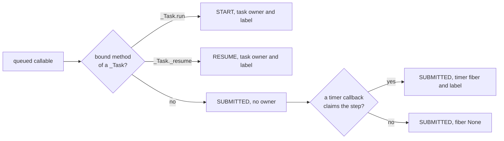

# Build Spec: Step Reports

**Status**: 📝 Draft — not started; spec 2 of 4 (see [Dependencies](#dependencies))

**Reference**: [#10 Feature request: hook that reports the duration and owner of each scheduler step](https://github.com/uclatommy/pycordis/issues/10)

## Goal

Let a host register a callback that receives the duration, the kind, the owner fiber, and the
effect label of each scheduler step, behind a feature flag, with no cost when no callback is
registered.

## Architecture

### What a step is

A step is one callable that a scheduler takes from its queue and runs. The report covers that
callable and all the work that it runs inline: listeners that it emits to, effect setups inside
`apply`, and the first step of another task that it starts with `start`. Work in a host call
(for example `ctx.use` with `ImmediateScheduler`) and timer callbacks that `ManualClock.advance`
runs on the calling thread are not steps, and get no report.

### The report

```
class StepKind(Enum): START, RESUME, SUBMITTED

@dataclass(frozen=True, slots=True)
class StepReport:
    duration: float              # seconds, from the scheduler clock
    kind: StepKind
    fiber: Fiber | None
    label: str | None            # EffectMeta.label of the effect that owns the task
    error: BaseException | None  # the exception that the step raised

observe_steps(scheduler: Scheduler, callback: Callable[[StepReport], None]) -> Callable[[], None]
```

The returned function removes the callback. All three names live in `pycordis.scheduler`, and
`pycordis/__init__.py` does not export them: this is the feature flag.

### How a step gets its owner



- **Tasks**: `spawn` and `start` take an owner fiber and a label, and the `_Task` keeps them.
  The step runner identifies a task step from the queued bound method. It does this only while
  a callback is registered.
- **Timer callbacks**: `pycordis.timer._run_logged` is the one place where a timer callback runs.
  It claims the current step for the fiber and the label of its timer effect. A claim applies
  only to a `SUBMITTED` step, and the first claim in a step wins. This covers `ThreadingClock` and
  any host clock that submits its callbacks, with no change to `Scheduler.submit`.
- **Why not `submit(fn, *, fiber, label)`**: the #10 feedback proposed it. `Scheduler` is a public
  ABC that hosts subclass. If the library called `submit` with new keywords, a host subclass with
  `submit(self, fn)` would break, and `0.1.3` is a patch release. A public label for host
  submits can come with a minor release.

### The base step runner

Both built-in schedulers run each queued callable through one private helper in the base class.
The helper times the step, builds the report, and calls the callbacks, only when callbacks
exist. A host subclass of `Scheduler` that does not use the helper sends no reports. The
`observe_steps` docstring says so.

## File Structure

```
src/pycordis/
├── scheduler.py        # MODIFY: StepKind, StepReport, observe_steps, base step runner, task owner
├── fiber.py            # MODIFY: owner and label at each spawn and start
├── events.py           # MODIFY: owner at each start
├── reflect.py          # MODIFY: owner at each start
├── timer.py            # MODIFY: _run_logged claims the step
├── loader/_entry.py    # MODIFY: owner at each spawn and start
└── hmr/_service.py     # MODIFY: owner at each start
tests/
└── test_scheduler.py   # MODIFY: report cases
conformance/
└── ledger.toml         # MODIFY: notes on the mirror entries
docs/
└── architecture.md     # MODIFY: divergence row
```

## Implementation References

- **This repository**: `_Task`, `spawn`, and `start` (`scheduler.py`); the queue loops of
  `ImmediateScheduler._drain` and `FramePumpScheduler.pump`; the scheduler clock from
  [Pump Budget](completed/pump_budget.md); `Scheduler.assert_owner` (the enforcement point for the
  observe-only rule); `pycordis.timer._run_logged` (the one path of a timer callback);
  `Hook.ctx` in `events.py` (the owner of a listener task); `EffectMeta.label` in `fiber.py`
  and the labels that `_log_failure`, `_logged`, and `_revert_on_failure` already receive;
  `test_an_empty_pump_is_fast_and_allocates_nothing` (the pattern for the no-cost test).
- **Upstream**: none. The scheduler has no upstream equivalent. The `host-introspection` row is
  the precedent for the divergence row.

## Key Constraints

- **No cost with no callback**: no clock read, no report object, and no inspection of the
  queued callable. A test checks that a counting clock is never called. The empty-pump
  allocation test passes with no change.
- **Owners**: a fiber task (load, unload, async effect, effect revert, logged disposer) is owned
  by its fiber; a listener task of `serial` or `parallel` by `hook.ctx.fiber`; a provider-release
  task of `reflect` by the fiber of the provider; loader and hmr tasks by the fiber of the
  loader or hmr service. The label is the `EffectMeta.label` where an effect owns the task;
  otherwise `None`.
- **Mirror code**: `Fiber._set_epoch`, `_reload`, and `_unload` are `mirror = true` ledger items.
  They get only an owner argument at their `start` calls. Their control flow does not change.
  Each ledger entry gets a `note` that says so.
- **Observe only**: while a callback runs, `assert_owner` raises `CordisError` with a message
  that says a step observer cannot call pycordis. The check sits in the failure branch of the
  existing thread comparison, so the success path costs nothing extra. Every context, fiber,
  and core-service method already calls `assert_owner`, so one check covers all of them.
  `Scheduler.submit` stays allowed. Reason: lifecycle work that a timing report starts would make
  the result depend on timing.
- **Callback errors**: an `Exception` from a callback is logged with
  `logging.getLogger(__name__)` (`pycordis.scheduler`). It does not reach the step, and the other
  callbacks and the later steps run.
- **A step that raises**: its report is sent first, with `error` set, and then the exception
  propagates as today. This answers point 2 of the #10 feedback.
- **Callback order**: in registration order. A callback that is added or removed during a report
  takes effect from the next step.
- **References**: the report holds the `Fiber`. The `observe_steps` docstring says that a
  callback must not keep a report after it returns.
- **Type hints**: `scheduler.py` imports `Fiber` only under `TYPE_CHECKING`, so the rule that the
  Python-runtime modules import no core module holds at run time.
- **Experimental warning**: the `observe_steps` docstring has a `!!! warning "Experimental"`
  admonition. It says that the API can change before it is exported from `pycordis`.

## Integration

- `pycordis/__init__.py` does not change (the feature flag). `pycordis.scheduler` is not a public
  module, so the new names have no stability promise until they are exported.
- Promotion (export from `pycordis`, a user guide section, and a public label for host
  `submit` calls) is a separate change after hosts try the flag.
- Release: a patch increment, in `0.1.3` with [Pump Budget](completed/pump_budget.md). The work goes on
  `feature/step-reports` from `develop`.
- `conformance/ledger.toml`: a `note` on `src/fiber.ts:Fiber._setEpoch`, `Fiber._reload`, and
  `Fiber._unload`. No status or hash changes.

## Testing

- ✅ Kinds: a queued task first step gives `START`, a resume gives `RESUME`, and a host `submit`
  gives `SUBMITTED` with `fiber=None` (one parametrized test)
- ✅ An async effect whose step advances a fake clock by 20 ms gives a report with a duration of
  20 ms, the fiber, and the effect label; a synchronous effect gives a report with the fiber and
  no label
- ✅ A timer callback through `ThreadingClock` gives a `SUBMITTED` report with the fiber and the
  label of its timer effect (`ctx.interval()`); the test waits with `ImmediateScheduler.serve`,
  joins the clock with a timeout, and is marked `slow` if its call time is 0.1 s or more
- ✅ A step that raises gives one report with `error` set, and then the exception reaches the
  caller of `pump`
- ✅ A callback that raises is logged (`caplog`), and the later steps run with no change to any
  fiber state
- ✅ `divergence("step-reports")`, `contract("LIFE-CONFLUENT")`: a callback that calls a context
  method gets `CordisError`, and the lifecycle result does not change; a callback that calls
  `submit` works
- ✅ With no callback, a counting clock is never called; the empty-pump allocation test passes
- ✅ The disposer from `observe_steps` stops the reports; two callbacks receive reports in
  registration order
- ✅ Both `ImmediateScheduler` and `FramePumpScheduler` send reports (parametrize the existing
  `run` fixture where it fits)
- ✅ `uv run pytest`, `uv run ruff check .`, and `uv run ruff format --check .` pass; the
  unmarked slow tests section of the full suite is empty

## Documentation

- Docstrings: `StepKind`, `StepReport` (each field), and `observe_steps` (the experimental
  warning, what a step is, the observe-only rule, the report for a step that raises, the
  host-subclass limit, and an example with a threshold log). The module docstring of
  `pycordis.scheduler` names `observe_steps`. The API page `docs/api/scheduler.md` is generated.
- `docs/architecture.md`: the `step-reports` row (see [Appendix A](#appendix-a-divergences)).
- `docs/user_guide.md`: none. The feature is behind a flag, and the user guide documents only
  exported API. The section comes with the promotion.
- `zensical.toml`: none (no new page).

## Dependencies

- **Sequence**: spec 2 of 4. The order is [Pump Budget](completed/pump_budget.md), Step Reports,
  [Checked Get](checked_get.md), [Context Restriction](context_restriction.md).
- **Prerequisite**: [Pump Budget](completed/pump_budget.md) (the scheduler clock in the base class).
- **Required by**: none.
- **Runtime**: none (standard library: `dataclasses`, `enum`, `logging`).
- **Dev**: none new.

## Migration Strategy

### Increment 1: Reports for each step
**Goal**: `observe_steps` gives a report for each step of both built-in schedulers, with the
kind, the duration, and the error, and with `fiber=None` and `label=None` for every step.
**Files**: `scheduler.py` (~120), `test_scheduler.py` (~150)
**Validation**: `uv run pytest tests/test_scheduler.py tests/test_threading.py`; manual: in
`uv run python`, observe a `FramePumpScheduler`, submit a step that raises, call `pump(1)`, and
check that the report has `error` set before the exception reaches the prompt
**Docs**: the docstrings of `StepKind`, `StepReport`, and `observe_steps`
**Status**: ⏳ Not started

### Increment 2: Owners and labels
**Goal**: each task step reports its owner fiber and effect label, a timer callback claims its
`SUBMITTED` step, and the divergence row and ledger notes are in place.
**Files**: `scheduler.py` (~30), `fiber.py` (~20), `events.py`, `reflect.py`, `timer.py`,
`loader/_entry.py`, `hmr/_service.py` (~5 each), `test_scheduler.py` (~100), `ledger.toml`,
`architecture.md`
**Validation**: `uv run pytest`; manual: in `uv run python`, observe an `ImmediateScheduler`,
use a component with an async effect, and check the fiber and the label in the reports
**Docs**: `docs/architecture.md` `step-reports` row; `observe_steps` docstring (owners, the timer
claim, the example); review of every docstring in `scheduler.py`
**Status**: ⏳ Not started

## Code Standards

- [Contributing](../contributing.md): the test and docstring standards, with the pull request
  checklist
- [Developer Guide](../developer_guide.md): branches, slow tests, and release rules
- [Architecture](../architecture.md): the semantic contract (`LIFE-CONFLUENT`) and the
  divergence table
- The instruction files in `.github/instructions/`: Python Coding Standards (mirror items),
  Docstrings & Markdown Style, Testing Standards, and Upstream Porting (ledger notes)

This spec is scaffolding — do not cite it, its filename, or its increment numbers in source,
docstrings, comments, or test names. Docstrings state the present rule, not the change that
introduced it.

## Appendix A: Divergences

The maintainer approved this row on #10. It goes to the divergence table in
`docs/architecture.md` in Increment 2.

| ID | Kind | Upstream | pycordis | Contract | Reason and evidence |
|---|---|---|---|---|---|
| `step-reports` | improvement | No timing or owner information for scheduled work | `pycordis.scheduler.observe_steps` reports the duration, kind, owner fiber, effect label, and error of each step; a callback cannot call pycordis | `LIFE-CONFLUENT` | A host finds the plugin that makes a slow frame. The callback observes only, so the reports do not change a lifecycle result. Test: `divergence("step-reports")` in `tests/test_scheduler.py` |
