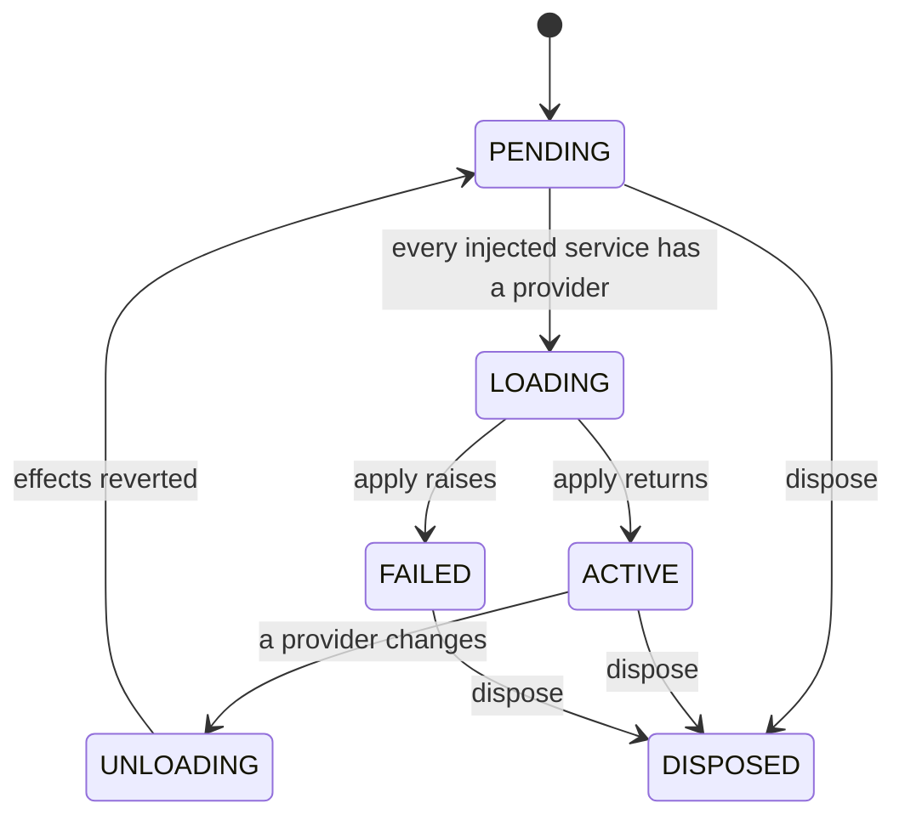

# User Guide

pycordis runs a program as a tree of **fibers**. Each fiber owns the **effects** that its
**component** registers. When a fiber ends, pycordis reverts its effects. A component declares
the **services** that it needs, and pycordis loads and unloads the component when those services
appear and disappear.

## Concepts

| Term | Meaning |
|---|---|
| Context | The object from which code registers effects. `Context(scheduler)` creates the root context. |
| Component | A function, a class, or an object with an `apply` method that `ctx.use()` runs. |
| Fiber | The runtime record of one component. It has a state, a parent, children, and effects. |
| Effect | An action that returns its inverse. The fiber calls the inverse when it ends. |
| Service | A value that one component provides under a name, and other components inject. |
| Key | A `Key[T]` is a service name that carries the type of its value. A plain `str` also works. |
| Scheduler | The object that runs the lifecycle steps on the owner thread. |

### Fibers and effects

`ctx.use(component)` creates a fiber for the component and returns it. The fiber runs the
component with a context of its own. Each call that registers something through that context,
such as `ctx.on(...)`, `ctx.provide(...)`, or `ctx.effect(...)`, is an effect of the fiber.

When the fiber is disposed, pycordis calls the inverses in the reverse order of registration.
A child fiber ends before its parent.

```python
from pycordis import Context, ImmediateScheduler

root = Context(ImmediateScheduler())


def greeter(ctx: Context, config: object) -> None:
    print("start")
    ctx.effect(lambda: lambda: print("stop"))


fiber = root.use(greeter)  # prints "start"
fiber.dispose()  # prints "stop"
```

### Services and dependencies

A component that needs a service declares it with `inject`. The fiber stays in the `PENDING`
state until a provider exists, and it unloads when the provider goes away.

```python
from pycordis import Context, ImmediateScheduler, Service, inject


class Database(Service):
    provide = "db"

    def cordis_init(self):
        print("database open")
        return lambda: print("database closed")


@inject("db")
class Report:
    def __init__(self, ctx: Context, config: object) -> None:
        print("report loads with", ctx["db"])


root = Context(ImmediateScheduler())
report = root.use(Report)  # PENDING: nothing provides "db"
database = root.use(Database)  # prints "database open", then the report loads
database.dispose()  # the report unloads first, then "database closed"
```

The fiber states are `PENDING`, `LOADING`, `ACTIVE`, `FAILED`, `UNLOADING`, and `DISPOSED`
(see `FiberState`).



Read a service through the context: `ctx["db"]` raises `CordisError` when the component did
not declare the service, and `ctx.get("db")` returns `None` when no provider is visible. A component receives its context and its configuration: `apply(ctx, config)`. A
`Key[Database]("db")` gives a type checker the type of the value.

### Failure

If `apply` raises, the fiber goes to `FAILED`, pycordis reverts the effects that the component
registered, and `fiber.error` holds the exception. The error does not reach the parent or the
siblings. The fiber does not load again until its component or configuration changes.

### Configuration

A component can have a `Config` attribute: an object with `model_validate`, or a function from
the raw configuration to the validated one. `ctx.use(component, config)` validates `config`
before `apply` runs. An invalid configuration fails the fiber with a `ValidationError`. The
validator must be synchronous: a validator that returns an awaitable raises `TypeError`.

## Choose a Scheduler

pycordis does not use `asyncio`. The host selects the scheduler when it creates the root
context.

| Scheduler | Use it when |
|---|---|
| `ImmediateScheduler` | Tests and headless programs. Lifecycle work runs to completion when the outermost call returns. |
| `FramePumpScheduler` | A host with a frame loop. Call `scheduler.pump(max_steps)` once per frame. A call runs at most `max_steps` steps and never blocks. |

An asynchronous effect is an `async def` coroutine or an async generator that awaits only a
`Deferred` or a `Fiber`. Use `fiber.wait()` to get a `Deferred` that completes when a fiber
becomes active.

## The Host Contract

A host program uses only these public contracts:

- **Owner thread**: the thread that creates the scheduler owns the root context. Every call to
  a `Context`, a `Fiber`, or a core service must come from that thread. A call from another
  thread raises `CordisError("WRONG_THREAD")`.
- **Thread-safe entry points**: `Scheduler.submit(fn)` and the completion of a `Deferred` are
  the only operations that another thread can call. `submit` runs `fn` on the owner thread in
  a later step.
- **Introspection**: `fiber.state`, `fiber.error`, `fiber.children`, `fiber.parent`, and
  `fiber.get_effects()` are read-only. A host can show them in a status view.
- **Logging**: pycordis writes to the standard `logging` logger `pycordis` and its children.
  The host sets the handlers and the levels. The library does not set them.

## Bind a Service for the Lifetime of Its Provider

A change of the service at a key reloads every dependent. Use this rule to keep the program
stable:

1. Bind a service at a key for the whole life of its provider. Do not rebind a key to show a
   new value.
2. Keep a value that changes often inside a stable service. The service publishes change events
   (`ctx.emit(...)`), and dependents listen with `ctx.on(...)`.

```python
class Settings(Service):
    provide = "settings"

    def __init__(self, ctx: Context, config: object) -> None:
        super().__init__(ctx)
        self.values: dict[str, object] = {}

    def update(self, **changes: object) -> None:
        self.values.update(changes)
        self.ctx.emit("settings/changed", self.values)
```

Here `update` changes the value in place and sends an event. No dependent reloads.

## Where to Go Next

- The [API Reference](api/index.md) has the full contract of every public name.
- [Architecture](architecture.md) states the guarantees that pycordis keeps and the differences
  from the upstream implementation.
