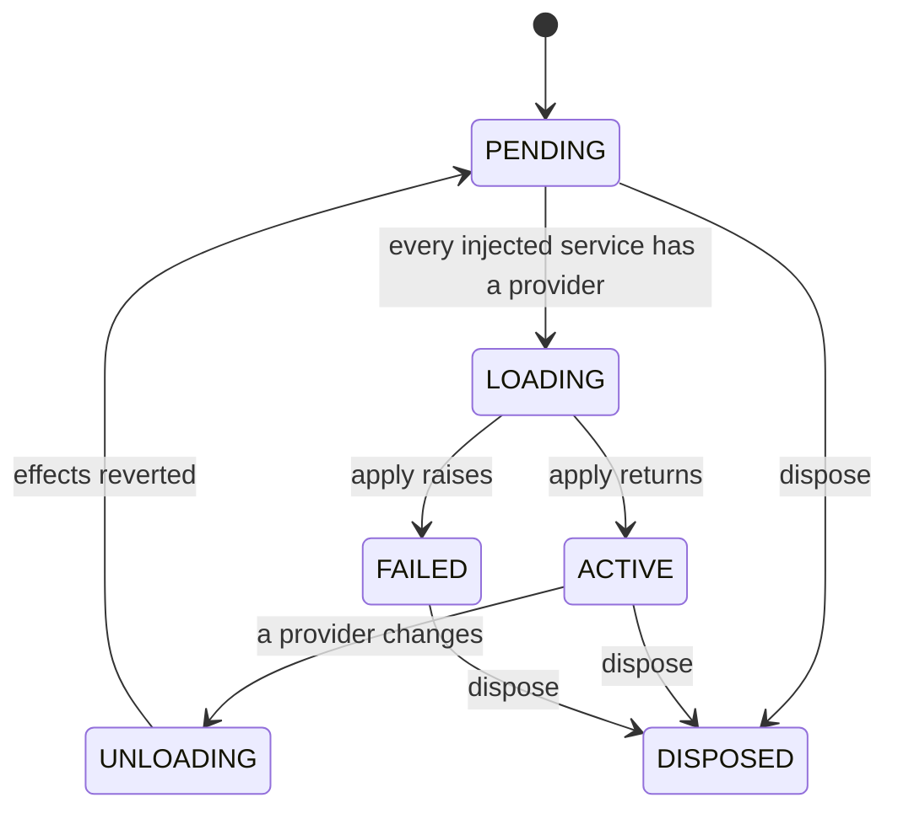

# User Guide

pycordis runs a program as a tree of **fibers**. Each fiber owns the **effects** that its
**component** registers. When a fiber ends, pycordis reverts its effects. A component declares
the **services** that it needs, and pycordis loads and unloads the component when those services
appear and disappear.

## Concepts

| Term | Meaning |
|---|---|
| Context | The object from which code registers effects. `Context(scheduler)` creates the root context. |
| Component | A function, a class, or an object with an `apply` method that `ctx.use()` runs. |
| Fiber | The runtime record of one component. It has a state, a parent, children, and effects. |
| Effect | An action that returns its inverse. The fiber calls the inverse when it ends. |
| Service | A value that one component provides under a name, and other components inject. |
| Key | A `Key[T]` is a service name that carries the type of its value. A plain `str` also works. |
| Scheduler | The object that runs the lifecycle steps on the owner thread. |

### Fibers and effects

`ctx.use(component)` creates a fiber for the component and returns it. The fiber runs the
component with a context of its own. Each call that registers something through that context,
such as `ctx.on(...)`, `ctx.provide(...)`, or `ctx.effect(...)`, is an effect of the fiber.

When the fiber is disposed, pycordis calls the inverses in the reverse order of registration.
A child fiber ends before its parent.

```python
from pycordis import Context, ImmediateScheduler

root = Context(ImmediateScheduler())


def greeter(ctx: Context, config: object) -> None:
    print("start")
    ctx.effect(lambda: lambda: print("stop"))


fiber = root.use(greeter)  # prints "start"
fiber.dispose()  # prints "stop"
```

### Services and dependencies

A component that needs a service declares it with `inject`. The fiber stays in the `PENDING`
state until a provider exists, and it unloads when the provider goes away.

```python
from pycordis import Context, ImmediateScheduler, Service, inject


class Database(Service):
    provide = "db"

    def cordis_init(self):
        print("database open")
        return lambda: print("database closed")


@inject("db")
class Report:
    def __init__(self, ctx: Context, config: object) -> None:
        print("report loads with", ctx["db"])


root = Context(ImmediateScheduler())
report = root.use(Report)  # PENDING: nothing provides "db"
database = root.use(Database)  # prints "database open", then the report loads
database.dispose()  # the report unloads first, then "database closed"
```

The fiber states are `PENDING`, `LOADING`, `ACTIVE`, `FAILED`, `UNLOADING`, and `DISPOSED`
(see `FiberState`).



Read a service through the context, with `ctx["db"]` or `ctx.get("db")`. A component can read
only a service that its fiber, or an ancestor fiber, declares in `inject` or provides. For any
other service, both reads raise `CordisError`, and a note on the error names the two ways to
declare the read. The two reads differ only when the fiber that declares the service is not
loaded, or when `strict` hides a provider whose fiber is not `ACTIVE`: then `ctx["db"]` raises,
and `ctx.get("db")` returns `None`. Both reads give the provider that the fiber loaded against,
also after the provider changes, until the fiber loads again. A read from the root context is
not checked.

A component receives its context and its configuration: `apply(ctx, config)`. A
`Key[Database]("db")` gives a type checker the type of the value.

A host can see which provider a context resolves, with no check, through
`ctx.reflect.get(ctx, "db")`.

#### Optional services

A component that can work without a service does not put the service in its own `inject`,
because then the component waits for a provider. It reads the service in a child fiber that
injects it. The child fiber loads when a provider is visible, and unloads when the provider goes
away. The component itself loads at once.

```python
from pycordis import Context, ImmediateScheduler


def apply(ctx: Context, config: object) -> None:
    ctx.inject(["metrics"], lambda inner: print("metrics:", inner.get("metrics")))


root = Context(ImmediateScheduler())
fiber = root.use(apply)  # ACTIVE: the component does not wait for "metrics"
root.provide("metrics", {"count": 0})  # prints "metrics: {'count': 0}"
```

For a service in another realm, isolate the name first:
`ctx.isolate("metrics", label).inject(["metrics"], callback)`. An `inject` of an ancestor does
not admit a read across an isolate, so `ctx.isolate("metrics", label).get("metrics")` raises.

### Failure

If `apply` raises, the fiber goes to `FAILED`, pycordis reverts the effects that the component
registered, and `fiber.error` holds the exception. The error does not reach the parent or the
siblings. The fiber does not load again until its component or configuration changes.

An error in a listener of a notification event (`internal/plugin`, `internal/replace`,
`internal/status`, `internal/service`, `internal/commit`, or `internal/dispatch`) does not
change the fiber that the event reports. pycordis logs the error with the logger of the
listener's fiber, and calls the next listener.

### Configuration

A component can have a `Config` attribute: an object with `model_validate`, or a function from
the raw configuration to the validated one. `ctx.use(component, config)` validates `config`
before `apply` runs. An invalid configuration fails the fiber with a `ValidationError`. The
validator must be synchronous: a validator that returns an awaitable raises `TypeError`.

## Choose a Scheduler

pycordis does not use `asyncio`. The host selects the scheduler when it creates the root
context.

| Scheduler | Use it when |
|---|---|
| `ImmediateScheduler` | Tests and headless programs. Lifecycle work runs to completion when the outermost call returns. |
| `FramePumpScheduler` | A host with a frame loop. Call `scheduler.pump(max_steps)` or `scheduler.pump(budget=seconds)` once per frame. A call stops at its step limit or its time budget, and never blocks. |

A frame loop that limits lifecycle work by time passes a budget, and reads `pending` to see
whether steps remain:

```python
from pycordis import Context, FramePumpScheduler

scheduler = FramePumpScheduler()
root = Context(scheduler)


def on_frame() -> None:
    scheduler.pump(budget=0.002)  # no later step starts after 2 ms
    if scheduler.pending:
        ...  # work remains for the next frame
```

When the queue has work, the first step of a call always runs, so a frame can be late by at
most one step. The budget measures the scheduler clock (`time.monotonic` by default). Pass
`FramePumpScheduler(clock=manual_clock.now)` to use the clock of a `ManualClock`. A blocking
wait, such as `ImmediateScheduler.serve`, uses real time.

An asynchronous effect is an `async def` coroutine or an async generator that awaits only a
`Deferred` or a `Fiber`. Use `fiber.wait()` to get a `Deferred` that completes when a fiber
becomes active.

## The Host Contract

A host program uses only these public contracts:

- **Owner thread**: the thread that creates the scheduler owns the root context. Every call to
  a `Context`, a `Fiber`, or a core service must come from that thread. A call from another
  thread raises `CordisError("WRONG_THREAD")`.
- **Thread-safe entry points**: `Scheduler.submit(fn)` and the completion of a `Deferred` are
  the only operations that another thread can call. `submit` runs `fn` on the owner thread in
  a later step.
- **Introspection**: `fiber.state`, `fiber.error`, `fiber.children`, `fiber.parent`, and
  `fiber.get_effects()` are read-only. A host can show them in a status view.
- **Logging**: pycordis writes to the standard `logging` logger `pycordis` and its children.
  The host sets the handlers and the levels. The library does not set them.

## Bind a Service for the Lifetime of Its Provider

A change of the service at a key reloads every dependent. Use this rule to keep the program
stable:

1. Bind a service at a key for the whole life of its provider. Do not rebind a key to show a
   new value.
2. Keep a value that changes often inside a stable service. The service publishes change events
   (`ctx.emit(...)`), and dependents listen with `ctx.on(...)`.

```python
class Settings(Service):
    provide = "settings"

    def __init__(self, ctx: Context, config: object) -> None:
        super().__init__(ctx)
        self.values: dict[str, object] = {}

    def update(self, **changes: object) -> None:
        self.values.update(changes)
        self.ctx.emit("settings/changed", self.values)
```

Here `update` changes the value in place and sends an event. No dependent reloads.

## Load Plugins from Data

A host whose plugin set comes from data (a list of dicts that it parsed from a file, for
example) can give the data to the loader. The loader makes the `use`, `dispose`, and `update`
calls. `pycordis.loader` is a public module that `import pycordis` does not import.

Each entry is a dict. These fields are the options of an entry:

| Field | Meaning |
|---|---|
| `id` | The name of the entry in its tree. It cannot contain `:`. The loader gives a random `id` to an entry that has none. |
| `name` | The component: `"package.module"` or `"package.module:attribute"`. |
| `config` | The config that the component receives. For a group, the list of child entries. |
| `group` | `True` for a structure. A group is always enabled, and its `disabled` value applies to its children. Its `name` is `"pycordis.loader:Group"`. |
| `disabled` | `True` keeps the component unloaded. It is a `bool`: the loader does not evaluate expressions. |
| `inject` | The services that must exist before the component loads. |
| `intercept` | The intercept configuration by service name. A change reaches the running component with no reload. |
| `isolate` | A realm for each service name: `True` for a realm of the entry, or a label that entries share. |

```python
from pycordis.loader import Group, Loader


def hello(ctx, config):
    def start():
        print("hello", config["who"])
        return lambda: print("bye", config["who"])

    ctx.effect(start)


components = {"hello": hello, "pycordis.loader:Group": Group}
loader = Loader(Context(ImmediateScheduler()), import_function=components.__getitem__)
loader.read(
    [
        {"id": "a", "name": "hello", "config": {"who": "a"}},
        {
            "id": "box",
            "name": "pycordis.loader:Group",
            "group": True,
            "config": [{"id": "b", "name": "hello", "config": {"who": "b"}}],
        },
    ]
)
loader.update("a", {"disabled": True})
loader.remove("box")
print(loader.root.data)
```

The loader follows these rules:

- **Import**: by default, the loader resolves `name` with `importlib`. A host can give its own
  function with the `import_function` argument. A missing module of the entry and a missing
  module that the component imports are different errors.
- **Ownership**: the loader copies the dicts that the host gives, and it owns the fibers that
  it creates. A later change to a host dict has no effect. Use `read`, `create`, `update`, and
  `remove` to change the tree.
- **Options**: the loader changes the options of an entry only for a host call, or when the
  component of the entry disposes its own fiber (the loader then sets `disabled: True`). The
  loss of a group or of a dependency never changes them.
- **Saving**: a host that saves changes overrides `EntryTree.commit`. It receives an
  `EntryChange` after each change, with copies of the new and the previous options.
- **Moves**: `update(id, {}, parent)` moves an entry. The component keeps running when the new
  group has the same isolation, intercepts, and `meta` as the old one. Otherwise, and for a
  move to another tree, the loader loads the component again. A change of `isolate`, `name`,
  or `inject` also loads it again.
- **Groups**: a group takes members after its own component has started. With a
  `FramePumpScheduler`, pump the scheduler after you create a group and before you move an
  entry into it.
- **Waiting**: `loader.wait()` returns a `Deferred` that completes when no entry loads or
  unloads. An entry that waits for a service is not busy.

## Timers

A timer that a plugin starts and does not stop runs after the plugin unloads. The timer
service avoids this: each timer is an effect of the fiber that starts it, so the fiber stops the
timer when it unloads. `pycordis.timer` is a public module that `import pycordis` does not
import.

1. The host provides a clock as the service `clock`. The timer service reads it.
2. The host uses `TimerService`.
3. A plugin that injects `timer` reads the timer methods from its context, for example
   `ctx["timeout"]`.

```python
from pycordis import Context, ImmediateScheduler
from pycordis.timer import CLOCK, ManualClock, TimerService

clock = ManualClock()
root = Context(ImmediateScheduler())
root.provide(CLOCK, clock)
root.use(TimerService)


def reminder(ctx: Context, config: object) -> None:
    ctx["timeout"](lambda: print("time is up"), 1.0)


reminder.inject = ["timer"]
fiber = root.use(reminder)
clock.advance(1.0)
```

The timer methods, with delays in seconds:

| Method | Result |
|---|---|
| `timeout(callback, delay)` | Calls `callback` once. It returns the effect handle. |
| `interval(callback, delay)` | Calls `callback` every `delay` seconds. It returns the effect handle. |
| `sleep(delay)` | Returns a `Deferred` that a task awaits. |
| `ticks(delay)` | Returns an async iterator for a task: `async for _ in ctx["ticks"](1.0)`. |
| `throttle(callback, delay, trailing=True)` | Returns a function that runs `callback` at most once in each `delay` seconds. |
| `debounce(callback, delay)` | Returns a function that runs `callback` after `delay` seconds with no call. |

- **Unload**: when the fiber unloads, its timers stop. A `sleep` that is pending rejects with
  `CordisError("Context has been disposed")`, and so do the pending reads of `ticks`. Call the
  handle of a timer, or `dispose()` on the result of `throttle` or `debounce`, to stop one timer
  earlier.
- **Early exit from a loop**: `break` or an exception in `async for` does not close `ticks`.
  Use `contextlib.aclosing` to stop the timer at the exit.
- **Lost ticks**: `ticks` does not buffer. A tick that comes while no read is pending is lost.
- **Errors**: an `Exception` from a callback that the clock runs is logged with the logger of
  the plugin's fiber, and the other timers continue.
- **A change of clock**: when the host provides a different clock, the timer service reloads,
  and so does every plugin that injects `timer`. No timer runs on the old clock.

Choose the clock for the host:

- `ManualClock` moves only when the host calls `advance(seconds)` on the owner thread. Use it
  in tests, and in a host with a frame loop: call `advance` each frame with the elapsed time.
- `ThreadingClock(scheduler)` uses one worker thread, and the scheduler runs each callback on
  the owner thread. Use it in a headless host. Call `close()` after the root context is
  disposed. With `ImmediateScheduler`, the callbacks of `timeout`, `interval`, `throttle`,
  and `debounce` run only while the owner thread serves submitted work: call
  `scheduler.serve(until, timeout)`, which runs that work until `until()` gives `True`.

```python
from pycordis import Context, ImmediateScheduler
from pycordis.timer import CLOCK, ThreadingClock, TimerService

scheduler = ImmediateScheduler()
root = Context(scheduler)
clock = ThreadingClock(scheduler)
root.provide(CLOCK, clock)
root.use(TimerService)
ticks: list[int] = []


def poller(ctx, config=None):
    ctx["interval"](lambda: ticks.append(1), 0.01)


poller.inject = ["timer"]
root.use(poller)
scheduler.serve(lambda: len(ticks) >= 3, timeout=10)
root.fiber.dispose()
clock.close()
```

## Reload modules

A development tool or an interactive host can load new code into a running system. The `Hmr`
service takes the paths of the files that changed, imports the changed modules again, and moves
the live fibers of their components to the new code. A fiber keeps its identity, its config,
and its place in the fiber tree. `pycordis.hmr` is a public module that `import pycordis` does
not import. A production host can restart instead.

The host watches its own files and calls `reconcile` with the changed paths. `reconcile` takes a
function that returns the paths (absolute paths of files or directories), and it returns a
`Deferred` of a `ReloadResult`.

```python
import sys
import tempfile
from pathlib import Path

from pycordis import Context, ImmediateScheduler
from pycordis.hmr import Hmr, HmrConfig

plugins = Path(tempfile.mkdtemp())
sys.path.insert(0, str(plugins))
source_file = plugins / "greeter.py"
template = "def apply(ctx, config=None):\n    ctx.on('greet', lambda: {!r})\n"
source_file.write_text(template.format("hello"))

import greeter

root = Context(ImmediateScheduler())
hmr_fiber = root.use(Hmr, HmrConfig(scope=(str(plugins),)))
fiber = root.use(greeter.apply)
print(root.bail("greet"))

source_file.write_text(template.format("hi"))
result = root.get("hmr").reconcile(lambda: [source_file]).result()
print(root.bail("greet"), result.settled == [fiber])
hmr_fiber.dispose()
```

A reload follows these rules:

- **What reloads together**: a changed module is a loaded module whose file is a changed path or
  is below a changed directory. Every module that imports a changed module reloads too, also
  when no component uses it, so that a later import gets the new code.
- **Which modules**: the service sees the modules below `HmrConfig.scope` (by default the
  working directory) that are not part of the Python installation. Other modules never reload.
- **Components**: a component of a module is a value in the module namespace, or the module
  itself, that the registry knows. Its replacement is the value of the same attribute in the new
  module. The registry moves the fibers with `RegistryService.replace`.
- **Units**: components that share a changed module form one unit. A unit applies as a whole,
  or not at all.
- **One transaction at a time**: a second call waits for the running one. A call from inside the
  running transaction rejects with `CordisError`.
- **Blocking**: an import runs on the owner thread and blocks it until the import ends.

The `ReloadResult` has three lists:

| Field | Meaning |
|---|---|
| `settled` | The moved fibers that still exist after they settled. A fiber whose new component raised in `apply` is in the list, in the state `FAILED`. The next change of its file retries it. |
| `aborted` | A unit whose new modules failed to import, or whose new value is not a component. Its old modules are in `sys.modules` again, and its fibers are as before. A later change of the files retries the unit. |
| `skipped` | A change that needs a restart. The reason is a `SkipReason`: a host module (`HOST_MODULE`), a C extension (`EXTENSION_MODULE`), or components of one unit that now hold different values (`AMBIGUOUS_EXPORT`). The other changes apply. |

A module that the `__main__` module imports, and the names in `HmrConfig.host_modules`, are host
modules. The host holds their objects, so they never reload.

These limits apply to every host:

- An object that the host holds, and a name that a host module imported with
  `from plugin import name`, keep the old code.
- The module globals of a reloaded module start again from the module source. A C extension
  does not reload.
- `sys.modules` belongs to the process, so only one `Hmr` is active in a process. A reload also
  affects other root contexts and other libraries that imported the module.
- Python checks a bytecode cache file against the modification time of the source in whole
  seconds and against its size. A change in the same second that keeps the size can load the old
  bytecode.
- The old imports of a module that was imported after the last transaction, and that changed
  before the next one, come from its new source. Call `reconcile` with no paths after the host
  loads modules to record them.
- `reconcile` finds a nested call only through a view of the service that `ctx["hmr"]` returns.
  A component that calls `reconcile` reads `hmr` this way, so it, or an ancestor, must inject
  `hmr`. If a moved fiber waits for a call through another reference, the transaction does not
  end.

## Where to Go Next

- The [API Reference](api/index.md) has the full contract of every public name.
- [Architecture](architecture.md) states the guarantees that pycordis keeps and the differences
  from the upstream implementation.
